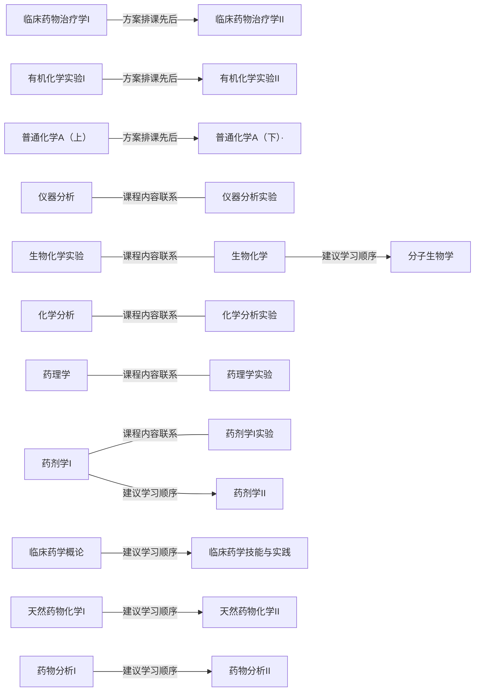

# 2024级临床药学专业“2+X”教学培养方案

药学院 · 药学(临床药学方向) · 方案 72724 · 125 个不同课程或科研条目。

[官方 Word](../originals/plan-72724.docx) · [教务详情](https://fdjwgl.fudan.edu.cn/manager/bizType/2/major-program-search/info/72724?skipAuth=1) · [方案快照](../raw/plan-72724.json.gz) · [年级目录](../README.md)

## 课程关系图

图中展示部分关系。下表保留全部已建立的课程对，来源位置使用本方案 JSON Pointer。

## 先修与内容联系

| 类型 | 起点 | 终点 | 依据 | 原表定位 |
| --- | --- | --- | --- | --- |
| 建议学习顺序 | 有机化学 (CHEM10002) | 生物化学 (PHAR20024) | 官能团与有机反应是理解生物分子性质的基础。  | `/courseModules/4/planCourses/7`、`/courseModules/5/planCourses/27` |
| 建议学习顺序 | 普通化学A（上） (CHEM10003) | 普通化学A（下） (CHEM10004) | 同方案的课程题名具有连续分册或序号。  | `/courseModules/4/planCourses/4`、`/courseModules/4/planCourses/0` |
| 建议学习顺序 | 有机化学实验I (CHEM10006) | 有机化学实验II (PHAR20014) | 同方案的课程题名具有连续分册或序号。  | `/courseModules/4/planCourses/2`、`/courseModules/14/planCourses/2` |
| 建议学习顺序 | 生物化学 (PHAR20024) | 分子生物学 (PHAR30040) | 生物分子的结构与功能支持分子生物学学习。  | `/courseModules/5/planCourses/27`、`/courseModules/14/planCourses/5` |
| 建议学习顺序 | 药用植物学I (PHAR20025) | 药用植物学II (PHAR30008) | 同方案的课程题名具有连续分册或序号。  | `/courseModules/14/planCourses/4`、`/courseModules/10/planCourses/1` |
| 建议学习顺序 | 生药学I (PHAR30002) | 生药学II (PHAR30009) | 同方案的课程题名具有连续分册或序号。  | `/courseModules/14/planCourses/8`、`/courseModules/10/planCourses/2` |
| 建议学习顺序 | 天然药物化学I (PHAR30004) | 天然药物化学II (PHAR40010) | 同方案的课程题名具有连续分册或序号。  | `/courseModules/14/planCourses/7`、`/courseModules/9/planCourses/4` |
| 建议学习顺序 | 临床药学概论 (PHAR30023) | 临床药学技能与实践 (PHAR40015) | “临床药学概论”题名标明基础层次，前置阅读可帮助了解“临床药学技能与实践”中的临床药学主题。  | `/courseModules/11/planCourses/8`、`/courseModules/5/planCourses/25` |
| 建议学习顺序 | 临床药物治疗学I (PHAR30039) | 临床药物治疗学II (PHAR40014) | 同方案的课程题名具有连续分册或序号。  | `/courseModules/5/planCourses/15`、`/courseModules/5/planCourses/23` |
| 建议学习顺序 | 药剂学I (PHAR30043) | 药剂学II (PHAR30011) | 同方案的课程题名具有连续分册或序号。  | `/courseModules/5/planCourses/20`、`/courseModules/10/planCourses/9` |
| 建议学习顺序 | 药物分析I (PHAR30045) | 药物分析II (PHAR130033) | 同方案的课程题名具有连续分册或序号。  | `/courseModules/14/planCourses/10`、`/courseModules/10/planCourses/0` |
| 方案排课先后 | 普通化学A（上） (CHEM10003) | 普通化学A（下） (CHEM10004) | 同方案该课程全部明确数字学期均早于后者。  | `/courseModules/4/planCourses/4`、`/courseModules/4/planCourses/0` |
| 方案排课先后 | 有机化学实验I (CHEM10006) | 有机化学实验II (PHAR20014) | 同方案该课程全部明确数字学期均早于后者。  | `/courseModules/4/planCourses/2`、`/courseModules/14/planCourses/2` |
| 方案排课先后 | 临床药物治疗学I (PHAR30039) | 临床药物治疗学II (PHAR40014) | 同方案该课程全部明确数字学期均早于后者。  | `/courseModules/5/planCourses/15`、`/courseModules/5/planCourses/23` |
| 课程内容联系 | 有机化学 (CHEM10002) | 有机化学实验I (CHEM10006) | 本方案两门课程的题名均含“有机化学”，可据此对照这一主题。  | `/courseModules/4/planCourses/7`、`/courseModules/4/planCourses/2` |
| 课程内容联系 | 有机化学 (CHEM10002) | 有机化学实验II (PHAR20014) | 本方案两门课程的题名均含“有机化学”，可据此对照这一主题。  | `/courseModules/4/planCourses/7`、`/courseModules/14/planCourses/2` |
| 课程内容联系 | 肿瘤分子生物学 (MED50016) | 分子生物学 (PHAR30040) | 本方案两门课程的题名均含“分子生物学”，可据此对照这一主题。  | `/courseModules/15/planCourses/14`、`/courseModules/14/planCourses/5` |
| 课程内容联系 | 药物分析II (PHAR130033) | 药物分析I (PHAR30045) | 本方案两门课程的题名均含“药物分析”，可据此对照这一主题。  | `/courseModules/10/planCourses/0`、`/courseModules/14/planCourses/10` |
| 课程内容联系 | 实验药理学 (PHAR130064) | 药理学 (PHAR20016) | 本方案两门课程的题名均含“药理”，可据此对照这一主题。  | `/courseModules/12/planCourses/3`、`/courseModules/5/planCourses/7` |
| 课程内容联系 | 生物化学(H) (PHAR130145h) | 生物化学 (PHAR20024) | 本方案两门课程的题名均含“生物化学”，可据此对照这一主题。  | `/courseModules/17/planCourses/7`、`/courseModules/5/planCourses/27` |
| 课程内容联系 | 生物化学实验 (PHAR20015) | 生物化学 (PHAR20024) | 题名显示相同主题的课程与实验、实践或实习。  | `/courseModules/5/planCourses/2`、`/courseModules/5/planCourses/27` |
| 课程内容联系 | 药理学 (PHAR20016) | 药理学(H) (PHAR20016h) | 本方案两门课程的题名均含“药理”，可据此对照这一主题。  | `/courseModules/5/planCourses/7`、`/courseModules/17/planCourses/8` |
| 课程内容联系 | 药理学 (PHAR20016) | 药理学实验 (PHAR20017) | 题名显示相同主题的课程与实验、实践或实习。  | `/courseModules/5/planCourses/7`、`/courseModules/5/planCourses/8` |
| 课程内容联系 | 药理学 (PHAR20016) | 临床药理学概论 (PHAR30053) | 本方案两门课程的题名均含“药理”，可据此对照这一主题。  | `/courseModules/5/planCourses/7`、`/courseModules/11/planCourses/6` |
| 课程内容联系 | 化学分析 (PHAR20018) | 化学分析实验 (PHAR20019) | 题名显示相同主题的课程与实验、实践或实习。  | `/courseModules/5/planCourses/3`、`/courseModules/5/planCourses/4` |
| 课程内容联系 | 仪器分析 (PHAR20020) | 仪器分析实验 (PHAR20021) | 题名显示相同主题的课程与实验、实践或实习。  | `/courseModules/5/planCourses/6`、`/courseModules/5/planCourses/0` |
| 课程内容联系 | 药用植物学I (PHAR20025) | 药用植物学II (PHAR30008) | 本方案两门课程的题名均含“植物学”，可据此对照这一主题。  | `/courseModules/14/planCourses/4`、`/courseModules/10/planCourses/1` |
| 课程内容联系 | 药剂学II (PHAR30011) | 药剂学I (PHAR30043) | 本方案两门课程的题名均含“药剂”，可据此对照这一主题。  | `/courseModules/10/planCourses/9`、`/courseModules/5/planCourses/20` |
| 课程内容联系 | 分子药剂学(H) (PHAR30011h) | 药剂学I (PHAR30043) | 本方案两门课程的题名均含“药剂”，可据此对照这一主题。  | `/courseModules/17/planCourses/3`、`/courseModules/5/planCourses/20` |
| 课程内容联系 | 临床药学概论 (PHAR30023) | 临床药学技能与实践 (PHAR40015) | 本方案两门课程的题名均含“临床药学”，可据此对照这一主题。  | `/courseModules/11/planCourses/8`、`/courseModules/5/planCourses/25` |
| 课程内容联系 | 体内药物分析 (PHAR30033) | 药物分析I (PHAR30045) | 本方案两门课程的题名均含“药物分析”，可据此对照这一主题。  | `/courseModules/10/planCourses/5`、`/courseModules/14/planCourses/10` |
| 课程内容联系 | 生物药剂学 (PHAR30041) | 药剂学I (PHAR30043) | 本方案两门课程的题名均含“药剂”，可据此对照这一主题。  | `/courseModules/10/planCourses/11`、`/courseModules/5/planCourses/20` |
| 课程内容联系 | 药剂学I (PHAR30043) | 药剂学I实验 (PHAR30044) | 题名显示相同主题的课程与实验、实践或实习。  | `/courseModules/5/planCourses/20`、`/courseModules/5/planCourses/21` |
| 课程内容联系 | 药物分析I (PHAR30045) | 药物分析(H) (PHAR30045h) | 本方案两门课程的题名均含“药物分析”，可据此对照这一主题。  | `/courseModules/14/planCourses/10`、`/courseModules/17/planCourses/9` |
| 课程内容联系 | 药物分析I (PHAR30045) | 药物分析I实验 (PHAR30046) | 题名显示相同主题的课程与实验、实践或实习。  | `/courseModules/14/planCourses/10`、`/courseModules/14/planCourses/11` |

本次未从可定位的明确表述中确认课程对课程预修。学期安排、系列分册与编辑建议均保留各自的依据。

## 按原方案模块阅读

同一模块展示原表中的课程归属。模块内课程之间的先后仍须逐项查阅。

- **药物化学**　合成设计、化学制药工艺学、有机光谱、化学生物学导论、手性药物与手性合成反应研究、有机结构分析、生物合成药物化学、合成药物化学实验、天然药物化学实验、药物合成反应、天然药物化学II（原表模块 9）
- **药学课程群**　药物分析II、新药研发案例、药用植物学II、生药学II、药剂学II、生物技术药物给药系统、药物靶向传释系统、体内药物分析、药用高分子材料学、生物药剂学、药物递送、药物动力学、物理药学（原表模块 10）
- **药学类通选课程**　药学文献检索、食品化学、药学专业英语、生物药物学、药用微生物学、中药新药的研究与开发、医药元素化学、医院药学、新药研发与上市管理、临床药学概论、天然药物研究前沿技术、临床医学概论、影像中的药物开发、药学研究热点话题讨论、临床药理学概论（原表模块 11）
- **药理课程群**　实验药理学、药理学专题讨论、神经药理学导论、基于问题的药理学（原表模块 12）
- **药事管理课程群**　学术前沿专题、药物经济学、药品生产与经营质量管理规范、医药企业管理（原表模块 13）
- **药学核心课程群**　有机合成、核药学概论、有机化学实验II、物理化学、药用植物学I、生物制药技术、生药学I、实验药物化学I、天然药物化学I、分子生物学、药物分析I、药物分析I实验、综合性药学实验、药物设计学（原表模块 14）

## 课程表

同一课程在不同模块分别出现时，按原表逐行列出。季节字段保留原值。

| 课程 | 代码 | 学分 | 学期 | 模块 |
| --- | --- | ---: | --- | --- |
| 普通化学A（下） | CHEM10004 | 2.0 | 第2学期 | 培养方案 / 大类基础课程 |
| 普通化学实验I | CHEM10005 | 1.0 | 第2学期 | 培养方案 / 大类基础课程 |
| 有机化学实验I | CHEM10006 | 1.0 | 第2学期 | 培养方案 / 大类基础课程 |
| 高等数学C I | MATH10018 | 5.0 | AUTUMN | 培养方案 / 大类基础课程 |
| 普通化学A（上） | CHEM10003 | 2.0 | 第1学期 | 培养方案 / 大类基础课程 |
| 普通物理B | PHYS10002 | 3.0 | 第1学期 | 培养方案 / 大类基础课程 |
| 基础物理实验 | PHYS10005 | 2.0 | 第1学期 | 培养方案 / 大类基础课程 |
| 有机化学 | CHEM10002 | 4.0 | 第2学期 | 培养方案 / 大类基础课程 |
| 仪器分析实验 | PHAR20021 | 1.0 | 第4学期 | 培养方案 / 专业核心教育课程 |
| 专业实习 | PHAR30006 | 2.0 | 第6学期 | 培养方案 / 专业核心教育课程 |
| 生物化学实验 | PHAR20015 | 1.0 | SPRING | 培养方案 / 专业核心教育课程 |
| 化学分析 | PHAR20018 | 1.0 | 第3学期 | 培养方案 / 专业核心教育课程 |
| 化学分析实验 | PHAR20019 | 1.0 | 第3学期 | 培养方案 / 专业核心教育课程 |
| 数理统计 | PHAR130049 | 2.0 | 第3学期 | 培养方案 / 专业核心教育课程 |
| 仪器分析 | PHAR20020 | 2.0 | 第4学期 | 培养方案 / 专业核心教育课程 |
| 药理学 | PHAR20016 | 4.0 | 第4学期 | 培养方案 / 专业核心教育课程 |
| 药理学实验 | PHAR20017 | 1.0 | 第4学期 | 培养方案 / 专业核心教育课程 |
| 感染与免疫 | MED20089 | 2.0 | 第4学期 | 培养方案 / 专业核心教育课程 |
| 医学基础 | MED20090 | 4.0 | 第4学期 | 培养方案 / 专业核心教育课程 |
| 药物流行病学 | PHAR30029 | 2.0 | 第5学期 | 培养方案 / 专业核心教育课程 |
| 病理生理学B | MED30009 | 3.0 | 第5学期 | 培养方案 / 专业核心教育课程 |
| 诊断学B | MED30019 | 3.5 | 第5学期 | 培养方案 / 专业核心教育课程 |
| 临床药物化学 | PHAR30027 | 2.0 | 第5学期 | 培养方案 / 专业核心教育课程 |
| 临床药物治疗学I | PHAR30039 | 3.0 | 第5学期 | 培养方案 / 专业核心教育课程 |
| 内科学C | MED30021 | 6.0 | 第6学期 | 培养方案 / 专业核心教育课程 |
| 外科学C | MED30022 | 3.0 | 第6学期 | 培养方案 / 专业核心教育课程 |
| 妇产科学C | MED30023 | 2.5 | 第6学期 | 培养方案 / 专业核心教育课程 |
| 儿科学C | MED30024 | 2.5 | 第6学期 | 培养方案 / 专业核心教育课程 |
| 药剂学I | PHAR30043 | 2.0 | 第7学期 | 培养方案 / 专业核心教育课程 |
| 药剂学I实验 | PHAR30044 | 1.5 | 第7学期 | 培养方案 / 专业核心教育课程 |
| 药事管理学 | PHAR40005 | 2.0 | 第7学期 | 培养方案 / 专业核心教育课程 |
| 临床药物治疗学II | PHAR40014 | 3.0 | 第7学期 | 培养方案 / 专业核心教育课程 |
| 临床药物动力学 | PHAR40011 | 2.0 | 第7学期 | 培养方案 / 专业核心教育课程 |
| 临床药学技能与实践 | PHAR40015 | 3.0 | 第7学期 | 培养方案 / 专业核心教育课程 |
| 毕业论文 | PHAR40006 | 6.0 | 第8学期 | 培养方案 / 专业核心教育课程 |
| 生物化学 | PHAR20024 | 3.0 | SPRING | 培养方案 / 专业核心教育课程 |
| 细胞生物学导论 | BIOL30022 | 2.0 | AUTUMN | 培养方案 / 专业核心教育课程 |
| 药物合成反应 | PHAR40009 | 3.0 | SPRING、AUTUMN | 培养方案 / 专业进阶I / 药物化学 |
| 生物合成药物化学 | PHAR30032 | 3.0 | SPRING、AUTUMN | 培养方案 / 专业进阶I / 药物化学 |
| 化学生物学导论 | PHAR20013 | 1.0 | SPRING、AUTUMN | 培养方案 / 专业进阶I / 药物化学 |
| 有机光谱 | PHAR20009 | 3.0 | SPRING、AUTUMN | 培养方案 / 专业进阶I / 药物化学 |
| 天然药物化学II | PHAR40010 | 1.0 | SPRING、AUTUMN | 培养方案 / 专业进阶I / 药物化学 |
| 合成设计 | PHAR130048 | 1.0 | SPRING、AUTUMN | 培养方案 / 专业进阶I / 药物化学 |
| 手性药物与手性合成反应研究 | PHAR30012 | 1.0 | SPRING、AUTUMN | 培养方案 / 专业进阶I / 药物化学 |
| 有机结构分析 | PHAR30020 | 3.0 | SPRING、AUTUMN | 培养方案 / 专业进阶I / 药物化学 |
| 合成药物化学实验 | PHAR30034 | 3.0 | SPRING、AUTUMN | 培养方案 / 专业进阶I / 药物化学 |
| 天然药物化学实验 | PHAR30035 | 2.0 | SPRING、AUTUMN | 培养方案 / 专业进阶I / 药物化学 |
| 化学制药工艺学 | PHAR130128 | 2.0 | SPRING、AUTUMN | 培养方案 / 专业进阶I / 药物化学 |
| 药物分析II | PHAR130033 | 2.0 | SPRING、AUTUMN | 培养方案 / 专业进阶I / 药学课程群 |
| 药用植物学II | PHAR30008 | 1.0 | SPRING、AUTUMN | 培养方案 / 专业进阶I / 药学课程群 |
| 生药学II | PHAR30009 | 2.0 | SPRING、AUTUMN | 培养方案 / 专业进阶I / 药学课程群 |
| 药用高分子材料学 | PHAR30038 | 2.0 | SPRING、AUTUMN | 培养方案 / 专业进阶I / 药学课程群 |
| 药物靶向传释系统 | PHAR30021 | 2.0 | SPRING、AUTUMN | 培养方案 / 专业进阶I / 药学课程群 |
| 体内药物分析 | PHAR30033 | 1.0 | SPRING、AUTUMN | 培养方案 / 专业进阶I / 药学课程群 |
| 生物技术药物给药系统 | PHAR30018 | 2.0 | SPRING、AUTUMN | 培养方案 / 专业进阶I / 药学课程群 |
| 药物递送 | PHAR30054 | 2.0 | SPRING、AUTUMN | 培养方案 / 专业进阶I / 药学课程群 |
| 新药研发案例 | PHAR20022 | 2.0 | SPRING、AUTUMN | 培养方案 / 专业进阶I / 药学课程群 |
| 药剂学II | PHAR30011 | 3.0 | SPRING、AUTUMN | 培养方案 / 专业进阶I / 药学课程群 |
| 物理药学 | PHAR40008 | 2.0 | SPRING、AUTUMN | 培养方案 / 专业进阶I / 药学课程群 |
| 生物药剂学 | PHAR30041 | 2.5 | SPRING、AUTUMN | 培养方案 / 专业进阶I / 药学课程群 |
| 药物动力学 | PHAR40007 | 3.0 | SPRING、AUTUMN | 培养方案 / 专业进阶I / 药学课程群 |
| 中药新药的研究与开发 | PHAR20008 | 1.0 | SPRING、AUTUMN | 培养方案 / 专业进阶I / 药学类通选课程 |
| 食品化学 | PHAR20004 | 1.0 | SPRING、AUTUMN | 培养方案 / 专业进阶I / 药学类通选课程 |
| 医院药学 | PHAR30010 | 2.0 | SPRING、AUTUMN | 培养方案 / 专业进阶I / 药学类通选课程 |
| 天然药物研究前沿技术 | PHAR30024 | 1.0 | SPRING、AUTUMN | 培养方案 / 专业进阶I / 药学类通选课程 |
| 生物药物学 | PHAR20006 | 1.0 | SPRING、AUTUMN | 培养方案 / 专业进阶I / 药学类通选课程 |
| 临床医学概论 | PHAR30026 | 2.0 | SPRING、AUTUMN | 培养方案 / 专业进阶I / 药学类通选课程 |
| 临床药理学概论 | PHAR30053 | 2.0 | SPRING、AUTUMN | 培养方案 / 专业进阶I / 药学类通选课程 |
| 影像中的药物开发 | PHAR30028 | 2.0 | SPRING、AUTUMN | 培养方案 / 专业进阶I / 药学类通选课程 |
| 临床药学概论 | PHAR30023 | 2.0 | SPRING、AUTUMN | 培养方案 / 专业进阶I / 药学类通选课程 |
| 药学文献检索 | PHAR20003 | 2.0 | SPRING、AUTUMN | 培养方案 / 专业进阶I / 药学类通选课程 |
| 药学专业英语 | PHAR20005 | 2.0 | SPRING、AUTUMN | 培养方案 / 专业进阶I / 药学类通选课程 |
| 新药研发与上市管理 | PHAR30015 | 2.0 | SPRING、AUTUMN | 培养方案 / 专业进阶I / 药学类通选课程 |
| 药学研究热点话题讨论 | PHAR30048 | 2.0 | SPRING、AUTUMN | 培养方案 / 专业进阶I / 药学类通选课程 |
| 药用微生物学 | PHAR20007 | 1.0 | SPRING、AUTUMN | 培养方案 / 专业进阶I / 药学类通选课程 |
| 医药元素化学 | PHAR30007 | 2.0 | SPRING、AUTUMN | 培养方案 / 专业进阶I / 药学类通选课程 |
| 基于问题的药理学 | PHAR30025 | 2.0 | SPRING、AUTUMN | 培养方案 / 专业进阶I / 药理课程群 |
| 神经药理学导论 | PHAR30019 | 1.0 | SPRING、AUTUMN | 培养方案 / 专业进阶I / 药理课程群 |
| 药理学专题讨论 | PHAR130075 | 1.0 | SPRING、AUTUMN | 培养方案 / 专业进阶I / 药理课程群 |
| 实验药理学 | PHAR130064 | 2.0 | SPRING、AUTUMN | 培养方案 / 专业进阶I / 药理课程群 |
| 学术前沿专题 | PHAR130132 | 1.0 | SPRING、AUTUMN | 培养方案 / 专业进阶I / 药事管理课程群 |
| 医药企业管理 | PHAR30017 | 1.0 | SPRING、AUTUMN | 培养方案 / 专业进阶I / 药事管理课程群 |
| 药品生产与经营质量管理规范 | PHAR30016 | 1.0 | SPRING、AUTUMN | 培养方案 / 专业进阶I / 药事管理课程群 |
| 药物经济学 | PHAR30013 | 1.0 | SPRING、AUTUMN | 培养方案 / 专业进阶I / 药事管理课程群 |
| 核药学概论 | PHAR20002 | 2.0 | 第3学期 | 培养方案 / 专业进阶I / 药学核心课程群 |
| 有机合成 | PHAR20001 | 2.0 | 第3学期 | 培养方案 / 专业进阶I / 药学核心课程群 |
| 有机化学实验II | PHAR20014 | 1.0 | 第3学期 | 培养方案 / 专业进阶I / 药学核心课程群 |
| 物理化学 | PHAR20023 | 3.0 | 第3学期 | 培养方案 / 专业进阶I / 药学核心课程群 |
| 药用植物学I | PHAR20025 | 1.0 | 第4学期 | 培养方案 / 专业进阶I / 药学核心课程群 |
| 分子生物学 | PHAR30040 | 2.5 | 第5学期 | 培养方案 / 专业进阶I / 药学核心课程群 |
| 生物制药技术 | PHAR30001 | 2.0 | 第5学期 | 培养方案 / 专业进阶I / 药学核心课程群 |
| 天然药物化学I | PHAR30004 | 2.0 | 第5学期 | 培养方案 / 专业进阶I / 药学核心课程群 |
| 生药学I | PHAR30002 | 2.0 | 第5学期 | 培养方案 / 专业进阶I / 药学核心课程群 |
| 实验药物化学I | PHAR30003 | 2.0 | 第6学期 | 培养方案 / 专业进阶I / 药学核心课程群 |
| 药物分析I | PHAR30045 | 2.0 | 第6学期 | 培养方案 / 专业进阶I / 药学核心课程群 |
| 药物分析I实验 | PHAR30046 | 1.0 | 第6学期 | 培养方案 / 专业进阶I / 药学核心课程群 |
| 药物设计学 | PHAR40013 | 2.0 | 第7学期 | 培养方案 / 专业进阶I / 药学核心课程群 |
| 综合性药学实验 | PHAR40012 | 2.0 | 第7学期 | 培养方案 / 专业进阶I / 药学核心课程群 |
| 医学文献检索与利用B | MED20016 | 2.0 | SPRING、AUTUMN | 培养方案 / 专业进阶II |
| 中西医结合基础概论 | MED20018 | 2.0 | SPRING、AUTUMN | 培养方案 / 专业进阶II |
| 临床免疫学 | MED130107 | 2.0 | SPRING、AUTUMN | 培养方案 / 专业进阶II |
| 临床营养学 | MED50012 | 2.0 | SPRING、AUTUMN | 培养方案 / 专业进阶II |
| 医患交流技巧 | MED30040 | 2.0 | SPRING、AUTUMN | 培养方案 / 专业进阶II |
| 医疗保险经济学 | MED130191 | 2.0 | SPRING、AUTUMN | 培养方案 / 专业进阶II |
| 急诊医学 | MED50014 | 2.0 | SPRING、AUTUMN | 培养方案 / 专业进阶II |
| 医学与生物安全 | MED20036 | 2.0 | SPRING、AUTUMN | 培养方案 / 专业进阶II |
| 生物医学科研论文的撰写 | MED130270 | 2.0 | SPRING、AUTUMN | 培养方案 / 专业进阶II |
| 管理与沟通技巧 | PHPM20005 | 1.0 | SPRING、AUTUMN | 培养方案 / 专业进阶II |
| 卫生经济评价方法 | PHPM50003 | 2.0 | SPRING、AUTUMN | 培养方案 / 专业进阶II |
| 免疫工程 | MED20019 | 2.0 | SPRING、AUTUMN | 培养方案 / 专业进阶II |
| 新发传染病 | MED50011 | 2.0 | SPRING、AUTUMN | 培养方案 / 专业进阶II |
| 艾滋病基础和临床 | MED50015 | 2.0 | SPRING、AUTUMN | 培养方案 / 专业进阶II |
| 肿瘤分子生物学 | MED50016 | 2.0 | SPRING、AUTUMN | 培养方案 / 专业进阶II |
| 现代医院质量评价及管理工具应用 | MED50023 | 2.0 | SPRING、AUTUMN | 培养方案 / 专业进阶II |
| 医院获得性感染 | PHPM20004 | 2.0 | SPRING、AUTUMN | 培养方案 / 专业进阶II |
| 生物技术药物学(H) | PHAR30001h | 5.0 | SPRING、AUTUMN | 培养方案 / 荣誉课程 |
| 生药学(H) | PHAR30002h | 4.0 | SPRING、AUTUMN | 培养方案 / 荣誉课程 |
| 天然药物化学（H） | PHAR30004h | 4.0 | SPRING、AUTUMN | 培养方案 / 荣誉课程 |
| 分子药剂学(H) | PHAR30011h | 5.0 | SPRING、AUTUMN | 培养方案 / 荣誉课程 |
| 创新药物研发的理论与实践 | PHAR30015h | 4.0 | SPRING、AUTUMN | 培养方案 / 荣誉课程 |
| 临床药物治疗学(H) | PHAR30023h | 4.0 | SPRING、AUTUMN | 培养方案 / 荣誉课程 |
| 药物化学(H) | PHAR30037h | 4.0 | SPRING、AUTUMN | 培养方案 / 荣誉课程 |
| 生物化学(H) | PHAR130145h | 6.0 | SPRING | 培养方案 / 荣誉课程 |
| 药理学(H) | PHAR20016h | 6.0 | SPRING | 培养方案 / 荣誉课程 |
| 药物分析(H) | PHAR30045h | 4.0 | SPRING、AUTUMN | 培养方案 / 荣誉课程 |
