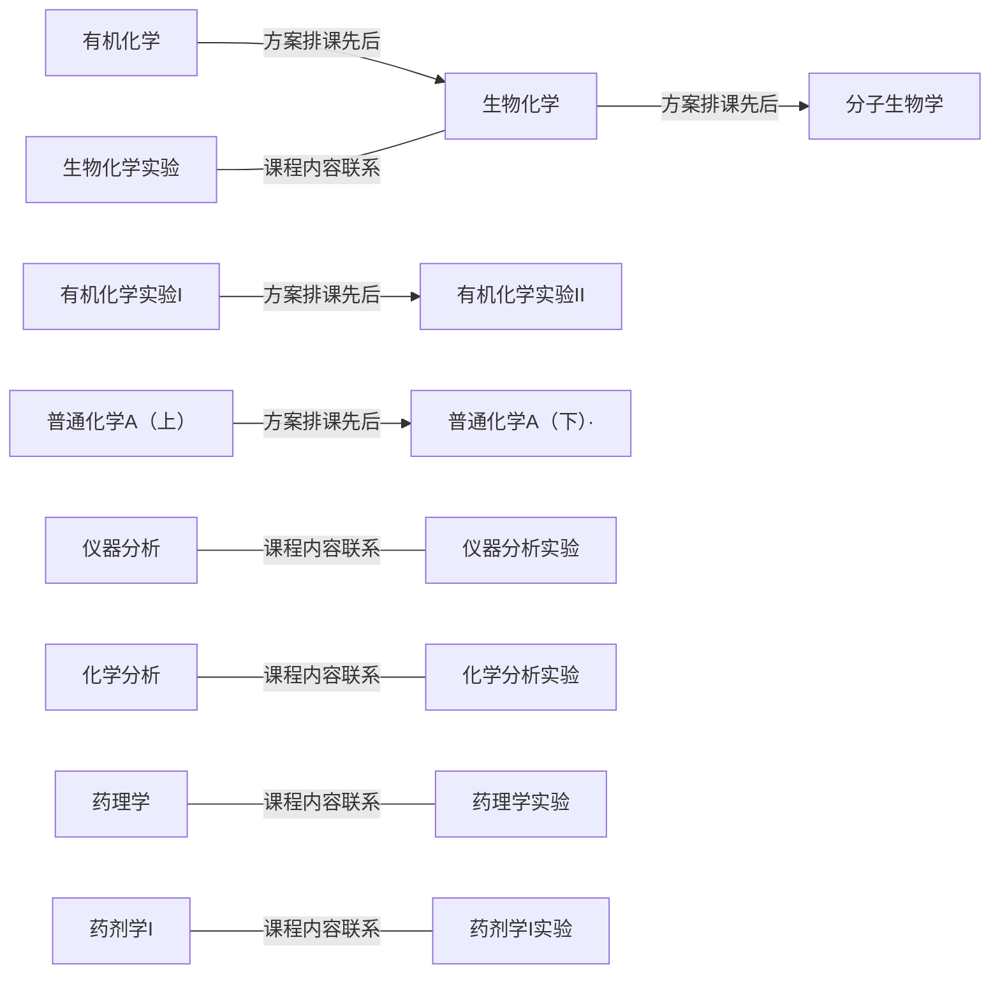

# 2025级药学专业本科教学培养方案

药学院 · 药学 · 方案 96696 · 50 个不同课程或科研条目。

[官方 Word](../originals/plan-96696.docx) · [教务详情](https://fdjwgl.fudan.edu.cn/manager/bizType/2/major-program-search/info/96696?skipAuth=1) · [方案快照](../raw/plan-96696.json.gz) · [年级目录](../README.md)

## 修读导读

- **建议先学**　《生物化学》（`PHAR20024`） → 《分子生物学》（`PHAR30040`）。生物分子的结构与功能支持分子生物学学习。方案分别列在第4、5学期。

- **可以对照着读**　《仪器分析》（`PHAR20020`）与《仪器分析实验》（`PHAR20021`）。可在实验或实践课中记录用到了哪些课堂概念，再回到相应章节复习。

- **查模块选课**　《核药学概论》（`PHAR20002`）、《生药学I》（`PHAR30002`）列在“专业核心教育课程”中。原表见 `/courseModules/6`。

## 课程关系图

图中展示部分关系。下表保留全部已建立的课程对，来源位置使用本方案 JSON Pointer。

## 先修与内容联系

| 类型 | 起点 | 终点 | 依据 | 原表定位 |
| --- | --- | --- | --- | --- |
| 建议学习顺序 | 有机化学 (CHEM10002) | 生物化学 (PHAR20024) | 官能团与有机反应是理解生物分子性质的基础。  | `/courseModules/5/planCourses/7`、`/courseModules/6/planCourses/22` |
| 建议学习顺序 | 普通化学A（上） (CHEM10003) | 普通化学A（下） (CHEM10004) | 同方案的课程题名具有连续分册或序号。  | `/courseModules/5/planCourses/4`、`/courseModules/5/planCourses/0` |
| 建议学习顺序 | 有机化学实验I (CHEM10006) | 有机化学实验II (PHAR20014) | 同方案的课程题名具有连续分册或序号。  | `/courseModules/5/planCourses/2`、`/courseModules/6/planCourses/9` |
| 建议学习顺序 | 生物化学 (PHAR20024) | 分子生物学 (PHAR30040) | 生物分子的结构与功能支持分子生物学学习。  | `/courseModules/6/planCourses/22`、`/courseModules/6/planCourses/11` |
| 方案排课先后 | 有机化学 (CHEM10002) | 生物化学 (PHAR20024) | 同方案该课程全部明确数字学期均早于后者。  | `/courseModules/5/planCourses/7`、`/courseModules/6/planCourses/22` |
| 方案排课先后 | 普通化学A（上） (CHEM10003) | 普通化学A（下） (CHEM10004) | 同方案该课程全部明确数字学期均早于后者。  | `/courseModules/5/planCourses/4`、`/courseModules/5/planCourses/0` |
| 方案排课先后 | 有机化学实验I (CHEM10006) | 有机化学实验II (PHAR20014) | 同方案该课程全部明确数字学期均早于后者。  | `/courseModules/5/planCourses/2`、`/courseModules/6/planCourses/9` |
| 方案排课先后 | 生物化学 (PHAR20024) | 分子生物学 (PHAR30040) | 同方案该课程全部明确数字学期均早于后者。  | `/courseModules/6/planCourses/22`、`/courseModules/6/planCourses/11` |
| 课程内容联系 | 有机化学 (CHEM10002) | 有机化学实验I (CHEM10006) | 本方案两门课程的题名均含“有机化学”，可据此对照这一主题。  | `/courseModules/5/planCourses/7`、`/courseModules/5/planCourses/2` |
| 课程内容联系 | 有机化学 (CHEM10002) | 有机化学实验II (PHAR20014) | 本方案两门课程的题名均含“有机化学”，可据此对照这一主题。  | `/courseModules/5/planCourses/7`、`/courseModules/6/planCourses/9` |
| 课程内容联系 | 生物化学(H) (PHAR130145h) | 生物化学 (PHAR20024) | 本方案两门课程的题名均含“生物化学”，可据此对照这一主题。  | `/courseModules/12/planCourses/1`、`/courseModules/6/planCourses/22` |
| 课程内容联系 | 生物化学实验 (PHAR20015) | 生物化学 (PHAR20024) | 题名显示相同主题的课程与实验、实践或实习。  | `/courseModules/6/planCourses/12`、`/courseModules/6/planCourses/22` |
| 课程内容联系 | 药理学 (PHAR20016) | 药理学(H) (PHAR20016h) | 本方案两门课程的题名均含“药理”，可据此对照这一主题。  | `/courseModules/6/planCourses/13`、`/courseModules/12/planCourses/0` |
| 课程内容联系 | 药理学 (PHAR20016) | 药理学实验 (PHAR20017) | 题名显示相同主题的课程与实验、实践或实习。  | `/courseModules/6/planCourses/13`、`/courseModules/6/planCourses/14` |
| 课程内容联系 | 化学分析 (PHAR20018) | 化学分析实验 (PHAR20019) | 题名显示相同主题的课程与实验、实践或实习。  | `/courseModules/6/planCourses/1`、`/courseModules/6/planCourses/2` |
| 课程内容联系 | 仪器分析 (PHAR20020) | 仪器分析实验 (PHAR20021) | 题名显示相同主题的课程与实验、实践或实习。  | `/courseModules/6/planCourses/3`、`/courseModules/6/planCourses/0` |
| 课程内容联系 | 分子药剂学(H) (PHAR30011h) | 药剂学I (PHAR30043) | 本方案两门课程的题名均含“药剂”，可据此对照这一主题。  | `/courseModules/12/planCourses/8`、`/courseModules/6/planCourses/15` |
| 课程内容联系 | 药剂学I (PHAR30043) | 药剂学I实验 (PHAR30044) | 题名显示相同主题的课程与实验、实践或实习。  | `/courseModules/6/planCourses/15`、`/courseModules/6/planCourses/16` |
| 课程内容联系 | 药物分析I (PHAR30045) | 药物分析(H) (PHAR30045h) | 本方案两门课程的题名均含“药物分析”，可据此对照这一主题。  | `/courseModules/6/planCourses/25`、`/courseModules/12/planCourses/9` |
| 课程内容联系 | 药物分析I (PHAR30045) | 药物分析I实验 (PHAR30046) | 题名显示相同主题的课程与实验、实践或实习。  | `/courseModules/6/planCourses/25`、`/courseModules/6/planCourses/17` |

本次未从可定位的明确表述中确认课程对课程预修。学期安排、系列分册与编辑建议均保留各自的依据。

## 按原方案模块阅读

同一模块展示原表中的课程归属。模块内课程之间的先后仍须逐项查阅。

- **荣誉项目**　生物化学(H)、药理学(H)、生物技术药物学(H)、生药学(H)、天然药物化学（H）、分子药剂学(H)、创新药物研发的理论与实践、临床药物治疗学(H)、药物化学(H)、药物分析(H)（原表模块 12）

## 课程表

同一课程在不同模块分别出现时，按原表逐行列出。季节字段保留原值。

| 课程 | 代码 | 学分 | 学期 | 模块 |
| --- | --- | ---: | --- | --- |
| 普通化学A（下） | CHEM10004 | 2.0 | 第2学期 | 培养方案 / 专业培养课程 / 学科基础课程 |
| 普通化学实验I | CHEM10005 | 1.0 | 第2学期 | 培养方案 / 专业培养课程 / 学科基础课程 |
| 有机化学实验I | CHEM10006 | 1.0 | 第2学期 | 培养方案 / 专业培养课程 / 学科基础课程 |
| 高等数学C I | MATH10018 | 5.0 | AUTUMN | 培养方案 / 专业培养课程 / 学科基础课程 |
| 普通化学A（上） | CHEM10003 | 2.0 | 第1学期 | 培养方案 / 专业培养课程 / 学科基础课程 |
| 普通物理B | PHYS10002 | 3.0 | 第1学期 | 培养方案 / 专业培养课程 / 学科基础课程 |
| 基础物理实验 | PHYS10005 | 2.0 | 第1学期 | 培养方案 / 专业培养课程 / 学科基础课程 |
| 有机化学 | CHEM10002 | 4.0 | 第2学期 | 培养方案 / 专业培养课程 / 学科基础课程 |
| 仪器分析实验 | PHAR20021 | 1.0 | 第4学期 | 培养方案 / 专业培养课程 / 专业核心教育课程 |
| 化学分析 | PHAR20018 | 1.0 | 第3学期 | 培养方案 / 专业培养课程 / 专业核心教育课程 |
| 化学分析实验 | PHAR20019 | 1.0 | 第3学期 | 培养方案 / 专业培养课程 / 专业核心教育课程 |
| 仪器分析 | PHAR20020 | 2.0 | 第4学期 | 培养方案 / 专业培养课程 / 专业核心教育课程 |
| 生物制药技术 | PHAR30001 | 2.0 | 第5学期 | 培养方案 / 专业培养课程 / 专业核心教育课程 |
| 核药学概论 | PHAR20002 | 2.0 | 第3学期 | 培养方案 / 专业培养课程 / 专业核心教育课程 |
| 生药学I | PHAR30002 | 2.0 | 第5学期 | 培养方案 / 专业培养课程 / 专业核心教育课程 |
| 实验药物化学I | PHAR30003 | 2.0 | 第6学期 | 培养方案 / 专业培养课程 / 专业核心教育课程 |
| 天然药物化学I | PHAR30004 | 2.0 | 第5学期 | 培养方案 / 专业培养课程 / 专业核心教育课程 |
| 有机化学实验II | PHAR20014 | 1.0 | 第3学期 | 培养方案 / 专业培养课程 / 专业核心教育课程 |
| 药物设计学 | PHAR40013 | 2.0 | 第7学期 | 培养方案 / 专业培养课程 / 专业核心教育课程 |
| 分子生物学 | PHAR30040 | 2.5 | 第5学期 | 培养方案 / 专业培养课程 / 专业核心教育课程 |
| 生物化学实验 | PHAR20015 | 1.0 | 第4学期 | 培养方案 / 专业培养课程 / 专业核心教育课程 |
| 药理学 | PHAR20016 | 4.0 | 第4学期 | 培养方案 / 专业培养课程 / 专业核心教育课程 |
| 药理学实验 | PHAR20017 | 1.0 | 第4学期 | 培养方案 / 专业培养课程 / 专业核心教育课程 |
| 药剂学I | PHAR30043 | 2.0 | 第5学期 | 培养方案 / 专业培养课程 / 专业核心教育课程 |
| 药剂学I实验 | PHAR30044 | 1.5 | 第5学期 | 培养方案 / 专业培养课程 / 专业核心教育课程 |
| 药物分析I实验 | PHAR30046 | 1.0 | 第6学期 | 培养方案 / 专业培养课程 / 专业核心教育课程 |
| 药物化学I | PHAR30037 | 3.0 | 第6学期 | 培养方案 / 专业培养课程 / 专业核心教育课程 |
| 药事管理学 | PHAR40005 | 2.0 | 第7学期 | 培养方案 / 专业培养课程 / 专业核心教育课程 |
| 感染与免疫 | MED20089 | 2.0 | 第4学期 | 培养方案 / 专业培养课程 / 专业核心教育课程 |
| 细胞生物学导论 | BIOL30022 | 2.0 | 第1学期 | 培养方案 / 专业培养课程 / 专业核心教育课程 |
| 生物化学 | PHAR20024 | 3.0 | 第4学期 | 培养方案 / 专业培养课程 / 专业核心教育课程 |
| 药用植物学I | PHAR20025 | 1.0 | 第4学期 | 培养方案 / 专业培养课程 / 专业核心教育课程 |
| 物理化学 | PHAR20023 | 3.0 | 第3学期 | 培养方案 / 专业培养课程 / 专业核心教育课程 |
| 药物分析I | PHAR30045 | 2.0 | 第6学期 | 培养方案 / 专业培养课程 / 专业核心教育课程 |
| 卫生统计学C | PHPM30013 | 2.0 | 第4学期 | 培养方案 / 专业培养课程 / 专业核心教育课程 |
| 医学基础 | MED20090 | 4.0 | 第3学期 | 培养方案 / 专业培养课程 / 专业核心教育课程 |
| 药理学(H) | PHAR20016h | 6.0 | SPRING | 培养方案 / 荣誉项目 |
| 生物化学(H) | PHAR130145h | 6.0 | SPRING | 培养方案 / 荣誉项目 |
| 生物技术药物学(H) | PHAR30001h | 5.0 | AUTUMN | 培养方案 / 荣誉项目 |
| 天然药物化学（H） | PHAR30004h | 4.0 | AUTUMN | 培养方案 / 荣誉项目 |
| 生药学(H) | PHAR30002h | 4.0 | AUTUMN | 培养方案 / 荣誉项目 |
| 临床药物治疗学(H) | PHAR30023h | 4.0 | SPRING、AUTUMN | 培养方案 / 荣誉项目 |
| 创新药物研发的理论与实践 | PHAR30015h | 4.0 | AUTUMN | 培养方案 / 荣誉项目 |
| 药物化学(H) | PHAR30037h | 4.0 | SPRING | 培养方案 / 荣誉项目 |
| 分子药剂学(H) | PHAR30011h | 5.0 | AUTUMN | 培养方案 / 荣誉项目 |
| 药物分析(H) | PHAR30045h | 4.0 | SPRING | 培养方案 / 荣誉项目 |
| 无学分科研实践 | 51 | 0.0 |  | 融合创新能力 |
| 综合性药学实验 | PHAR40012 | 2.0 | 第7学期 | 融合创新能力 |
| 毕业论文 | PHAR40006 | 6.0 | 第8学期 | 融合创新能力 |
| 专业实习 | PHAR30006 | 2.0 | SUMMER | 融合创新能力 |
