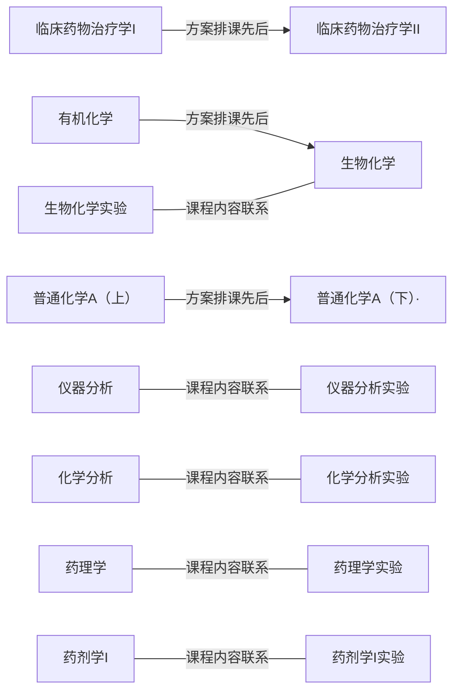

# 2025临床药学专业本科培养方案

药学院 · 药学(临床药学方向) · 方案 96802 · 65 个不同课程或科研条目。

[官方 Word](../originals/plan-96802.docx) · [教务详情](https://fdjwgl.fudan.edu.cn/manager/bizType/2/major-program-search/info/96802?skipAuth=1) · [方案快照](../raw/plan-96802.json.gz) · [年级目录](../README.md)

## 修读导读

- **建议先学**　《有机化学》（`CHEM10002`） → 《生物化学》（`PHAR20024`）。官能团与有机反应是理解生物分子性质的基础。方案分别列在第2、4学期。

- **可以对照着读**　《仪器分析》（`PHAR20020`）与《仪器分析实验》（`PHAR20021`）。可在实验或实践课中记录用到了哪些课堂概念，再回到相应章节复习。

- **查模块选课**　《临床药学技能与实践》（`PHAR40015`）、《生物化学实验》（`PHAR20015`）列在“专业核心教育课程”中。原表见 `/courseModules/6`。

## 课程关系图

图中展示部分关系。下表保留全部已建立的课程对，来源位置使用本方案 JSON Pointer。

## 先修与内容联系

| 类型 | 起点 | 终点 | 依据 | 原表定位 |
| --- | --- | --- | --- | --- |
| 建议学习顺序 | 有机化学 (CHEM10002) | 生物化学 (PHAR20024) | 官能团与有机反应是理解生物分子性质的基础。  | `/courseModules/5/planCourses/7`、`/courseModules/6/planCourses/24` |
| 建议学习顺序 | 普通化学A（上） (CHEM10003) | 普通化学A（下） (CHEM10004) | 同方案的课程题名具有连续分册或序号。  | `/courseModules/5/planCourses/4`、`/courseModules/5/planCourses/0` |
| 建议学习顺序 | 临床药物治疗学I (PHAR30039) | 临床药物治疗学II (PHAR40014) | 同方案的课程题名具有连续分册或序号。  | `/courseModules/6/planCourses/13`、`/courseModules/6/planCourses/21` |
| 方案排课先后 | 有机化学 (CHEM10002) | 生物化学 (PHAR20024) | 同方案该课程全部明确数字学期均早于后者。  | `/courseModules/5/planCourses/7`、`/courseModules/6/planCourses/24` |
| 方案排课先后 | 普通化学A（上） (CHEM10003) | 普通化学A（下） (CHEM10004) | 同方案该课程全部明确数字学期均早于后者。  | `/courseModules/5/planCourses/4`、`/courseModules/5/planCourses/0` |
| 方案排课先后 | 临床药物治疗学I (PHAR30039) | 临床药物治疗学II (PHAR40014) | 同方案该课程全部明确数字学期均早于后者。  | `/courseModules/6/planCourses/13`、`/courseModules/6/planCourses/21` |
| 课程内容联系 | 有机化学 (CHEM10002) | 有机化学实验I (CHEM10006) | 本方案两门课程的题名均含“有机化学”，可据此对照这一主题。  | `/courseModules/5/planCourses/7`、`/courseModules/5/planCourses/2` |
| 课程内容联系 | 生物化学(H) (PHAR130145h) | 生物化学 (PHAR20024) | 本方案两门课程的题名均含“生物化学”，可据此对照这一主题。  | `/courseModules/12/planCourses/1`、`/courseModules/6/planCourses/24` |
| 课程内容联系 | 生物化学实验 (PHAR20015) | 生物化学 (PHAR20024) | 题名显示相同主题的课程与实验、实践或实习。  | `/courseModules/6/planCourses/1`、`/courseModules/6/planCourses/24` |
| 课程内容联系 | 药理学 (PHAR20016) | 药理学(H) (PHAR20016h) | 本方案两门课程的题名均含“药理”，可据此对照这一主题。  | `/courseModules/6/planCourses/5`、`/courseModules/12/planCourses/0` |
| 课程内容联系 | 药理学 (PHAR20016) | 药理学实验 (PHAR20017) | 题名显示相同主题的课程与实验、实践或实习。  | `/courseModules/6/planCourses/5`、`/courseModules/6/planCourses/6` |
| 课程内容联系 | 化学分析 (PHAR20018) | 化学分析实验 (PHAR20019) | 题名显示相同主题的课程与实验、实践或实习。  | `/courseModules/6/planCourses/2`、`/courseModules/6/planCourses/3` |
| 课程内容联系 | 仪器分析 (PHAR20020) | 仪器分析实验 (PHAR20021) | 题名显示相同主题的课程与实验、实践或实习。  | `/courseModules/6/planCourses/4`、`/courseModules/6/planCourses/0` |
| 课程内容联系 | 分子药剂学(H) (PHAR30011h) | 药剂学I (PHAR30043) | 本方案两门课程的题名均含“药剂”，可据此对照这一主题。  | `/courseModules/12/planCourses/8`、`/courseModules/6/planCourses/18` |
| 课程内容联系 | 药剂学I (PHAR30043) | 药剂学I实验 (PHAR30044) | 题名显示相同主题的课程与实验、实践或实习。  | `/courseModules/6/planCourses/18`、`/courseModules/6/planCourses/19` |

本次未从可定位的明确表述中确认课程对课程预修。学期安排、系列分册与编辑建议均保留各自的依据。

## 按原方案模块阅读

同一模块展示原表中的课程归属。模块内课程之间的先后仍须逐项查阅。

- **荣誉项目**　生物化学(H)、药理学(H)、生物技术药物学(H)、生药学(H)、天然药物化学（H）、分子药剂学(H)、创新药物研发的理论与实践、临床药物治疗学(H)、药物化学(H)、药物分析(H)（原表模块 12）

## 课程表

同一课程在不同模块分别出现时，按原表逐行列出。季节字段保留原值。

| 课程 | 代码 | 学分 | 学期 | 模块 |
| --- | --- | ---: | --- | --- |
| 普通化学A（下） | CHEM10004 | 2.0 | 第2学期 | 培养方案 / 专业培养课程 / 学科基础课程 |
| 普通化学实验I | CHEM10005 | 1.0 | 第2学期 | 培养方案 / 专业培养课程 / 学科基础课程 |
| 有机化学实验I | CHEM10006 | 1.0 | 第2学期 | 培养方案 / 专业培养课程 / 学科基础课程 |
| 高等数学C I | MATH10018 | 5.0 | AUTUMN | 培养方案 / 专业培养课程 / 学科基础课程 |
| 普通化学A（上） | CHEM10003 | 2.0 | 第1学期 | 培养方案 / 专业培养课程 / 学科基础课程 |
| 普通物理B | PHYS10002 | 3.0 | 第1学期 | 培养方案 / 专业培养课程 / 学科基础课程 |
| 基础物理实验 | PHYS10005 | 2.0 | 第1学期 | 培养方案 / 专业培养课程 / 学科基础课程 |
| 有机化学 | CHEM10002 | 4.0 | 第2学期 | 培养方案 / 专业培养课程 / 学科基础课程 |
| 仪器分析实验 | PHAR20021 | 1.0 | 第4学期 | 培养方案 / 专业培养课程 / 专业核心教育课程 |
| 生物化学实验 | PHAR20015 | 1.0 | 第4学期 | 培养方案 / 专业培养课程 / 专业核心教育课程 |
| 化学分析 | PHAR20018 | 1.0 | 第3学期 | 培养方案 / 专业培养课程 / 专业核心教育课程 |
| 化学分析实验 | PHAR20019 | 1.0 | 第3学期 | 培养方案 / 专业培养课程 / 专业核心教育课程 |
| 仪器分析 | PHAR20020 | 2.0 | 第4学期 | 培养方案 / 专业培养课程 / 专业核心教育课程 |
| 药理学 | PHAR20016 | 4.0 | 第4学期 | 培养方案 / 专业培养课程 / 专业核心教育课程 |
| 药理学实验 | PHAR20017 | 1.0 | 第4学期 | 培养方案 / 专业培养课程 / 专业核心教育课程 |
| 感染与免疫 | MED20089 | 2.0 | 第4学期 | 培养方案 / 专业培养课程 / 专业核心教育课程 |
| 医学基础 | MED20090 | 4.0 | 第3学期 | 培养方案 / 专业培养课程 / 专业核心教育课程 |
| 药物流行病学 | PHAR30029 | 2.0 | 第5学期 | 培养方案 / 专业培养课程 / 专业核心教育课程 |
| 病理生理学B | MED30009 | 3.0 | 第5学期 | 培养方案 / 专业培养课程 / 专业核心教育课程 |
| 诊断学B | MED30019 | 3.5 | 第5学期 | 培养方案 / 专业培养课程 / 专业核心教育课程 |
| 临床药物化学 | PHAR30027 | 2.0 | 第5学期 | 培养方案 / 专业培养课程 / 专业核心教育课程 |
| 临床药物治疗学I | PHAR30039 | 3.0 | 第5学期 | 培养方案 / 专业培养课程 / 专业核心教育课程 |
| 内科学C | MED30021 | 6.0 | 第6学期 | 培养方案 / 专业培养课程 / 专业核心教育课程 |
| 外科学C | MED30022 | 3.0 | 第6学期 | 培养方案 / 专业培养课程 / 专业核心教育课程 |
| 妇产科学C | MED30023 | 2.5 | 第6学期 | 培养方案 / 专业培养课程 / 专业核心教育课程 |
| 儿科学C | MED30024 | 2.5 | 第6学期 | 培养方案 / 专业培养课程 / 专业核心教育课程 |
| 药剂学I | PHAR30043 | 2.0 | 第7学期 | 培养方案 / 专业培养课程 / 专业核心教育课程 |
| 药剂学I实验 | PHAR30044 | 1.5 | 第7学期 | 培养方案 / 专业培养课程 / 专业核心教育课程 |
| 药事管理学 | PHAR40005 | 2.0 | 第7学期 | 培养方案 / 专业培养课程 / 专业核心教育课程 |
| 临床药物治疗学II | PHAR40014 | 3.0 | 第7学期 | 培养方案 / 专业培养课程 / 专业核心教育课程 |
| 临床药物动力学 | PHAR40011 | 2.0 | 第7学期 | 培养方案 / 专业培养课程 / 专业核心教育课程 |
| 临床药学技能与实践 | PHAR40015 | 3.0 | 第7学期 | 培养方案 / 专业培养课程 / 专业核心教育课程 |
| 生物化学 | PHAR20024 | 3.0 | 第4学期 | 培养方案 / 专业培养课程 / 专业核心教育课程 |
| 细胞生物学导论 | BIOL30022 | 2.0 | 第1学期 | 培养方案 / 专业培养课程 / 专业核心教育课程 |
| 卫生统计学C | PHPM30013 | 2.0 | 第4学期 | 培养方案 / 专业培养课程 / 专业核心教育课程 |
| 医学文献检索与利用B | MED20016 | 2.0 | SPRING、AUTUMN | 培养方案 / 专业进阶II |
| 中西医结合基础概论 | MED20018 | 2.0 | SPRING、AUTUMN | 培养方案 / 专业进阶II |
| 临床免疫学 | MED130107 | 2.0 | SPRING、AUTUMN | 培养方案 / 专业进阶II |
| 临床营养学 | MED50012 | 2.0 | SPRING、AUTUMN | 培养方案 / 专业进阶II |
| 医患交流技巧 | MED30040 | 2.0 | SPRING、AUTUMN | 培养方案 / 专业进阶II |
| 医疗保险经济学 | MED130191 | 2.0 | SPRING、AUTUMN | 培养方案 / 专业进阶II |
| 急诊医学 | MED50014 | 2.0 | SPRING、AUTUMN | 培养方案 / 专业进阶II |
| 医学与生物安全 | MED20036 | 2.0 | SPRING、AUTUMN | 培养方案 / 专业进阶II |
| 生物医学科研论文的撰写 | MED130270 | 2.0 | SPRING、AUTUMN | 培养方案 / 专业进阶II |
| 管理与沟通技巧 | PHPM20005 | 1.0 | SPRING、AUTUMN | 培养方案 / 专业进阶II |
| 卫生经济评价方法 | PHPM50003 | 2.0 | SPRING、AUTUMN | 培养方案 / 专业进阶II |
| 免疫工程 | MED20019 | 2.0 | SPRING、AUTUMN | 培养方案 / 专业进阶II |
| 新发传染病 | MED50011 | 2.0 | SPRING、AUTUMN | 培养方案 / 专业进阶II |
| 艾滋病基础和临床 | MED50015 | 2.0 | SPRING、AUTUMN | 培养方案 / 专业进阶II |
| 肿瘤分子生物学 | MED50016 | 2.0 | SPRING、AUTUMN | 培养方案 / 专业进阶II |
| 现代医院质量评价及管理工具应用 | MED50023 | 2.0 | SPRING、AUTUMN | 培养方案 / 专业进阶II |
| 医院获得性感染 | PHPM20004 | 2.0 | SPRING、AUTUMN | 培养方案 / 专业进阶II |
| 药理学(H) | PHAR20016h | 6.0 | SPRING | 培养方案 / 荣誉项目 |
| 生物化学(H) | PHAR130145h | 6.0 | SPRING | 培养方案 / 荣誉项目 |
| 生物技术药物学(H) | PHAR30001h | 5.0 | AUTUMN | 培养方案 / 荣誉项目 |
| 天然药物化学（H） | PHAR30004h | 4.0 | AUTUMN | 培养方案 / 荣誉项目 |
| 生药学(H) | PHAR30002h | 4.0 | AUTUMN | 培养方案 / 荣誉项目 |
| 临床药物治疗学(H) | PHAR30023h | 4.0 | SPRING、AUTUMN | 培养方案 / 荣誉项目 |
| 创新药物研发的理论与实践 | PHAR30015h | 4.0 | AUTUMN | 培养方案 / 荣誉项目 |
| 药物化学(H) | PHAR30037h | 4.0 | SPRING | 培养方案 / 荣誉项目 |
| 分子药剂学(H) | PHAR30011h | 5.0 | AUTUMN | 培养方案 / 荣誉项目 |
| 药物分析(H) | PHAR30045h | 4.0 | SPRING | 培养方案 / 荣誉项目 |
| 无学分科研实践 | 51 | 0.0 |  | 融合创新能力 |
| 毕业论文 | PHAR40006 | 6.0 | 第8学期 | 融合创新能力 |
| 专业实习 | PHAR30006 | 2.0 | SUMMER | 融合创新能力 |
