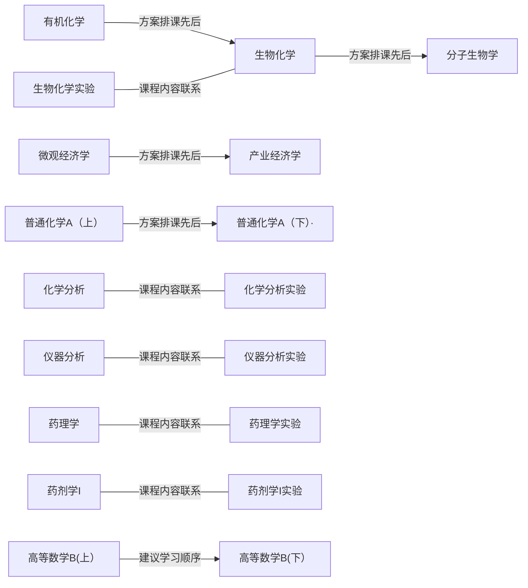

# 2025级药学-经济学双学士学位项目教学培养方案

药学院 · 药学-经济学(双学士学位项目) · 方案 97085 · 79 个不同课程或科研条目。

[官方 Word](../originals/plan-97085.docx) · [教务详情](https://fdjwgl.fudan.edu.cn/manager/bizType/2/major-program-search/info/97085?skipAuth=1) · [方案快照](../raw/plan-97085.json.gz) · [年级目录](../README.md)

## 修读导读

- **建议先学**　《生物化学》（`PHAR20024`） → 《分子生物学》（`PHAR30040`）。生物分子的结构与功能支持分子生物学学习。方案分别列在第4、5学期。

- **可以对照着读**　《化学分析》（`PHAR20018`）与《化学分析实验》（`PHAR20019`）。可在实验或实践课中记录用到了哪些课堂概念，再回到相应章节复习。

- **查模块选课**　《物理化学》（`PHAR20023`）、《生物化学实验》（`PHAR20015`）列在“专业核心教育课程”中。原表见 `/courseModules/6`。

## 课程关系图

图中展示部分关系。下表保留全部已建立的课程对，来源位置使用本方案 JSON Pointer。

## 先修与内容联系

| 类型 | 起点 | 终点 | 依据 | 原表定位 |
| --- | --- | --- | --- | --- |
| 建议学习顺序 | 有机化学 (CHEM10002) | 生物化学 (PHAR20024) | 官能团与有机反应是理解生物分子性质的基础。  | `/courseModules/5/planCourses/3`、`/courseModules/6/planCourses/4` |
| 建议学习顺序 | 普通化学A（上） (CHEM10003) | 普通化学A（下） (CHEM10004) | 同方案的课程题名具有连续分册或序号。  | `/courseModules/5/planCourses/0`、`/courseModules/5/planCourses/1` |
| 建议学习顺序 | 微观经济学 (ECON20003) | 产业经济学 (ECON30025) | 企业和市场结构是产业经济分析的基础。  | `/courseModules/5/planCourses/9`、`/courseModules/6/planCourses/29` |
| 建议学习顺序 | 高等数学B(上） (MATH10004) | 高等数学B(下） (MATH10005) | 同方案的课程题名具有连续分册或序号。  | `/courseModules/5/planCourses/5`、`/courseModules/5/planCourses/6` |
| 建议学习顺序 | 生物化学 (PHAR20024) | 分子生物学 (PHAR30040) | 生物分子的结构与功能支持分子生物学学习。  | `/courseModules/6/planCourses/4`、`/courseModules/6/planCourses/12` |
| 方案排课先后 | 有机化学 (CHEM10002) | 生物化学 (PHAR20024) | 同方案该课程全部明确数字学期均早于后者。  | `/courseModules/5/planCourses/3`、`/courseModules/6/planCourses/4` |
| 方案排课先后 | 普通化学A（上） (CHEM10003) | 普通化学A（下） (CHEM10004) | 同方案该课程全部明确数字学期均早于后者。  | `/courseModules/5/planCourses/0`、`/courseModules/5/planCourses/1` |
| 方案排课先后 | 微观经济学 (ECON20003) | 产业经济学 (ECON30025) | 同方案该课程全部明确数字学期均早于后者。  | `/courseModules/5/planCourses/9`、`/courseModules/6/planCourses/29` |
| 方案排课先后 | 生物化学 (PHAR20024) | 分子生物学 (PHAR30040) | 同方案该课程全部明确数字学期均早于后者。  | `/courseModules/6/planCourses/4`、`/courseModules/6/planCourses/12` |
| 课程内容联系 | 有机化学 (CHEM10002) | 有机化学实验I (CHEM10006) | 本方案两门课程的题名均含“有机化学”，可据此对照这一主题。  | `/courseModules/5/planCourses/3`、`/courseModules/5/planCourses/4` |
| 课程内容联系 | 宏观经济学 (ECON20004) | 货币银行学 (ECON30021) | 共同主题为货币政策与宏观经济运行。  | `/courseModules/5/planCourses/10`、`/courseModules/12/planCourses/7` |
| 课程内容联系 | 国际金融 (ECON30017) | 公司金融 (ECON30122) | 本方案两门课程的题名均含“金融”，可据此对照这一主题。  | `/courseModules/12/planCourses/5`、`/courseModules/6/planCourses/24` |
| 课程内容联系 | 生物化学(H) (PHAR130145h) | 生物化学 (PHAR20024) | 本方案两门课程的题名均含“生物化学”，可据此对照这一主题。  | `/courseModules/14/planCourses/1`、`/courseModules/6/planCourses/4` |
| 课程内容联系 | 生物化学实验 (PHAR20015) | 生物化学 (PHAR20024) | 题名显示相同主题的课程与实验、实践或实习。  | `/courseModules/6/planCourses/5`、`/courseModules/6/planCourses/4` |
| 课程内容联系 | 药理学 (PHAR20016) | 药理学(H) (PHAR20016h) | 本方案两门课程的题名均含“药理”，可据此对照这一主题。  | `/courseModules/6/planCourses/10`、`/courseModules/14/planCourses/0` |
| 课程内容联系 | 药理学 (PHAR20016) | 药理学实验 (PHAR20017) | 题名显示相同主题的课程与实验、实践或实习。  | `/courseModules/6/planCourses/10`、`/courseModules/6/planCourses/11` |
| 课程内容联系 | 化学分析 (PHAR20018) | 化学分析实验 (PHAR20019) | 题名显示相同主题的课程与实验、实践或实习。  | `/courseModules/6/planCourses/1`、`/courseModules/6/planCourses/2` |
| 课程内容联系 | 仪器分析 (PHAR20020) | 仪器分析实验 (PHAR20021) | 题名显示相同主题的课程与实验、实践或实习。  | `/courseModules/6/planCourses/6`、`/courseModules/6/planCourses/7` |
| 课程内容联系 | 分子药剂学(H) (PHAR30011h) | 药剂学I (PHAR30043) | 本方案两门课程的题名均含“药剂”，可据此对照这一主题。  | `/courseModules/14/planCourses/8`、`/courseModules/6/planCourses/13` |
| 课程内容联系 | 药剂学I (PHAR30043) | 药剂学I实验 (PHAR30044) | 题名显示相同主题的课程与实验、实践或实习。  | `/courseModules/6/planCourses/13`、`/courseModules/6/planCourses/14` |
| 课程内容联系 | 药物分析I (PHAR30045) | 药物分析(H) (PHAR30045h) | 本方案两门课程的题名均含“药物分析”，可据此对照这一主题。  | `/courseModules/6/planCourses/18`、`/courseModules/14/planCourses/9` |
| 课程内容联系 | 药物分析I (PHAR30045) | 药物分析I实验 (PHAR30046) | 题名显示相同主题的课程与实验、实践或实习。  | `/courseModules/6/planCourses/18`、`/courseModules/6/planCourses/19` |

本次未从可定位的明确表述中确认课程对课程预修。学期安排、系列分册与编辑建议均保留各自的依据。

## 按原方案模块阅读

同一模块展示原表中的课程归属。模块内课程之间的先后仍须逐项查阅。

- **经济学专业进阶模块**　人工智能与应用经济学、十六世纪后的世界政治、经济与思想、数字时代的经济法律实践、创新经济学、国际金融、货币银行学、发展经济学、区域经济学、农村和农业经济学、城市经济学、公司财务分析、信息经济学、劳动经济学、投资学、公共财政政策分析、资源环境经济学、时间序列分析的方法、截面与面板数据分析等22项（原表模块 12）
- **荣誉项目**　生物化学(H)、药理学(H)、生物技术药物学(H)、生药学(H)、天然药物化学（H）、分子药剂学(H)、创新药物研发的理论与实践、临床药物治疗学(H)、药物化学(H)、药物分析(H)（原表模块 14）

## 课程表

同一课程在不同模块分别出现时，按原表逐行列出。季节字段保留原值。

| 课程 | 代码 | 学分 | 学期 | 模块 |
| --- | --- | ---: | --- | --- |
| 普通化学A（上） | CHEM10003 | 2.0 | 第1学期 | 培养方案 / 专业培养课程 / 学科基础课程 |
| 普通化学A（下） | CHEM10004 | 2.0 | 第2学期 | 培养方案 / 专业培养课程 / 学科基础课程 |
| 普通化学实验I | CHEM10005 | 1.0 | 第2学期 | 培养方案 / 专业培养课程 / 学科基础课程 |
| 有机化学 | CHEM10002 | 4.0 | 第2学期 | 培养方案 / 专业培养课程 / 学科基础课程 |
| 有机化学实验I | CHEM10006 | 1.0 | 第2学期 | 培养方案 / 专业培养课程 / 学科基础课程 |
| 高等数学B(上） | MATH10004 | 5.0 | SPRING、AUTUMN | 培养方案 / 专业培养课程 / 学科基础课程 |
| 高等数学B(下） | MATH10005 | 5.0 | SPRING、AUTUMN | 培养方案 / 专业培养课程 / 学科基础课程 |
| 会计学 | BA10003 | 3.0 | 第2学期 | 培养方案 / 专业培养课程 / 学科基础课程 |
| 线性代数 | MATH10017 | 3.0 | 第2学期 | 培养方案 / 专业培养课程 / 学科基础课程 |
| 微观经济学 | ECON20003 | 3.0 | 第1学期 | 培养方案 / 专业培养课程 / 学科基础课程 |
| 宏观经济学 | ECON20004 | 3.0 | 第2学期 | 培养方案 / 专业培养课程 / 学科基础课程 |
| 细胞生物学导论 | BIOL30022 | 2.0 | 第1学期 | 培养方案 / 专业培养课程 / 专业核心教育课程 |
| 化学分析 | PHAR20018 | 1.0 | 第3学期 | 培养方案 / 专业培养课程 / 专业核心教育课程 |
| 化学分析实验 | PHAR20019 | 1.0 | 第3学期 | 培养方案 / 专业培养课程 / 专业核心教育课程 |
| 物理化学 | PHAR20023 | 3.0 | 第3学期 | 培养方案 / 专业培养课程 / 专业核心教育课程 |
| 生物化学 | PHAR20024 | 3.0 | 第4学期 | 培养方案 / 专业培养课程 / 专业核心教育课程 |
| 生物化学实验 | PHAR20015 | 1.0 | 第4学期 | 培养方案 / 专业培养课程 / 专业核心教育课程 |
| 仪器分析 | PHAR20020 | 2.0 | 第4学期 | 培养方案 / 专业培养课程 / 专业核心教育课程 |
| 仪器分析实验 | PHAR20021 | 1.0 | 第4学期 | 培养方案 / 专业培养课程 / 专业核心教育课程 |
| 感染与免疫 | MED20089 | 2.0 | 第4学期 | 培养方案 / 专业培养课程 / 专业核心教育课程 |
| 医学基础 | MED20090 | 4.0 | 第3学期 | 培养方案 / 专业培养课程 / 专业核心教育课程 |
| 药理学 | PHAR20016 | 4.0 | 第4学期 | 培养方案 / 专业培养课程 / 专业核心教育课程 |
| 药理学实验 | PHAR20017 | 1.0 | 第4学期 | 培养方案 / 专业培养课程 / 专业核心教育课程 |
| 分子生物学 | PHAR30040 | 2.5 | 第5学期 | 培养方案 / 专业培养课程 / 专业核心教育课程 |
| 药剂学I | PHAR30043 | 2.0 | 第5学期 | 培养方案 / 专业培养课程 / 专业核心教育课程 |
| 药剂学I实验 | PHAR30044 | 1.5 | 第5学期 | 培养方案 / 专业培养课程 / 专业核心教育课程 |
| 生物制药技术 | PHAR30001 | 2.0 | 第5学期 | 培养方案 / 专业培养课程 / 专业核心教育课程 |
| 天然药物化学I | PHAR30004 | 2.0 | 第5学期 | 培养方案 / 专业培养课程 / 专业核心教育课程 |
| 实验药物化学I | PHAR30003 | 2.0 | 第6学期 | 培养方案 / 专业培养课程 / 专业核心教育课程 |
| 药物分析I | PHAR30045 | 2.0 | 第6学期 | 培养方案 / 专业培养课程 / 专业核心教育课程 |
| 药物分析I实验 | PHAR30046 | 1.0 | 第6学期 | 培养方案 / 专业培养课程 / 专业核心教育课程 |
| 药物化学I | PHAR30037 | 3.0 | 第6学期 | 培养方案 / 专业培养课程 / 专业核心教育课程 |
| 药事管理学 | PHAR40005 | 2.0 | 第7学期 | 培养方案 / 专业培养课程 / 专业核心教育课程 |
| 概率论与数理统计 | ECON30016 | 3.0 | 第3学期 | 培养方案 / 专业培养课程 / 专业核心教育课程 |
| 经济史 | ECON30120 | 3.0 | 第3学期 | 培养方案 / 专业培养课程 / 专业核心教育课程 |
| 公司金融 | ECON30122 | 3.0 | 第3学期 | 培养方案 / 专业培养课程 / 专业核心教育课程 |
| 计量经济学 | ECON30121 | 4.0 | 第4学期 | 培养方案 / 专业培养课程 / 专业核心教育课程 |
| 财政学 | ECON30019 | 3.0 | 第4学期 | 培养方案 / 专业培养课程 / 专业核心教育课程 |
| 当代中国经济 | ECON30024 | 3.0 | 第5学期 | 培养方案 / 专业培养课程 / 专业核心教育课程 |
| 制度经济学 | ECON30074 | 3.0 | 第3学期 | 培养方案 / 专业培养课程 / 专业核心教育课程 |
| 产业经济学 | ECON30025 | 3.0 | 第6学期 | 培养方案 / 专业培养课程 / 专业核心教育课程 |
| 博弈论 | ECON30054 | 3.0 | 第4学期 | 培养方案 / 专业培养课程 / 专业核心教育课程 |
| 外国经济思想史 | ECON30075 | 3.0 | 第3学期 | 培养方案 / 专业培养课程 / 专业核心教育课程 |
| 国际经济学 | ECON30029 | 3.0 | 第4学期 | 培养方案 / 专业培养课程 / 专业核心教育课程 |
| 药物经济学 | PHAR30013 | 1.0 | SPRING、AUTUMN | 培养方案 / 经济学专业进阶模块 |
| 卫生经济学 | PHPM20007 | 4.0 | SPRING、AUTUMN | 培养方案 / 经济学专业进阶模块 |
| 药品经济与市场营销 | GEEC20046 | 2.0 | SPRING、AUTUMN | 培养方案 / 经济学专业进阶模块 |
| 资源环境经济学 | ECON30136 | 3.0 | 第6学期 | 培养方案 / 经济学专业进阶模块 |
| 投资学 | ECON30126 | 3.0 | 第6学期 | 培养方案 / 经济学专业进阶模块 |
| 国际金融 | ECON30017 | 3.0 | 第5学期 | 培养方案 / 经济学专业进阶模块 |
| 农村和农业经济学 | ECON30048 | 2.0 | 第5学期 | 培养方案 / 经济学专业进阶模块 |
| 货币银行学 | ECON30021 | 3.0 | 第5学期 | 培养方案 / 经济学专业进阶模块 |
| 劳动经济学 | ECON30113 | 3.0 | 第6学期 | 培养方案 / 经济学专业进阶模块 |
| 区域经济学 | ECON30047 | 2.0 | 第7学期 | 培养方案 / 经济学专业进阶模块 |
| 城市经济学 | ECON30049 | 3.0 | 第7学期 | 培养方案 / 经济学专业进阶模块 |
| 信息经济学 | ECON30081 | 2.0 | 第5学期 | 培养方案 / 经济学专业进阶模块 |
| 发展经济学 | ECON30026 | 3.0 | 第7学期 | 培养方案 / 经济学专业进阶模块 |
| 十六世纪后的世界政治、经济与思想 | ECON30001 | 3.0 | 第6学期 | 培养方案 / 经济学专业进阶模块 |
| 创新经济学 | ECON30013 | 3.0 | 第6学期 | 培养方案 / 经济学专业进阶模块 |
| 时间序列分析的方法 | ECON40004 | 3.0 | 第6学期 | 培养方案 / 经济学专业进阶模块 |
| 截面与面板数据分析 | ECON40012 | 3.0 | 第6学期 | 培养方案 / 经济学专业进阶模块 |
| 数量分析软件应用 | ECON40013 | 3.0 | 第7学期 | 培养方案 / 经济学专业进阶模块 |
| 人工智能与应用经济学 | AIS410005 | 3.0 | 第7学期 | 培养方案 / 经济学专业进阶模块 |
| 数字时代的经济法律实践 | ECON30009 | 3.0 | 第6学期 | 培养方案 / 经济学专业进阶模块 |
| 公共财政政策分析 | ECON30130 | 3.0 | 第6学期 | 培养方案 / 经济学专业进阶模块 |
| 公司财务分析 | ECON30055 | 2.0 | 第6学期 | 培养方案 / 经济学专业进阶模块 |
| 药理学(H) | PHAR20016h | 6.0 | SPRING | 培养方案 / 荣誉项目 |
| 生物化学(H) | PHAR130145h | 6.0 | SPRING | 培养方案 / 荣誉项目 |
| 生物技术药物学(H) | PHAR30001h | 5.0 | AUTUMN | 培养方案 / 荣誉项目 |
| 天然药物化学（H） | PHAR30004h | 4.0 | AUTUMN | 培养方案 / 荣誉项目 |
| 生药学(H) | PHAR30002h | 4.0 | AUTUMN | 培养方案 / 荣誉项目 |
| 临床药物治疗学(H) | PHAR30023h | 4.0 | SPRING、AUTUMN | 培养方案 / 荣誉项目 |
| 创新药物研发的理论与实践 | PHAR30015h | 4.0 | AUTUMN | 培养方案 / 荣誉项目 |
| 药物化学(H) | PHAR30037h | 4.0 | SPRING | 培养方案 / 荣誉项目 |
| 分子药剂学(H) | PHAR30011h | 5.0 | AUTUMN | 培养方案 / 荣誉项目 |
| 药物分析(H) | PHAR30045h | 4.0 | SPRING | 培养方案 / 荣誉项目 |
| 无学分科研实践 | 51 | 0.0 |  | 融合创新能力 |
| 毕业论文 | PHAR40006 | 6.0 | 第8学期 | 融合创新能力 |
| 专业实习 | PHAR30006 | 2.0 | SUMMER | 融合创新能力 |
