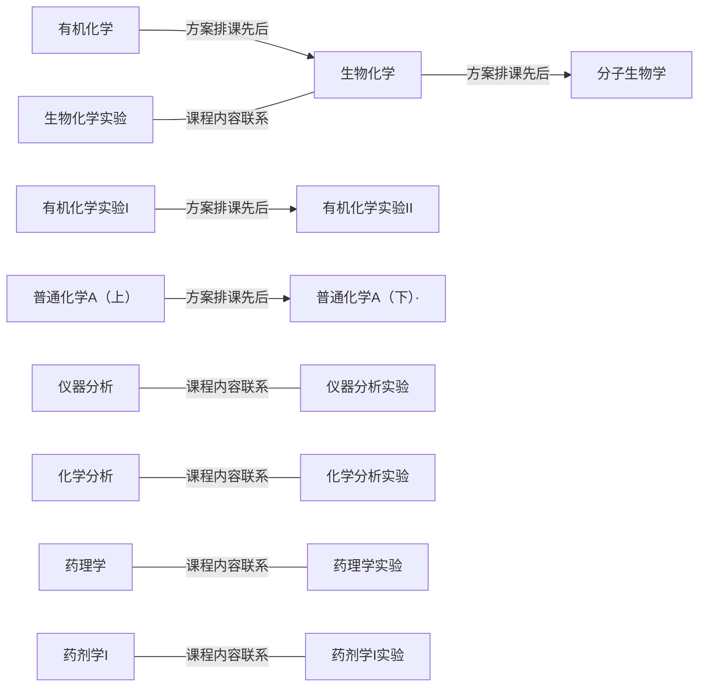

# 2025药学-药学本硕融通培养方案（药学产教融合人才班）

药学院 · 药学 · 方案 97092 · 111 个不同课程或科研条目。

[官方 Word](../originals/plan-97092.docx) · [教务详情](https://fdjwgl.fudan.edu.cn/manager/bizType/2/major-program-search/info/97092?skipAuth=1) · [方案快照](../raw/plan-97092.json.gz) · [年级目录](../README.md)

## 课程关系图

图中展示部分关系。下表保留全部已建立的课程对，来源位置使用本方案 JSON Pointer。

## 先修与内容联系

| 类型 | 起点 | 终点 | 依据 | 原表定位 |
| --- | --- | --- | --- | --- |
| 建议学习顺序 | 有机化学 (CHEM10002) | 生物化学 (PHAR20024) | 官能团与有机反应是理解生物分子性质的基础。  | `/courseModules/12/planCourses/7`、`/courseModules/13/planCourses/22` |
| 建议学习顺序 | 普通化学A（上） (CHEM10003) | 普通化学A（下） (CHEM10004) | 同方案的课程题名具有连续分册或序号。  | `/courseModules/12/planCourses/4`、`/courseModules/12/planCourses/0` |
| 建议学习顺序 | 有机化学实验I (CHEM10006) | 有机化学实验II (PHAR20014) | 同方案的课程题名具有连续分册或序号。  | `/courseModules/12/planCourses/2`、`/courseModules/13/planCourses/10` |
| 建议学习顺序 | 生物化学 (PHAR20024) | 分子生物学 (PHAR30040) | 生物分子的结构与功能支持分子生物学学习。  | `/courseModules/13/planCourses/22`、`/courseModules/13/planCourses/11` |
| 方案排课先后 | 有机化学 (CHEM10002) | 生物化学 (PHAR20024) | 同方案该课程全部明确数字学期均早于后者。  | `/courseModules/12/planCourses/7`、`/courseModules/13/planCourses/22` |
| 方案排课先后 | 普通化学A（上） (CHEM10003) | 普通化学A（下） (CHEM10004) | 同方案该课程全部明确数字学期均早于后者。  | `/courseModules/12/planCourses/4`、`/courseModules/12/planCourses/0` |
| 方案排课先后 | 有机化学实验I (CHEM10006) | 有机化学实验II (PHAR20014) | 同方案该课程全部明确数字学期均早于后者。  | `/courseModules/12/planCourses/2`、`/courseModules/13/planCourses/10` |
| 方案排课先后 | 生物化学 (PHAR20024) | 分子生物学 (PHAR30040) | 同方案该课程全部明确数字学期均早于后者。  | `/courseModules/13/planCourses/22`、`/courseModules/13/planCourses/11` |
| 课程内容联系 | 人工智能生物学 (AIS310017) | 人工智能药物设计学 (AIS310020) | 本方案两门课程的题名均含“人工智能”，可据此对照这一主题。  | `/courseModules/15/planCourses/34`、`/courseModules/13/planCourses/27` |
| 课程内容联系 | 人工智能生物学 (AIS310017) | 医学大数据与人工智能 (AIS410015) | 本方案两门课程的题名均含“人工智能”，可据此对照这一主题。  | `/courseModules/15/planCourses/34`、`/courseModules/15/planCourses/33` |
| 课程内容联系 | 人工智能生物学 (AIS310017) | 生物药物研发与人工智能 (AIT631015) | 本方案两门课程的题名均含“人工智能”，可据此对照这一主题。  | `/courseModules/15/planCourses/34`、`/courseModules/15/planCourses/21` |
| 课程内容联系 | 有机化学 (CHEM10002) | 有机化学实验I (CHEM10006) | 本方案两门课程的题名均含“有机化学”，可据此对照这一主题。  | `/courseModules/12/planCourses/7`、`/courseModules/12/planCourses/2` |
| 课程内容联系 | 有机化学 (CHEM10002) | 有机化学实验II (PHAR20014) | 本方案两门课程的题名均含“有机化学”，可据此对照这一主题。  | `/courseModules/12/planCourses/7`、`/courseModules/13/planCourses/10` |
| 课程内容联系 | 生物药剂学 (PHAR130040) | 药剂学I (PHAR30043) | 本方案两门课程的题名均含“药剂”，可据此对照这一主题。  | `/courseModules/15/planCourses/15`、`/courseModules/13/planCourses/15` |
| 课程内容联系 | 生物化学实验 (PHAR20015) | 生物化学 (PHAR20024) | 题名显示相同主题的课程与实验、实践或实习。  | `/courseModules/13/planCourses/12`、`/courseModules/13/planCourses/22` |
| 课程内容联系 | 药理学 (PHAR20016) | 药理学实验 (PHAR20017) | 题名显示相同主题的课程与实验、实践或实习。  | `/courseModules/13/planCourses/13`、`/courseModules/13/planCourses/14` |
| 课程内容联系 | 化学分析 (PHAR20018) | 化学分析实验 (PHAR20019) | 题名显示相同主题的课程与实验、实践或实习。  | `/courseModules/13/planCourses/2`、`/courseModules/13/planCourses/3` |
| 课程内容联系 | 仪器分析 (PHAR20020) | 仪器分析实验 (PHAR20021) | 题名显示相同主题的课程与实验、实践或实习。  | `/courseModules/13/planCourses/4`、`/courseModules/13/planCourses/0` |
| 课程内容联系 | 药剂学I (PHAR30043) | 药剂学I实验 (PHAR30044) | 题名显示相同主题的课程与实验、实践或实习。  | `/courseModules/13/planCourses/15`、`/courseModules/13/planCourses/16` |
| 课程内容联系 | 药剂学I (PHAR30043) | 工业药剂学 (PHAR60026) | 本方案两门课程的题名均含“药剂”，可据此对照这一主题。  | `/courseModules/13/planCourses/15`、`/courseModules/16/planCourses/0` |
| 课程内容联系 | 药物分析I (PHAR30045) | 药物分析I实验 (PHAR30046) | 题名显示相同主题的课程与实验、实践或实习。  | `/courseModules/13/planCourses/25`、`/courseModules/13/planCourses/17` |

本次未从可定位的明确表述中确认课程对课程预修。学期安排、系列分册与编辑建议均保留各自的依据。

## 课程表

同一课程在不同模块分别出现时，按原表逐行列出。季节字段保留原值。

| 课程 | 代码 | 学分 | 学期 | 模块 |
| --- | --- | ---: | --- | --- |
| 中国近现代史纲要 | GEIP20006 | 3.0 | SPRING、SUMMER、AUTUMN | 培养方案 / 通识教育课程 / 通识教育核心课程 / 思想政治理论课模块 / 思政A |
| 马克思主义基本原理 | GEIP40012 | 3.0 | SPRING、SUMMER、AUTUMN | 培养方案 / 通识教育课程 / 通识教育核心课程 / 思想政治理论课模块 / 思政A |
| 思想道德与法治 | GEIP20007 | 3.0 | SPRING、SUMMER、AUTUMN | 培养方案 / 通识教育课程 / 通识教育核心课程 / 思想政治理论课模块 / 思政A |
| 毛泽东思想和中国特色社会主义理论体系概论 | GEIP30001 | 3.0 | SPRING、SUMMER、AUTUMN | 培养方案 / 通识教育课程 / 通识教育核心课程 / 思想政治理论课模块 / 思政A |
| 习近平新时代中国特色社会主义思想概论 | GEIP30002 | 3.0 | SPRING、AUTUMN | 培养方案 / 通识教育课程 / 通识教育核心课程 / 思想政治理论课模块 / 思政A |
| 强国之路：形势、政策与使命Ⅰ | GESP10003 | 0.5 | 第1学期 | 培养方案 / 通识教育课程 / 通识教育核心课程 / 思想政治理论课模块 / 思政A |
| 强国之路：形势、政策与使命Ⅱ | GESP10004 | 0.5 | 第2学期 | 培养方案 / 通识教育课程 / 通识教育核心课程 / 思想政治理论课模块 / 思政A |
| 强国之路：形势、政策与使命Ⅲ | GESP20003 | 0.5 | 第3学期 | 培养方案 / 通识教育课程 / 通识教育核心课程 / 思想政治理论课模块 / 思政A |
| 强国之路：形势、政策与使命Ⅳ | GESP20004 | 0.5 | 第4学期 | 培养方案 / 通识教育课程 / 通识教育核心课程 / 思想政治理论课模块 / 思政A |
| 中国共产党历史 | GEIP20002 | 2.0 | SPRING、AUTUMN | 培养方案 / 通识教育课程 / 通识教育核心课程 / 思想政治理论课模块 / 思政B |
| 新中国史 | GEIP20003 | 2.0 | SPRING、AUTUMN | 培养方案 / 通识教育课程 / 通识教育核心课程 / 思想政治理论课模块 / 思政B |
| 改革开放史 | GEIP20004 | 2.0 | SPRING、AUTUMN | 培养方案 / 通识教育课程 / 通识教育核心课程 / 思想政治理论课模块 / 思政B |
| 社会主义发展史 | GEIP20005 | 2.0 | SPRING、AUTUMN | 培养方案 / 通识教育课程 / 通识教育核心课程 / 思想政治理论课模块 / 思政B |
| 新时代中国特色社会主义理论与实践 | GEIP40013 | 2.0 | SPRING、AUTUMN | 培养方案 / 通识教育课程 / 通识教育核心课程 / 思想政治理论课模块 / 研究生政治课程 / 本硕融通 |
| 自然辩证法 | GEIP40007 | 1.0 | SPRING、AUTUMN | 培养方案 / 通识教育课程 / 通识教育核心课程 / 思想政治理论课模块 / 研究生政治课程 / 本硕融通 |
| 马克思主义与社会科学方法论 | GEIP40008 | 1.0 | SPRING、AUTUMN | 培养方案 / 通识教育课程 / 通识教育核心课程 / 思想政治理论课模块 / 研究生政治课程 / 本硕融通 |
| 自然辨证法概论 | GEIP40009 | 1.0 | SPRING、AUTUMN | 培养方案 / 通识教育课程 / 通识教育核心课程 / 思想政治理论课模块 / 研究生政治课程 / 本硕融通 |
| 大学生国家安全教育 | GESS10001 | 1.0 | SPRING、AUTUMN | 培养方案 / 通识教育课程 / 通识教育核心课程 / 国家安全教育 |
| 普通化学A（下） | CHEM10004 | 2.0 | 第2学期 | 培养方案 / 专业培养课程 / 学科基础课程 |
| 普通化学实验I | CHEM10005 | 1.0 | 第2学期 | 培养方案 / 专业培养课程 / 学科基础课程 |
| 有机化学实验I | CHEM10006 | 1.0 | 第2学期 | 培养方案 / 专业培养课程 / 学科基础课程 |
| 高等数学C I | MATH10018 | 5.0 | AUTUMN | 培养方案 / 专业培养课程 / 学科基础课程 |
| 普通化学A（上） | CHEM10003 | 2.0 | 第1学期 | 培养方案 / 专业培养课程 / 学科基础课程 |
| 普通物理B | PHYS10002 | 3.0 | 第1学期 | 培养方案 / 专业培养课程 / 学科基础课程 |
| 基础物理实验 | PHYS10005 | 2.0 | 第1学期 | 培养方案 / 专业培养课程 / 学科基础课程 |
| 有机化学 | CHEM10002 | 4.0 | 第2学期 | 培养方案 / 专业培养课程 / 学科基础课程 |
| 仪器分析实验 | PHAR20021 | 1.0 | 第4学期 | 培养方案 / 专业培养课程 / 专业核心教育课程 |
| 医学基础 | MED20090 | 4.0 | 第3学期 | 培养方案 / 专业培养课程 / 专业核心教育课程 |
| 化学分析 | PHAR20018 | 1.0 | 第3学期 | 培养方案 / 专业培养课程 / 专业核心教育课程 |
| 化学分析实验 | PHAR20019 | 1.0 | 第3学期 | 培养方案 / 专业培养课程 / 专业核心教育课程 |
| 仪器分析 | PHAR20020 | 2.0 | 第4学期 | 培养方案 / 专业培养课程 / 专业核心教育课程 |
| 生物制药技术 | PHAR30001 | 2.0 | 第5学期 | 培养方案 / 专业培养课程 / 专业核心教育课程 |
| 核药学概论 | PHAR20002 | 2.0 | 第3学期 | 培养方案 / 专业培养课程 / 专业核心教育课程 |
| 生药学I | PHAR30002 | 2.0 | 第5学期 | 培养方案 / 专业培养课程 / 专业核心教育课程 |
| 实验药物化学I | PHAR30003 | 2.0 | 第6学期 | 培养方案 / 专业培养课程 / 专业核心教育课程 |
| 天然药物化学I | PHAR30004 | 2.0 | 第5学期 | 培养方案 / 专业培养课程 / 专业核心教育课程 |
| 有机化学实验II | PHAR20014 | 1.0 | 第3学期 | 培养方案 / 专业培养课程 / 专业核心教育课程 |
| 分子生物学 | PHAR30040 | 2.5 | 第5学期 | 培养方案 / 专业培养课程 / 专业核心教育课程 |
| 生物化学实验 | PHAR20015 | 1.0 | 第4学期 | 培养方案 / 专业培养课程 / 专业核心教育课程 |
| 药理学 | PHAR20016 | 4.0 | 第4学期 | 培养方案 / 专业培养课程 / 专业核心教育课程 |
| 药理学实验 | PHAR20017 | 1.0 | 第4学期 | 培养方案 / 专业培养课程 / 专业核心教育课程 |
| 药剂学I | PHAR30043 | 2.0 | 第5学期 | 培养方案 / 专业培养课程 / 专业核心教育课程 |
| 药剂学I实验 | PHAR30044 | 1.5 | 第5学期 | 培养方案 / 专业培养课程 / 专业核心教育课程 |
| 药物分析I实验 | PHAR30046 | 1.0 | 第6学期 | 培养方案 / 专业培养课程 / 专业核心教育课程 |
| 药物化学I | PHAR30037 | 3.0 | 第6学期 | 培养方案 / 专业培养课程 / 专业核心教育课程 |
| 药事管理学 | PHAR40005 | 2.0 | 第7学期 | 培养方案 / 专业培养课程 / 专业核心教育课程 |
| 感染与免疫 | MED20089 | 2.0 | 第4学期 | 培养方案 / 专业培养课程 / 专业核心教育课程 |
| 细胞生物学导论 | BIOL30022 | 2.0 | 第1学期 | 培养方案 / 专业培养课程 / 专业核心教育课程 |
| 生物化学 | PHAR20024 | 3.0 | 第4学期 | 培养方案 / 专业培养课程 / 专业核心教育课程 |
| 药用植物学I | PHAR20025 | 1.0 | 第4学期 | 培养方案 / 专业培养课程 / 专业核心教育课程 |
| 物理化学 | PHAR20023 | 3.0 | 第3学期 | 培养方案 / 专业培养课程 / 专业核心教育课程 |
| 药物分析I | PHAR30045 | 2.0 | 第6学期 | 培养方案 / 专业培养课程 / 专业核心教育课程 |
| 卫生统计学C | PHPM30013 | 2.0 | 第4学期 | 培养方案 / 专业培养课程 / 专业核心教育课程 |
| 人工智能药物设计学 | AIS310020 | 2.0 | 第7学期 | 培养方案 / 专业培养课程 / 专业核心教育课程 |
| 药学文献检索 | PHAR20003 | 2.0 | SPRING、AUTUMN | 培养方案 / 专业进阶模块I |
| 药学专业英语 | PHAR20005 | 2.0 | SPRING、AUTUMN | 培养方案 / 专业进阶模块I |
| 药学研究进展 | PHAR50004 | 2.0 | 第7学期 | 培养方案 / 专业进阶模块I |
| 药学研究热点话题讨论 | PHAR30048 | 2.0 | SPRING、AUTUMN | 培养方案 / 专业进阶模块I |
| 临床医学概论 | PHAR30026 | 2.0 | SPRING、AUTUMN | 培养方案 / 专业进阶模块I |
| 药品专利法 | PHAR30014 | 1.0 | SPRING、AUTUMN | 培养方案 / 专业进阶模块I |
| 化学生物学导论 | PHAR20013 | 1.0 | SPRING、AUTUMN | 培养方案 / 专业进阶模块I |
| 有机合成 | PHAR20001 | 2.0 | SPRING、AUTUMN | 培养方案 / 专业进阶模块I |
| 药物合成反应 | PHAR40009 | 3.0 | SPRING、AUTUMN | 培养方案 / 专业进阶模块I |
| 合成设计 | PHAR130048 | 1.0 | SPRING、AUTUMN | 培养方案 / 专业进阶模块I |
| 手性药物与手性合成反应研究 | PHAR30012 | 1.0 | SPRING、AUTUMN | 培养方案 / 专业进阶模块I |
| 光谱分析 | PHAR40016 | 3.0 | 第5学期 | 培养方案 / 专业进阶模块I |
| 有机结构分析 | PHAR30020 | 3.0 | SPRING、AUTUMN | 培养方案 / 专业进阶模块I |
| 现代色谱技术 | PHAR40019 | 3.0 | 第7学期 | 培养方案 / 专业进阶模块I |
| 物理药学 | PHAR40018 | 3.0 | 第6学期 | 培养方案 / 专业进阶模块I |
| 生物药剂学 | PHAR130040 | 2.0 | SPRING、AUTUMN | 培养方案 / 专业进阶模块I |
| 药物动力学进展 | PHAR60020 | 2.0 | 第7学期 | 培养方案 / 专业进阶模块I |
| 药用微生物学 | PHAR20007 | 1.0 | SPRING、AUTUMN | 培养方案 / 专业进阶模块I |
| 新药研发案例 | PHAR20022 | 2.0 | SPRING、AUTUMN | 培养方案 / 专业进阶模块I |
| 临床药学概论 | PHAR30023 | 2.0 | SPRING、AUTUMN | 培养方案 / 专业进阶模块I |
| AI在生物分子结构中的研究及应用 | AIS410014 | 2.0 | AUTUMN | 培养方案 / 专业进阶模块I |
| 生物药物研发与人工智能 | AIT631015 | 2.0 | SPRING | 培养方案 / 专业进阶模块I |
| 科研伦理与学术规范 | PHAR70033 | 1.0 | 第5学期 | 培养方案 / 专业进阶模块I |
| 药物研发新策略 | PHAR70034 | 2.0 | 第7学期 | 培养方案 / 专业进阶模块I |
| 现代药物发现 | PHAR70030 | 2.0 | 第7学期 | 培养方案 / 专业进阶模块I |
| 药学实验设计优化法 | PHAR40017 | 1.5 | 第8学期 | 培养方案 / 专业进阶模块I |
| 药物设计进展 | PHAR50003 | 2.0 | 第8学期 | 培养方案 / 专业进阶模块I |
| 药用动物实验技术 | PHAR70009 | 2.0 | 第7学期 | 培养方案 / 专业进阶模块I |
| 近代仪器分析基础 | PHAR50002 | 2.0 | 第7学期 | 培养方案 / 专业进阶模块I |
| 药物递送系统前沿 | PHAR70038 | 2.0 | 第7学期 | 培养方案 / 专业进阶模块I |
| 药品研发与注册 | PHAR40028 | 2.0 | 第7学期 | 培养方案 / 专业进阶模块I |
| AI制药前沿与实践 | AIT531031 | 2.0 | 第7学期 | 培养方案 / 专业进阶模块I |
| AI for Brain Science：数据、计算和前沿 | AIS310021 | 2.0 | SPRING | 培养方案 / 专业进阶模块I |
| 医学大数据与人工智能 | AIS410015 | 3.0 | SPRING | 培养方案 / 专业进阶模块I |
| 人工智能生物学 | AIS310017 | 2.0 | AUTUMN | 培养方案 / 专业进阶模块I |
| 医学信息检索与利用 | MLIS50020 | 2.5 | 第7学期 | 培养方案 / 专业进阶模块I |
| 工业药剂学 | PHAR60026 | 2.0 | 第8学期 | 培养方案 / 专业进阶模块II |
| 药学综合知识与技能 | PHAR60016 | 2.0 | 第8学期 | 培养方案 / 专业进阶模块II |
| 《中国药典》简介 | PHAR60015 | 1.0 | 第8学期 | 培养方案 / 专业进阶模块II |
| 我国药品监督管理相关法规 | PHAR70010 | 1.5 | 第8学期 | 培养方案 / 专业进阶模块II |
| 中药新药的开发研究 | PHAR70006 | 2.0 | 第8学期 | 培养方案 / 专业进阶模块II |
| 生物技术与新药研究 | PHAR40023 | 1.5 | 第8学期 | 培养方案 / 专业进阶模块II |
| 影像与生物药物开发 | PHAR70017 | 2.0 | 第7学期 | 培养方案 / 专业进阶模块II |
| 现代中药制剂研究新技术 | PHAR70011 | 2.0 | 第8学期 | 培养方案 / 专业进阶模块II |
| 药物动力学及其在新药研发中的应用 | PHAR70019 | 2.0 | 第7学期 | 培养方案 / 专业进阶模块II |
| 口服给药系统的研发 | PHAR70032 | 2.0 | 第8学期 | 培养方案 / 专业进阶模块II |
| 科研轮转 | 54 | 0.0 |  | 融合创新能力 |
| 无学分科研实践 | 51 | 0.0 |  | 融合创新能力 |
| 研究生学术活动 | 4 | 2.0 |  | 融合创新能力 |
| 研究生实践活动 | 5 | 4.0 |  | 融合创新能力 |
| 硕士学位论文开题 | 11 | 0.0 |  | 融合创新能力 |
| 硕士论文中期考核 | 31 | 0.0 |  | 融合创新能力 |
| 硕士学位论文预审 | 61 | 0.0 |  | 融合创新能力 |
| 复芏计划(FDUROP) | 102 | 0.0 |  | 融合创新能力 |
| 专业实习 | PHAR30006 | 2.0 | SUMMER | 融合创新能力 |
| 毕业论文 | PHAR40006 | 6.0 | 第8学期 | 融合创新能力 |
| 综合性药学实验 | PHAR40012 | 2.0 | 第7学期 | 融合创新能力 |
