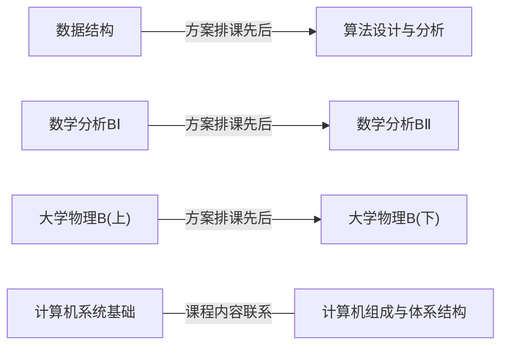

# 2023 信息安全专业“2+X”教学培养方案

计算与智能创新学院 · 信息安全 · 方案 67455 · 51 个不同课程或科研条目。

[官方 Word](../originals/plan-67455.docx) · [教务详情](https://fdjwgl.fudan.edu.cn/manager/bizType/2/major-program-search/info/67455?skipAuth=1) · [方案快照](../raw/plan-67455.json.gz) · [年级目录](../README.md)

## 课程关系图

图中展示部分关系。下表保留全部已建立的课程对，来源位置使用本方案 JSON Pointer。

## 先修与内容联系

| 类型 | 起点 | 终点 | 依据 | 原表定位 |
| --- | --- | --- | --- | --- |
| 建议学习顺序 | 数据结构 (CS20009) | 算法设计与分析 (CS30016) | 数据组织与基本操作为算法设计提供基础。  | `/courseModules/6/planCourses/1`、`/courseModules/8/planCourses/0` |
| 建议学习顺序 | 数学分析BⅠ (MATH10012) | 数学分析BⅡ (MATH10013) | 同方案的课程题名具有连续分册或序号。  | `/courseModules/5/planCourses/3`、`/courseModules/5/planCourses/4` |
| 建议学习顺序 | 大学物理B(上) (PHYS10003) | 大学物理B(下) (PHYS10004) | 同方案的课程题名具有连续分册或序号。  | `/courseModules/5/planCourses/5`、`/courseModules/5/planCourses/6` |
| 方案排课先后 | 数据结构 (CS20009) | 算法设计与分析 (CS30016) | 同方案该课程全部明确数字学期均早于后者。  | `/courseModules/6/planCourses/1`、`/courseModules/8/planCourses/0` |
| 方案排课先后 | 数学分析BⅠ (MATH10012) | 数学分析BⅡ (MATH10013) | 同方案该课程全部明确数字学期均早于后者。  | `/courseModules/5/planCourses/3`、`/courseModules/5/planCourses/4` |
| 方案排课先后 | 大学物理B(上) (PHYS10003) | 大学物理B(下) (PHYS10004) | 同方案该课程全部明确数字学期均早于后者。  | `/courseModules/5/planCourses/5`、`/courseModules/5/planCourses/6` |
| 课程内容联系 | 计算机系统基础 (CS10005) | 计算机组成与体系结构 (CS30052) | 处理器、存储与系统执行模型具有共同内容。  | `/courseModules/6/planCourses/13`、`/courseModules/6/planCourses/12` |

本次未从可定位的明确表述中确认课程对课程预修。学期安排、系列分册与编辑建议均保留各自的依据。

## 课程表

同一课程在不同模块分别出现时，按原表逐行列出。季节字段保留原值。

| 课程 | 代码 | 学分 | 学期 | 模块 |
| --- | --- | ---: | --- | --- |
| 线性代数 | CS10003 | 3.0 | 第1学期 | 培养方案 / 专业培养课程 / 大类基础课程 |
| 程序设计 | CS10004 | 4.0 | 第1学期 | 培养方案 / 专业培养课程 / 大类基础课程 |
| 电子系统导论 | EST10003 | 3.0 | 第2学期 | 培养方案 / 专业培养课程 / 大类基础课程 |
| 数学分析BⅠ | MATH10012 | 5.0 | 第1学期 | 培养方案 / 专业培养课程 / 大类基础课程 |
| 数学分析BⅡ | MATH10013 | 5.0 | 第2学期 | 培养方案 / 专业培养课程 / 大类基础课程 |
| 大学物理B(上) | PHYS10003 | 4.0 | 第1学期 | 培养方案 / 专业培养课程 / 大类基础课程 |
| 大学物理B(下) | PHYS10004 | 4.0 | 第2学期 | 培养方案 / 专业培养课程 / 大类基础课程 |
| 基础物理实验 | PHYS10005 | 2.0 | 第2学期 | 培养方案 / 专业培养课程 / 大类基础课程 |
| 数字逻辑与部件设计 | CS20008 | 3.0 | 第3学期 | 培养方案 / 专业培养课程 / 专业核心教育课程 |
| 数据结构 | CS20009 | 4.0 | 第3学期 | 培养方案 / 专业培养课程 / 专业核心教育课程 |
| 代数结构与数理逻辑 | CS30015 | 3.0 | 第4学期 | 培养方案 / 专业培养课程 / 专业核心教育课程 |
| 概率论与数理统计 | STAT30014 | 4.0 | 第5学期 | 培养方案 / 专业培养课程 / 专业核心教育课程 |
| 毕业论文 | CS40009 | 6.0 | 第8学期 | 培养方案 / 专业培养课程 / 专业核心教育课程 |
| 密码学基础 | CSEC30007 | 3.0 | 第6学期 | 培养方案 / 专业培养课程 / 专业核心教育课程 |
| 操作系统 | CS30031 | 3.0 | 第5学期 | 培养方案 / 专业培养课程 / 专业核心教育课程 |
| 面向对象程序设计 | CS20012 | 2.0 | 第2学期 | 培养方案 / 专业培养课程 / 专业核心教育课程 |
| 集合与图论 | CS30043 | 3.0 | 第3学期 | 培养方案 / 专业培养课程 / 专业核心教育课程 |
| 逆向工程原理 | CSEC20004 | 3.0 | 第4学期 | 培养方案 / 专业培养课程 / 专业核心教育课程 |
| 信息安全导论 | CSEC20005 | 3.0 | 第3学期 | 培养方案 / 专业培养课程 / 专业核心教育课程 |
| 计算机网络及安全 | COMP130190 | 4.0 | 第4学期 | 培养方案 / 专业培养课程 / 专业核心教育课程 |
| 计算机组成与体系结构 | CS30052 | 4.0 | 第4学期 | 培养方案 / 专业培养课程 / 专业核心教育课程 |
| 计算机系统基础 | CS10005 | 3.0 | 第3学期 | 培养方案 / 专业培养课程 / 专业核心教育课程 |
| 专业实践与生产实习 | CS40024 | 2.0 | 第7学期 | 培养方案 / 专业培养课程 / 专业核心教育课程 |
| 算法设计与分析 | CS30016 | 3.0 | 第5学期 | 培养方案 / 专业进阶模块I |
| 编译 | CS30017 | 3.0 | 第6学期 | 培养方案 / 专业进阶模块I |
| 安全攻防综合实验 | CSEC40004 | 3.0 | 第7学期 | 培养方案 / 专业进阶模块I |
| 软件安全 | CSEC30013 | 3.0 | 第6学期 | 培养方案 / 专业进阶模块I |
| 信息系统安全 | CSEC30015 | 3.0 | 第5学期 | 培养方案 / 专业进阶模块I |
| 数据库引论 | CS20010 | 3.0 | 第4学期 | 培养方案 / 专业进阶II |
| 计算理论基础 | CS30021 | 3.0 | 第5学期 | 培养方案 / 专业进阶II |
| 嵌入式系统 | CS30027 | 2.0 | 第6学期 | 培养方案 / 专业进阶II |
| 信息论与编码 | CSEC30006 | 3.0 | 第6学期 | 培养方案 / 专业进阶II |
| 数学建模 | CS30028 | 2.0 | 第6学期 | 培养方案 / 专业进阶II |
| 多媒体信息技术 | CS30029 | 2.0 | 第6学期 | 培养方案 / 专业进阶II |
| 数字水印技术 | CS30030 | 2.0 | 第6学期 | 培养方案 / 专业进阶II |
| 电子商务结构和安全 | CS40012 | 2.0 | 第7学期 | 培养方案 / 专业进阶II |
| 计算机病毒及其防治 | CS40013 | 2.0 | 第7学期 | 培养方案 / 专业进阶II |
| 防火墙技术 | CSEC50003 | 2.0 | 第5学期 | 培养方案 / 专业进阶II |
| 信息内容安全 | CSEC30009 | 2.0 | 第5学期 | 培养方案 / 专业进阶II |
| 大数据分析技术 | CS40014 | 2.0 | 第7学期 | 培养方案 / 专业进阶II |
| 无线网络及安全 | CSEC50005 | 3.0 | 第5学期 | 培养方案 / 专业进阶II |
| 信息系统分析与设计 | CSEC30012 | 3.0 | 第6学期 | 培养方案 / 专业进阶II |
| 数据安全和隐私保护 | CSEC40005 | 2.0 | 第7学期 | 培养方案 / 专业进阶II |
| 泄密取证技术 | CSEC30014 | 2.0 | 第6学期 | 培养方案 / 专业进阶II |
| 并行分布式计算 | CS40021 | 3.0 | 第7学期 | 培养方案 / 专业进阶II |
| 信息隐藏与多媒体安全 | CSEC40009 | 2.0 | 第7学期 | 培养方案 / 专业进阶II |
| 区块链技术 | CSEC30016 | 3.0 | 第7学期 | 培养方案 / 专业进阶II |
| 智能系统安全实践 | CSEC30017 | 2.0 | 第6学期 | 培养方案 / 专业进阶II |
| 人工智能 | CS30057 | 3.0 | 第6学期 | 培养方案 / 专业进阶II |
| 卫星互联网 | ICE50001 | 3.0 | 第6学期 | 培养方案 / 专业进阶II |
| 代码安全审计和分析 | CSEC50006 | 3.0 | 第5学期 | 培养方案 / 专业进阶II |
