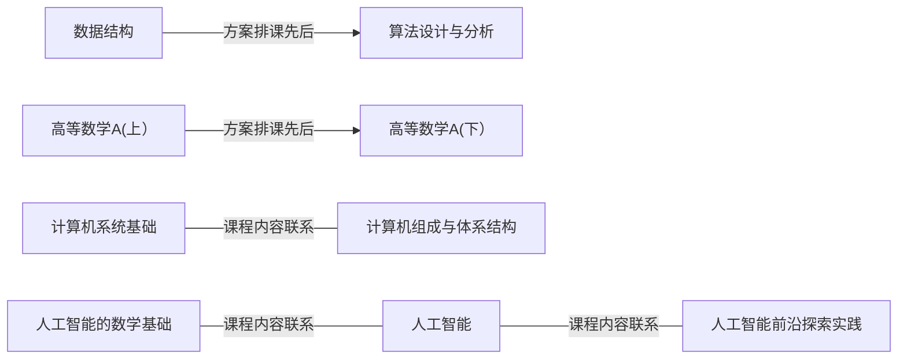

# 2024 软件工程专业“2+X”教学培养方案@普通本科生

计算与智能创新学院 · 软件工程 · 方案 72517 · 49 个不同课程或科研条目。

[官方 Word](../originals/plan-72517.docx) · [教务详情](https://fdjwgl.fudan.edu.cn/manager/bizType/2/major-program-search/info/72517?skipAuth=1) · [方案快照](../raw/plan-72517.json.gz) · [年级目录](../README.md)

## 课程关系图

图中展示部分关系。下表保留全部已建立的课程对，来源位置使用本方案 JSON Pointer。

## 先修与内容联系

| 类型 | 起点 | 终点 | 依据 | 原表定位 |
| --- | --- | --- | --- | --- |
| 建议学习顺序 | 数据结构 (CS20009) | 算法设计与分析 (CS30016) | 数据组织与基本操作为算法设计提供基础。  | `/courseModules/6/planCourses/3`、`/courseModules/6/planCourses/10` |
| 建议学习顺序 | 高等数学A(上） (MATH10015) | 高等数学A(下） (MATH10016) | 同方案的课程题名具有连续分册或序号。  | `/courseModules/5/planCourses/2`、`/courseModules/5/planCourses/3` |
| 方案排课先后 | 数据结构 (CS20009) | 算法设计与分析 (CS30016) | 同方案该课程全部明确数字学期均早于后者。  | `/courseModules/6/planCourses/3`、`/courseModules/6/planCourses/10` |
| 方案排课先后 | 高等数学A(上） (MATH10015) | 高等数学A(下） (MATH10016) | 同方案该课程全部明确数字学期均早于后者。  | `/courseModules/5/planCourses/2`、`/courseModules/5/planCourses/3` |
| 课程内容联系 | 计算机系统基础 (CS10005) | 计算机组成与体系结构 (CS30052) | 处理器、存储与系统执行模型具有共同内容。  | `/courseModules/6/planCourses/0`、`/courseModules/6/planCourses/6` |
| 课程内容联系 | 人工智能的数学基础 (CS20014) | 人工智能 (CS30057) | 本方案两门课程的题名均含“人工智能”，可据此对照这一主题。  | `/courseModules/6/planCourses/5`、`/courseModules/6/planCourses/9` |
| 课程内容联系 | 人工智能 (CS30057) | 人工智能前沿探索实践 (CS40025) | 本方案两门课程的题名均含“人工智能”，可据此对照这一主题。  | `/courseModules/6/planCourses/9`、`/courseModules/10/planCourses/19` |

本次未从可定位的明确表述中确认课程对课程预修。学期安排、系列分册与编辑建议均保留各自的依据。

## 课程表

同一课程在不同模块分别出现时，按原表逐行列出。季节字段保留原值。

| 课程 | 代码 | 学分 | 学期 | 模块 |
| --- | --- | ---: | --- | --- |
| 程序设计 | CS10004 | 4.0 | 第1学期 | 培养方案 / 专业培养课程 / 大类基础课程 |
| 线性代数 | CS10003 | 3.0 | 第1学期 | 培养方案 / 专业培养课程 / 大类基础课程 |
| 高等数学A(上） | MATH10015 | 5.0 | 第1学期 | 培养方案 / 专业培养课程 / 大类基础课程 |
| 高等数学A(下） | MATH10016 | 5.0 | 第2学期 | 培养方案 / 专业培养课程 / 大类基础课程 |
| 普通物理B | PHYS10002 | 3.0 | 第2学期 | 培养方案 / 专业培养课程 / 大类基础课程 |
| 计算机系统基础 | CS10005 | 3.0 | 第2学期 | 培养方案 / 专业培养课程 / 专业核心教育课程 |
| 面向对象程序设计 | SOFT130059 | 2.0 | 第2学期 | 培养方案 / 专业培养课程 / 专业核心教育课程 |
| 数字逻辑与部件设计 | CS20008 | 3.0 | 第3学期 | 培养方案 / 专业培养课程 / 专业核心教育课程 |
| 数据结构 | CS20009 | 4.0 | 第3学期 | 培养方案 / 专业培养课程 / 专业核心教育课程 |
| 集合与图论 | CS30043 | 3.0 | 第3学期 | 培养方案 / 专业培养课程 / 专业核心教育课程 |
| 人工智能的数学基础 | CS20014 | 3.0 | 第3学期 | 培养方案 / 专业培养课程 / 专业核心教育课程 |
| 计算机组成与体系结构 | CS30052 | 4.0 | 第4学期 | 培养方案 / 专业培养课程 / 专业核心教育课程 |
| 软件工程 | CS20020 | 4.0 | 第4学期 | 培养方案 / 专业培养课程 / 专业核心教育课程 |
| 数据库设计 | CS20021 | 3.0 | 第4学期 | 培养方案 / 专业培养课程 / 专业核心教育课程 |
| 人工智能 | CS30057 | 3.0 | 第4学期 | 培养方案 / 专业培养课程 / 专业核心教育课程 |
| 算法设计与分析 | CS30016 | 3.0 | 第5学期 | 培养方案 / 专业培养课程 / 专业核心教育课程 |
| 编译 | CS30017 | 3.0 | 第6学期 | 培养方案 / 专业培养课程 / 专业核心教育课程 |
| 操作系统 | CS30031 | 3.0 | 第5学期 | 培养方案 / 专业培养课程 / 专业核心教育课程 |
| 计算机网络 | CS30066 | 3.0 | 第5学期 | 培养方案 / 专业培养课程 / 专业核心教育课程 |
| 软件质量保障与测试 | CS30070 | 3.0 | 第6学期 | 培养方案 / 专业培养课程 / 专业核心教育课程 |
| 专业实践与生产实习 | CS40035 | 2.0 | 第7学期 | 培养方案 / 专业培养课程 / 专业核心教育课程 |
| 毕业论文 | CS40031 | 6.0 | 第8学期 | 培养方案 / 专业培养课程 / 专业核心教育课程 |
| 软件设计 | CS30075 | 3.0 | 第5学期 | 培养方案 / 专业进阶课程I |
| 云计算与虚拟化技术 | CS30055 | 3.0 | 第5学期 | 培养方案 / 专业进阶课程I |
| 大数据平台技术 | CS30056 | 3.0 | 第6学期 | 培养方案 / 专业进阶课程I |
| 机器学习系统 | CS30058 | 3.0 | 第6学期 | 培养方案 / 专业进阶课程I |
| 信息物理融合系统 | CS40026 | 3.0 | 第7学期 | 培养方案 / 专业进阶课程I |
| 计算机视觉 | CS30034 | 3.0 | 第5学期 | 培养方案 / 专业进阶模块II |
| 自然语言处理和知识表示 | CS30054 | 3.0 | 第5学期 | 培养方案 / 专业进阶模块II |
| 工业互联网软件技术 | CS30072 | 3.0 | 第5学期 | 培养方案 / 专业进阶模块II |
| 机器人编程导论 | CS30073 | 3.0 | 第5学期 | 培养方案 / 专业进阶模块II |
| 程序设计语言原理 | CS30020 | 2.0 | 第6学期 | 培养方案 / 专业进阶模块II |
| 数据挖掘技术 | CS30042 | 3.0 | 第6学期 | 培养方案 / 专业进阶模块II |
| 信息安全 | CSEC30018 | 3.0 | 第6学期 | 培养方案 / 专业进阶模块II |
| 计算机系统工程 | CS30068 | 4.0 | 第6学期 | 培养方案 / 专业进阶模块II |
| 计算机图形学 | CS30069 | 3.0 | 第6学期 | 培养方案 / 专业进阶模块II |
| 云原生软件技术 | CS30074 | 3.0 | 第5学期 | 培养方案 / 专业进阶模块II |
| 数据与智能安全 | CSEC30020 | 3.0 | 第6学期 | 培养方案 / 专业进阶模块II |
| 大数据分析技术 | CS40014 | 2.0 | 第6学期 | 培养方案 / 专业进阶模块II |
| 虚拟现实技术导引 | CS30059 | 3.0 | 第6学期 | 培养方案 / 专业进阶模块II |
| 系统程序设计 | CS30071 | 3.0 | 第6学期 | 培养方案 / 专业进阶模块II |
| 分布式系统 | CS30033 | 3.0 | 第6学期、第7学期 | 培养方案 / 专业进阶模块II |
| 并行计算与性能优化 | CS40033 | 2.0 | 第6学期、第7学期 | 培养方案 / 专业进阶模块II |
| 系统安全攻防技术 | CSEC30019 | 2.0 | 第6学期、第7学期 | 培养方案 / 专业进阶模块II |
| 人机交互 | CS40032 | 2.0 | 第7学期 | 培养方案 / 专业进阶模块II |
| 深度学习及其应用 | CS40034 | 2.0 | 第7学期 | 培养方案 / 专业进阶模块II |
| 人工智能前沿探索实践 | CS40025 | 3.0 | 第7学期 | 培养方案 / 专业进阶模块II |
| 并发理论 | CS40017 | 2.0 | 第7学期 | 培养方案 / 专业进阶模块II |
| 信息内容安全 | CSEC30009 | 2.0 | SPRING、AUTUMN | 培养方案 / 专业进阶模块II / 限定专业选修课程 |
