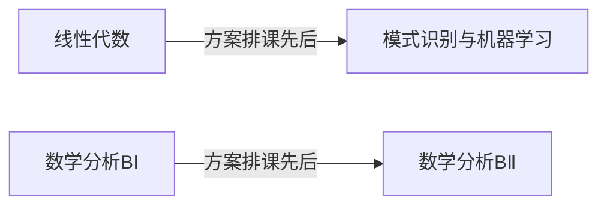

# 2024 计算机科学拔尖人才试验班专业培养方案@普通本科生

计算与智能创新学院 · 计算机科学与技术(拔尖人才试验班) · 方案 72665 · 47 个不同课程或科研条目。

[官方 Word](../originals/plan-72665.docx) · [教务详情](https://fdjwgl.fudan.edu.cn/manager/bizType/2/major-program-search/info/72665?skipAuth=1) · [方案快照](../raw/plan-72665.json.gz) · [年级目录](../README.md)

## 修读导读

- **建议先学**　《线性代数》（`CS10003`） → 《模式识别与机器学习》（`CS30037`）。向量表示和矩阵运算支持理解分类、回归等模型。方案分别列在第1、5学期。

- **查模块选课**　《计算机系统基础》（`CS10005`）、《数字逻辑与部件设计》（`CS20008`）列在“专业核心教育课程”中。模块说明写明“要求修读71学分，其中相关荣誉课程（H）需要修满24学分”。原表见 `/courseModules/6`。

## 课程关系图

图中展示部分关系。下表保留全部已建立的课程对，来源位置使用本方案 JSON Pointer。

## 先修与内容联系

| 类型 | 起点 | 终点 | 依据 | 原表定位 |
| --- | --- | --- | --- | --- |
| 建议学习顺序 | 线性代数 (CS10003) | 模式识别与机器学习 (CS30037) | 向量表示和矩阵运算支持理解分类、回归等模型。  | `/courseModules/5/planCourses/3`、`/courseModules/7/planCourses/3` |
| 建议学习顺序 | 数学分析BⅠ (MATH10012) | 数学分析BⅡ (MATH10013) | 同方案的课程题名具有连续分册或序号。  | `/courseModules/5/planCourses/0`、`/courseModules/5/planCourses/1` |
| 方案排课先后 | 线性代数 (CS10003) | 模式识别与机器学习 (CS30037) | 同方案该课程全部明确数字学期均早于后者。  | `/courseModules/5/planCourses/3`、`/courseModules/7/planCourses/3` |
| 方案排课先后 | 数学分析BⅠ (MATH10012) | 数学分析BⅡ (MATH10013) | 同方案该课程全部明确数字学期均早于后者。  | `/courseModules/5/planCourses/0`、`/courseModules/5/planCourses/1` |

本次未从可定位的明确表述中确认课程对课程预修。学期安排、系列分册与编辑建议均保留各自的依据。

## 课程表

同一课程在不同模块分别出现时，按原表逐行列出。季节字段保留原值。

| 课程 | 代码 | 学分 | 学期 | 模块 |
| --- | --- | ---: | --- | --- |
| 数学分析BⅠ | MATH10012 | 5.0 | 第1学期 | 培养方案 / 专业培养课程 / 大类基础课程 |
| 数学分析BⅡ | MATH10013 | 5.0 | 第2学期 | 培养方案 / 专业培养课程 / 大类基础课程 |
| 程序设计 | CS10004 | 4.0 | 第1学期 | 培养方案 / 专业培养课程 / 大类基础课程 |
| 线性代数 | CS10003 | 3.0 | 第1学期 | 培养方案 / 专业培养课程 / 大类基础课程 |
| 普通物理B | PHYS10002 | 3.0 | 第2学期 | 培养方案 / 专业培养课程 / 大类基础课程 |
| 数据结构（H） | CS20009h | 5.0 | 第3学期 | 培养方案 / 专业培养课程 / 专业核心教育课程 |
| 集合与图论（H） | CS30043h | 4.0 | 第3学期 | 培养方案 / 专业培养课程 / 专业核心教育课程 |
| 计算机系统基础 | CS10005 | 3.0 | 第3学期 | 培养方案 / 专业培养课程 / 专业核心教育课程 |
| 数字逻辑与部件设计 | CS20008 | 3.0 | 第3学期 | 培养方案 / 专业培养课程 / 专业核心教育课程 |
| 信息安全导论 | CSEC20005 | 3.0 | 第3学期 | 培养方案 / 专业培养课程 / 专业核心教育课程 |
| 代数结构与数理逻辑 | CS30015 | 3.0 | 第4学期 | 培养方案 / 专业培养课程 / 专业核心教育课程 |
| 计算机组成与体系结构（H） | CS30052h | 5.0 | 第4学期 | 培养方案 / 专业培养课程 / 专业核心教育课程 |
| 数据库引论（H） | CS20010h | 4.0 | 第4学期 | 培养方案 / 专业培养课程 / 专业核心教育课程 |
| 计算理论基础 | CS30021 | 3.0 | 第5学期 | 培养方案 / 专业培养课程 / 专业核心教育课程 |
| 概率论与数理统计 | STAT30014 | 4.0 | 第5学期 | 培养方案 / 专业培养课程 / 专业核心教育课程 |
| 计算机网络(H) | CS30036h | 4.0 | 第5学期 | 培养方案 / 专业培养课程 / 专业核心教育课程 |
| 操作系统（H） | CS30031h | 4.0 | 第5学期 | 培养方案 / 专业培养课程 / 专业核心教育课程 |
| 算法设计与分析(H) | CS30016h | 4.0 | 第4学期 | 培养方案 / 专业培养课程 / 专业核心教育课程 |
| 软件工程（H） | CS30018h | 4.0 | 第6学期 | 培养方案 / 专业培养课程 / 专业核心教育课程 |
| 编译(H) | CS30017h | 4.0 | 第6学期 | 培养方案 / 专业培养课程 / 专业核心教育课程 |
| 计算机图形学A | CS30019 | 3.0 | 第6学期 | 培养方案 / 专业培养课程 / 专业核心教育课程 |
| 人工智能（H） | CS30057h | 4.0 | 第6学期 | 培养方案 / 专业培养课程 / 专业核心教育课程 |
| 并行分布式计算 | CS40021 | 3.0 | 第7学期 | 培养方案 / 专业培养课程 / 专业核心教育课程 |
| 专业实践与生产实习 | CS40024 | 2.0 | 第7学期 | 培养方案 / 专业培养课程 / 专业核心教育课程 |
| 毕业论文 | CS40009 | 6.0 | 第8学期 | 培养方案 / 专业培养课程 / 专业核心教育课程 |
| 面向对象程序设计 | CS20012 | 2.0 | 第2学期 | 培养方案 / 专业培养课程 / 专业选修课程 |
| 类脑智能与人工通用智能 | CS30060 | 2.0 | 第5学期 | 培养方案 / 专业培养课程 / 专业选修课程 |
| 计算机视觉 | CS30034 | 3.0 | 第5学期 | 培养方案 / 专业培养课程 / 专业选修课程 |
| 模式识别与机器学习 | CS30037 | 3.0 | 第5学期 | 培养方案 / 专业培养课程 / 专业选修课程 |
| 自然语言处理和知识表示 | CS30054 | 3.0 | 第5学期 | 培养方案 / 专业培养课程 / 专业选修课程 |
| 计算复杂性与密码学 | CS30041 | 3.0 | 第5学期 | 培养方案 / 专业培养课程 / 专业选修课程 |
| 编程方法与技术 | CS30048 | 3.0 | 第5学期 | 培养方案 / 专业培养课程 / 专业选修课程 |
| 数字图象处理 | CS30026 | 3.0 | 第6学期 | 培养方案 / 专业培养课程 / 专业选修课程 |
| 人机交互 | CS30038 | 2.0 | 第6学期 | 培养方案 / 专业培养课程 / 专业选修课程 |
| 数字信号处理 | CS30039 | 3.0 | 第6学期 | 培养方案 / 专业培养课程 / 专业选修课程 |
| 移动互联网 | CS40016 | 3.0 | 第6学期 | 培养方案 / 专业培养课程 / 专业选修课程 |
| 数据挖掘技术 | CS30042 | 3.0 | 第6学期 | 培养方案 / 专业培养课程 / 专业选修课程 |
| 互联网体系结构 | CS30049 | 3.0 | 第6学期 | 培养方案 / 专业培养课程 / 专业选修课程 |
| 软件质量保障与测试 | CS30070 | 3.0 | 第6学期 | 培养方案 / 专业培养课程 / 专业选修课程 |
| 虚拟现实技术导引 | CS30059 | 3.0 | 第6学期 | 培养方案 / 专业培养课程 / 专业选修课程 |
| 卫星互联网 | ICE50001 | 3.0 | 第6学期 | 培养方案 / 专业培养课程 / 专业选修课程 |
| 大数据分析技术 | CS40014 | 2.0 | 第7学期 | 培养方案 / 专业培养课程 / 专业选修课程 |
| 并发理论 | CS40017 | 2.0 | 第7学期 | 培养方案 / 专业培养课程 / 专业选修课程 |
| 算法竞赛导论 | CS30044 | 3.0 | 第7学期 | 培养方案 / 专业培养课程 / 专业选修课程 |
| 信息物理融合系统 | CS40026 | 3.0 | 第7学期 | 培养方案 / 专业培养课程 / 专业选修课程 |
| 算法竞赛进阶 | CS40018 | 4.0 | 第8学期 | 培养方案 / 专业培养课程 / 专业选修课程 |
| 并行计算与性能优化 | CS40033 | 2.0 | 第6学期、第7学期 | 培养方案 / 专业培养课程 / 专业选修课程 |
