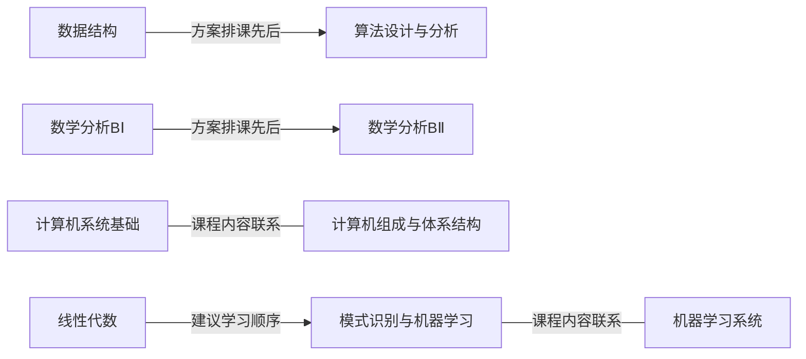

# 2024 信息与计算科学专业教学培养方案（强基班适用）

计算与智能创新学院 · 信息与计算科学(计算机科学方向)(强基计划) · 方案 72695 · 42 个不同课程或科研条目。

[官方 Word](../originals/plan-72695.docx) · [教务详情](https://fdjwgl.fudan.edu.cn/manager/bizType/2/major-program-search/info/72695?skipAuth=1) · [方案快照](../raw/plan-72695.json.gz) · [年级目录](../README.md)

## 修读导读

- **建议先学**　《数据结构》（`CS20009`） → 《算法设计与分析》（`CS30016`）。数据组织与基本操作为算法设计提供基础。方案分别列在第2、4学期。

- **可以对照着读**　《计算机系统基础》（`CS10005`）与《计算机组成与体系结构》（`CS30052`）。处理器、存储与系统执行模型具有共同内容。

- **查模块选课**　《数字逻辑与部件设计》（`CS20008`）、《集合与图论》（`CS30043`）列在“专业核心教育课程”中。模块说明写明“要求修读46学分（部分课程学分可用荣誉课程学分替代）”。原表见 `/courseModules/6`。

## 课程关系图

图中展示部分关系。下表保留全部已建立的课程对，来源位置使用本方案 JSON Pointer。

## 先修与内容联系

| 类型 | 起点 | 终点 | 依据 | 原表定位 |
| --- | --- | --- | --- | --- |
| 建议学习顺序 | 线性代数 (CS10003) | 模式识别与机器学习 (CS30037) | 向量表示和矩阵运算支持理解分类、回归等模型。  | `/courseModules/5/planCourses/2`、`/courseModules/7/planCourses/2` |
| 建议学习顺序 | 数据结构 (CS20009) | 算法设计与分析 (CS30016) | 数据组织与基本操作为算法设计提供基础。  | `/courseModules/6/planCourses/0`、`/courseModules/6/planCourses/5` |
| 建议学习顺序 | 数学分析BⅠ (MATH10012) | 数学分析BⅡ (MATH10013) | 同方案的课程题名具有连续分册或序号。  | `/courseModules/5/planCourses/0`、`/courseModules/5/planCourses/1` |
| 方案排课先后 | 数据结构 (CS20009) | 算法设计与分析 (CS30016) | 同方案该课程全部明确数字学期均早于后者。  | `/courseModules/6/planCourses/0`、`/courseModules/6/planCourses/5` |
| 方案排课先后 | 数学分析BⅠ (MATH10012) | 数学分析BⅡ (MATH10013) | 同方案该课程全部明确数字学期均早于后者。  | `/courseModules/5/planCourses/0`、`/courseModules/5/planCourses/1` |
| 课程内容联系 | 计算机系统基础 (CS10005) | 计算机组成与体系结构 (CS30052) | 处理器、存储与系统执行模型具有共同内容。  | `/courseModules/6/planCourses/3`、`/courseModules/6/planCourses/7` |
| 课程内容联系 | 模式识别与机器学习 (CS30037) | 机器学习系统 (CS30058) | 本方案两门课程的题名均含“机器学习”，可据此对照这一主题。  | `/courseModules/7/planCourses/2`、`/courseModules/7/planCourses/9` |

本次未从可定位的明确表述中确认课程对课程预修。学期安排、系列分册与编辑建议均保留各自的依据。

## 按原方案模块阅读

同一模块展示原表中的课程归属。模块内课程之间的先后仍须逐项查阅。

- **专业选修**　程序设计语言原理、信息论基础、分布式系统、计算机视觉、模式识别与机器学习、人机交互、数据挖掘技术、算法竞赛导论、自然语言处理和知识表示、云计算与虚拟化技术、机器学习系统、云原生软件技术、大数据分析技术、算法竞赛进阶、大学生创新实践B、卫星互联网、最优化方法（原表模块 7）

## 课程表

同一课程在不同模块分别出现时，按原表逐行列出。季节字段保留原值。

| 课程 | 代码 | 学分 | 学期 | 模块 |
| --- | --- | ---: | --- | --- |
| 数学分析BⅠ | MATH10012 | 5.0 | 第1学期 | 培养方案 / 专业培养课程 / 大类基础课程 |
| 数学分析BⅡ | MATH10013 | 5.0 | 第2学期 | 培养方案 / 专业培养课程 / 大类基础课程 |
| 线性代数 | CS10003 | 3.0 | 第1学期 | 培养方案 / 专业培养课程 / 大类基础课程 |
| 程序设计（A） | CS10006 | 4.0 | 第1学期 | 培养方案 / 专业培养课程 / 大类基础课程 |
| 普通物理B | PHYS10002 | 3.0 | 第2学期 | 培养方案 / 专业培养课程 / 大类基础课程 |
| 数据结构 | CS20009 | 4.0 | 第2学期 | 培养方案 / 专业培养课程 / 专业核心教育课程 |
| 数字逻辑与部件设计 | CS20008 | 3.0 | 第3学期 | 培养方案 / 专业培养课程 / 专业核心教育课程 |
| 集合与图论 | CS30043 | 3.0 | 第3学期 | 培养方案 / 专业培养课程 / 专业核心教育课程 |
| 计算机系统基础 | CS10005 | 3.0 | 第3学期 | 培养方案 / 专业培养课程 / 专业核心教育课程 |
| 数据库引论 | CS20010 | 3.0 | 第4学期 | 培养方案 / 专业培养课程 / 专业核心教育课程 |
| 算法设计与分析 | CS30016 | 3.0 | 第4学期 | 培养方案 / 专业培养课程 / 专业核心教育课程 |
| 计算机网络 | CS30036 | 3.0 | 第4学期 | 培养方案 / 专业培养课程 / 专业核心教育课程 |
| 计算机组成与体系结构 | CS30052 | 4.0 | 第4学期 | 培养方案 / 专业培养课程 / 专业核心教育课程 |
| 操作系统 | CS30031 | 3.0 | 第5学期 | 培养方案 / 专业培养课程 / 专业核心教育课程 |
| 编译 | CS30017 | 3.0 | 第6学期 | 培养方案 / 专业培养课程 / 专业核心教育课程 |
| 软件工程 | CS30018 | 3.0 | 第6学期 | 培养方案 / 专业培养课程 / 专业核心教育课程 |
| 人工智能 | CS30057 | 3.0 | 第6学期 | 培养方案 / 专业培养课程 / 专业核心教育课程 |
| 专业实践与生产实习 | CS40024 | 2.0 | 第7学期 | 培养方案 / 专业培养课程 / 专业核心教育课程 |
| 毕业论文 | CS40009 | 6.0 | 第8学期 | 培养方案 / 专业培养课程 / 专业核心教育课程 |
| 信息安全导论 | CSEC20005 | 3.0 | 第3学期 | 培养方案 / 专业培养课程 / 专业核心教育课程 |
| 代数结构与数理逻辑 | CS30015 | 3.0 | 第4学期 | 培养方案 / 专业培养课程 / 专业核心教育课程 |
| 计算理论基础 | CS30021 | 3.0 | 第5学期 | 培养方案 / 专业培养课程 / 专业核心教育课程 |
| 概率论与数理统计 | STAT30014 | 4.0 | 第5学期 | 培养方案 / 专业培养课程 / 专业核心教育课程 |
| 计算机图形学A | CS30019 | 3.0 | 第6学期 | 培养方案 / 专业培养课程 / 专业核心教育课程 |
| 并行分布式计算 | CS40021 | 3.0 | 第7学期 | 培养方案 / 专业培养课程 / 专业核心教育课程 |
| 计算机视觉 | CS30034 | 3.0 | SPRING、AUTUMN | 培养方案 / 专业培养课程 / 专业选修 |
| 自然语言处理和知识表示 | CS30054 | 3.0 | SPRING、AUTUMN | 培养方案 / 专业培养课程 / 专业选修 |
| 模式识别与机器学习 | CS30037 | 3.0 | SPRING、AUTUMN | 培养方案 / 专业培养课程 / 专业选修 |
| 最优化方法 | MATH30020 | 3.0 | SPRING、AUTUMN | 培养方案 / 专业培养课程 / 专业选修 |
| 程序设计语言原理 | CS30020 | 2.0 | SPRING、AUTUMN | 培养方案 / 专业培养课程 / 专业选修 |
| 信息论基础 | CS30024 | 2.0 | SPRING、AUTUMN | 培养方案 / 专业培养课程 / 专业选修 |
| 人机交互 | CS30038 | 2.0 | SPRING、AUTUMN | 培养方案 / 专业培养课程 / 专业选修 |
| 云计算与虚拟化技术 | CS30055 | 3.0 | SPRING、AUTUMN | 培养方案 / 专业培养课程 / 专业选修 |
| 卫星互联网 | ICE50001 | 3.0 | SPRING、AUTUMN | 培养方案 / 专业培养课程 / 专业选修 |
| 机器学习系统 | CS30058 | 3.0 | SPRING、AUTUMN | 培养方案 / 专业培养课程 / 专业选修 |
| 云原生软件技术 | CS30074 | 3.0 | SPRING、AUTUMN | 培养方案 / 专业培养课程 / 专业选修 |
| 大数据分析技术 | CS40014 | 2.0 | SPRING、AUTUMN | 培养方案 / 专业培养课程 / 专业选修 |
| 算法竞赛导论 | CS30044 | 3.0 | SPRING、AUTUMN | 培养方案 / 专业培养课程 / 专业选修 |
| 算法竞赛进阶 | CS40018 | 4.0 | SPRING、AUTUMN | 培养方案 / 专业培养课程 / 专业选修 |
| 分布式系统 | CS30033 | 3.0 | SPRING、AUTUMN | 培养方案 / 专业培养课程 / 专业选修 |
| 数据挖掘技术 | CS30042 | 3.0 | SPRING、AUTUMN | 培养方案 / 专业培养课程 / 专业选修 |
| 大学生创新实践B | GEIN40003 | 6.0 | SPRING、AUTUMN | 培养方案 / 专业培养课程 / 专业选修 |
