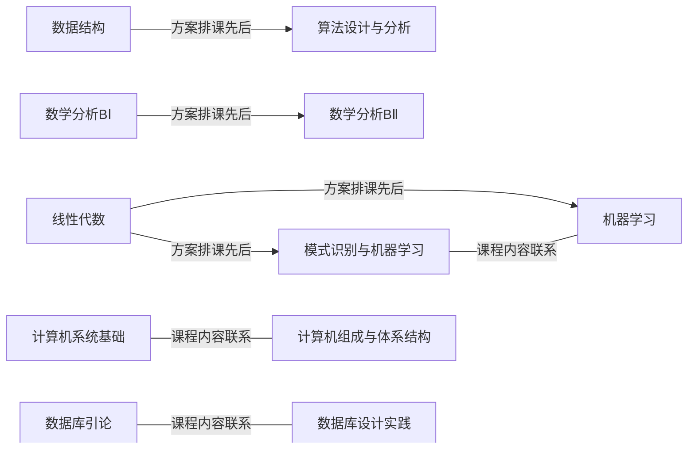

# 2024 计算机科学与技术专业“2+X”教学培养方案@留学生

计算与智能创新学院 · 计算机科学与技术 · 方案 73052 · 66 个不同课程或科研条目。

[官方 Word](../originals/plan-73052.docx) · [教务详情](https://fdjwgl.fudan.edu.cn/manager/bizType/2/major-program-search/info/73052?skipAuth=1) · [方案快照](../raw/plan-73052.json.gz) · [年级目录](../README.md)

## 修读导读

- **建议先学**　《数据结构》（`CS20009`） → 《算法设计与分析》（`CS30016`）。数据组织与基本操作为算法设计提供基础。方案分别列在第3、4学期。

- **可以对照着读**　《计算机系统基础》（`CS10005`）与《计算机组成与体系结构》（`CS30052`）。处理器、存储与系统执行模型具有共同内容。

- **查模块选课**　《数字逻辑与部件设计》（`CS20008`）、《软件工程》（`CS30018`）列在“专业核心教育课程”中。原表见 `/courseModules/3`。

## 课程关系图

图中展示部分关系。下表保留全部已建立的课程对，来源位置使用本方案 JSON Pointer。

## 先修与内容联系

| 类型 | 起点 | 终点 | 依据 | 原表定位 |
| --- | --- | --- | --- | --- |
| 建议学习顺序 | 线性代数 (CS10003) | 模式识别与机器学习 (CS30037) | 向量表示和矩阵运算支持理解分类、回归等模型。  | `/courseModules/2/planCourses/0`、`/courseModules/10/planCourses/17` |
| 建议学习顺序 | 线性代数 (CS10003) | 机器学习 (CS30045) | 向量、矩阵及线性映射为理解学习模型提供数学准备。  | `/courseModules/2/planCourses/0`、`/courseModules/10/planCourses/8` |
| 建议学习顺序 | 数据结构 (CS20009) | 算法设计与分析 (CS30016) | 数据组织与基本操作为算法设计提供基础。  | `/courseModules/3/planCourses/1`、`/courseModules/3/planCourses/2` |
| 建议学习顺序 | 数学分析BⅠ (MATH10012) | 数学分析BⅡ (MATH10013) | 同方案的课程题名具有连续分册或序号。  | `/courseModules/2/planCourses/2`、`/courseModules/2/planCourses/3` |
| 方案排课先后 | 线性代数 (CS10003) | 模式识别与机器学习 (CS30037) | 同方案该课程全部明确数字学期均早于后者。  | `/courseModules/2/planCourses/0`、`/courseModules/10/planCourses/17` |
| 方案排课先后 | 线性代数 (CS10003) | 机器学习 (CS30045) | 同方案该课程全部明确数字学期均早于后者。  | `/courseModules/2/planCourses/0`、`/courseModules/10/planCourses/8` |
| 方案排课先后 | 数据结构 (CS20009) | 算法设计与分析 (CS30016) | 同方案该课程全部明确数字学期均早于后者。  | `/courseModules/3/planCourses/1`、`/courseModules/3/planCourses/2` |
| 方案排课先后 | 数学分析BⅠ (MATH10012) | 数学分析BⅡ (MATH10013) | 同方案该课程全部明确数字学期均早于后者。  | `/courseModules/2/planCourses/2`、`/courseModules/2/planCourses/3` |
| 课程内容联系 | 计算机系统基础 (CS10005) | 计算机组成与体系结构 (CS30052) | 处理器、存储与系统执行模型具有共同内容。  | `/courseModules/3/planCourses/12`、`/courseModules/3/planCourses/9` |
| 课程内容联系 | 数据库引论 (CS20010) | 数据库设计实践 (CS40010) | 本方案两门课程的题名均含“数据库”，可据此对照这一主题。  | `/courseModules/3/planCourses/8`、`/courseModules/10/planCourses/26` |
| 课程内容联系 | 模式识别与机器学习 (CS30037) | 机器学习 (CS30045) | 本方案两门课程的题名均含“机器学习”，可据此对照这一主题。  | `/courseModules/10/planCourses/17`、`/courseModules/10/planCourses/8` |

本次未从可定位的明确表述中确认课程对课程预修。学期安排、系列分册与编辑建议均保留各自的依据。

## 课程表

同一课程在不同模块分别出现时，按原表逐行列出。季节字段保留原值。

| 课程 | 代码 | 学分 | 学期 | 模块 |
| --- | --- | ---: | --- | --- |
| 线性代数 | CS10003 | 3.0 | 第1学期 | 培养方案 / 专业培养课程 / 大类基础课程 |
| 程序设计 | CS10004 | 4.0 | 第1学期 | 培养方案 / 专业培养课程 / 大类基础课程 |
| 数学分析BⅠ | MATH10012 | 5.0 | 第1学期 | 培养方案 / 专业培养课程 / 大类基础课程 |
| 数学分析BⅡ | MATH10013 | 5.0 | 第2学期 | 培养方案 / 专业培养课程 / 大类基础课程 |
| 普通物理B | PHYS10002 | 3.0 | 第2学期 | 培养方案 / 专业培养课程 / 大类基础课程 |
| 数字逻辑与部件设计 | CS20008 | 3.0 | 第3学期 | 培养方案 / 专业培养课程 / 专业核心教育课程 |
| 数据结构 | CS20009 | 4.0 | 第3学期 | 培养方案 / 专业培养课程 / 专业核心教育课程 |
| 算法设计与分析 | CS30016 | 3.0 | 第4学期 | 培养方案 / 专业培养课程 / 专业核心教育课程 |
| 软件工程 | CS30018 | 3.0 | 第6学期 | 培养方案 / 专业培养课程 / 专业核心教育课程 |
| 毕业论文 | CS40009 | 6.0 | 第8学期 | 培养方案 / 专业培养课程 / 专业核心教育课程 |
| 面向对象程序设计 | CS20012 | 2.0 | 第2学期 | 培养方案 / 专业培养课程 / 专业核心教育课程 |
| 计算机网络 | CS30036 | 3.0 | 第5学期 | 培养方案 / 专业培养课程 / 专业核心教育课程 |
| 集合与图论 | CS30043 | 3.0 | 第3学期 | 培养方案 / 专业培养课程 / 专业核心教育课程 |
| 数据库引论 | CS20010 | 3.0 | 第4学期 | 培养方案 / 专业培养课程 / 专业核心教育课程 |
| 计算机组成与体系结构 | CS30052 | 4.0 | 第4学期 | 培养方案 / 专业培养课程 / 专业核心教育课程 |
| 操作系统 | CS30031 | 3.0 | 第5学期 | 培养方案 / 专业培养课程 / 专业核心教育课程 |
| 专业实践与生产实习 | CS40024 | 2.0 | 第7学期 | 培养方案 / 专业培养课程 / 专业核心教育课程 |
| 计算机系统基础 | CS10005 | 3.0 | 第3学期 | 培养方案 / 专业培养课程 / 专业核心教育课程 |
| 人工智能 | CS30057 | 3.0 | 第6学期 | 培养方案 / 专业培养课程 / 专业核心教育课程 |
| 编译 | CS30017 | 3.0 | 第6学期 | 培养方案 / 专业培养课程 / 专业核心教育课程 |
| 计算理论基础 | CS30021 | 3.0 | 第5学期 | 培养方案 / 专业进阶模块I |
| 并行分布式计算 | CS40021 | 3.0 | 第7学期 | 培养方案 / 专业进阶模块I |
| 计算机图形学A | CS30019 | 3.0 | 第6学期 | 培养方案 / 专业进阶模块I |
| 代数结构与数理逻辑 | CS30015 | 3.0 | 第4学期 | 培养方案 / 专业进阶模块I |
| 概率论与数理统计 | STAT30014 | 4.0 | 第5学期 | 培养方案 / 专业进阶模块I |
| 信息安全导论 | CSEC20005 | 3.0 | 第3学期 | 培养方案 / 专业进阶模块I |
| 虚拟现实技术导引 | CS30059 | 3.0 | 第6学期 | 培养方案 / 专业进阶模块II |
| 卫星互联网 | ICE50001 | 3.0 | 第6学期 | 培养方案 / 专业进阶模块II |
| 网络存储导论 | CS20011 | 2.0 | 第4学期 | 培养方案 / 专业进阶模块II |
| 软件体系结构 | CS30023 | 2.0 | 第5学期 | 培养方案 / 专业进阶模块II |
| 模式识别 | CS30025 | 3.0 | 第5学期 | 培养方案 / 专业进阶模块II |
| 计算机视觉 | CS30034 | 3.0 | 第5学期 | 培养方案 / 专业进阶模块II |
| 计算复杂性与密码学 | CS30041 | 3.0 | 第5学期 | 培养方案 / 专业进阶模块II |
| 信息系统安全 | CSEC30015 | 3.0 | 第5学期 | 培养方案 / 专业进阶模块II |
| 机器学习 | CS30045 | 3.0 | 第5学期 | 培养方案 / 专业进阶模块II |
| 编程方法与技术 | CS30048 | 3.0 | 第5学期 | 培养方案 / 专业进阶模块II |
| 互联网：协议与应用 | CS30050 | 3.0 | 第5学期 | 培养方案 / 专业进阶模块II |
| 物联网与边缘计算 | CS40020 | 3.0 | 第5学期 | 培养方案 / 专业进阶模块II |
| 信息安全原理 | CSEC30005 | 3.0 | 第6学期 | 培养方案 / 专业进阶模块II |
| 程序设计语言原理 | CS30020 | 2.0 | 第6学期 | 培养方案 / 专业进阶模块II |
| 面向对象技术 | CS30022 | 2.0 | 第6学期 | 培养方案 / 专业进阶模块II |
| 信息论基础 | CS30024 | 2.0 | 第6学期 | 培养方案 / 专业进阶模块II |
| 数学建模 | CS30028 | 2.0 | 第6学期 | 培养方案 / 专业进阶模块II |
| 模式识别与机器学习 | CS30037 | 3.0 | 第5学期 | 培养方案 / 专业进阶模块II |
| 人机交互 | CS30038 | 2.0 | 第6学期 | 培养方案 / 专业进阶模块II |
| 数字信号处理 | CS30039 | 3.0 | 第6学期 | 培养方案 / 专业进阶模块II |
| 移动互联网 | CS40016 | 3.0 | 第6学期 | 培养方案 / 专业进阶模块II |
| 数据挖掘技术 | CS30042 | 3.0 | 第6学期 | 培养方案 / 专业进阶模块II |
| 计算机可视化 | CS30047 | 2.0 | 第6学期 | 培养方案 / 专业进阶模块II |
| 互联网体系结构 | CS30049 | 3.0 | 第6学期 | 培养方案 / 专业进阶模块II |
| 领域数据学 | CS30051 | 3.0 | 第6学期 | 培养方案 / 专业进阶模块II |
| 云计算与虚拟化技术 | CS30055 | 3.0 | 第6学期 | 培养方案 / 专业进阶模块II |
| 数据库设计实践 | CS40010 | 2.0 | 第7学期 | 培养方案 / 专业进阶模块II |
| 机器人学导论 | CS40011 | 3.0 | 第7学期 | 培养方案 / 专业进阶模块II |
| 大数据分析技术 | CS40014 | 2.0 | 第7学期 | 培养方案 / 专业进阶模块II |
| 并发理论 | CS40017 | 2.0 | 第7学期 | 培养方案 / 专业进阶模块II |
| 算法竞赛导论 | CS30044 | 3.0 | 第7学期 | 培养方案 / 专业进阶模块II |
| 计算机可视化-进阶实践 | CS40019 | 1.0 | 第7学期 | 培养方案 / 专业进阶模块II |
| 信息物理融合系统 | CS40026 | 3.0 | 第7学期 | 培养方案 / 专业进阶模块II |
| 算法竞赛进阶 | CS40018 | 4.0 | 第8学期 | 培养方案 / 专业进阶模块II |
| 软件工程化开发 | CS30032 | 2.0 | 第5学期 | 培养方案 / 专业进阶模块II |
| 数字图象处理 | CS30026 | 3.0 | 第6学期 | 培养方案 / 专业进阶模块II |
| 类脑智能与人工通用智能 | CS30060 | 2.0 | 第5学期 | 培养方案 / 专业进阶模块II |
| 电子系统导论 | EST10003 | 3.0 | 第2学期 | 培养方案 / 专业进阶模块II |
| 自然语言处理和知识表示 | CS30054 | 3.0 | 第5学期 | 培养方案 / 专业进阶模块II |
| 并行计算与性能优化 | CS40033 | 2.0 | 第6学期、第7学期 | 培养方案 / 专业进阶模块II |
