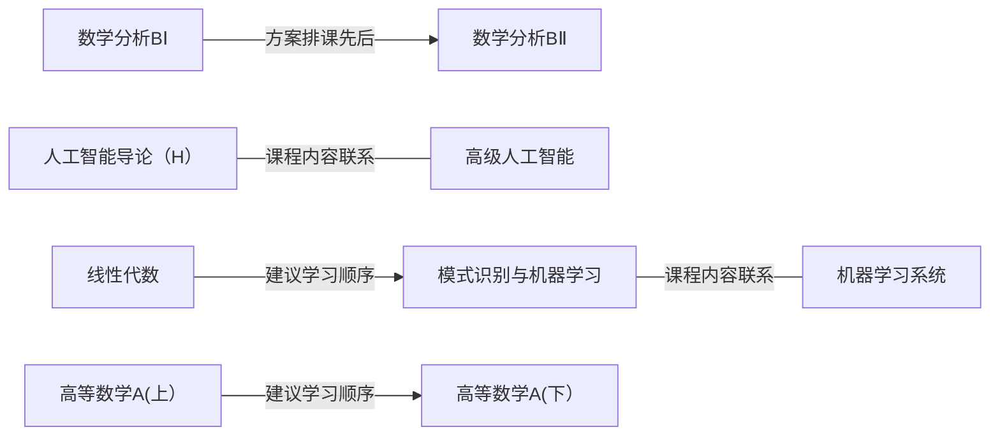

# 2025 计算机科学与技术-计算机科学与技术-网络空间安全本博融通培养方案 （拔尖人才试验班适用）

计算与智能创新学院 · 计算机科学与技术(拔尖人才试验班) · 方案 96930 · 69 个不同课程或科研条目。

[官方 Word](../originals/plan-96930.docx) · [教务详情](https://fdjwgl.fudan.edu.cn/manager/bizType/2/major-program-search/info/96930?skipAuth=1) · [方案快照](../raw/plan-96930.json.gz) · [年级目录](../README.md)

## 课程关系图

图中展示部分关系。下表保留全部已建立的课程对，来源位置使用本方案 JSON Pointer。

## 先修与内容联系

| 类型 | 起点 | 终点 | 依据 | 原表定位 |
| --- | --- | --- | --- | --- |
| 建议学习顺序 | 线性代数 (CS10003) | 模式识别与机器学习 (CS30037) | 向量表示和矩阵运算支持理解分类、回归等模型。  | `/courseModules/6/planCourses/2`、`/courseModules/9/planCourses/6` |
| 建议学习顺序 | 数学分析BⅠ (MATH10012) | 数学分析BⅡ (MATH10013) | 同方案的课程题名具有连续分册或序号。  | `/courseModules/9/planCourses/0`、`/courseModules/9/planCourses/1` |
| 建议学习顺序 | 高等数学A(上） (MATH10015) | 高等数学A(下） (MATH10016) | 同方案的课程题名具有连续分册或序号。  | `/courseModules/6/planCourses/0`、`/courseModules/6/planCourses/1` |
| 方案排课先后 | 数学分析BⅠ (MATH10012) | 数学分析BⅡ (MATH10013) | 同方案该课程全部明确数字学期均早于后者。  | `/courseModules/9/planCourses/0`、`/courseModules/9/planCourses/1` |
| 课程内容联系 | 人工智能导论（H） (AIE310005h) | 高级人工智能 (CS40002) | 本方案两门课程的题名均含“人工智能”，可据此对照这一主题。  | `/courseModules/7/planCourses/9`、`/courseModules/7/planCourses/15` |
| 课程内容联系 | 模式识别与机器学习 (CS30037) | 机器学习系统 (CS30058) | 本方案两门课程的题名均含“机器学习”，可据此对照这一主题。  | `/courseModules/9/planCourses/6`、`/courseModules/9/planCourses/28` |

本次未从可定位的明确表述中确认课程对课程预修。学期安排、系列分册与编辑建议均保留各自的依据。

## 按原方案模块阅读

同一模块展示原表中的课程归属。模块内课程之间的先后仍须逐项查阅。

- **工学基础课程**　线性代数、程序设计、高等数学A(上）、高等数学A(下）、普通物理B（原表模块 6）

## 课程表

同一课程在不同模块分别出现时，按原表逐行列出。季节字段保留原值。

| 课程 | 代码 | 学分 | 学期 | 模块 |
| --- | --- | ---: | --- | --- |
| 高等数学A(上） | MATH10015 | 5.0 | AUTUMN | 培养方案 / 专业培养课程 / 学科基础课程 / 工学基础课程 |
| 高等数学A(下） | MATH10016 | 5.0 | SPRING | 培养方案 / 专业培养课程 / 学科基础课程 / 工学基础课程 |
| 线性代数 | CS10003 | 3.0 | AUTUMN | 培养方案 / 专业培养课程 / 学科基础课程 / 工学基础课程 |
| 程序设计 | CS10004 | 4.0 | 第1学期 | 培养方案 / 专业培养课程 / 学科基础课程 / 工学基础课程 |
| 普通物理B | PHYS10002 | 3.0 | 第2学期 | 培养方案 / 专业培养课程 / 学科基础课程 / 工学基础课程 |
| 数字逻辑与部件设计 | CS20008 | 3.0 | 第3学期 | 培养方案 / 专业培养课程 / 专业核心教育课程 |
| 数据结构（H） | CS20009h | 5.0 | 第3学期 | 培养方案 / 专业培养课程 / 专业核心教育课程 |
| 概率论与数理统计 | STAT30001 | 3.0 | 第3学期 | 培养方案 / 专业培养课程 / 专业核心教育课程 |
| 集合与图论（H） | CS30043h | 4.0 | 第3学期 | 培养方案 / 专业培养课程 / 专业核心教育课程 |
| 计算机系统基础 | CS10005 | 3.0 | 第3学期 | 培养方案 / 专业培养课程 / 专业核心教育课程 |
| 代数结构与数理逻辑 | CS30015 | 3.0 | 第4学期 | 培养方案 / 专业培养课程 / 专业核心教育课程 |
| 算法设计与分析(H) | CS30016h | 4.0 | 第4学期 | 培养方案 / 专业培养课程 / 专业核心教育课程 |
| 计算机组成与体系结构（H） | CS30052h | 5.0 | 第4学期 | 培养方案 / 专业培养课程 / 专业核心教育课程 |
| 数据库系统（H） | CS20001h | 4.0 | 第4学期 | 培养方案 / 专业培养课程 / 专业核心教育课程 |
| 人工智能导论（H） | AIE310005h | 4.0 | 第4学期 | 培养方案 / 专业培养课程 / 专业核心教育课程 |
| 计算理论基础 | CS30021 | 3.0 | 第5学期 | 培养方案 / 专业培养课程 / 专业核心教育课程 |
| 操作系统（H） | CS30031h | 4.0 | 第5学期 | 培养方案 / 专业培养课程 / 专业核心教育课程 |
| 计算机网络(H) | CS30036h | 4.0 | 第5学期 | 培养方案 / 专业培养课程 / 专业核心教育课程 |
| 编译(H) | CS30017h | 4.0 | 第6学期 | 培养方案 / 专业培养课程 / 专业核心教育课程 |
| 软件工程（H） | CS20020h | 5.0 | 第6学期 | 培养方案 / 专业培养课程 / 专业核心教育课程 |
| 高级人工智能 | CS40002 | 3.0 | 第6学期 | 培养方案 / 专业培养课程 / 专业核心教育课程 |
| 分布式系统 | CS30033 | 3.0 | 第7学期 | 培养方案 / 专业培养课程 / 专业核心教育课程 |
| 计算机安全原理与实践 | CSEC50002 | 4.0 | 第7学期 | 培养方案 / 专业培养课程 / 专业核心教育课程 |
| 科学研究概述与思维方法 | CS50015 | 2.0 | 第8学期 | 培养方案 / 专业培养课程 / 专业核心教育课程 |
| 数学分析BⅠ | MATH10012 | 5.0 | 第1学期 | 培养方案 / 专业选修课 |
| 数学分析BⅡ | MATH10013 | 5.0 | 第2学期 | 培养方案 / 专业选修课 |
| 面向对象程序设计 | CS20012 | 2.0 | 第2学期 | 培养方案 / 专业选修课 |
| 网络存储导论 | CS20011 | 2.0 | 第4学期 | 培养方案 / 专业选修课 |
| 自然语言处理与大语言模型 | AIE410002 | 3.0 | 第5学期 | 培养方案 / 专业选修课 |
| 计算机视觉 | CS30034 | 3.0 | 第5学期 | 培养方案 / 专业选修课 |
| 模式识别与机器学习 | CS30037 | 3.0 | 第5学期 | 培养方案 / 专业选修课 |
| 编程方法与技术 | CS30048 | 3.0 | 第5学期 | 培养方案 / 专业选修课 |
| 类脑智能与人工通用智能 | CS30060 | 2.0 | 第5学期 | 培养方案 / 专业选修课 |
| 信息论基础 | CS30024 | 2.0 | 第6学期 | 培养方案 / 专业选修课 |
| 数字信号处理 | CS30039 | 3.0 | 第6学期 | 培养方案 / 专业选修课 |
| 移动互联网 | CS40016 | 3.0 | 第6学期 | 培养方案 / 专业选修课 |
| 数据挖掘 | CS30005 | 3.0 | 第6学期 | 培养方案 / 专业选修课 |
| 新型网络体系结构 | CS40003 | 3.0 | 第6学期 | 培养方案 / 专业选修课 |
| 大数据技术 | CS30002 | 3.0 | 第6学期 | 培养方案 / 专业选修课 |
| 卫星互联网 | ICE50001 | 3.0 | 第6学期 | 培养方案 / 专业选修课 |
| 数字图像处理 | CS30004 | 3.0 | 第6学期 | 培养方案 / 专业选修课 |
| 软件测试 | CS30008 | 3.0 | 第6学期 | 培养方案 / 专业选修课 |
| 程序设计语言原理 | CS40006 | 3.0 | 第6学期 | 培养方案 / 专业选修课 |
| 高性能编程 | CS30001 | 3.0 | 第6学期 | 培养方案 / 专业选修课 |
| 数据科学基础 | CS10001 | 3.0 | 第6学期 | 培养方案 / 专业选修课 |
| 并发理论 | CS40017 | 2.0 | 第7学期 | 培养方案 / 专业选修课 |
| 信息物理融合系统 | CS40026 | 3.0 | 第7学期 | 培养方案 / 专业选修课 |
| 算法竞赛导论 | CS30044 | 3.0 | 第7学期 | 培养方案 / 专业选修课 |
| 算法竞赛进阶 | CS40018 | 4.0 | 第7学期 | 培养方案 / 专业选修课 |
| 机器人学导论 | CS70012 | 3.0 | 第8学期 | 培养方案 / 专业选修课 |
| 并行计算与性能优化 | CS40033 | 2.0 | 第6学期、第7学期 | 培养方案 / 专业选修课 |
| 人机交互 | CS30053 | 3.0 | SPRING、AUTUMN | 培养方案 / 专业选修课 |
| 机器学习系统 | CS30058 | 3.0 | 第7学期、第8学期、第9学期、第10学期、第11学期、第12学期 | 培养方案 / 专业选修课 |
| 神经网络与深度学习 | CS60010 | 3.0 | 第7学期、第8学期、第9学期、第10学期、第11学期、第12学期 | 培养方案 / 专业选修课 |
| 量子通信与计算 | CS50003 | 3.0 | 第7学期、第8学期、第9学期、第10学期、第11学期、第12学期 | 培养方案 / 专业选修课 |
| 计算思维与算法实践 | CS50002 | 3.0 | 第7学期、第8学期、第9学期、第10学期、第11学期、第12学期 | 培养方案 / 专业选修课 |
| 复芏计划(FDUROP) | 102 | 0.0 |  | 融合创新能力 |
| 研究生学术活动 | 4 | 2.0 |  | 融合创新能力 |
| 研究生实践活动 | 5 | 1.0 |  | 融合创新能力 |
| 专业外语 | 8 | 0.0 |  | 融合创新能力 |
| 国际交流 | 7 | 0.0 |  | 融合创新能力 |
| 博士学位论文开题 | 1 | 0.0 |  | 融合创新能力 |
| 博士生资格考核 | 2 | 0.0 |  | 融合创新能力 |
| 博士论文中期考核 | 3 | 0.0 |  | 融合创新能力 |
| 博士学位论文预审 | 6 | 0.0 |  | 融合创新能力 |
| 课题组轮转 | CS20006 | 1.0 | 第4学期 | 融合创新能力 |
| 综合实践 | CS30010 | 3.0 | 第5学期 | 融合创新能力 |
| 前沿探索 | CS30011 | 3.0 | 第6学期 | 融合创新能力 |
| 毕业论文 | CS40009 | 6.0 | 第8学期 | 融合创新能力 |
