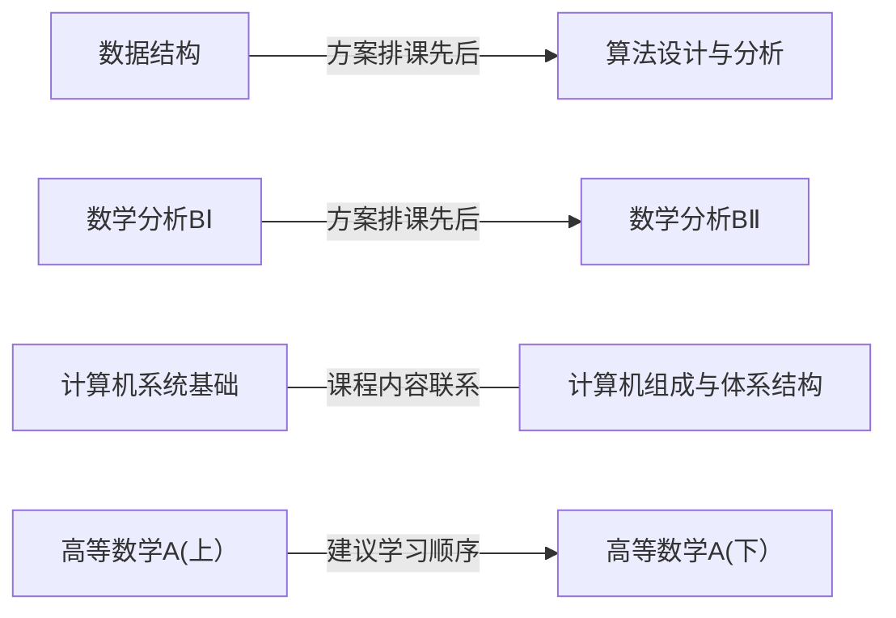

# 2025 保密技术-电子信息本硕融通培养方案

计算与智能创新学院 · 保密技术 · 方案 96942 · 58 个不同课程或科研条目。

[官方 Word](../originals/plan-96942.docx) · [教务详情](https://fdjwgl.fudan.edu.cn/manager/bizType/2/major-program-search/info/96942?skipAuth=1) · [方案快照](../raw/plan-96942.json.gz) · [年级目录](../README.md)

## 修读导读

- **建议先学**　《数据结构》（`CS20009`） → 《算法设计与分析》（`CS30016`）。数据组织与基本操作为算法设计提供基础。方案分别列在第3、4学期。

- **可以对照着读**　《计算机系统基础》（`CS10005`）与《计算机组成与体系结构》（`CS30052`）。处理器、存储与系统执行模型具有共同内容。

- **查模块选课**　《保密技术概论》（`CSEC30010`）、《面向对象程序设计》（`CS20012`）列在“专业核心教育课程”中。原表见 `/courseModules/7`。

## 课程关系图

图中展示部分关系。下表保留全部已建立的课程对，来源位置使用本方案 JSON Pointer。

## 先修与内容联系

| 类型 | 起点 | 终点 | 依据 | 原表定位 |
| --- | --- | --- | --- | --- |
| 建议学习顺序 | 数据结构 (CS20009) | 算法设计与分析 (CS30016) | 数据组织与基本操作为算法设计提供基础。  | `/courseModules/7/planCourses/2`、`/courseModules/7/planCourses/8` |
| 建议学习顺序 | 数学分析BⅠ (MATH10012) | 数学分析BⅡ (MATH10013) | 同方案的课程题名具有连续分册或序号。  | `/courseModules/11/planCourses/5`、`/courseModules/11/planCourses/6` |
| 建议学习顺序 | 高等数学A(上） (MATH10015) | 高等数学A(下） (MATH10016) | 同方案的课程题名具有连续分册或序号。  | `/courseModules/6/planCourses/0`、`/courseModules/6/planCourses/1` |
| 方案排课先后 | 数据结构 (CS20009) | 算法设计与分析 (CS30016) | 同方案该课程全部明确数字学期均早于后者。  | `/courseModules/7/planCourses/2`、`/courseModules/7/planCourses/8` |
| 方案排课先后 | 数学分析BⅠ (MATH10012) | 数学分析BⅡ (MATH10013) | 同方案该课程全部明确数字学期均早于后者。  | `/courseModules/11/planCourses/5`、`/courseModules/11/planCourses/6` |
| 课程内容联系 | 计算机系统基础 (CS10005) | 计算机组成与体系结构 (CS30052) | 处理器、存储与系统执行模型具有共同内容。  | `/courseModules/7/planCourses/4`、`/courseModules/7/planCourses/10` |

本次未从可定位的明确表述中确认课程对课程预修。学期安排、系列分册与编辑建议均保留各自的依据。

## 按原方案模块阅读

同一模块展示原表中的课程归属。模块内课程之间的先后仍须逐项查阅。

- **工学基础课程**　线性代数、程序设计、高等数学A(上）、高等数学A(下）、普通物理B（原表模块 6）

## 课程表

同一课程在不同模块分别出现时，按原表逐行列出。季节字段保留原值。

| 课程 | 代码 | 学分 | 学期 | 模块 |
| --- | --- | ---: | --- | --- |
| 高等数学A(上） | MATH10015 | 5.0 | AUTUMN | 培养方案 / 专业培养课程 / 学科基础课程 / 工学基础课程 |
| 高等数学A(下） | MATH10016 | 5.0 | SPRING | 培养方案 / 专业培养课程 / 学科基础课程 / 工学基础课程 |
| 线性代数 | CS10003 | 3.0 | AUTUMN | 培养方案 / 专业培养课程 / 学科基础课程 / 工学基础课程 |
| 程序设计 | CS10004 | 4.0 | 第1学期 | 培养方案 / 专业培养课程 / 学科基础课程 / 工学基础课程 |
| 普通物理B | PHYS10002 | 3.0 | 第2学期 | 培养方案 / 专业培养课程 / 学科基础课程 / 工学基础课程 |
| 面向对象程序设计 | CS20012 | 2.0 | 第2学期 | 培养方案 / 专业培养课程 / 专业核心教育课程 |
| 数字逻辑与部件设计 | CS20008 | 3.0 | 第3学期 | 培养方案 / 专业培养课程 / 专业核心教育课程 |
| 数据结构 | CS20009 | 4.0 | 第3学期 | 培养方案 / 专业培养课程 / 专业核心教育课程 |
| 集合与图论 | CS30043 | 3.0 | 第3学期 | 培养方案 / 专业培养课程 / 专业核心教育课程 |
| 计算机系统基础 | CS10005 | 3.0 | 第3学期 | 培养方案 / 专业培养课程 / 专业核心教育课程 |
| 概率论与数理统计 | STAT30001 | 3.0 | 第3学期 | 培养方案 / 专业培养课程 / 专业核心教育课程 |
| 保密法与保密管理 | CSEC20001 | 3.0 | 第4学期 | 培养方案 / 专业培养课程 / 专业核心教育课程 |
| 代数结构与数理逻辑 | CS30015 | 3.0 | 第4学期 | 培养方案 / 专业培养课程 / 专业核心教育课程 |
| 算法设计与分析 | CS30016 | 3.0 | 第4学期 | 培养方案 / 专业培养课程 / 专业核心教育课程 |
| 保密技术概论 | CSEC30010 | 3.0 | 第4学期 | 培养方案 / 专业培养课程 / 专业核心教育课程 |
| 计算机组成与体系结构 | CS30052 | 4.0 | 第4学期 | 培养方案 / 专业培养课程 / 专业核心教育课程 |
| 计算机网络 | CS30036 | 3.0 | 第5学期 | 培养方案 / 专业培养课程 / 专业核心教育课程 |
| 人工智能导论 | AIE310005 | 3.0 | 第6学期 | 培养方案 / 专业培养课程 / 专业核心教育课程 |
| 密码学基础 | CSEC30007 | 3.0 | 第6学期 | 培养方案 / 专业培养课程 / 专业核心教育课程 |
| 操作系统 | CS30031 | 3.0 | 第5学期 | 培养方案 / 专业进阶模块I |
| 定密理论与保密督查 | CSEC30011 | 3.0 | 第5学期 | 培养方案 / 专业进阶模块I |
| 电磁泄露与物理安全 | CSEC40006 | 3.0 | 第5学期 | 培养方案 / 专业进阶模块I |
| 通信安全保密技术 | CSEC40003 | 2.0 | 第7学期 | 培养方案 / 专业进阶模块I |
| 窃密与反窃密综合实验 | CSEC40007 | 3.0 | 第7学期 | 培养方案 / 专业进阶模块I |
| 信息论与编码 | CSEC30006 | 3.0 | 第5学期 | 培养方案 / 专业进阶模块II |
| 保密检查与保密监管技术 | CSEC40008 | 2.0 | 第6学期 | 培养方案 / 专业进阶模块II |
| 保密违法行为核查技术 | CSEC40001 | 2.0 | 第6学期 | 培养方案 / 专业进阶模块II |
| 计算机网络安全与保密技术 | CSEC60001 | 3.0 | 第9学期 | 培养方案 / 专业进阶模块II |
| AI支撑的泄密风险识别技术 | CSEC70001 | 3.0 | 第10学期 | 培养方案 / 专业进阶模块II |
| 数学分析BⅠ | MATH10012 | 5.0 | 第1学期 | 培养方案 / 专业进阶模块II |
| 数学分析BⅡ | MATH10013 | 5.0 | 第2学期 | 培养方案 / 专业进阶模块II |
| 逆向工程原理 | CSEC20004 | 3.0 | 第4学期 | 培养方案 / 专业进阶模块II |
| 信息内容安全 | CSEC30003 | 3.0 | 第5学期 | 培养方案 / 专业进阶模块II |
| 无线网络及安全 | CSEC50005 | 3.0 | 第5学期 | 培养方案 / 专业进阶模块II |
| 软件安全 | CSEC30013 | 3.0 | 第5学期 | 培养方案 / 专业进阶模块II |
| 云计算与虚拟化技术 | CS30055 | 3.0 | 第6学期 | 培养方案 / 专业进阶模块II |
| 多媒体信息安全 | CSEC30001 | 3.0 | 第6学期 | 培养方案 / 专业进阶模块II |
| 计算机取证 | CSEC50004 | 2.0 | 第6学期 | 培养方案 / 专业进阶模块II |
| 信息系统安全 | CSEC30015 | 3.0 | 第6学期 | 培养方案 / 专业进阶模块II |
| 智能系统安全实践 | CSEC30004 | 3.0 | 第6学期 | 培养方案 / 专业进阶模块II |
| 卫星互联网 | ICE50001 | 3.0 | 第6学期 | 培养方案 / 专业进阶模块II |
| 区块链技术 | CSEC30016 | 3.0 | 第7学期 | 培养方案 / 专业进阶模块II |
| 代码安全审计和分析 | CSEC50006 | 3.0 | 第7学期 | 培养方案 / 专业进阶模块II |
| 数据安全和隐私保护 | CSEC40002 | 3.0 | 第7学期 | 培养方案 / 专业进阶模块II |
| 安全编程语言设计 | CS60016 | 3.0 | 第7学期 | 培养方案 / 专业进阶模块II |
| 生物特征识别与安全 | CSEC60006 | 3.0 | 第8学期 | 培养方案 / 专业进阶模块II |
| 信息系统分析与设计 | CSEC30012 | 3.0 | SPRING、AUTUMN | 培养方案 / 专业进阶模块II |
| 量子通信与计算 | CS50003 | 3.0 | SPRING、AUTUMN | 培养方案 / 专业进阶模块II |
| 大模型理论与方法 | AIS531006 | 3.0 | SPRING、AUTUMN | 培养方案 / 专业进阶模块II |
| 可证明安全理论与应用 | CSEC60002 | 3.0 | SPRING、AUTUMN | 培养方案 / 专业进阶模块II |
| 复芏计划(FDUROP) | 102 | 0.0 |  | 融合创新能力 |
| 研究生学术活动 | 4 | 2.0 |  | 融合创新能力 |
| 研究生实践活动 | 5 | 3.0 |  | 融合创新能力 |
| 专业外语 | 8 | 0.0 |  | 融合创新能力 |
| 课题组轮转 | CS20006 | 1.0 | 第4学期 | 融合创新能力 |
| 综合实践 | CS30010 | 3.0 | 第5学期 | 融合创新能力 |
| 前沿探索 | CS30011 | 3.0 | 第6学期 | 融合创新能力 |
| 毕业论文 | CS40009 | 6.0 | 第8学期 | 融合创新能力 |
