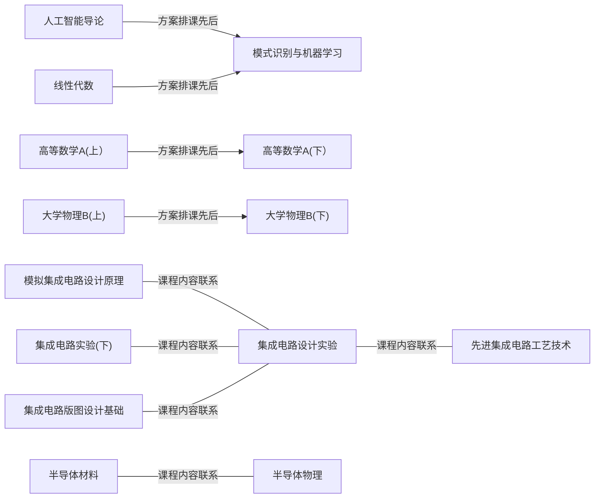

# 2025 微电子科学与工程（集成电路方向）-信息与计算科学专业双学士学位项目培养方案

集成电路与微纳电子创新学院 · 微电子科学与工程(集成电路方向)-信息与计算科学(人工智能方向)(双学士学位项目) · 方案 97007 · 103 个不同课程或科研条目。

[官方 Word](../originals/plan-97007.docx) · [教务详情](https://fdjwgl.fudan.edu.cn/manager/bizType/2/major-program-search/info/97007?skipAuth=1) · [方案快照](../raw/plan-97007.json.gz) · [年级目录](../README.md)

## 课程关系图

图中展示部分关系。下表保留全部已建立的课程对，来源位置使用本方案 JSON Pointer。

## 先修与内容联系

| 类型 | 起点 | 终点 | 依据 | 原表定位 |
| --- | --- | --- | --- | --- |
| 建议学习顺序 | 线性代数 (CS10003) | 模式识别与机器学习 (AIE410001) | 向量表示和矩阵运算支持理解分类、回归等模型。  | `/courseModules/5/planCourses/2`、`/courseModules/6/planCourses/7` |
| 建议学习顺序 | 人工智能导论 (EST10001) | 模式识别与机器学习 (AIE410001) | 人工智能问题与模型类别可为学习模式识别作准备。  | `/courseModules/6/planCourses/18`、`/courseModules/6/planCourses/7` |
| 建议学习顺序 | 高等数学A(上） (MATH10015) | 高等数学A(下） (MATH10016) | 同方案的课程题名具有连续分册或序号。  | `/courseModules/5/planCourses/0`、`/courseModules/5/planCourses/1` |
| 建议学习顺序 | 大学物理B(上) (PHYS10003) | 大学物理B(下) (PHYS10004) | 同方案的课程题名具有连续分册或序号。  | `/courseModules/5/planCourses/3`、`/courseModules/5/planCourses/4` |
| 方案排课先后 | 线性代数 (CS10003) | 模式识别与机器学习 (AIE410001) | 同方案该课程全部明确数字学期均早于后者。  | `/courseModules/5/planCourses/2`、`/courseModules/6/planCourses/7` |
| 方案排课先后 | 人工智能导论 (EST10001) | 模式识别与机器学习 (AIE410001) | 同方案该课程全部明确数字学期均早于后者。  | `/courseModules/6/planCourses/18`、`/courseModules/6/planCourses/7` |
| 方案排课先后 | 高等数学A(上） (MATH10015) | 高等数学A(下） (MATH10016) | 同方案该课程全部明确数字学期均早于后者。  | `/courseModules/5/planCourses/0`、`/courseModules/5/planCourses/1` |
| 方案排课先后 | 大学物理B(上) (PHYS10003) | 大学物理B(下) (PHYS10004) | 同方案该课程全部明确数字学期均早于后者。  | `/courseModules/5/planCourses/3`、`/courseModules/5/planCourses/4` |
| 课程内容联系 | 计算机系统基础 (AIE210006) | 计算机组成与体系结构 (CS30052) | 处理器、存储与系统执行模型具有共同内容。  | `/courseModules/6/planCourses/21`、`/courseModules/8/planCourses/1` |
| 课程内容联系 | 数据结构 (AIE310007) | 数据结构与算法 (ICSE30011) | 本方案两门课程的题名均含“数据结构”，可据此对照这一主题。  | `/courseModules/6/planCourses/19`、`/courseModules/10/planCourses/13` |
| 课程内容联系 | 数据结构 (AIE310007) | 数据结构与算法(H) (ICSE30011h) | 本方案两门课程的题名均含“数据结构”，可据此对照这一主题。  | `/courseModules/6/planCourses/19`、`/courseModules/13/planCourses/2` |
| 课程内容联系 | 人工智能的数学基础 (AIE310009) | 模式识别与机器学习 (AIE410001) | 数学表达与学习模型的统计、优化工具可对照。  | `/courseModules/6/planCourses/20`、`/courseModules/6/planCourses/7` |
| 课程内容联系 | 人工智能的数学基础 (AIE310009) | 人工智能安全 (AIE831001) | 本方案两门课程的题名均含“人工智能”，可据此对照这一主题。  | `/courseModules/6/planCourses/20`、`/courseModules/6/planCourses/22` |
| 课程内容联系 | 模式识别与机器学习 (AIE410001) | 机器学习算法 (ICSE30001) | 本方案两门课程的题名均含“机器学习”，可据此对照这一主题。  | `/courseModules/6/planCourses/7`、`/courseModules/11/planCourses/21` |
| 课程内容联系 | 人工智能前沿探索实践 (AIE531001) | 人工智能安全 (AIE831001) | 本方案两门课程的题名均含“人工智能”，可据此对照这一主题。  | `/courseModules/6/planCourses/15`、`/courseModules/6/planCourses/22` |
| 课程内容联系 | 人工智能安全 (AIE831001) | 人工智能导论 (EST10001) | 本方案两门课程的题名均含“人工智能”，可据此对照这一主题。  | `/courseModules/6/planCourses/22`、`/courseModules/6/planCourses/18` |
| 课程内容联系 | 人工智能安全 (AIE831001) | 人工智能的伦理与治理 (PHIL50006) | 本方案两门课程的题名均含“人工智能”，可据此对照这一主题。  | `/courseModules/6/planCourses/22`、`/courseModules/6/planCourses/23` |
| 课程内容联系 | 机器学习系统 (CS30058) | 机器学习算法 (ICSE30001) | 本方案两门课程的题名均含“机器学习”，可据此对照这一主题。  | `/courseModules/8/planCourses/5`、`/courseModules/11/planCourses/21` |
| 课程内容联系 | 数字信号处理A (EST30002) | 模拟信号处理 (ICSE30030) | 本方案两门课程的题名均含“信号处理”，可据此对照这一主题。  | `/courseModules/11/planCourses/19`、`/courseModules/11/planCourses/16` |
| 课程内容联系 | 模拟与数字电路实验 (EST40012) | 数字电路逻辑综合及描述方法概论 (ICSE20016) | 本方案两门课程的题名均含“数字电路”，可据此对照这一主题。  | `/courseModules/11/planCourses/6`、`/courseModules/11/planCourses/17` |
| 课程内容联系 | 半导体材料 (ICSE20003) | 半导体物理 (ICSE20007) | 本方案两门课程的题名均含“半导体”，可据此对照这一主题。  | `/courseModules/10/planCourses/0`、`/courseModules/6/planCourses/3` |
| 课程内容联系 | 半导体材料 (ICSE20003) | 半导体物理(H) (ICSE20007h) | 本方案两门课程的题名均含“半导体”，可据此对照这一主题。  | `/courseModules/10/planCourses/0`、`/courseModules/13/planCourses/6` |
| 课程内容联系 | 半导体材料 (ICSE20003) | 半导体光电子器件 (ICSE30008) | 本方案两门课程的题名均含“半导体”，可据此对照这一主题。  | `/courseModules/10/planCourses/0`、`/courseModules/10/planCourses/1` |
| 课程内容联系 | 半导体材料 (ICSE20003) | 半导体器件原理 (ICSE30020) | 本方案两门课程的题名均含“半导体”，可据此对照这一主题。  | `/courseModules/10/planCourses/0`、`/courseModules/6/planCourses/8` |
| 课程内容联系 | 集成电路版图设计基础 (ICSE20015) | 集成电路设计实验 (ICSE40014) | 本方案两门课程的题名均含“集成电路”，可据此对照这一主题。  | `/courseModules/8/planCourses/10`、`/courseModules/6/planCourses/16` |
| 课程内容联系 | 微电子重要进展及研究方法 (ICSE30009) | 有机微电子技术 (ICSE40011) | 本方案两门课程的题名均含“微电子”，可据此对照这一主题。  | `/courseModules/12/planCourses/0`、`/courseModules/10/planCourses/3` |
| 课程内容联系 | 微电子封装材料及工艺 (ICSE30013) | 有机微电子技术 (ICSE40011) | 本方案两门课程的题名均含“微电子”，可据此对照这一主题。  | `/courseModules/12/planCourses/1`、`/courseModules/10/planCourses/3` |
| 课程内容联系 | 模拟集成电路设计原理 (ICSE30022) | 集成电路设计实验 (ICSE40014) | 本方案两门课程的题名均含“集成电路”，可据此对照这一主题。  | `/courseModules/6/planCourses/9`、`/courseModules/6/planCourses/16` |
| 课程内容联系 | 集成电路实验(下) (ICSE40009) | 集成电路设计实验 (ICSE40014) | 本方案两门课程的题名均含“集成电路”，可据此对照这一主题。  | `/courseModules/15/planCourses/2`、`/courseModules/6/planCourses/16` |
| 课程内容联系 | 集成电路设计实验 (ICSE40014) | 先进集成电路工艺技术 (ICSE40016) | 本方案两门课程的题名均含“集成电路”，可据此对照这一主题。  | `/courseModules/6/planCourses/16`、`/courseModules/10/planCourses/6` |

本次未从可定位的明确表述中确认课程对课程预修。学期安排、系列分册与编辑建议均保留各自的依据。

## 按原方案模块阅读

同一模块展示原表中的课程归属。模块内课程之间的先后仍须逐项查阅。

- **工艺和器件**　计算机体系结构、前沿讲座、半导体材料、工程数学及概率方法、量子力学、半导体光电子器件、数据结构与算法、集成电路制造仿真模拟原理和应用、传感器原理及应用、半导体表面与界面、超低功耗半导体器件、现代集成电路光刻技术导论、有机微电子技术、先进集成电路工艺技术、器件可靠性原理与测试（原表模块 10）
- **设计及方法**　数字信号处理A、模拟与数字电路实验、前沿讲座、智能硬件创新方法概论与基础实践、高频电子线路A、Perl语言入门和提高、MATLAB概论、数字电路逻辑综合及描述方法概论、机器学习算法、FPGA结构原理和应用、可编程逻辑结构与设计原理、模拟集成电路设计自动化基础、数字集成电路设计自动化基础、存储器电路设计导论、超大规模集成电路物理设计中的数学方法、EDA系统软件分析和设计方法学、模拟信号处理、AI专用处理器架构设计方法等22项（原表模块 11）
- **芯片集成与测试**　微电子重要进展及研究方法、新型微纳器件概论、微电子封装材料及工艺、闪存（FLASH）存储器技术与设计实现、集成电路高级硬件描述语言、模拟测试原理与电路设计、智能计算芯片导论、电子材料薄膜测试表征方法（原表模块 12）

## 课程表

同一课程在不同模块分别出现时，按原表逐行列出。季节字段保留原值。

| 课程 | 代码 | 学分 | 学期 | 模块 |
| --- | --- | ---: | --- | --- |
| 高等数学A(上） | MATH10015 | 5.0 | 第1学期 | 培养方案 / 专业培养课程 / 学科基础课程 |
| 高等数学A(下） | MATH10016 | 5.0 | 第2学期 | 培养方案 / 专业培养课程 / 学科基础课程 |
| 线性代数 | CS10003 | 3.0 | 第1学期 | 培养方案 / 专业培养课程 / 学科基础课程 |
| 大学物理B(上) | PHYS10003 | 4.0 | 第1学期 | 培养方案 / 专业培养课程 / 学科基础课程 |
| 大学物理B(下) | PHYS10004 | 4.0 | 第2学期 | 培养方案 / 专业培养课程 / 学科基础课程 |
| 基础物理实验 | PHYS10005 | 2.0 | 第2学期 | 培养方案 / 专业培养课程 / 学科基础课程 |
| 程序设计 | CS10004 | 4.0 | 第1学期 | 培养方案 / 专业培养课程 / 学科基础课程 |
| 电路基础 | ICSE10001 | 3.0 | 第2学期 | 培养方案 / 专业培养课程 / 学科基础课程 |
| AI模拟电子线路 | ICSE20017 | 3.0 | 第3学期 | 培养方案 / 专业培养课程 / 专业核心教育课程 |
| 数字逻辑基础 | ICSE20005 | 4.0 | 第3学期 | 培养方案 / 专业培养课程 / 专业核心教育课程 |
| 信号与系统概论 | ICSE20006 | 3.0 | 第4学期 | 培养方案 / 专业培养课程 / 专业核心教育课程 |
| 半导体物理 | ICSE20007 | 4.0 | 第4学期 | 培养方案 / 专业培养课程 / 专业核心教育课程 |
| 嵌入式处理器与芯片系统设计 | ICSE20008 | 5.0 | 第4学期 | 培养方案 / 专业培养课程 / 专业核心教育课程 |
| 计算机软件基础 | ICSE20014 | 3.0 | 第4学期 | 培养方案 / 专业培养课程 / 专业核心教育课程 |
| 人工智能算法在EDA的应用 | ICSE40019 | 3.0 | 第5学期 | 培养方案 / 专业培养课程 / 专业核心教育课程 |
| 模式识别与机器学习 | AIE410001 | 3.0 | 第5学期 | 培养方案 / 专业培养课程 / 专业核心教育课程 |
| 半导体器件原理 | ICSE30020 | 4.0 | 第5学期 | 培养方案 / 专业培养课程 / 专业核心教育课程 |
| 模拟集成电路设计原理 | ICSE30022 | 3.0 | 第6学期 | 培养方案 / 专业培养课程 / 专业核心教育课程 |
| 基于大模型的电子系统设计自动化 | AIT531028 | 3.0 | 第6学期 | 培养方案 / 专业培养课程 / 专业核心教育课程 |
| 智能硬件创新方法概论与基础实践 | ICE50013 | 2.0 | 第6学期 | 培养方案 / 专业培养课程 / 专业核心教育课程 |
| AI半导体制造工艺 | ICSE30035 | 3.0 | 第6学期 | 培养方案 / 专业培养课程 / 专业核心教育课程 |
| AI专用芯片设计 | ICSE30036 | 2.0 | 第6学期 | 培养方案 / 专业培养课程 / 专业核心教育课程 |
| 人工智能处理的数字集成电路实现 | ICSE50009 | 3.0 | 第7学期 | 培养方案 / 专业培养课程 / 专业核心教育课程 |
| 人工智能前沿探索实践 | AIE531001 | 3.0 | 第7学期 | 培养方案 / 专业培养课程 / 专业核心教育课程 |
| 集成电路设计实验 | ICSE40014 | 3.0 | 第7学期 | 培养方案 / 专业培养课程 / 专业核心教育课程 |
| AI 射频集成电路基础 | ICSE40020 | 2.0 | 第7学期 | 培养方案 / 专业培养课程 / 专业核心教育课程 |
| 人工智能导论 | EST10001 | 2.0 | 第3学期 | 培养方案 / 专业培养课程 / 专业核心教育课程 |
| 数据结构 | AIE310007 | 4.0 | 第3学期 | 培养方案 / 专业培养课程 / 专业核心教育课程 |
| 人工智能的数学基础 | AIE310009 | 3.0 | 第3学期 | 培养方案 / 专业培养课程 / 专业核心教育课程 |
| 计算机系统基础 | AIE210006 | 3.0 | 第3学期 | 培养方案 / 专业培养课程 / 专业核心教育课程 |
| 人工智能安全 | AIE831001 | 3.0 | 第5学期 | 培养方案 / 专业培养课程 / 专业核心教育课程 |
| 人工智能的伦理与治理 | PHIL50006 | 2.0 | 第4学期、第6学期 | 培养方案 / 专业培养课程 / 专业核心教育课程 |
| 计算机视觉 | AIE310004 | 3.0 | 第7学期 | 培养方案 / 专业培养课程 / 专业核心教育课程 |
| 自然语言处理与大语言模型算法 | EST20001 | 2.0 | 第7学期 | 培养方案 / 专业培养课程 / 专业核心教育课程 |
| 人工智能的计算机软件基础 | EST30001 | 3.0 | 第6学期 | 培养方案 / 专业培养课程 / 专业核心教育课程 |
| 集合与图论 | CS30043 | 3.0 | 第7学期 | 培养方案 / 专业进阶Ⅰ |
| 计算机组成与体系结构 | CS30052 | 4.0 | 第4学期 | 培养方案 / 专业进阶Ⅰ |
| 数据库引论 | CS20010 | 3.0 | 第5学期 | 培养方案 / 专业进阶Ⅰ |
| 计算机网络 | CS30036 | 3.0 | SPRING、AUTUMN | 培养方案 / 专业进阶Ⅰ |
| 软件工程 | CS30018 | 3.0 | 第7学期 | 培养方案 / 专业进阶Ⅰ |
| 机器学习系统 | CS30058 | 3.0 | 第7学期 | 培养方案 / 专业进阶Ⅰ |
| 计算机图形学A | CS30019 | 3.0 | SPRING、AUTUMN | 培养方案 / 专业进阶Ⅰ |
| 固体物理基础 | ICSE20010 | 3.0 | 第3学期 | 培养方案 / 专业进阶Ⅰ |
| 特色工艺与功率半导体技术 | ICSE20012 | 2.0 | 第4学期 | 培养方案 / 专业进阶Ⅰ |
| 微机电系统应用 | ICSE40015 | 2.0 | 第7学期 | 培养方案 / 专业进阶Ⅰ |
| 集成电路版图设计基础 | ICSE20015 | 2.0 | 第6学期 | 培养方案 / 专业进阶Ⅰ |
| 半导体材料 | ICSE20003 | 2.0 | 第6学期 | 培养方案 / 专业进阶II / 工艺和器件 |
| 半导体光电子器件 | ICSE30008 | 2.0 | 第5学期 | 培养方案 / 专业进阶II / 工艺和器件 |
| 前沿讲座 | ICE50010 | 2.0 | 第3学期 | 培养方案 / 专业进阶II / 工艺和器件 |
| 有机微电子技术 | ICSE40011 | 2.0 | 第7学期 | 培养方案 / 专业进阶II / 工艺和器件 |
| 器件可靠性原理与测试 | ICSE50008 | 3.0 | 第6学期 | 培养方案 / 专业进阶II / 工艺和器件 |
| 量子力学 | ICSE20011 | 3.0 | 第3学期 | 培养方案 / 专业进阶II / 工艺和器件 |
| 先进集成电路工艺技术 | ICSE40016 | 3.0 | 第7学期 | 培养方案 / 专业进阶II / 工艺和器件 |
| 传感器原理及应用 | ICSE30023 | 3.0 | 第5学期 | 培养方案 / 专业进阶II / 工艺和器件 |
| 集成电路制造仿真模拟原理和应用 | ICSE30014 | 2.0 | 第5学期 | 培养方案 / 专业进阶II / 工艺和器件 |
| 半导体表面与界面 | ICSE30029 | 3.0 | 第6学期 | 培养方案 / 专业进阶II / 工艺和器件 |
| 超低功耗半导体器件 | ICSE30031 | 2.0 | 第5学期 | 培养方案 / 专业进阶II / 工艺和器件 |
| 现代集成电路光刻技术导论 | ICSE30032 | 2.0 | 第5学期 | 培养方案 / 专业进阶II / 工艺和器件 |
| 计算机体系结构 | EST30005 | 3.0 | 第7学期 | 培养方案 / 专业进阶II / 工艺和器件 |
| 数据结构与算法 | ICSE30011 | 4.0 | 第5学期 | 培养方案 / 专业进阶II / 工艺和器件 |
| 工程数学及概率方法 | ICSE20009 | 3.0 | 第3学期 | 培养方案 / 专业进阶II / 工艺和器件 |
| 电子标签与物联网 | ICSE40012 | 2.0 | SPRING、AUTUMN | 培养方案 / 专业进阶II / 设计及方法 |
| 智能硬件创新方法概论与基础实践 | ICE50013 | 2.0 | 第4学期 | 培养方案 / 专业进阶II / 设计及方法 |
| MATLAB概论 | ICSE20013 | 3.0 | 第4学期 | 培养方案 / 专业进阶II / 设计及方法 |
| 可编程逻辑结构与设计原理 | ICSE30017 | 2.0 | 第6学期 | 培养方案 / 专业进阶II / 设计及方法 |
| 模拟集成电路设计自动化基础 | ICSE30018 | 3.0 | 第5学期 | 培养方案 / 专业进阶II / 设计及方法 |
| 数字集成电路设计自动化基础 | ICSE30019 | 3.0 | 第6学期 | 培养方案 / 专业进阶II / 设计及方法 |
| 模拟与数字电路实验 | EST40012 | 3.0 | 第4学期 | 培养方案 / 专业进阶II / 设计及方法 |
| EDA系统软件分析和设计方法学 | ICSE30028 | 3.0 | 第6学期 | 培养方案 / 专业进阶II / 设计及方法 |
| 超大规模集成电路物理设计中的数学方法 | ICSE30026 | 2.0 | 第5学期 | 培养方案 / 专业进阶II / 设计及方法 |
| 高频电子线路A | ICSE20001 | 4.0 | 第4学期 | 培养方案 / 专业进阶II / 设计及方法 |
| Perl语言入门和提高 | ICSE20002 | 2.0 | 第4学期 | 培养方案 / 专业进阶II / 设计及方法 |
| 前沿讲座 | ICE50010 | 2.0 | 第3学期 | 培养方案 / 专业进阶II / 设计及方法 |
| 射频微波测试基础 | ICSE40010 | 2.0 | 第7学期 | 培养方案 / 专业进阶II / 设计及方法 |
| 基于FPGA的人工智能算法加速及应用 | ICSE40018 | 2.0 | 第6学期 | 培养方案 / 专业进阶II / 设计及方法 |
| FPGA结构原理和应用 | ICSE30016 | 3.0 | 第6学期 | 培养方案 / 专业进阶II / 设计及方法 |
| 存储器电路设计导论 | ICSE30025 | 3.0 | 第6学期 | 培养方案 / 专业进阶II / 设计及方法 |
| 模拟信号处理 | ICSE30030 | 2.0 | 第6学期 | 培养方案 / 专业进阶II / 设计及方法 |
| 数字电路逻辑综合及描述方法概论 | ICSE20016 | 2.0 | 第4学期 | 培养方案 / 专业进阶II / 设计及方法 |
| 数模/模数转换器原理概论 | ICSE50001 | 2.0 | 第6学期 | 培养方案 / 专业进阶II / 设计及方法 |
| 数字信号处理A | EST30002 | 3.0 | 第5学期 | 培养方案 / 专业进阶II / 设计及方法 |
| AI专用处理器架构设计方法 | ICSE40002 | 3.0 | 第7学期 | 培养方案 / 专业进阶II / 设计及方法 |
| 机器学习算法 | ICSE30001 | 3.0 | 第6学期 | 培养方案 / 专业进阶II / 设计及方法 |
| 微电子重要进展及研究方法 | ICSE30009 | 2.0 | 第5学期 | 培养方案 / 专业进阶II / 芯片集成与测试 |
| 微电子封装材料及工艺 | ICSE30013 | 2.0 | 第6学期 | 培养方案 / 专业进阶II / 芯片集成与测试 |
| 电子材料薄膜测试表征方法 | ICSE40017 | 2.0 | 第7学期 | 培养方案 / 专业进阶II / 芯片集成与测试 |
| 闪存（FLASH）存储器技术与设计实现 | ICSE30024 | 3.0 | 第6学期 | 培养方案 / 专业进阶II / 芯片集成与测试 |
| 模拟测试原理与电路设计 | ICSE30033 | 3.0 | 第5学期 | 培养方案 / 专业进阶II / 芯片集成与测试 |
| 智能计算芯片导论 | ICSE30034 | 2.0 | 第6学期 | 培养方案 / 专业进阶II / 芯片集成与测试 |
| 集成电路高级硬件描述语言 | ICSE30027 | 3.0 | 第5学期 | 培养方案 / 专业进阶II / 芯片集成与测试 |
| 新型微纳器件概论 | ICSE30012 | 2.0 | 第6学期 | 培养方案 / 专业进阶II / 芯片集成与测试 |
| 数字逻辑基础(H) | ICSE20005h | 6.0 | 第3学期 | 培养方案 / 荣誉课程 |
| 嵌入式处理器与芯片系统设计(H) | ICSE20008h | 6.0 | 第5学期 | 培养方案 / 荣誉课程 |
| 数据结构与算法(H) | ICSE30011h | 6.0 | 第4学期 | 培养方案 / 荣誉课程 |
| 半导体器件原理(H) | ICSE30020h | 6.0 | 第5学期 | 培养方案 / 荣誉课程 |
| 模拟集成电路设计原理(H) | ICSE30022h | 4.0 | 第6学期 | 培养方案 / 荣誉课程 |
| 电子材料薄膜测试表征方法(H) | ICSE40017h | 3.0 | 第7学期 | 培养方案 / 荣誉课程 |
| 半导体物理(H) | ICSE20007h | 6.0 | 第4学期 | 培养方案 / 荣誉课程 |
| 集成电路工艺原理(H) | ICSE30010h | 4.0 | 第6学期 | 培养方案 / 荣誉课程 |
| 数字集成电路设计原理(H) | ICSE30021h | 4.0 | 第5学期 | 培养方案 / 荣誉课程 |
| FPGA结构原理和应用(H) | ICSE30016h | 5.0 | 第6学期 | 培养方案 / 荣誉课程 |
| 无学分讨论班 | 101 | 0.0 |  | 融合创新能力 |
| 复芏计划(FDUROP) | 102 | 0.0 |  | 融合创新能力 |
| 集成电路实验(下) | ICSE40009 | 2.0 | 第8学期 | 融合创新能力 |
| 毕业论文 | ICSE40021 | 2.0 | 第8学期 | 融合创新能力 |
