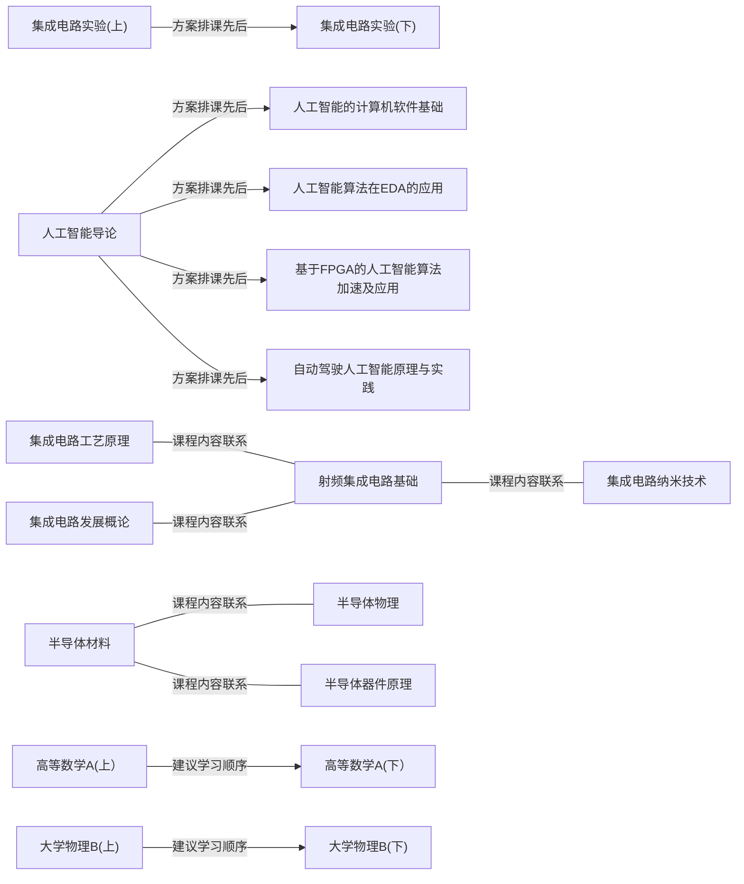

# 2025集成电路科学与工程本科培养方案

集成电路与微纳电子创新学院 · 集成电路科学与工程 · 方案 97141 · 96 个不同课程或科研条目。

[官方 Word](../originals/plan-97141.docx) · [教务详情](https://fdjwgl.fudan.edu.cn/manager/bizType/2/major-program-search/info/97141?skipAuth=1) · [方案快照](../raw/plan-97141.json.gz) · [年级目录](../README.md)

## 修读导读

- **建议先学**　《集成电路实验(上)》（`ICSE40008`） → 《集成电路实验(下)》（`ICSE40009`）。题名列出连续册次或级别。可沿用前一阶段的实验记录格式，对照后来新增的测量方法和误差来源。方案分别列在第7、8学期。

- **可以对照着读**　《集成电路工艺原理》（`ICSE30010`）与《射频集成电路基础》（`ICSE30015`）。两门课的题名都涉及集成电路。用同一电路功能比较器件、工艺条件与电路性能之间的联系。

- **查模块选课**　《模拟电子线路》（`ICSE20004`）、《数字逻辑基础》（`ICSE20005`）列在“专业核心教育课程”中。原表见 `/courseModules/6`。

## 课程关系图

图中展示部分关系。下表保留全部已建立的课程对，来源位置使用本方案 JSON Pointer。

## 先修与内容联系

| 类型 | 起点 | 终点 | 依据 | 原表定位 |
| --- | --- | --- | --- | --- |
| 建议学习顺序 | 人工智能导论 (EST10001) | 自动驾驶人工智能原理与实践 (AIT410017) | “人工智能导论”题名标明基础层次，前置阅读可帮助了解“自动驾驶人工智能原理与实践”中的人工智能主题。  | `/courseModules/9/planCourses/2`、`/courseModules/9/planCourses/10` |
| 建议学习顺序 | 人工智能导论 (EST10001) | 人工智能的计算机软件基础 (EST30001) | “人工智能导论”题名标明基础层次，前置阅读可帮助了解“人工智能的计算机软件基础”中的人工智能主题。  | `/courseModules/9/planCourses/2`、`/courseModules/9/planCourses/6` |
| 建议学习顺序 | 人工智能导论 (EST10001) | 基于FPGA的人工智能算法加速及应用 (ICSE40018) | “人工智能导论”题名标明基础层次，前置阅读可帮助了解“基于FPGA的人工智能算法加速及应用”中的人工智能主题。  | `/courseModules/9/planCourses/2`、`/courseModules/9/planCourses/5` |
| 建议学习顺序 | 人工智能导论 (EST10001) | 人工智能算法在EDA的应用 (ICSE40019) | “人工智能导论”题名标明基础层次，前置阅读可帮助了解“人工智能算法在EDA的应用”中的人工智能主题。  | `/courseModules/9/planCourses/2`、`/courseModules/11/planCourses/36` |
| 建议学习顺序 | 集成电路实验(上) (ICSE40008) | 集成电路实验(下) (ICSE40009) | 同方案的课程题名具有连续分册或序号。  | `/courseModules/17/planCourses/0`、`/courseModules/17/planCourses/3` |
| 建议学习顺序 | 高等数学A(上） (MATH10015) | 高等数学A(下） (MATH10016) | 同方案的课程题名具有连续分册或序号。  | `/courseModules/5/planCourses/0`、`/courseModules/5/planCourses/1` |
| 建议学习顺序 | 大学物理B(上) (PHYS10003) | 大学物理B(下) (PHYS10004) | 同方案的课程题名具有连续分册或序号。  | `/courseModules/5/planCourses/3`、`/courseModules/5/planCourses/4` |
| 方案排课先后 | 人工智能导论 (EST10001) | 自动驾驶人工智能原理与实践 (AIT410017) | 同方案该课程全部明确数字学期均早于后者。  | `/courseModules/9/planCourses/2`、`/courseModules/9/planCourses/10` |
| 方案排课先后 | 人工智能导论 (EST10001) | 人工智能的计算机软件基础 (EST30001) | 同方案该课程全部明确数字学期均早于后者。  | `/courseModules/9/planCourses/2`、`/courseModules/9/planCourses/6` |
| 方案排课先后 | 人工智能导论 (EST10001) | 基于FPGA的人工智能算法加速及应用 (ICSE40018) | 同方案该课程全部明确数字学期均早于后者。  | `/courseModules/9/planCourses/2`、`/courseModules/9/planCourses/5` |
| 方案排课先后 | 人工智能导论 (EST10001) | 人工智能算法在EDA的应用 (ICSE40019) | 同方案该课程全部明确数字学期均早于后者。  | `/courseModules/9/planCourses/2`、`/courseModules/11/planCourses/36` |
| 方案排课先后 | 集成电路实验(上) (ICSE40008) | 集成电路实验(下) (ICSE40009) | 同方案该课程全部明确数字学期均早于后者。  | `/courseModules/17/planCourses/0`、`/courseModules/17/planCourses/3` |
| 方案排课先后 | 高等数学A(上） (MATH10015) | 高等数学A(下） (MATH10016) | 同方案该课程全部明确数字学期均早于后者。  | `/courseModules/5/planCourses/0`、`/courseModules/5/planCourses/1` |
| 方案排课先后 | 大学物理B(上) (PHYS10003) | 大学物理B(下) (PHYS10004) | 同方案该课程全部明确数字学期均早于后者。  | `/courseModules/5/planCourses/3`、`/courseModules/5/planCourses/4` |
| 课程内容联系 | 自动驾驶人工智能原理与实践 (AIT410017) | 人工智能导论 (EST10001) | 本方案两门课程的题名均含“人工智能”，可据此对照这一主题。  | `/courseModules/9/planCourses/10`、`/courseModules/9/planCourses/2` |
| 课程内容联系 | 人工智能导论 (EST10001) | 人工智能的计算机软件基础 (EST30001) | 本方案两门课程的题名均含“人工智能”，可据此对照这一主题。  | `/courseModules/9/planCourses/2`、`/courseModules/9/planCourses/6` |
| 课程内容联系 | 人工智能导论 (EST10001) | 基于FPGA的人工智能算法加速及应用 (ICSE40018) | 本方案两门课程的题名均含“人工智能”，可据此对照这一主题。  | `/courseModules/9/planCourses/2`、`/courseModules/9/planCourses/5` |
| 课程内容联系 | 人工智能导论 (EST10001) | 人工智能算法在EDA的应用 (ICSE40019) | 本方案两门课程的题名均含“人工智能”，可据此对照这一主题。  | `/courseModules/9/planCourses/2`、`/courseModules/11/planCourses/36` |
| 课程内容联系 | 数字信号处理A (EST30002) | 模拟信号处理 (ICSE30030) | 本方案两门课程的题名均含“信号处理”，可据此对照这一主题。  | `/courseModules/11/planCourses/8`、`/courseModules/11/planCourses/28` |
| 课程内容联系 | 模拟与数字电路实验 (EST40012) | 数字电路逻辑综合及描述方法概论 (ICSE20016) | 本方案两门课程的题名均含“数字电路”，可据此对照这一主题。  | `/courseModules/11/planCourses/3`、`/courseModules/11/planCourses/6` |
| 课程内容联系 | 半导体材料 (ICSE20003) | 半导体物理 (ICSE20007) | 本方案两门课程的题名均含“半导体”，可据此对照这一主题。  | `/courseModules/10/planCourses/14`、`/courseModules/6/planCourses/3` |
| 课程内容联系 | 半导体材料 (ICSE20003) | 半导体光电子器件 (ICSE30008) | 本方案两门课程的题名均含“半导体”，可据此对照这一主题。  | `/courseModules/10/planCourses/14`、`/courseModules/10/planCourses/6` |
| 课程内容联系 | 半导体材料 (ICSE20003) | 半导体器件原理 (ICSE30020) | 本方案两门课程的题名均含“半导体”，可据此对照这一主题。  | `/courseModules/10/planCourses/14`、`/courseModules/6/planCourses/5` |
| 课程内容联系 | 半导体材料 (ICSE20003) | 半导体表面与界面 (ICSE30029) | 本方案两门课程的题名均含“半导体”，可据此对照这一主题。  | `/courseModules/10/planCourses/14`、`/courseModules/10/planCourses/11` |
| 课程内容联系 | 集成电路发展概论 (ICSE30006) | 射频集成电路基础 (ICSE30015) | 本方案两门课程的题名均含“集成电路”，可据此对照这一主题。  | `/courseModules/10/planCourses/12`、`/courseModules/11/planCourses/14` |
| 课程内容联系 | 微电子重要进展及研究方法 (ICSE30009) | 有机微电子技术 (ICSE40011) | 本方案两门课程的题名均含“微电子”，可据此对照这一主题。  | `/courseModules/11/planCourses/9`、`/courseModules/10/planCourses/20` |
| 课程内容联系 | 集成电路工艺原理 (ICSE30010) | 射频集成电路基础 (ICSE30015) | 本方案两门课程的题名均含“集成电路”，可据此对照这一主题。  | `/courseModules/6/planCourses/7`、`/courseModules/11/planCourses/14` |
| 课程内容联系 | 微电子封装材料及工艺 (ICSE30013) | 有机微电子技术 (ICSE40011) | 本方案两门课程的题名均含“微电子”，可据此对照这一主题。  | `/courseModules/11/planCourses/23`、`/courseModules/10/planCourses/20` |
| 课程内容联系 | 射频集成电路基础 (ICSE30015) | 集成电路纳米技术 (ICSE40003) | 本方案两门课程的题名均含“集成电路”，可据此对照这一主题。  | `/courseModules/11/planCourses/14`、`/courseModules/10/planCourses/21` |
| 课程内容联系 | 射频集成电路基础 (ICSE30015) | 集成电路设计实验 (ICSE40014) | 本方案两门课程的题名均含“集成电路”，可据此对照这一主题。  | `/courseModules/11/planCourses/14`、`/courseModules/11/planCourses/34` |

本次未从可定位的明确表述中确认课程对课程预修。学期安排、系列分册与编辑建议均保留各自的依据。

## 按原方案模块阅读

同一模块展示原表中的课程归属。模块内课程之间的先后仍须逐项查阅。

- **新算力课程模块**　自动驾驶人工智能原理与实践、人工智能导论、自然语言处理与大语言模型算法、人工智能的计算机软件基础、前沿讲座、智能硬件创新方法概论与基础实践、工程数学及概率方法、机器学习算法、FPGA结构原理和应用、AI专用处理器架构设计方法、新型计算范式概论、基于FPGA的人工智能算法加速及应用、数学物理方法A（原表模块 9）
- **新制造课程模块**　半导体材料、固体物理基础、量子力学、特色工艺与功率半导体技术、光电子器件与集成、存储器技术、集成电路发展概论、半导体光电子器件、新型微纳器件概论、传感器原理及应用、半导体表面与界面、超低功耗半导体器件、现代集成电路光刻技术导论、AI半导体制造工艺、集成电路纳米技术、有机微电子技术、微机电系统应用、先进集成电路工艺技术等23项（原表模块 10）
- **芯粒集成课程模块**　数字信号处理A、模拟与数字电路实验、电磁场与电磁波、高频电子线路A、Perl语言入门和提高、MATLAB概论、计算机软件基础、集成电路版图设计基础、数字电路逻辑综合及描述方法概论、器件模型与SPICE仿真、模拟电路测试原理、专用集成电路设计方法、微电子重要进展及研究方法、数据结构与算法、微电子封装材料及工艺、集成电路制造仿真模拟原理和应用、射频集成电路基础、模拟集成电路设计自动化基础等37项（原表模块 11）

## 课程表

同一课程在不同模块分别出现时，按原表逐行列出。季节字段保留原值。

| 课程 | 代码 | 学分 | 学期 | 模块 |
| --- | --- | ---: | --- | --- |
| 高等数学A(上） | MATH10015 | 5.0 | 第1学期 | 培养方案 / 专业培养课程 / 学科基础课程 |
| 高等数学A(下） | MATH10016 | 5.0 | 第2学期 | 培养方案 / 专业培养课程 / 学科基础课程 |
| 线性代数 | CS10003 | 3.0 | 第1学期 | 培养方案 / 专业培养课程 / 学科基础课程 |
| 大学物理B(上) | PHYS10003 | 4.0 | 第1学期 | 培养方案 / 专业培养课程 / 学科基础课程 |
| 大学物理B(下) | PHYS10004 | 4.0 | 第2学期 | 培养方案 / 专业培养课程 / 学科基础课程 |
| 基础物理实验 | PHYS10005 | 2.0 | 第2学期 | 培养方案 / 专业培养课程 / 学科基础课程 |
| 程序设计 | CS10004 | 4.0 | 第1学期 | 培养方案 / 专业培养课程 / 学科基础课程 |
| 电路基础 | ICSE10001 | 3.0 | 第2学期 | 培养方案 / 专业培养课程 / 学科基础课程 |
| 模拟电子线路 | ICSE20004 | 3.0 | 第3学期 | 培养方案 / 专业培养课程 / 专业核心教育课程 |
| 数字逻辑基础 | ICSE20005 | 4.0 | 第3学期 | 培养方案 / 专业培养课程 / 专业核心教育课程 |
| 信号与系统概论 | ICSE20006 | 3.0 | 第4学期 | 培养方案 / 专业培养课程 / 专业核心教育课程 |
| 半导体物理 | ICSE20007 | 4.0 | 第4学期 | 培养方案 / 专业培养课程 / 专业核心教育课程 |
| 嵌入式处理器与芯片系统设计 | ICSE20008 | 5.0 | 第4学期 | 培养方案 / 专业培养课程 / 专业核心教育课程 |
| 半导体器件原理 | ICSE30020 | 4.0 | 第5学期 | 培养方案 / 专业培养课程 / 专业核心教育课程 |
| 数字集成电路设计原理 | ICSE30021 | 3.0 | 第5学期 | 培养方案 / 专业培养课程 / 专业核心教育课程 |
| 集成电路工艺原理 | ICSE30010 | 3.0 | 第6学期 | 培养方案 / 专业培养课程 / 专业核心教育课程 |
| 模拟集成电路设计原理 | ICSE30022 | 3.0 | 第6学期 | 培养方案 / 专业培养课程 / 专业核心教育课程 |
| 集成电路封装与测试 | ICSE40004 | 3.0 | 第6学期 | 培养方案 / 专业培养课程 / 专业核心教育课程 |
| 工程数学及概率方法 | ICSE20009 | 3.0 | 第3学期 | 培养方案 / 新算力课程模块 |
| 前沿讲座 | ICE50010 | 2.0 | 第3学期 | 培养方案 / 新算力课程模块 |
| 人工智能导论 | EST10001 | 2.0 | 第3学期 | 培养方案 / 新算力课程模块 |
| 智能硬件创新方法概论与基础实践 | ICE50013 | 2.0 | 第4学期 | 培养方案 / 新算力课程模块 |
| FPGA结构原理和应用 | ICSE30016 | 3.0 | 第6学期 | 培养方案 / 新算力课程模块 |
| 基于FPGA的人工智能算法加速及应用 | ICSE40018 | 2.0 | 第6学期 | 培养方案 / 新算力课程模块 |
| 人工智能的计算机软件基础 | EST30001 | 3.0 | 第6学期 | 培养方案 / 新算力课程模块 |
| 机器学习算法 | ICSE30001 | 3.0 | 第6学期 | 培养方案 / 新算力课程模块 |
| AI专用处理器架构设计方法 | ICSE40002 | 3.0 | 第7学期 | 培养方案 / 新算力课程模块 |
| 自然语言处理与大语言模型算法 | EST20001 | 2.0 | 第7学期 | 培养方案 / 新算力课程模块 |
| 自动驾驶人工智能原理与实践 | AIT410017 | 2.0 | 第7学期 | 培养方案 / 新算力课程模块 |
| 数学物理方法A | PHYS20006 | 4.0 | 第7学期 | 培养方案 / 新算力课程模块 |
| 新型计算范式概论 | ICSE40007 | 3.0 | 第7学期 | 培养方案 / 新算力课程模块 |
| 固体物理基础 | ICSE20010 | 3.0 | 第3学期 | 培养方案 / 新制造课程模块 |
| 量子力学 | ICSE20011 | 3.0 | 第3学期 | 培养方案 / 新制造课程模块 |
| 固体物理 | PHYS30011 | 4.0 | 第4学期 | 培养方案 / 新制造课程模块 |
| 热力学与统计物理I | PHYS20013 | 4.0 | 第4学期 | 培养方案 / 新制造课程模块 |
| 特色工艺与功率半导体技术 | ICSE20012 | 2.0 | 第4学期 | 培养方案 / 新制造课程模块 |
| 存储器技术 | ICSE30005 | 3.0 | 第5学期 | 培养方案 / 新制造课程模块 |
| 半导体光电子器件 | ICSE30008 | 2.0 | 第5学期 | 培养方案 / 新制造课程模块 |
| 超低功耗半导体器件 | ICSE30031 | 2.0 | 第5学期 | 培养方案 / 新制造课程模块 |
| 计算物理基础 | PHYS20009 | 3.0 | 第5学期 | 培养方案 / 新制造课程模块 |
| 光电子器件与集成 | ICSE30004 | 3.0 | 第5学期 | 培养方案 / 新制造课程模块 |
| 现代集成电路光刻技术导论 | ICSE30032 | 2.0 | 第5学期 | 培养方案 / 新制造课程模块 |
| 半导体表面与界面 | ICSE30029 | 3.0 | 第6学期 | 培养方案 / 新制造课程模块 |
| 集成电路发展概论 | ICSE30006 | 3.0 | 第6学期 | 培养方案 / 新制造课程模块 |
| 新型微纳器件概论 | ICSE30012 | 2.0 | 第6学期 | 培养方案 / 新制造课程模块 |
| 半导体材料 | ICSE20003 | 2.0 | 第6学期 | 培养方案 / 新制造课程模块 |
| 薄膜技术 | MASE30019 | 3.0 | 第6学期 | 培养方案 / 新制造课程模块 |
| 材料分析 | MASE30023 | 3.0 | 第6学期 | 培养方案 / 新制造课程模块 |
| AI半导体制造工艺 | ICSE30035 | 3.0 | 第6学期 | 培养方案 / 新制造课程模块 |
| 传感器原理及应用 | ICSE30023 | 3.0 | 第7学期 | 培养方案 / 新制造课程模块 |
| 微机电系统应用 | ICSE40015 | 2.0 | 第7学期 | 培养方案 / 新制造课程模块 |
| 有机微电子技术 | ICSE40011 | 2.0 | 第7学期 | 培养方案 / 新制造课程模块 |
| 集成电路纳米技术 | ICSE40003 | 2.0 | 第7学期 | 培养方案 / 新制造课程模块 |
| 先进集成电路工艺技术 | ICSE40016 | 3.0 | 第7学期 | 培养方案 / 新制造课程模块 |
| 电磁场与电磁波 | ICE50009 | 3.0 | 第3学期 | 培养方案 / 芯粒集成课程模块 |
| 高频电子线路A | ICSE20001 | 4.0 | 第4学期 | 培养方案 / 芯粒集成课程模块 |
| Perl语言入门和提高 | ICSE20002 | 2.0 | 第4学期 | 培养方案 / 芯粒集成课程模块 |
| 模拟与数字电路实验 | EST40012 | 3.0 | 第4学期 | 培养方案 / 芯粒集成课程模块 |
| MATLAB概论 | ICSE20013 | 3.0 | 第4学期 | 培养方案 / 芯粒集成课程模块 |
| 计算机软件基础 | ICSE20014 | 3.0 | 第4学期 | 培养方案 / 芯粒集成课程模块 |
| 数字电路逻辑综合及描述方法概论 | ICSE20016 | 2.0 | 第4学期 | 培养方案 / 芯粒集成课程模块 |
| 模拟电路测试原理 | ICSE30003 | 3.0 | 第5学期 | 培养方案 / 芯粒集成课程模块 |
| 数字信号处理A | EST30002 | 3.0 | 第5学期 | 培养方案 / 芯粒集成课程模块 |
| 微电子重要进展及研究方法 | ICSE30009 | 2.0 | 第5学期 | 培养方案 / 芯粒集成课程模块 |
| 电子材料分析 | MASE30015 | 3.0 | 第5学期 | 培养方案 / 芯粒集成课程模块 |
| 材料科学导论 | MASE20002 | 3.0 | 第5学期 | 培养方案 / 芯粒集成课程模块 |
| 数据结构与算法 | ICSE30011 | 4.0 | 第5学期 | 培养方案 / 芯粒集成课程模块 |
| 集成电路制造仿真模拟原理和应用 | ICSE30014 | 2.0 | 第5学期 | 培养方案 / 芯粒集成课程模块 |
| 射频集成电路基础 | ICSE30015 | 2.0 | 第5学期 | 培养方案 / 芯粒集成课程模块 |
| 模拟集成电路设计自动化基础 | ICSE30018 | 3.0 | 第5学期 | 培养方案 / 芯粒集成课程模块 |
| 超大规模集成电路物理设计中的数学方法 | ICSE30026 | 2.0 | 第5学期 | 培养方案 / 芯粒集成课程模块 |
| 集成电路高级硬件描述语言 | ICSE30027 | 3.0 | 第5学期 | 培养方案 / 芯粒集成课程模块 |
| 模拟测试原理与电路设计 | ICSE30033 | 3.0 | 第5学期 | 培养方案 / 芯粒集成课程模块 |
| 器件模型与SPICE仿真 | ICSE30002 | 3.0 | 第6学期 | 培养方案 / 芯粒集成课程模块 |
| 专用集成电路设计方法 | ICSE30007 | 2.0 | 第6学期 | 培养方案 / 芯粒集成课程模块 |
| 数模/模数转换器原理概论 | ICSE50001 | 2.0 | 第6学期 | 培养方案 / 芯粒集成课程模块 |
| 器件可靠性原理与测试 | ICSE50008 | 3.0 | 第6学期 | 培养方案 / 芯粒集成课程模块 |
| 微电子封装材料及工艺 | ICSE30013 | 2.0 | 第6学期 | 培养方案 / 芯粒集成课程模块 |
| 数字集成电路设计自动化基础 | ICSE30019 | 3.0 | 第6学期 | 培养方案 / 芯粒集成课程模块 |
| 闪存（FLASH）存储器技术与设计实现 | ICSE30024 | 3.0 | 第6学期 | 培养方案 / 芯粒集成课程模块 |
| 存储器电路设计导论 | ICSE30025 | 3.0 | 第6学期 | 培养方案 / 芯粒集成课程模块 |
| EDA系统软件分析和设计方法学 | ICSE30028 | 3.0 | 第6学期 | 培养方案 / 芯粒集成课程模块 |
| 模拟信号处理 | ICSE30030 | 2.0 | 第6学期 | 培养方案 / 芯粒集成课程模块 |
| 集成电路版图设计基础 | ICSE20015 | 2.0 | 第6学期 | 培养方案 / 芯粒集成课程模块 |
| AI专用芯片设计 | ICSE30036 | 2.0 | 第6学期 | 培养方案 / 芯粒集成课程模块 |
| 超低功耗集成电路设计 | ICSE40005 | 3.0 | 第7学期 | 培养方案 / 芯粒集成课程模块 |
| 先进封装 | ICSE40006 | 2.0 | 第7学期 | 培养方案 / 芯粒集成课程模块 |
| 射频微波测试基础 | ICSE40010 | 2.0 | 第7学期 | 培养方案 / 芯粒集成课程模块 |
| 集成电路设计实验 | ICSE40014 | 3.0 | 第7学期 | 培养方案 / 芯粒集成课程模块 |
| 电子材料薄膜测试表征方法 | ICSE40017 | 2.0 | 第7学期 | 培养方案 / 芯粒集成课程模块 |
| 人工智能算法在EDA的应用 | ICSE40019 | 3.0 | 第7学期 | 培养方案 / 芯粒集成课程模块 |
| 集成电路实验(上) | ICSE40008 | 3.0 | 第7学期 | 融合创新能力 |
| 无学分讨论班 | 101 | 0.0 |  | 融合创新能力 |
| 复芏计划(FDUROP) | 102 | 0.0 |  | 融合创新能力 |
| 集成电路实验(下) | ICSE40009 | 2.0 | 第8学期 | 融合创新能力 |
| 毕业论文 | ICSE40021 | 2.0 | 第8学期 | 融合创新能力 |
