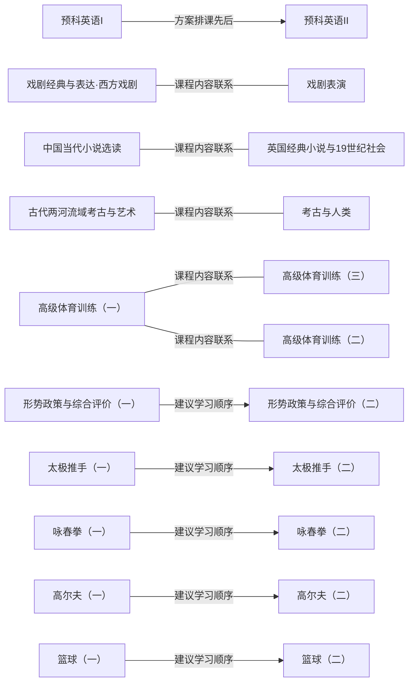

# 2025 预科班

预科 · 预科班 · 方案 98034 · 326 个不同课程或科研条目。

[官方 Word](../originals/plan-98034.docx) · [教务详情](https://fdjwgl.fudan.edu.cn/manager/bizType/2/major-program-search/info/98034?skipAuth=1) · [方案快照](../raw/plan-98034.json.gz) · [年级目录](../README.md)

## 修读导读

- **建议先学**　《预科英语I》（`GEEF00001`） → 《预科英语II》（`GEEF00002`）。题名列出连续册次或级别。按级别积累词汇和句式，后一阶段阅读新材料时可回查前一阶段的例句。方案分别列在第1、2学期。

- **可以对照着读**　《戏剧经典与表达·西方戏剧》（`GECC10040`）与《戏剧表演》（`GEEC10136`）。两门课的题名都涉及戏剧。同一个动作或一段台词，写在剧本里与放到舞台上分别怎样传达角色意图？

- **查模块选课**　《大学语文》（`CHIN00001`）、《汉语写作》（`CHIN00002`）列在“预科生必修类课程”中。原表见 `/courseModules/1`。

## 课程关系图

图中展示部分关系。下表保留全部已建立的课程对，来源位置使用本方案 JSON Pointer。

## 先修与内容联系

| 类型 | 起点 | 终点 | 依据 | 原表定位 |
| --- | --- | --- | --- | --- |
| 建议学习顺序 | 预科英语I (GEEF00001) | 预科英语II (GEEF00002) | 同方案的课程题名具有连续分册或序号。  | `/courseModules/1/planCourses/3`、`/courseModules/1/planCourses/2` |
| 建议学习顺序 | 射击（一） (GEPE10001) | 射击（二） (GEPE10002) | 同方案的课程题名具有连续分册或序号。  | `/courseModules/13/planCourses/104`、`/courseModules/13/planCourses/105` |
| 建议学习顺序 | 花样跳绳（一） (GEPE10003) | 花样跳绳（二） (GEPE10004) | 同方案的课程题名具有连续分册或序号。  | `/courseModules/13/planCourses/98`、`/courseModules/13/planCourses/99` |
| 建议学习顺序 | 跆拳道（一） (GEPE10005) | 跆拳道（二） (GEPE10006) | 同方案的课程题名具有连续分册或序号。  | `/courseModules/13/planCourses/102`、`/courseModules/13/planCourses/103` |
| 建议学习顺序 | 太极推手（一） (GEPE10015) | 太极推手（二） (GEPE10016) | 同方案的课程题名具有连续分册或序号。  | `/courseModules/13/planCourses/8`、`/courseModules/13/planCourses/9` |
| 建议学习顺序 | 咏春拳（一） (GEPE10017) | 咏春拳（二） (GEPE10018) | 同方案的课程题名具有连续分册或序号。  | `/courseModules/13/planCourses/10`、`/courseModules/13/planCourses/11` |
| 建议学习顺序 | 高尔夫（一） (GEPE10019) | 高尔夫（二） (GEPE10020) | 同方案的课程题名具有连续分册或序号。  | `/courseModules/13/planCourses/12`、`/courseModules/13/planCourses/13` |
| 建议学习顺序 | 篮球（一） (GEPE10021) | 篮球（二） (GEPE10022) | 同方案的课程题名具有连续分册或序号。  | `/courseModules/13/planCourses/14`、`/courseModules/13/planCourses/15` |
| 建议学习顺序 | 排球（一） (GEPE10023) | 排球（二） (GEPE10024) | 同方案的课程题名具有连续分册或序号。  | `/courseModules/13/planCourses/16`、`/courseModules/13/planCourses/17` |
| 建议学习顺序 | 足球（一） (GEPE10025) | 足球（二） (GEPE10026) | 同方案的课程题名具有连续分册或序号。  | `/courseModules/13/planCourses/18`、`/courseModules/13/planCourses/19` |
| 建议学习顺序 | 乒乓球（一） (GEPE10027) | 乒乓球（二） (GEPE10028) | 同方案的课程题名具有连续分册或序号。  | `/courseModules/13/planCourses/20`、`/courseModules/13/planCourses/21` |
| 建议学习顺序 | 羽毛球（一） (GEPE10029) | 羽毛球（二） (GEPE10030) | 同方案的课程题名具有连续分册或序号。  | `/courseModules/13/planCourses/22`、`/courseModules/13/planCourses/23` |
| 建议学习顺序 | 网球（一） (GEPE10031) | 网球（二） (GEPE10032) | 同方案的课程题名具有连续分册或序号。  | `/courseModules/13/planCourses/24`、`/courseModules/13/planCourses/25` |
| 建议学习顺序 | 棒球（一） (GEPE10033) | 棒球（二） (GEPE10034) | 同方案的课程题名具有连续分册或序号。  | `/courseModules/13/planCourses/26`、`/courseModules/13/planCourses/27` |
| 建议学习顺序 | 垒球（一） (GEPE10035) | 垒球（二） (GEPE10036) | 同方案的课程题名具有连续分册或序号。  | `/courseModules/13/planCourses/28`、`/courseModules/13/planCourses/29` |
| 建议学习顺序 | 板球（一） (GEPE10037) | 板球（二） (GEPE10038) | 同方案的课程题名具有连续分册或序号。  | `/courseModules/13/planCourses/30`、`/courseModules/13/planCourses/31` |
| 建议学习顺序 | 体育舞蹈（一） (GEPE10039) | 体育舞蹈（二） (GEPE10040) | 同方案的课程题名具有连续分册或序号。  | `/courseModules/13/planCourses/32`、`/courseModules/13/planCourses/33` |
| 建议学习顺序 | 击剑（一） (GEPE10041) | 击剑（二） (GEPE10042) | 同方案的课程题名具有连续分册或序号。  | `/courseModules/13/planCourses/34`、`/courseModules/13/planCourses/35` |
| 建议学习顺序 | 综合体育（一） (GEPE10043) | 综合体育（二） (GEPE10044) | 同方案的课程题名具有连续分册或序号。  | `/courseModules/13/planCourses/36`、`/courseModules/13/planCourses/37` |
| 建议学习顺序 | 艺术体操（一） (GEPE10045) | 艺术体操（二） (GEPE10046) | 同方案的课程题名具有连续分册或序号。  | `/courseModules/13/planCourses/38`、`/courseModules/13/planCourses/39` |
| 建议学习顺序 | 形体健美（一） (GEPE10047) | 形体健美（二） (GEPE10048) | 同方案的课程题名具有连续分册或序号。  | `/courseModules/13/planCourses/40`、`/courseModules/13/planCourses/41` |
| 建议学习顺序 | 健美操（一） (GEPE10049) | 健美操（二） (GEPE10050) | 同方案的课程题名具有连续分册或序号。  | `/courseModules/13/planCourses/42`、`/courseModules/13/planCourses/43` |
| 建议学习顺序 | 健美（一） (GEPE10051) | 健美（二） (GEPE10052) | 同方案的课程题名具有连续分册或序号。  | `/courseModules/13/planCourses/44`、`/courseModules/13/planCourses/45` |
| 建议学习顺序 | 游泳（一） (GEPE10053) | 游泳（二） (GEPE10054) | 同方案的课程题名具有连续分册或序号。  | `/courseModules/13/planCourses/46`、`/courseModules/13/planCourses/47` |
| 建议学习顺序 | 手球（一） (GEPE10059) | 手球（二） (GEPE10060) | 同方案的课程题名具有连续分册或序号。  | `/courseModules/13/planCourses/52`、`/courseModules/13/planCourses/53` |
| 建议学习顺序 | 气排球（一） (GEPE10061) | 气排球（二） (GEPE10062) | 同方案的课程题名具有连续分册或序号。  | `/courseModules/13/planCourses/54`、`/courseModules/13/planCourses/55` |
| 建议学习顺序 | 有氧塑身（一） (GEPE10063) | 有氧塑身（二） (GEPE10064) | 同方案的课程题名具有连续分册或序号。  | `/courseModules/13/planCourses/56`、`/courseModules/13/planCourses/57` |
| 建议学习顺序 | 游泳救生（一） (GEPE10065) | 游泳救生（二） (GEPE10066) | 同方案的课程题名具有连续分册或序号。  | `/courseModules/13/planCourses/58`、`/courseModules/13/planCourses/59` |
| 建议学习顺序 | 龙狮运动（一） (GEPE10067) | 龙狮运动（二） (GEPE10068) | 同方案的课程题名具有连续分册或序号。  | `/courseModules/13/planCourses/60`、`/courseModules/13/planCourses/61` |
| 建议学习顺序 | 射艺（一） (GEPE10069) | 射艺（二） (GEPE10070) | 同方案的课程题名具有连续分册或序号。  | `/courseModules/13/planCourses/62`、`/courseModules/13/planCourses/63` |
| 建议学习顺序 | 导引养生（一） (GEPE10071) | 导引养生（二） (GEPE10072) | 同方案的课程题名具有连续分册或序号。  | `/courseModules/13/planCourses/64`、`/courseModules/13/planCourses/65` |
| 建议学习顺序 | 防身术（一） (GEPE10073) | 防身术（二） (GEPE10074) | 同方案的课程题名具有连续分册或序号。  | `/courseModules/13/planCourses/66`、`/courseModules/13/planCourses/67` |
| 建议学习顺序 | 旱地冰球（一） (GEPE10075) | 旱地冰球（二） (GEPE10076) | 同方案的课程题名具有连续分册或序号。  | `/courseModules/13/planCourses/82`、`/courseModules/13/planCourses/83` |
| 建议学习顺序 | 健康体适能（一） (GEPE10077) | 健康体适能（二） (GEPE10078) | 同方案的课程题名具有连续分册或序号。  | `/courseModules/13/planCourses/84`、`/courseModules/13/planCourses/85` |
| 建议学习顺序 | 瑜伽（一） (GEPE10079) | 瑜伽（二） (GEPE10080) | 同方案的课程题名具有连续分册或序号。  | `/courseModules/13/planCourses/86`、`/courseModules/13/planCourses/87` |
| 建议学习顺序 | 极限飞盘（一） (GEPE10081) | 极限飞盘（二） (GEPE10082) | 同方案的课程题名具有连续分册或序号。  | `/courseModules/13/planCourses/88`、`/courseModules/13/planCourses/89` |
| 建议学习顺序 | 武术兵道（一） (GEPE10083) | 武术兵道（二） (GEPE10084) | 同方案的课程题名具有连续分册或序号。  | `/courseModules/13/planCourses/90`、`/courseModules/13/planCourses/91` |
| 建议学习顺序 | 毽球（一） (GEPE10085) | 毽球（二） (GEPE10086) | 同方案的课程题名具有连续分册或序号。  | `/courseModules/13/planCourses/92`、`/courseModules/13/planCourses/93` |
| 建议学习顺序 | 中国传统舞蹈（一） (GEPE10087) | 中国传统舞蹈（二） (GEPE10088) | 同方案的课程题名具有连续分册或序号。  | `/courseModules/13/planCourses/106`、`/courseModules/13/planCourses/107` |
| 建议学习顺序 | 匹克球（一） (GEPE10091) | 匹克球（二） (GEPE10092) | 同方案的课程题名具有连续分册或序号。  | `/courseModules/13/planCourses/110`、`/courseModules/13/planCourses/111` |
| 建议学习顺序 | 武术短兵（一） (GEPE10093) | 武术短兵（二） (GEPE10094) | 同方案的课程题名具有连续分册或序号。  | `/courseModules/13/planCourses/112`、`/courseModules/13/planCourses/113` |
| 建议学习顺序 | 花样跳绳-提高（一） (GEPE20001) | 花样跳绳-提高（二） (GEPE20002) | 同方案的课程题名具有连续分册或序号。  | `/courseModules/13/planCourses/100`、`/courseModules/13/planCourses/101` |
| 建议学习顺序 | 高级体育训练（一） (GEPE40001) | 高级体育训练（二） (GEPE40002) | 同方案的课程题名具有连续分册或序号。  | `/courseModules/13/planCourses/94`、`/courseModules/13/planCourses/95` |
| 建议学习顺序 | 高级体育训练（二） (GEPE40002) | 高级体育训练（三） (GEPE40003) | 同方案的课程题名具有连续分册或序号。  | `/courseModules/13/planCourses/95`、`/courseModules/13/planCourses/96` |
| 建议学习顺序 | 高级体育训练（三） (GEPE40003) | 高级体育训练（四） (GEPE40004) | 同方案的课程题名具有连续分册或序号。  | `/courseModules/13/planCourses/96`、`/courseModules/13/planCourses/97` |
| 建议学习顺序 | 形势政策与综合评价（一） (GESP00001) | 形势政策与综合评价（二） (GESP00002) | 同方案的课程题名具有连续分册或序号。  | `/courseModules/4/planCourses/0`、`/courseModules/4/planCourses/1` |
| 方案排课先后 | 预科英语I (GEEF00001) | 预科英语II (GEEF00002) | 同方案该课程全部明确数字学期均早于后者。  | `/courseModules/1/planCourses/3`、`/courseModules/1/planCourses/2` |
| 课程内容联系 | 中国当代小说选读 (GECC10009) | 英国经典小说与19世纪社会 (GECC10050) | 本方案两门课程的题名均含“小说”，可据此对照这一主题。  | `/courseModules/6/planCourses/25`、`/courseModules/8/planCourses/22` |
| 课程内容联系 | 戏剧经典与表达·西方戏剧 (GECC10040) | 戏剧表演 (GEEC10136) | 本方案两门课程的题名均含“戏剧”，可据此对照这一主题。  | `/courseModules/12/planCourses/11`、`/courseModules/12/planCourses/2` |
| 课程内容联系 | 古代两河流域考古与艺术 (GECC10075) | 考古与人类 (GECC10101) | 本方案两门课程的题名均含“考古”，可据此对照这一主题。  | `/courseModules/8/planCourses/10`、`/courseModules/12/planCourses/17` |
| 课程内容联系 | 高级体育训练（一） (GEPE40001) | 高级体育训练（二） (GEPE40002) | 本方案两门课程的题名均含“体育训练”，可据此对照这一主题。  | `/courseModules/13/planCourses/94`、`/courseModules/13/planCourses/95` |
| 课程内容联系 | 高级体育训练（一） (GEPE40001) | 高级体育训练（三） (GEPE40003) | 本方案两门课程的题名均含“体育训练”，可据此对照这一主题。  | `/courseModules/13/planCourses/94`、`/courseModules/13/planCourses/96` |
| 课程内容联系 | 高级体育训练（一） (GEPE40001) | 高级体育训练（四） (GEPE40004) | 本方案两门课程的题名均含“体育训练”，可据此对照这一主题。  | `/courseModules/13/planCourses/94`、`/courseModules/13/planCourses/97` |

本次未从可定位的明确表述中确认课程对课程预修。学期安排、系列分册与编辑建议均保留各自的依据。

## 按原方案模块阅读

同一模块展示原表中的课程归属。模块内课程之间的先后仍须逐项查阅。

- **预科生必修类课程**　大学语文、汉语写作、预科英语I、预科英语II、预科数学、高等数学B(上）、高等数学C(上）、高等数学D、高等数学A(上）、高等数学C I（原表模块 1）
- **思想政治理论课模块**　中国共产党历史、新中国史、改革开放史、社会主义发展史、中国近现代史纲要、思想道德与法治、毛泽东思想和中国特色社会主义理论体系概论、习近平新时代中国特色社会主义思想概论、马克思主义基本原理（原表模块 3）
- **文史经典与文化传承**　古典诗词导读、《周易》与中华审美文化、唐诗经典与中国文化传统、唐宋八大家古文、中国当代小说选读、中国新诗导读、《史记》导读、宋词导读、诗经与传统文化、《红楼梦》与人生、《三国志》导读、《文选》与中古社会、中国现代散文导读、《尔雅》与中国古典语文、《谈艺录》导读、中国现代文学名著选讲、《西游记》导读、陶渊明精读等28项（原表模块 6）
- **哲学智慧与批判性思维**　《艺术即经验》导读、托克维尔论美国的民主、笛卡尔《谈谈方法》导读、康德《实践理性批判》精读、《论法的精神》导读、《法哲学原理》导读、《尼各马可伦理学》导读、《查拉图斯特拉如是说》导读、《费尔巴哈论》研读、西方道德哲学原著选读、《第一哲学沉思集》导读、休谟《人性论》导读、《新教伦理与资本主义精神》导读、艺术哲学与审美问题、科学哲学与认知问题、批判性思维与论证问题、形而上学与知识论问题、《理想国》导读等23项（原表模块 7）
- **文明对话与世界视野**　莎士比亚作品撷英、从特洛伊到漫威世界：西方叙事传统的演变与发展、英国中世纪文学与文化、卡夫卡与全球现代性、英国经典小说与19世纪社会、文艺复兴史、中西文化交流史、《荷马史诗》导读、中国现代学科的形成、基督教文明史、欧洲文明的现代历程、希腊悲剧、性别与历史、日本文明的历史变迁、印度宗教经典导读、东亚文明史、古代近东的英雄与神祇、16-20世纪的欧洲殖民帝国等32项（原表模块 8）
- **社会研究与当代中国**　经济与社会、传播与社会、人权与法、法治理念与实践、法律与科技文明、全球化时代的法律冲突与对话、政治与社会、社会科学经典导读、社会科学研究方法、文化与社会、法律与社会（原表模块 9）
- **科学探索与技术创新**　化学与中国文明、智能社会与“元宇宙”、化学与人类、化学与中国文明、从计算到智能、计算思维、信号、信息与社会、无处不在的大分子、材料与社会、数据的背后、随机现象与概率、航空与航天、超级智能与人类文明、物理与文化、天体物理与宇宙论的演化、人文的物理学、量子科学与未来计算（原表模块 10）
- **生态环境与生命关怀**　神经、心智与类脑智能、宜居地球与人类未来、环境与人类、环境灾害与启示、生态文明：人与自然和谐共生、医学的社会文化史、认识地球、医药伦理、药物·生命·社会、环境与人群健康、社会发展与健康、公共卫生应急与现代社会、生命进化论、微生物与人类健康、人类进化、生态学：管理大自然的经济学、生物技术与人类社会、身边的基因科学等22项（原表模块 11）
- **艺术创作与审美体验**　游戏与文化、中国戏曲·京剧、陶艺与雕塑、戏剧经典与表达·西方戏剧、达芬奇笔记与绘画实践、西方古典建筑、诗意的音画世界、走进电影世界、欧洲电影解析与实践、玺印赏析与篆刻实践、中国古代艺术史专题、文物赏析与体验、博物馆文化解读、考古与人类、中国古代物质文化·读懂青铜器、中国古代物质文化·玉与瓷的技艺之美、中国古代物质文化·生活美学、中国书法艺术等56项（原表模块 12）
- **体育课程**　射击（一）、射击（二）、花样跳绳（一）、花样跳绳（二）、跆拳道（一）、跆拳道（二）、木兰拳、木兰扇、十六式太极拳、陈式太极拳、长拳二段、长拳三段、段位剑术二段、段位剑术三段、太极推手（一）、太极推手（二）、咏春拳（一）、咏春拳（二）等116项（原表模块 13）

## 课程表

同一课程在不同模块分别出现时，按原表逐行列出。季节字段保留原值。

| 课程 | 代码 | 学分 | 学期 | 模块 |
| --- | --- | ---: | --- | --- |
| 大学语文 | CHIN00001 | 2.0 | 第1学期 | 培养方案 / 预科生必修类课程 |
| 汉语写作 | CHIN00002 | 2.0 | 第2学期 | 培养方案 / 预科生必修类课程 |
| 预科英语II | GEEF00002 | 4.0 | 第2学期 | 培养方案 / 预科生必修类课程 |
| 预科英语I | GEEF00001 | 4.0 | 第1学期 | 培养方案 / 预科生必修类课程 |
| 预科数学 | MATH00001 | 0.0 | AUTUMN | 培养方案 / 预科生必修类课程 |
| 高等数学B(上） | MATH10004 | 5.0 | AUTUMN | 培养方案 / 预科生必修类课程 |
| 高等数学D | MATH10008 | 4.0 | AUTUMN | 培养方案 / 预科生必修类课程 |
| 高等数学C(上） | MATH10006 | 4.0 | AUTUMN | 培养方案 / 预科生必修类课程 |
| 高等数学A(上） | MATH10015 | 5.0 | AUTUMN | 培养方案 / 预科生必修类课程 |
| 高等数学C I | MATH10018 | 5.0 | AUTUMN | 培养方案 / 预科生必修类课程 |
| 社会主义发展史 | GEIP20005 | 2.0 | SPRING、AUTUMN | 培养方案 / 必修课程 / 思想政治理论课模块 |
| 新中国史 | GEIP20003 | 2.0 | SPRING、AUTUMN | 培养方案 / 必修课程 / 思想政治理论课模块 |
| 毛泽东思想和中国特色社会主义理论体系概论 | GEIP30001 | 3.0 | SPRING、AUTUMN | 培养方案 / 必修课程 / 思想政治理论课模块 |
| 中国近现代史纲要 | GEIP20006 | 3.0 | SPRING、AUTUMN | 培养方案 / 必修课程 / 思想政治理论课模块 |
| 思想道德与法治 | GEIP20007 | 3.0 | SPRING、AUTUMN | 培养方案 / 必修课程 / 思想政治理论课模块 |
| 中国共产党历史 | GEIP20002 | 2.0 | SPRING、AUTUMN | 培养方案 / 必修课程 / 思想政治理论课模块 |
| 马克思主义基本原理 | GEIP40012 | 3.0 | SPRING、AUTUMN | 培养方案 / 必修课程 / 思想政治理论课模块 |
| 改革开放史 | GEIP20004 | 2.0 | SPRING、AUTUMN | 培养方案 / 必修课程 / 思想政治理论课模块 |
| 习近平新时代中国特色社会主义思想概论 | GEIP30002 | 3.0 | SPRING、AUTUMN | 培养方案 / 必修课程 / 思想政治理论课模块 |
| 形势政策与综合评价（一） | GESP00001 | 2.0 | AUTUMN | 培养方案 / 必修课程 / A组 |
| 形势政策与综合评价（二） | GESP00002 | 2.0 | SPRING | 培养方案 / 必修课程 / A组 |
| 《三国志》与三国史 | GECC10083 | 3.0 | SPRING、AUTUMN | 培养方案 / 必修课程 / 核心课程七大模块 / 文史经典与文化传承 |
| 《荀子》导读 | GECC20012 | 2.0 | SPRING、AUTUMN | 培养方案 / 必修课程 / 核心课程七大模块 / 文史经典与文化传承 |
| 《十三经》导读 | GECC10058 | 2.0 | SPRING、AUTUMN | 培养方案 / 必修课程 / 核心课程七大模块 / 文史经典与文化传承 |
| 陶渊明精读 | GECC10024 | 2.0 | SPRING、AUTUMN | 培养方案 / 必修课程 / 核心课程七大模块 / 文史经典与文化传承 |
| 汉语方言与中国文化 | GECC10027 | 2.0 | SPRING、AUTUMN | 培养方案 / 必修课程 / 核心课程七大模块 / 文史经典与文化传承 |
| 中国历史上的民族与国家 | GECC10087 | 2.0 | SPRING、AUTUMN | 培养方案 / 必修课程 / 核心课程七大模块 / 文史经典与文化传承 |
| 《孟子》导读 | GECC20017 | 2.0 | SPRING、AUTUMN | 培养方案 / 必修课程 / 核心课程七大模块 / 文史经典与文化传承 |
| 古典诗词导读 | GECC10004 | 2.0 | SPRING、AUTUMN | 培养方案 / 必修课程 / 核心课程七大模块 / 文史经典与文化传承 |
| 《周易》与中华审美文化 | GECC10006 | 2.0 | SPRING、AUTUMN | 培养方案 / 必修课程 / 核心课程七大模块 / 文史经典与文化传承 |
| 唐诗经典与中国文化传统 | GECC10007 | 2.0 | SPRING、AUTUMN | 培养方案 / 必修课程 / 核心课程七大模块 / 文史经典与文化传承 |
| 唐宋八大家古文 | GECC10008 | 2.0 | SPRING、AUTUMN | 培养方案 / 必修课程 / 核心课程七大模块 / 文史经典与文化传承 |
| 中国新诗导读 | GECC10010 | 2.0 | SPRING、AUTUMN | 培养方案 / 必修课程 / 核心课程七大模块 / 文史经典与文化传承 |
| 《史记》导读 | GECC10012 | 2.0 | SPRING、AUTUMN | 培养方案 / 必修课程 / 核心课程七大模块 / 文史经典与文化传承 |
| 《红楼梦》与人生 | GECC10015 | 2.0 | SPRING、AUTUMN | 培养方案 / 必修课程 / 核心课程七大模块 / 文史经典与文化传承 |
| 《文选》与中古社会 | GECC10017 | 2.0 | SPRING、AUTUMN | 培养方案 / 必修课程 / 核心课程七大模块 / 文史经典与文化传承 |
| 中国现代散文导读 | GECC10018 | 2.0 | SPRING、AUTUMN | 培养方案 / 必修课程 / 核心课程七大模块 / 文史经典与文化传承 |
| 诗经与传统文化 | GECC10014 | 2.0 | SPRING、AUTUMN | 培养方案 / 必修课程 / 核心课程七大模块 / 文史经典与文化传承 |
| 宋词导读 | GECC10013 | 2.0 | SPRING、AUTUMN | 培养方案 / 必修课程 / 核心课程七大模块 / 文史经典与文化传承 |
| 《三国志》导读 | GECC10016 | 2.0 | SPRING、AUTUMN | 培养方案 / 必修课程 / 核心课程七大模块 / 文史经典与文化传承 |
| 《春秋》三传选读 | GECC20036 | 3.0 | SPRING、AUTUMN | 培养方案 / 必修课程 / 核心课程七大模块 / 文史经典与文化传承 |
| 《谈艺录》导读 | GECC10021 | 2.0 | SPRING、AUTUMN | 培养方案 / 必修课程 / 核心课程七大模块 / 文史经典与文化传承 |
| 现代散文经典选读 | GECC10025 | 3.0 | SPRING、AUTUMN | 培养方案 / 必修课程 / 核心课程七大模块 / 文史经典与文化传承 |
| 《资治通鉴》导读 | GECC10069 | 3.0 | SPRING、AUTUMN | 培养方案 / 必修课程 / 核心课程七大模块 / 文史经典与文化传承 |
| 中国现代文学名著选讲 | GECC10022 | 3.0 | SPRING、AUTUMN | 培养方案 / 必修课程 / 核心课程七大模块 / 文史经典与文化传承 |
| 《西游记》导读 | GECC10023 | 2.0 | SPRING、AUTUMN | 培养方案 / 必修课程 / 核心课程七大模块 / 文史经典与文化传承 |
| 中国当代小说选读 | GECC10009 | 2.0 | SPRING、AUTUMN | 培养方案 / 必修课程 / 核心课程七大模块 / 文史经典与文化传承 |
| 《老子》导读 | GECC20020 | 2.0 | SPRING、AUTUMN | 培养方案 / 必修课程 / 核心课程七大模块 / 文史经典与文化传承 |
| 《尔雅》与中国古典语文 | GECC10020 | 2.0 | SPRING、AUTUMN | 培养方案 / 必修课程 / 核心课程七大模块 / 文史经典与文化传承 |
| 康德《实践理性批判》精读 | GECC20013 | 2.0 | SPRING、AUTUMN | 培养方案 / 必修课程 / 核心课程七大模块 / 哲学智慧与批判性思维 |
| 卢梭论人类不平等的起源与基础 | GECC20037 | 3.0 | SPRING、AUTUMN | 培养方案 / 必修课程 / 核心课程七大模块 / 哲学智慧与批判性思维 |
| 《法哲学原理》导读 | GECC20015 | 2.0 | SPRING、AUTUMN | 培养方案 / 必修课程 / 核心课程七大模块 / 哲学智慧与批判性思维 |
| 《尼各马可伦理学》导读 | GECC20016 | 2.0 | SPRING、AUTUMN | 培养方案 / 必修课程 / 核心课程七大模块 / 哲学智慧与批判性思维 |
| 《费尔巴哈论》研读 | GECC20022 | 2.0 | SPRING、AUTUMN | 培养方案 / 必修课程 / 核心课程七大模块 / 哲学智慧与批判性思维 |
| 科学哲学与认知问题 | GECC20028 | 2.0 | SPRING、AUTUMN | 培养方案 / 必修课程 / 核心课程七大模块 / 哲学智慧与批判性思维 |
| 《法华经》导读 | GECC20038 | 2.0 | SPRING、AUTUMN | 培养方案 / 必修课程 / 核心课程七大模块 / 哲学智慧与批判性思维 |
| 托克维尔论美国的民主 | GECC10112 | 3.0 | SPRING、AUTUMN | 培养方案 / 必修课程 / 核心课程七大模块 / 哲学智慧与批判性思维 |
| 形而上学与知识论问题 | GECC20030 | 2.0 | SPRING、AUTUMN | 培养方案 / 必修课程 / 核心课程七大模块 / 哲学智慧与批判性思维 |
| 哲学视野中的人工智能 | GECC20040 | 2.0 | SPRING、AUTUMN | 培养方案 / 必修课程 / 核心课程七大模块 / 哲学智慧与批判性思维 |
| 西方道德哲学原著选读 | GECC20023 | 2.0 | SPRING、AUTUMN | 培养方案 / 必修课程 / 核心课程七大模块 / 哲学智慧与批判性思维 |
| 休谟《人性论》导读 | GECC20025 | 2.0 | SPRING、AUTUMN | 培养方案 / 必修课程 / 核心课程七大模块 / 哲学智慧与批判性思维 |
| 《第一哲学沉思集》导读 | GECC20024 | 2.0 | SPRING、AUTUMN | 培养方案 / 必修课程 / 核心课程七大模块 / 哲学智慧与批判性思维 |
| 艺术哲学与审美问题 | GECC20027 | 3.0 | SPRING、AUTUMN | 培养方案 / 必修课程 / 核心课程七大模块 / 哲学智慧与批判性思维 |
| 笛卡尔《谈谈方法》导读 | GECC20009 | 2.0 | SPRING、AUTUMN | 培养方案 / 必修课程 / 核心课程七大模块 / 哲学智慧与批判性思维 |
| 《功利主义》研读 | GECC20043 | 2.0 | SPRING、AUTUMN | 培养方案 / 必修课程 / 核心课程七大模块 / 哲学智慧与批判性思维 |
| 《论法的精神》导读 | GECC20014 | 2.0 | SPRING、AUTUMN | 培养方案 / 必修课程 / 核心课程七大模块 / 哲学智慧与批判性思维 |
| 《艺术即经验》导读 | GECC10019 | 2.0 | SPRING、AUTUMN | 培养方案 / 必修课程 / 核心课程七大模块 / 哲学智慧与批判性思维 |
| 霍布斯论“利维坦” | GECC20041 | 3.0 | SPRING、AUTUMN | 培养方案 / 必修课程 / 核心课程七大模块 / 哲学智慧与批判性思维 |
| 批判性思维与论证问题 | GECC20029 | 2.0 | SPRING、AUTUMN | 培养方案 / 必修课程 / 核心课程七大模块 / 哲学智慧与批判性思维 |
| 《查拉图斯特拉如是说》导读 | GECC20021 | 2.0 | SPRING、AUTUMN | 培养方案 / 必修课程 / 核心课程七大模块 / 哲学智慧与批判性思维 |
| 《新教伦理与资本主义精神》导读 | GECC20026 | 2.0 | SPRING、AUTUMN | 培养方案 / 必修课程 / 核心课程七大模块 / 哲学智慧与批判性思维 |
| 《理想国》导读 | GECC20034 | 3.0 | SPRING、AUTUMN | 培养方案 / 必修课程 / 核心课程七大模块 / 哲学智慧与批判性思维 |
| 中世纪欧洲文明 | GECC10068 | 2.0 | SPRING、AUTUMN | 培养方案 / 必修课程 / 核心课程七大模块 / 文明对话与世界视野 |
| 16-20世纪的欧洲殖民帝国 | GECC10067 | 2.0 | SPRING、AUTUMN | 培养方案 / 必修课程 / 核心课程七大模块 / 文明对话与世界视野 |
| 文艺复兴史 | GECC10052 | 2.0 | SPRING、AUTUMN | 培养方案 / 必修课程 / 核心课程七大模块 / 文明对话与世界视野 |
| 新约历史、文学与宗教 | GECC20033 | 2.0 | SPRING、AUTUMN | 培养方案 / 必修课程 / 核心课程七大模块 / 文明对话与世界视野 |
| 基督教文明史 | GECC10057 | 2.0 | SPRING、AUTUMN | 培养方案 / 必修课程 / 核心课程七大模块 / 文明对话与世界视野 |
| 欧洲文明的现代历程 | GECC10059 | 2.0 | SPRING、AUTUMN | 培养方案 / 必修课程 / 核心课程七大模块 / 文明对话与世界视野 |
| 希腊悲剧 | GECC10061 | 2.0 | SPRING、AUTUMN | 培养方案 / 必修课程 / 核心课程七大模块 / 文明对话与世界视野 |
| 性别与历史 | GECC10062 | 2.0 | SPRING、AUTUMN | 培养方案 / 必修课程 / 核心课程七大模块 / 文明对话与世界视野 |
| 现代欧洲思想观念 | GECC10077 | 2.0 | SPRING、AUTUMN | 培养方案 / 必修课程 / 核心课程七大模块 / 文明对话与世界视野 |
| 20世纪的中美关系与东亚世界 | GECC10073 | 2.0 | SPRING、AUTUMN | 培养方案 / 必修课程 / 核心课程七大模块 / 文明对话与世界视野 |
| 古代两河流域考古与艺术 | GECC10075 | 3.0 | SPRING、AUTUMN | 培养方案 / 必修课程 / 核心课程七大模块 / 文明对话与世界视野 |
| 从特洛伊到漫威世界：西方叙事传统的演变与发展 | GECC10046 | 2.0 | SPRING、AUTUMN | 培养方案 / 必修课程 / 核心课程七大模块 / 文明对话与世界视野 |
| 希伯来圣经 | GECC20031 | 2.0 | SPRING、AUTUMN | 培养方案 / 必修课程 / 核心课程七大模块 / 文明对话与世界视野 |
| 修昔底德战争史 | GECC10113 | 3.0 | SPRING、AUTUMN | 培养方案 / 必修课程 / 核心课程七大模块 / 文明对话与世界视野 |
| 古希腊文明 | GECC10080 | 3.0 | SPRING、AUTUMN | 培养方案 / 必修课程 / 核心课程七大模块 / 文明对话与世界视野 |
| 英国中世纪文学与文化 | GECC10048 | 2.0 | SPRING、AUTUMN | 培养方案 / 必修课程 / 核心课程七大模块 / 文明对话与世界视野 |
| 古埃及文明 | GECC10070 | 2.0 | SPRING、AUTUMN | 培养方案 / 必修课程 / 核心课程七大模块 / 文明对话与世界视野 |
| 古希腊神话 | GECC10071 | 2.0 | SPRING、AUTUMN | 培养方案 / 必修课程 / 核心课程七大模块 / 文明对话与世界视野 |
| 印度宗教经典导读 | GECC10064 | 2.0 | SPRING、AUTUMN | 培养方案 / 必修课程 / 核心课程七大模块 / 文明对话与世界视野 |
| 东亚文明史 | GECC10065 | 3.0 | SPRING、AUTUMN | 培养方案 / 必修课程 / 核心课程七大模块 / 文明对话与世界视野 |
| 卡夫卡与全球现代性 | GECC10049 | 3.0 | SPRING、AUTUMN | 培养方案 / 必修课程 / 核心课程七大模块 / 文明对话与世界视野 |
| 莎士比亚作品撷英 | GECC10045 | 3.0 | SPRING、AUTUMN | 培养方案 / 必修课程 / 核心课程七大模块 / 文明对话与世界视野 |
| 英国经典小说与19世纪社会 | GECC10050 | 2.0 | SPRING、AUTUMN | 培养方案 / 必修课程 / 核心课程七大模块 / 文明对话与世界视野 |
| 欧洲公法发展与现代国家观念 | GECC20052 | 2.0 | SPRING、AUTUMN | 培养方案 / 必修课程 / 核心课程七大模块 / 文明对话与世界视野 |
| 中西文化交流史 | GECC10054 | 2.0 | SPRING、AUTUMN | 培养方案 / 必修课程 / 核心课程七大模块 / 文明对话与世界视野 |
| 《荷马史诗》导读 | GECC10055 | 2.0 | SPRING、AUTUMN | 培养方案 / 必修课程 / 核心课程七大模块 / 文明对话与世界视野 |
| 中国现代学科的形成 | GECC10056 | 2.0 | SPRING、AUTUMN | 培养方案 / 必修课程 / 核心课程七大模块 / 文明对话与世界视野 |
| 日本文明的历史变迁 | GECC10063 | 2.0 | SPRING、AUTUMN | 培养方案 / 必修课程 / 核心课程七大模块 / 文明对话与世界视野 |
| 近现代中西文化交流 | GECC10084 | 2.0 | SPRING、AUTUMN | 培养方案 / 必修课程 / 核心课程七大模块 / 文明对话与世界视野 |
| 古代近东的英雄与神祇 | GECC10066 | 2.0 | SPRING、AUTUMN | 培养方案 / 必修课程 / 核心课程七大模块 / 文明对话与世界视野 |
| 现代非洲与世界 | GECC10085 | 2.0 | SPRING、AUTUMN | 培养方案 / 必修课程 / 核心课程七大模块 / 文明对话与世界视野 |
| 雅典-斯巴达战争年代的古希腊文学 | GECC10086 | 2.0 | SPRING、AUTUMN | 培养方案 / 必修课程 / 核心课程七大模块 / 文明对话与世界视野 |
| 社会科学经典导读 | GECC10114 | 2.0 | SPRING、AUTUMN | 培养方案 / 必修课程 / 核心课程七大模块 / 社会研究与当代中国 |
| 法律与社会 | GECC20008 | 3.0 | SPRING、AUTUMN | 培养方案 / 必修课程 / 核心课程七大模块 / 社会研究与当代中国 |
| 经济与社会 | GECC10032 | 3.0 | SPRING、AUTUMN | 培养方案 / 必修课程 / 核心课程七大模块 / 社会研究与当代中国 |
| 社会科学研究方法 | GECC10115 | 3.0 | SPRING、AUTUMN | 培养方案 / 必修课程 / 核心课程七大模块 / 社会研究与当代中国 |
| 传播与社会 | GECC10089 | 3.0 | SPRING、AUTUMN | 培养方案 / 必修课程 / 核心课程七大模块 / 社会研究与当代中国 |
| 文化与社会 | GECC10116 | 3.0 | SPRING、AUTUMN | 培养方案 / 必修课程 / 核心课程七大模块 / 社会研究与当代中国 |
| 全球化时代的法律冲突与对话 | GECC10093 | 2.0 | SPRING、AUTUMN | 培养方案 / 必修课程 / 核心课程七大模块 / 社会研究与当代中国 |
| 政治与社会 | GECC10111 | 2.0 | SPRING、AUTUMN | 培养方案 / 必修课程 / 核心课程七大模块 / 社会研究与当代中国 |
| 人权与法 | GECC10090 | 2.0 | SPRING、AUTUMN | 培养方案 / 必修课程 / 核心课程七大模块 / 社会研究与当代中国 |
| 法治理念与实践 | GECC10091 | 2.0 | SPRING、AUTUMN | 培养方案 / 必修课程 / 核心课程七大模块 / 社会研究与当代中国 |
| 法律与科技文明 | GECC10092 | 2.0 | SPRING、AUTUMN | 培养方案 / 必修课程 / 核心课程七大模块 / 社会研究与当代中国 |
| 随机现象与概率 | GECC10097 | 2.0 | SPRING、AUTUMN | 培养方案 / 必修课程 / 核心课程七大模块 / 科学探索与技术创新 |
| 天体物理与宇宙论的演化 | GECC20047 | 2.0 | SPRING、AUTUMN | 培养方案 / 必修课程 / 核心课程七大模块 / 科学探索与技术创新 |
| 数据的背后 | GECC10096 | 2.0 | SPRING、AUTUMN | 培养方案 / 必修课程 / 核心课程七大模块 / 科学探索与技术创新 |
| 人文的物理学 | GECC20048 | 2.0 | SPRING、AUTUMN | 培养方案 / 必修课程 / 核心课程七大模块 / 科学探索与技术创新 |
| 化学与人类 | GECC10002 | 2.0 | SPRING、AUTUMN | 培养方案 / 必修课程 / 核心课程七大模块 / 科学探索与技术创新 |
| 航空与航天 | GECC10098 | 2.0 | SPRING、AUTUMN | 培养方案 / 必修课程 / 核心课程七大模块 / 科学探索与技术创新 |
| 信号、信息与社会 | GECC10088 | 2.0 | SPRING、AUTUMN | 培养方案 / 必修课程 / 核心课程七大模块 / 科学探索与技术创新 |
| 材料与社会 | GECC10095 | 2.0 | SPRING、AUTUMN | 培养方案 / 必修课程 / 核心课程七大模块 / 科学探索与技术创新 |
| 无处不在的大分子 | GECC10094 | 2.0 | SPRING、AUTUMN | 培养方案 / 必修课程 / 核心课程七大模块 / 科学探索与技术创新 |
| 物理与文化 | GECC20046 | 2.0 | SPRING、AUTUMN | 培养方案 / 必修课程 / 核心课程七大模块 / 科学探索与技术创新 |
| 化学与中国文明 | CHEM119009 | 2.0 | SPRING、AUTUMN | 培养方案 / 必修课程 / 核心课程七大模块 / 科学探索与技术创新 |
| 从计算到智能 | GECC10029 | 2.0 | SPRING、AUTUMN | 培养方案 / 必修课程 / 核心课程七大模块 / 科学探索与技术创新 |
| 智能社会与“元宇宙” | DATA119001 | 2.0 | SPRING、AUTUMN | 培养方案 / 必修课程 / 核心课程七大模块 / 科学探索与技术创新 |
| 计算思维 | GECC10030 | 2.0 | SPRING、AUTUMN | 培养方案 / 必修课程 / 核心课程七大模块 / 科学探索与技术创新 |
| 化学与中国文明 | GECC10003 | 3.0 | SPRING、AUTUMN | 培养方案 / 必修课程 / 核心课程七大模块 / 科学探索与技术创新 |
| 量子科学与未来计算 | GECC20049 | 2.0 | SPRING、AUTUMN | 培养方案 / 必修课程 / 核心课程七大模块 / 科学探索与技术创新 |
| 超级智能与人类文明 | GECC20044 | 2.0 | SPRING、AUTUMN | 培养方案 / 必修课程 / 核心课程七大模块 / 科学探索与技术创新 |
| 环境与人群健康 | GECC10107 | 2.0 | SPRING、AUTUMN | 培养方案 / 必修课程 / 核心课程七大模块 / 生态环境与生命关怀 |
| 认识地球 | GECC10081 | 2.0 | SPRING、AUTUMN | 培养方案 / 必修课程 / 核心课程七大模块 / 生态环境与生命关怀 |
| 生命进化论 | GECC20002 | 2.0 | SPRING、AUTUMN | 培养方案 / 必修课程 / 核心课程七大模块 / 生态环境与生命关怀 |
| 微生物与人类健康 | GECC20003 | 2.0 | SPRING、AUTUMN | 培养方案 / 必修课程 / 核心课程七大模块 / 生态环境与生命关怀 |
| 生命科学史 | GECC20050 | 2.0 | SPRING、AUTUMN | 培养方案 / 必修课程 / 核心课程七大模块 / 生态环境与生命关怀 |
| 生态学：管理大自然的经济学 | GECC20005 | 3.0 | SPRING、AUTUMN | 培养方案 / 必修课程 / 核心课程七大模块 / 生态环境与生命关怀 |
| 元宇宙与未来医学 | GECC20053 | 2.0 | SPRING、AUTUMN | 培养方案 / 必修课程 / 核心课程七大模块 / 生态环境与生命关怀 |
| 病原生物与人类 | GECC20055 | 2.0 | SPRING、AUTUMN | 培养方案 / 必修课程 / 核心课程七大模块 / 生态环境与生命关怀 |
| 人类进化 | GECC20004 | 3.0 | SPRING、AUTUMN | 培养方案 / 必修课程 / 核心课程七大模块 / 生态环境与生命关怀 |
| 改变世界的流行病 | GECC30001 | 2.0 | SPRING、AUTUMN | 培养方案 / 必修课程 / 核心课程七大模块 / 生态环境与生命关怀 |
| 神经、心智与类脑智能 | BIOL119015 | 2.0 | SPRING、AUTUMN | 培养方案 / 必修课程 / 核心课程七大模块 / 生态环境与生命关怀 |
| 生物技术与人类社会 | GECC20006 | 3.0 | SPRING、AUTUMN | 培养方案 / 必修课程 / 核心课程七大模块 / 生态环境与生命关怀 |
| 医学的社会文化史 | GECC10076 | 3.0 | SPRING、AUTUMN | 培养方案 / 必修课程 / 核心课程七大模块 / 生态环境与生命关怀 |
| 公共卫生应急与现代社会 | GECC10109 | 2.0 | SPRING、AUTUMN | 培养方案 / 必修课程 / 核心课程七大模块 / 生态环境与生命关怀 |
| 身边的基因科学 | GECC20007 | 3.0 | SPRING、AUTUMN | 培养方案 / 必修课程 / 核心课程七大模块 / 生态环境与生命关怀 |
| 宜居地球与人类未来 | GECC10001 | 2.0 | SPRING、AUTUMN | 培养方案 / 必修课程 / 核心课程七大模块 / 生态环境与生命关怀 |
| 环境与人类 | GECC10033 | 2.0 | SPRING、AUTUMN | 培养方案 / 必修课程 / 核心课程七大模块 / 生态环境与生命关怀 |
| 环境灾害与启示 | GECC10034 | 2.0 | SPRING、AUTUMN | 培养方案 / 必修课程 / 核心课程七大模块 / 生态环境与生命关怀 |
| 生态文明：人与自然和谐共生 | GECC10035 | 2.0 | SPRING、AUTUMN | 培养方案 / 必修课程 / 核心课程七大模块 / 生态环境与生命关怀 |
| 社会发展与健康 | GECC10108 | 2.0 | SPRING、AUTUMN | 培养方案 / 必修课程 / 核心课程七大模块 / 生态环境与生命关怀 |
| 医药伦理 | GECC10105 | 2.0 | SPRING、AUTUMN | 培养方案 / 必修课程 / 核心课程七大模块 / 生态环境与生命关怀 |
| 药物·生命·社会 | GECC10106 | 2.0 | SPRING、AUTUMN | 培养方案 / 必修课程 / 核心课程七大模块 / 生态环境与生命关怀 |
| 中国古代物质文化·玉与瓷的技艺之美 | GECC10103 | 3.0 | SPRING、AUTUMN | 培养方案 / 必修课程 / 核心课程七大模块 / 艺术创作与审美体验 |
| 影片精读：方法与实践 | GEEC10126 | 2.0 | SPRING、AUTUMN | 培养方案 / 必修课程 / 核心课程七大模块 / 艺术创作与审美体验 |
| 戏剧表演 | GEEC10136 | 2.0 | SPRING、AUTUMN | 培养方案 / 必修课程 / 核心课程七大模块 / 艺术创作与审美体验 |
| 古琴艺术导赏与演奏入门 | GEEC10137 | 2.0 | SPRING、AUTUMN | 培养方案 / 必修课程 / 核心课程七大模块 / 艺术创作与审美体验 |
| 中国古代艺术史专题 | GECC10082 | 2.0 | SPRING、AUTUMN | 培养方案 / 必修课程 / 核心课程七大模块 / 艺术创作与审美体验 |
| 中国书法艺术 | GECC10110 | 2.0 | SPRING、AUTUMN | 培养方案 / 必修课程 / 核心课程七大模块 / 艺术创作与审美体验 |
| 玺印赏析与篆刻实践 | GECC10079 | 2.0 | SPRING、AUTUMN | 培养方案 / 必修课程 / 核心课程七大模块 / 艺术创作与审美体验 |
| 走进电影世界 | GECC10044 | 3.0 | SPRING、AUTUMN | 培养方案 / 必修课程 / 核心课程七大模块 / 艺术创作与审美体验 |
| 诗意的音画世界 | GECC10043 | 3.0 | SPRING、AUTUMN | 培养方案 / 必修课程 / 核心课程七大模块 / 艺术创作与审美体验 |
| 文物赏析与体验 | GECC10099 | 2.0 | SPRING、AUTUMN | 培养方案 / 必修课程 / 核心课程七大模块 / 艺术创作与审美体验 |
| 博物馆文化解读 | GECC10100 | 2.0 | SPRING、AUTUMN | 培养方案 / 必修课程 / 核心课程七大模块 / 艺术创作与审美体验 |
| 戏剧经典与表达·西方戏剧 | GECC10040 | 2.0 | SPRING、AUTUMN | 培养方案 / 必修课程 / 核心课程七大模块 / 艺术创作与审美体验 |
| 微电影与微时代 | GEEC10132 | 2.0 | SPRING、AUTUMN | 培养方案 / 必修课程 / 核心课程七大模块 / 艺术创作与审美体验 |
| 外国代表性舞蹈表演与赏析 | GEEC10121 | 2.0 | SPRING、AUTUMN | 培养方案 / 必修课程 / 核心课程七大模块 / 艺术创作与审美体验 |
| 写生 | GEEC10131 | 2.0 | SPRING、AUTUMN | 培养方案 / 必修课程 / 核心课程七大模块 / 艺术创作与审美体验 |
| 中国古代物质文化·生活美学 | GECC10104 | 3.0 | SPRING、AUTUMN | 培养方案 / 必修课程 / 核心课程七大模块 / 艺术创作与审美体验 |
| 合唱与指挥 | GEEC10135 | 2.0 | SPRING、AUTUMN | 培养方案 / 必修课程 / 核心课程七大模块 / 艺术创作与审美体验 |
| 考古与人类 | GECC10101 | 2.0 | SPRING、AUTUMN | 培养方案 / 必修课程 / 核心课程七大模块 / 艺术创作与审美体验 |
| 影视剧艺术 | GEEC10099 | 2.0 | SPRING、AUTUMN | 培养方案 / 必修课程 / 核心课程七大模块 / 艺术创作与审美体验 |
| 中国音乐史 | GEEC10108 | 2.0 | SPRING、AUTUMN | 培养方案 / 必修课程 / 核心课程七大模块 / 艺术创作与审美体验 |
| 虚拟空间设计与表现 | GEEC10138 | 2.0 | SPRING、AUTUMN | 培养方案 / 必修课程 / 核心课程七大模块 / 艺术创作与审美体验 |
| 合唱作品赏析与实践（中级） | GEEC20005 | 2.0 | SPRING、AUTUMN | 培养方案 / 必修课程 / 核心课程七大模块 / 艺术创作与审美体验 |
| 欧洲电影解析与实践 | GECC10047 | 3.0 | SPRING、AUTUMN | 培养方案 / 必修课程 / 核心课程七大模块 / 艺术创作与审美体验 |
| 西方古典建筑 | GECC10042 | 3.0 | SPRING、AUTUMN | 培养方案 / 必修课程 / 核心课程七大模块 / 艺术创作与审美体验 |
| 中国民族器乐概论 | GEEC10140 | 2.0 | SPRING、AUTUMN | 培养方案 / 必修课程 / 核心课程七大模块 / 艺术创作与审美体验 |
| 声乐（美声唱法） | GEEC10141 | 2.0 | SPRING、AUTUMN | 培养方案 / 必修课程 / 核心课程七大模块 / 艺术创作与审美体验 |
| 合唱作品赏析与实践（初级） | GEEC10111 | 2.0 | SPRING、AUTUMN | 培养方案 / 必修课程 / 核心课程七大模块 / 艺术创作与审美体验 |
| 二胡演奏艺术及技法 | GEEC10112 | 2.0 | SPRING、AUTUMN | 培养方案 / 必修课程 / 核心课程七大模块 / 艺术创作与审美体验 |
| 世界民族音乐文化 | GEEC10113 | 2.0 | SPRING、AUTUMN | 培养方案 / 必修课程 / 核心课程七大模块 / 艺术创作与审美体验 |
| 美学与人生 | GEEC10114 | 2.0 | SPRING、AUTUMN | 培养方案 / 必修课程 / 核心课程七大模块 / 艺术创作与审美体验 |
| 构成艺术与设计思维 | GEEC10117 | 2.0 | SPRING、AUTUMN | 培养方案 / 必修课程 / 核心课程七大模块 / 艺术创作与审美体验 |
| 数码艺术设计基础 | GEEC10118 | 2.0 | SPRING、AUTUMN | 培养方案 / 必修课程 / 核心课程七大模块 / 艺术创作与审美体验 |
| 数码钢琴演奏（初级） | GEEC10109 | 2.0 | SPRING、AUTUMN | 培养方案 / 必修课程 / 核心课程七大模块 / 艺术创作与审美体验 |
| 数码钢琴演奏（中级） | GEEC20004 | 2.0 | SPRING、AUTUMN | 培养方案 / 必修课程 / 核心课程七大模块 / 艺术创作与审美体验 |
| 中外电影比较研究 | GEEC10110 | 2.0 | SPRING、AUTUMN | 培养方案 / 必修课程 / 核心课程七大模块 / 艺术创作与审美体验 |
| 中外建筑与环境艺术 | GEEC10115 | 2.0 | SPRING、AUTUMN | 培养方案 / 必修课程 / 核心课程七大模块 / 艺术创作与审美体验 |
| 新媒体艺术 | GEEC10119 | 2.0 | SPRING、AUTUMN | 培养方案 / 必修课程 / 核心课程七大模块 / 艺术创作与审美体验 |
| 达芬奇笔记与绘画实践 | GECC10041 | 3.0 | SPRING、AUTUMN | 培养方案 / 必修课程 / 核心课程七大模块 / 艺术创作与审美体验 |
| 中外音乐审美 | GEEC10102 | 2.0 | SPRING、AUTUMN | 培养方案 / 必修课程 / 核心课程七大模块 / 艺术创作与审美体验 |
| 建筑艺术创意解读 | GEEC10124 | 2.0 | SPRING、AUTUMN | 培养方案 / 必修课程 / 核心课程七大模块 / 艺术创作与审美体验 |
| 校园歌曲赏析和创作 | GEEC10100 | 2.0 | SPRING、AUTUMN | 培养方案 / 必修课程 / 核心课程七大模块 / 艺术创作与审美体验 |
| 当代电影美学 | GEEC10101 | 2.0 | SPRING、AUTUMN | 培养方案 / 必修课程 / 核心课程七大模块 / 艺术创作与审美体验 |
| 中西美术 | GEEC10103 | 2.0 | SPRING、AUTUMN | 培养方案 / 必修课程 / 核心课程七大模块 / 艺术创作与审美体验 |
| 陶艺与雕塑 | GECC10039 | 2.0 | SPRING、AUTUMN | 培养方案 / 必修课程 / 核心课程七大模块 / 艺术创作与审美体验 |
| 中国古代物质文化·读懂青铜器 | GECC10102 | 3.0 | SPRING、AUTUMN | 培养方案 / 必修课程 / 核心课程七大模块 / 艺术创作与审美体验 |
| 中国戏曲·京剧 | GECC10037 | 2.0 | SPRING、AUTUMN | 培养方案 / 必修课程 / 核心课程七大模块 / 艺术创作与审美体验 |
| 中国传统建筑文化 | GEEC10134 | 2.0 | SPRING、AUTUMN | 培养方案 / 必修课程 / 核心课程七大模块 / 艺术创作与审美体验 |
| 色彩 | GEEC10130 | 2.0 | SPRING、AUTUMN | 培养方案 / 必修课程 / 核心课程七大模块 / 艺术创作与审美体验 |
| 素描 | GEEC10129 | 2.0 | SPRING、AUTUMN | 培养方案 / 必修课程 / 核心课程七大模块 / 艺术创作与审美体验 |
| 音乐美学与实践 | GEEC10125 | 2.0 | SPRING、AUTUMN | 培养方案 / 必修课程 / 核心课程七大模块 / 艺术创作与审美体验 |
| 中国民族民间舞表演与赏析 | GEEC10127 | 2.0 | SPRING、AUTUMN | 培养方案 / 必修课程 / 核心课程七大模块 / 艺术创作与审美体验 |
| 数字动画艺术与设计 | GEEC10120 | 2.0 | SPRING、AUTUMN | 培养方案 / 必修课程 / 核心课程七大模块 / 艺术创作与审美体验 |
| 后人类艺术观察 | GEEC10142 | 2.0 | SPRING、AUTUMN | 培养方案 / 必修课程 / 核心课程七大模块 / 艺术创作与审美体验 |
| 建筑空间艺术之旅 | GEEC10122 | 2.0 | SPRING、AUTUMN | 培养方案 / 必修课程 / 核心课程七大模块 / 艺术创作与审美体验 |
| 视觉艺术流派解析 | GEEC10123 | 2.0 | SPRING、AUTUMN | 培养方案 / 必修课程 / 核心课程七大模块 / 艺术创作与审美体验 |
| 游戏与文化 | GECC10026 | 2.0 | SPRING、AUTUMN | 培养方案 / 必修课程 / 核心课程七大模块 / 艺术创作与审美体验 |
| 木兰拳 | GEPE10007 | 1.0 | AUTUMN | 培养方案 / 必修课程 / 体育课程 |
| 木兰扇 | GEPE10008 | 1.0 | SPRING | 培养方案 / 必修课程 / 体育课程 |
| 十六式太极拳 | GEPE10009 | 1.0 | AUTUMN | 培养方案 / 必修课程 / 体育课程 |
| 陈式太极拳 | GEPE10010 | 1.0 | SPRING | 培养方案 / 必修课程 / 体育课程 |
| 长拳二段 | GEPE10011 | 1.0 | AUTUMN | 培养方案 / 必修课程 / 体育课程 |
| 长拳三段 | GEPE10012 | 1.0 | SPRING | 培养方案 / 必修课程 / 体育课程 |
| 段位剑术二段 | GEPE10013 | 1.0 | AUTUMN | 培养方案 / 必修课程 / 体育课程 |
| 段位剑术三段 | GEPE10014 | 1.0 | SPRING | 培养方案 / 必修课程 / 体育课程 |
| 太极推手（一） | GEPE10015 | 1.0 | AUTUMN | 培养方案 / 必修课程 / 体育课程 |
| 太极推手（二） | GEPE10016 | 1.0 | SPRING | 培养方案 / 必修课程 / 体育课程 |
| 咏春拳（一） | GEPE10017 | 1.0 | AUTUMN | 培养方案 / 必修课程 / 体育课程 |
| 咏春拳（二） | GEPE10018 | 1.0 | SPRING | 培养方案 / 必修课程 / 体育课程 |
| 高尔夫（一） | GEPE10019 | 1.0 | AUTUMN | 培养方案 / 必修课程 / 体育课程 |
| 高尔夫（二） | GEPE10020 | 1.0 | SPRING | 培养方案 / 必修课程 / 体育课程 |
| 篮球（一） | GEPE10021 | 1.0 | AUTUMN | 培养方案 / 必修课程 / 体育课程 |
| 篮球（二） | GEPE10022 | 1.0 | SPRING | 培养方案 / 必修课程 / 体育课程 |
| 排球（一） | GEPE10023 | 1.0 | AUTUMN | 培养方案 / 必修课程 / 体育课程 |
| 排球（二） | GEPE10024 | 1.0 | SPRING | 培养方案 / 必修课程 / 体育课程 |
| 足球（一） | GEPE10025 | 1.0 | AUTUMN | 培养方案 / 必修课程 / 体育课程 |
| 足球（二） | GEPE10026 | 1.0 | SPRING | 培养方案 / 必修课程 / 体育课程 |
| 乒乓球（一） | GEPE10027 | 1.0 | AUTUMN | 培养方案 / 必修课程 / 体育课程 |
| 乒乓球（二） | GEPE10028 | 1.0 | SPRING | 培养方案 / 必修课程 / 体育课程 |
| 羽毛球（一） | GEPE10029 | 1.0 | AUTUMN | 培养方案 / 必修课程 / 体育课程 |
| 羽毛球（二） | GEPE10030 | 1.0 | SPRING | 培养方案 / 必修课程 / 体育课程 |
| 网球（一） | GEPE10031 | 1.0 | AUTUMN | 培养方案 / 必修课程 / 体育课程 |
| 网球（二） | GEPE10032 | 1.0 | SPRING | 培养方案 / 必修课程 / 体育课程 |
| 棒球（一） | GEPE10033 | 1.0 | AUTUMN | 培养方案 / 必修课程 / 体育课程 |
| 棒球（二） | GEPE10034 | 1.0 | SPRING | 培养方案 / 必修课程 / 体育课程 |
| 垒球（一） | GEPE10035 | 1.0 | AUTUMN | 培养方案 / 必修课程 / 体育课程 |
| 垒球（二） | GEPE10036 | 1.0 | SPRING | 培养方案 / 必修课程 / 体育课程 |
| 板球（一） | GEPE10037 | 1.0 | AUTUMN | 培养方案 / 必修课程 / 体育课程 |
| 板球（二） | GEPE10038 | 1.0 | SPRING | 培养方案 / 必修课程 / 体育课程 |
| 体育舞蹈（一） | GEPE10039 | 1.0 | AUTUMN | 培养方案 / 必修课程 / 体育课程 |
| 体育舞蹈（二） | GEPE10040 | 1.0 | SPRING | 培养方案 / 必修课程 / 体育课程 |
| 击剑（一） | GEPE10041 | 1.0 | AUTUMN | 培养方案 / 必修课程 / 体育课程 |
| 击剑（二） | GEPE10042 | 1.0 | SPRING | 培养方案 / 必修课程 / 体育课程 |
| 综合体育（一） | GEPE10043 | 1.0 | AUTUMN | 培养方案 / 必修课程 / 体育课程 |
| 综合体育（二） | GEPE10044 | 1.0 | SPRING | 培养方案 / 必修课程 / 体育课程 |
| 艺术体操（一） | GEPE10045 | 1.0 | AUTUMN | 培养方案 / 必修课程 / 体育课程 |
| 艺术体操（二） | GEPE10046 | 1.0 | SPRING | 培养方案 / 必修课程 / 体育课程 |
| 形体健美（一） | GEPE10047 | 1.0 | AUTUMN | 培养方案 / 必修课程 / 体育课程 |
| 形体健美（二） | GEPE10048 | 1.0 | SPRING | 培养方案 / 必修课程 / 体育课程 |
| 健美操（一） | GEPE10049 | 1.0 | AUTUMN | 培养方案 / 必修课程 / 体育课程 |
| 健美操（二） | GEPE10050 | 1.0 | SPRING | 培养方案 / 必修课程 / 体育课程 |
| 健美（一） | GEPE10051 | 1.0 | AUTUMN | 培养方案 / 必修课程 / 体育课程 |
| 健美（二） | GEPE10052 | 1.0 | SPRING | 培养方案 / 必修课程 / 体育课程 |
| 游泳（一） | GEPE10053 | 1.0 | AUTUMN | 培养方案 / 必修课程 / 体育课程 |
| 游泳（二） | GEPE10054 | 1.0 | SPRING | 培养方案 / 必修课程 / 体育课程 |
| 传统体育养生-八段锦 | GEPE10055 | 1.0 | SPRING | 培养方案 / 必修课程 / 体育课程 |
| 传统体育养生-易筋经 | GEPE10056 | 1.0 | AUTUMN | 培养方案 / 必修课程 / 体育课程 |
| 传统体育养生-五禽戏 | GEPE10057 | 1.0 | SPRING | 培养方案 / 必修课程 / 体育课程 |
| 传统体育养生-六字诀 | GEPE10058 | 1.0 | AUTUMN | 培养方案 / 必修课程 / 体育课程 |
| 手球（一） | GEPE10059 | 1.0 | AUTUMN | 培养方案 / 必修课程 / 体育课程 |
| 手球（二） | GEPE10060 | 1.0 | SPRING | 培养方案 / 必修课程 / 体育课程 |
| 气排球（一） | GEPE10061 | 1.0 | AUTUMN | 培养方案 / 必修课程 / 体育课程 |
| 气排球（二） | GEPE10062 | 1.0 | SPRING | 培养方案 / 必修课程 / 体育课程 |
| 有氧塑身（一） | GEPE10063 | 1.0 | AUTUMN | 培养方案 / 必修课程 / 体育课程 |
| 有氧塑身（二） | GEPE10064 | 1.0 | SPRING | 培养方案 / 必修课程 / 体育课程 |
| 游泳救生（一） | GEPE10065 | 1.0 | AUTUMN | 培养方案 / 必修课程 / 体育课程 |
| 游泳救生（二） | GEPE10066 | 1.0 | SPRING | 培养方案 / 必修课程 / 体育课程 |
| 龙狮运动（一） | GEPE10067 | 1.0 | AUTUMN | 培养方案 / 必修课程 / 体育课程 |
| 龙狮运动（二） | GEPE10068 | 1.0 | SPRING | 培养方案 / 必修课程 / 体育课程 |
| 射艺（一） | GEPE10069 | 1.0 | AUTUMN | 培养方案 / 必修课程 / 体育课程 |
| 射艺（二） | GEPE10070 | 1.0 | SPRING | 培养方案 / 必修课程 / 体育课程 |
| 导引养生（一） | GEPE10071 | 1.0 | AUTUMN | 培养方案 / 必修课程 / 体育课程 |
| 导引养生（二） | GEPE10072 | 1.0 | SPRING | 培养方案 / 必修课程 / 体育课程 |
| 防身术（一） | GEPE10073 | 1.0 | AUTUMN | 培养方案 / 必修课程 / 体育课程 |
| 防身术（二） | GEPE10074 | 1.0 | SPRING | 培养方案 / 必修课程 / 体育课程 |
| 篮球（提高一） | GEPE20003 | 1.0 | AUTUMN | 培养方案 / 必修课程 / 体育课程 |
| 篮球（提高二） | GEPE20004 | 1.0 | SPRING | 培养方案 / 必修课程 / 体育课程 |
| 排球（提高一） | GEPE20005 | 1.0 | AUTUMN | 培养方案 / 必修课程 / 体育课程 |
| 排球（提高二） | GEPE20006 | 1.0 | SPRING | 培养方案 / 必修课程 / 体育课程 |
| 足球（提高一） | GEPE20007 | 1.0 | AUTUMN | 培养方案 / 必修课程 / 体育课程 |
| 足球（提高二） | GEPE20008 | 1.0 | SPRING | 培养方案 / 必修课程 / 体育课程 |
| 网球（提高一） | GEPE20009 | 1.0 | AUTUMN | 培养方案 / 必修课程 / 体育课程 |
| 网球（提高二） | GEPE20010 | 1.0 | SPRING | 培养方案 / 必修课程 / 体育课程 |
| 羽毛球（提高一） | GEPE20011 | 1.0 | AUTUMN | 培养方案 / 必修课程 / 体育课程 |
| 羽毛球（提高二） | GEPE20012 | 1.0 | SPRING | 培养方案 / 必修课程 / 体育课程 |
| 乒乓球（提高一） | GEPE20013 | 1.0 | AUTUMN | 培养方案 / 必修课程 / 体育课程 |
| 乒乓球（提高二） | GEPE20014 | 1.0 | SPRING | 培养方案 / 必修课程 / 体育课程 |
| 健美操（提高一） | GEPE20015 | 1.0 | AUTUMN | 培养方案 / 必修课程 / 体育课程 |
| 健美操（提高二） | GEPE20016 | 1.0 | SPRING | 培养方案 / 必修课程 / 体育课程 |
| 旱地冰球（一） | GEPE10075 | 1.0 | AUTUMN | 培养方案 / 必修课程 / 体育课程 |
| 旱地冰球（二） | GEPE10076 | 1.0 | SPRING | 培养方案 / 必修课程 / 体育课程 |
| 健康体适能（一） | GEPE10077 | 1.0 | AUTUMN | 培养方案 / 必修课程 / 体育课程 |
| 健康体适能（二） | GEPE10078 | 1.0 | SPRING | 培养方案 / 必修课程 / 体育课程 |
| 瑜伽（一） | GEPE10079 | 1.0 | AUTUMN | 培养方案 / 必修课程 / 体育课程 |
| 瑜伽（二） | GEPE10080 | 1.0 | SPRING | 培养方案 / 必修课程 / 体育课程 |
| 极限飞盘（一） | GEPE10081 | 1.0 | AUTUMN | 培养方案 / 必修课程 / 体育课程 |
| 极限飞盘（二） | GEPE10082 | 1.0 | SPRING | 培养方案 / 必修课程 / 体育课程 |
| 武术兵道（一） | GEPE10083 | 1.0 | AUTUMN | 培养方案 / 必修课程 / 体育课程 |
| 武术兵道（二） | GEPE10084 | 1.0 | SPRING | 培养方案 / 必修课程 / 体育课程 |
| 毽球（一） | GEPE10085 | 1.0 | AUTUMN | 培养方案 / 必修课程 / 体育课程 |
| 毽球（二） | GEPE10086 | 1.0 | SPRING | 培养方案 / 必修课程 / 体育课程 |
| 高级体育训练（一） | GEPE40001 | 1.0 | AUTUMN | 培养方案 / 必修课程 / 体育课程 |
| 高级体育训练（二） | GEPE40002 | 1.0 | SPRING | 培养方案 / 必修课程 / 体育课程 |
| 高级体育训练（三） | GEPE40003 | 1.0 | AUTUMN | 培养方案 / 必修课程 / 体育课程 |
| 高级体育训练（四） | GEPE40004 | 1.0 | SPRING | 培养方案 / 必修课程 / 体育课程 |
| 花样跳绳（一） | GEPE10003 | 1.0 | AUTUMN | 培养方案 / 必修课程 / 体育课程 |
| 花样跳绳（二） | GEPE10004 | 1.0 | SPRING | 培养方案 / 必修课程 / 体育课程 |
| 花样跳绳-提高（一） | GEPE20001 | 1.0 | AUTUMN | 培养方案 / 必修课程 / 体育课程 |
| 花样跳绳-提高（二） | GEPE20002 | 1.0 | SPRING | 培养方案 / 必修课程 / 体育课程 |
| 跆拳道（一） | GEPE10005 | 1.0 | AUTUMN | 培养方案 / 必修课程 / 体育课程 |
| 跆拳道（二） | GEPE10006 | 1.0 | SPRING | 培养方案 / 必修课程 / 体育课程 |
| 射击（一） | GEPE10001 | 1.0 | AUTUMN | 培养方案 / 必修课程 / 体育课程 |
| 射击（二） | GEPE10002 | 1.0 | SPRING | 培养方案 / 必修课程 / 体育课程 |
| 中国传统舞蹈（一） | GEPE10087 | 1.0 |  | 培养方案 / 必修课程 / 体育课程 |
| 中国传统舞蹈（二） | GEPE10088 | 1.0 |  | 培养方案 / 必修课程 / 体育课程 |
| 中国传统舞蹈（提高一） | GEPE10089 | 1.0 |  | 培养方案 / 必修课程 / 体育课程 |
| 中国传统舞蹈（提高二） | GEPE10090 | 1.0 |  | 培养方案 / 必修课程 / 体育课程 |
| 匹克球（一） | GEPE10091 | 1.0 |  | 培养方案 / 必修课程 / 体育课程 |
| 匹克球（二） | GEPE10092 | 1.0 |  | 培养方案 / 必修课程 / 体育课程 |
| 武术短兵（一） | GEPE10093 | 1.0 |  | 培养方案 / 必修课程 / 体育课程 |
| 武术短兵（二） | GEPE10094 | 1.0 |  | 培养方案 / 必修课程 / 体育课程 |
| 中国传统舞蹈（提高一） | GEPE20017 | 1.0 |  | 培养方案 / 必修课程 / 体育课程 |
| 中国传统舞蹈（提高二） | GEPE20018 | 1.0 |  | 培养方案 / 必修课程 / 体育课程 |
