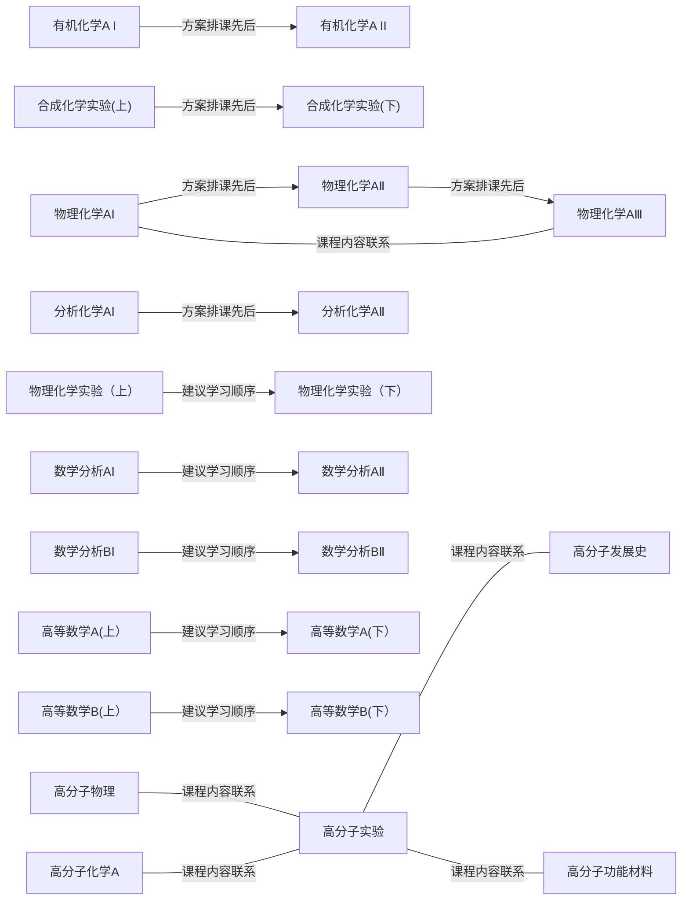

# 2024化学类（高分子化学）专业教学培养方案

高分子科学系 · 化学(高分子化学方向) · 方案 154475 · 72 个不同课程或科研条目。

[官方 Word](../originals/plan-154475.docx) · [教务详情](https://fdjwgl.fudan.edu.cn/manager/bizType/2/major-program-search/info/154475?skipAuth=1) · [方案快照](../raw/plan-154475.json.gz) · [年级目录](../README.md)

## 课程关系图

图中展示部分关系。下表保留全部已建立的课程对，来源位置使用本方案 JSON Pointer。

## 先修与内容联系

| 类型 | 起点 | 终点 | 依据 | 原表定位 |
| --- | --- | --- | --- | --- |
| 建议学习顺序 | 普通化学A（上） (CHEM10003) | 普通化学A（下） (CHEM10004) | 同方案的课程题名具有连续分册或序号。  | `/courseModules/7/planCourses/16`、`/courseModules/7/planCourses/17` |
| 建议学习顺序 | 分析化学AⅠ (CHEM20001) | 分析化学AⅡ (CHEM20002) | 同方案的课程题名具有连续分册或序号。  | `/courseModules/8/planCourses/1`、`/courseModules/13/planCourses/3` |
| 建议学习顺序 | 合成化学实验(上) (CHEM20004) | 合成化学实验(下) (CHEM30003) | 同方案的课程题名具有连续分册或序号。  | `/courseModules/8/planCourses/4`、`/courseModules/8/planCourses/9` |
| 建议学习顺序 | 物理化学AⅠ (CHEM20005) | 物理化学AⅡ (CHEM20006) | 同方案的课程题名具有连续分册或序号。  | `/courseModules/8/planCourses/3`、`/courseModules/8/planCourses/5` |
| 建议学习顺序 | 物理化学AⅡ (CHEM20006) | 物理化学AⅢ (CHEM30004) | 同方案的课程题名具有连续分册或序号。  | `/courseModules/8/planCourses/5`、`/courseModules/8/planCourses/10` |
| 建议学习顺序 | 物理化学A II(H) (CHEM20006h) | 物理化学A III(H) (CHEM30004h) | 同方案的课程题名具有连续分册或序号。  | `/courseModules/15/planCourses/0`、`/courseModules/15/planCourses/4` |
| 建议学习顺序 | 有机化学A I (CHEM20013) | 有机化学A II (CHEM20014) | 同方案的课程题名具有连续分册或序号。  | `/courseModules/8/planCourses/2`、`/courseModules/8/planCourses/7` |
| 建议学习顺序 | 物理化学实验（上） (CHEM30031) | 物理化学实验（下） (CHEM30032) | 同方案的课程题名具有连续分册或序号。  | `/courseModules/8/planCourses/8`、`/courseModules/8/planCourses/12` |
| 建议学习顺序 | 高等数学B(上） (MATH10004) | 高等数学B(下） (MATH10005) | 同方案的课程题名具有连续分册或序号。  | `/courseModules/7/planCourses/6`、`/courseModules/7/planCourses/7` |
| 建议学习顺序 | 数学分析AⅠ (MATH10010) | 数学分析AⅡ (MATH10011) | 同方案的课程题名具有连续分册或序号。  | `/courseModules/7/planCourses/0`、`/courseModules/7/planCourses/1` |
| 建议学习顺序 | 数学分析BⅠ (MATH10012) | 数学分析BⅡ (MATH10013) | 同方案的课程题名具有连续分册或序号。  | `/courseModules/7/planCourses/2`、`/courseModules/7/planCourses/3` |
| 建议学习顺序 | 高等数学A(上） (MATH10015) | 高等数学A(下） (MATH10016) | 同方案的课程题名具有连续分册或序号。  | `/courseModules/7/planCourses/4`、`/courseModules/7/planCourses/5` |
| 建议学习顺序 | 大学物理B(上) (PHYS10003) | 大学物理B(下) (PHYS10004) | 同方案的课程题名具有连续分册或序号。  | `/courseModules/7/planCourses/8`、`/courseModules/7/planCourses/9` |
| 方案排课先后 | 普通化学A（上） (CHEM10003) | 普通化学A（下） (CHEM10004) | 同方案该课程全部明确数字学期均早于后者。  | `/courseModules/7/planCourses/16`、`/courseModules/7/planCourses/17` |
| 方案排课先后 | 分析化学AⅠ (CHEM20001) | 分析化学AⅡ (CHEM20002) | 同方案该课程全部明确数字学期均早于后者。  | `/courseModules/8/planCourses/1`、`/courseModules/13/planCourses/3` |
| 方案排课先后 | 合成化学实验(上) (CHEM20004) | 合成化学实验(下) (CHEM30003) | 同方案该课程全部明确数字学期均早于后者。  | `/courseModules/8/planCourses/4`、`/courseModules/8/planCourses/9` |
| 方案排课先后 | 物理化学AⅠ (CHEM20005) | 物理化学AⅡ (CHEM20006) | 同方案该课程全部明确数字学期均早于后者。  | `/courseModules/8/planCourses/3`、`/courseModules/8/planCourses/5` |
| 方案排课先后 | 物理化学AⅡ (CHEM20006) | 物理化学AⅢ (CHEM30004) | 同方案该课程全部明确数字学期均早于后者。  | `/courseModules/8/planCourses/5`、`/courseModules/8/planCourses/10` |
| 方案排课先后 | 物理化学A II(H) (CHEM20006h) | 物理化学A III(H) (CHEM30004h) | 同方案该课程全部明确数字学期均早于后者。  | `/courseModules/15/planCourses/0`、`/courseModules/15/planCourses/4` |
| 方案排课先后 | 有机化学A I (CHEM20013) | 有机化学A II (CHEM20014) | 同方案该课程全部明确数字学期均早于后者。  | `/courseModules/8/planCourses/2`、`/courseModules/8/planCourses/7` |
| 方案排课先后 | 高等数学B(上） (MATH10004) | 高等数学B(下） (MATH10005) | 同方案该课程全部明确数字学期均早于后者。  | `/courseModules/7/planCourses/6`、`/courseModules/7/planCourses/7` |
| 方案排课先后 | 数学分析AⅠ (MATH10010) | 数学分析AⅡ (MATH10011) | 同方案该课程全部明确数字学期均早于后者。  | `/courseModules/7/planCourses/0`、`/courseModules/7/planCourses/1` |
| 方案排课先后 | 数学分析BⅠ (MATH10012) | 数学分析BⅡ (MATH10013) | 同方案该课程全部明确数字学期均早于后者。  | `/courseModules/7/planCourses/2`、`/courseModules/7/planCourses/3` |
| 方案排课先后 | 高等数学A(上） (MATH10015) | 高等数学A(下） (MATH10016) | 同方案该课程全部明确数字学期均早于后者。  | `/courseModules/7/planCourses/4`、`/courseModules/7/planCourses/5` |
| 方案排课先后 | 大学物理B(上) (PHYS10003) | 大学物理B(下) (PHYS10004) | 同方案该课程全部明确数字学期均早于后者。  | `/courseModules/7/planCourses/8`、`/courseModules/7/planCourses/9` |
| 课程内容联系 | 分析化学AⅠ (CHEM20001) | 分析化学AⅡ (CHEM20002) | 本方案两门课程的题名均含“分析化学”，可据此对照这一主题。  | `/courseModules/8/planCourses/1`、`/courseModules/13/planCourses/3` |
| 课程内容联系 | 物理化学AⅠ (CHEM20005) | 物理化学AⅡ (CHEM20006) | 本方案两门课程的题名均含“物理化学”，可据此对照这一主题。  | `/courseModules/8/planCourses/3`、`/courseModules/8/planCourses/5` |
| 课程内容联系 | 物理化学AⅠ (CHEM20005) | 物理化学AⅢ (CHEM30004) | 本方案两门课程的题名均含“物理化学”，可据此对照这一主题。  | `/courseModules/8/planCourses/3`、`/courseModules/8/planCourses/10` |
| 课程内容联系 | 物理化学AⅠ (CHEM20005) | 物理化学实验（上） (CHEM30031) | 本方案两门课程的题名均含“物理化学”，可据此对照这一主题。  | `/courseModules/8/planCourses/3`、`/courseModules/8/planCourses/8` |
| 课程内容联系 | 物理化学AⅠ (CHEM20005) | 物理化学实验（下） (CHEM30032) | 本方案两门课程的题名均含“物理化学”，可据此对照这一主题。  | `/courseModules/8/planCourses/3`、`/courseModules/8/planCourses/12` |
| 课程内容联系 | 有机化学A I (CHEM20013) | 有机化学A II (CHEM20014) | 本方案两门课程的题名均含“有机化学”，可据此对照这一主题。  | `/courseModules/8/planCourses/2`、`/courseModules/8/planCourses/7` |
| 课程内容联系 | 有机化学A I (CHEM20013) | 有机化学A II (H) (CHEM20014h) | 本方案两门课程的题名均含“有机化学”，可据此对照这一主题。  | `/courseModules/8/planCourses/2`、`/courseModules/15/planCourses/1` |
| 课程内容联系 | 线性代数 (CS10003) | 线性代数（理工类） (MATH10014) | 本方案两门课程的题名均含“线性代数”，可据此对照这一主题。  | `/courseModules/7/planCourses/11`、`/courseModules/7/planCourses/10` |
| 课程内容联系 | 高分子化学A (MASE30004) | 高分子实验 (MASE30006) | 本方案两门课程的题名均含“高分子”，可据此对照这一主题。  | `/courseModules/8/planCourses/11`、`/courseModules/8/planCourses/14` |
| 课程内容联系 | 高分子物理 (MASE30005) | 高分子实验 (MASE30006) | 本方案两门课程的题名均含“高分子”，可据此对照这一主题。  | `/courseModules/8/planCourses/13`、`/courseModules/8/planCourses/14` |
| 课程内容联系 | 高分子实验 (MASE30006) | 高分子功能材料 (MASE50011) | 本方案两门课程的题名均含“高分子”，可据此对照这一主题。  | `/courseModules/8/planCourses/14`、`/courseModules/12/planCourses/5` |
| 课程内容联系 | 高分子实验 (MASE30006) | 高分子发展史 (MASE50012) | 本方案两门课程的题名均含“高分子”，可据此对照这一主题。  | `/courseModules/8/planCourses/14`、`/courseModules/13/planCourses/1` |

本次未从可定位的明确表述中确认课程对课程预修。学期安排、系列分册与编辑建议均保留各自的依据。

## 按原方案模块阅读

同一模块展示原表中的课程归属。模块内课程之间的先后仍须逐项查阅。

- **技术科学类基础课程（交叉科学类适用）**　现代生物科学导论A、现代生物科学实验、普通化学A（上）、普通化学A（下）、普通化学实验I、线性代数、程序设计、模拟电子学基础、电子系统导论、高等数学B(上）、高等数学B(下）、数学分析AⅠ、数学分析AⅡ、数学分析BⅠ、数学分析BⅡ、线性代数（理工类）、高等数学A(上）、高等数学A(下）等25项（原表模块 7）

## 课程表

同一课程在不同模块分别出现时，按原表逐行列出。季节字段保留原值。

| 课程 | 代码 | 学分 | 学期 | 模块 |
| --- | --- | ---: | --- | --- |
| 数学分析AⅠ | MATH10010 | 5.0 | 第1学期 | 培养方案 / 专业培养课程 / 大类基础课程 / 技术科学类基础课程 / 技术科学类基础课程（交叉科学类适用） |
| 数学分析AⅡ | MATH10011 | 5.0 | 第2学期 | 培养方案 / 专业培养课程 / 大类基础课程 / 技术科学类基础课程 / 技术科学类基础课程（交叉科学类适用） |
| 数学分析BⅠ | MATH10012 | 5.0 | 第1学期 | 培养方案 / 专业培养课程 / 大类基础课程 / 技术科学类基础课程 / 技术科学类基础课程（交叉科学类适用） |
| 数学分析BⅡ | MATH10013 | 5.0 | 第2学期 | 培养方案 / 专业培养课程 / 大类基础课程 / 技术科学类基础课程 / 技术科学类基础课程（交叉科学类适用） |
| 高等数学A(上） | MATH10015 | 5.0 | 第1学期 | 培养方案 / 专业培养课程 / 大类基础课程 / 技术科学类基础课程 / 技术科学类基础课程（交叉科学类适用） |
| 高等数学A(下） | MATH10016 | 5.0 | 第2学期 | 培养方案 / 专业培养课程 / 大类基础课程 / 技术科学类基础课程 / 技术科学类基础课程（交叉科学类适用） |
| 高等数学B(上） | MATH10004 | 5.0 | 第1学期 | 培养方案 / 专业培养课程 / 大类基础课程 / 技术科学类基础课程 / 技术科学类基础课程（交叉科学类适用） |
| 高等数学B(下） | MATH10005 | 5.0 | 第2学期 | 培养方案 / 专业培养课程 / 大类基础课程 / 技术科学类基础课程 / 技术科学类基础课程（交叉科学类适用） |
| 大学物理B(上) | PHYS10003 | 4.0 | 第1学期 | 培养方案 / 专业培养课程 / 大类基础课程 / 技术科学类基础课程 / 技术科学类基础课程（交叉科学类适用） |
| 大学物理B(下) | PHYS10004 | 4.0 | 第2学期 | 培养方案 / 专业培养课程 / 大类基础课程 / 技术科学类基础课程 / 技术科学类基础课程（交叉科学类适用） |
| 线性代数（理工类） | MATH10014 | 3.0 | 第1学期 | 培养方案 / 专业培养课程 / 大类基础课程 / 技术科学类基础课程 / 技术科学类基础课程（交叉科学类适用） |
| 线性代数 | CS10003 | 3.0 | 第1学期 | 培养方案 / 专业培养课程 / 大类基础课程 / 技术科学类基础课程 / 技术科学类基础课程（交叉科学类适用） |
| 大学物理A：力学 | PHYS10006 | 4.0 | 第1学期 | 培养方案 / 专业培养课程 / 大类基础课程 / 技术科学类基础课程 / 技术科学类基础课程（交叉科学类适用） |
| 大学物理A：热学 | PHYS10007 | 2.0 | 第2学期 | 培养方案 / 专业培养课程 / 大类基础课程 / 技术科学类基础课程 / 技术科学类基础课程（交叉科学类适用） |
| 大学物理A：电磁学 | PHYS10008 | 4.0 | 第2学期 | 培养方案 / 专业培养课程 / 大类基础课程 / 技术科学类基础课程 / 技术科学类基础课程（交叉科学类适用） |
| 基础物理实验 | PHYS10005 | 2.0 | 第2学期 | 培养方案 / 专业培养课程 / 大类基础课程 / 技术科学类基础课程 / 技术科学类基础课程（交叉科学类适用） |
| 普通化学A（上） | CHEM10003 | 2.0 | 第1学期 | 培养方案 / 专业培养课程 / 大类基础课程 / 技术科学类基础课程 / 技术科学类基础课程（交叉科学类适用） |
| 普通化学A（下） | CHEM10004 | 2.0 | 第2学期 | 培养方案 / 专业培养课程 / 大类基础课程 / 技术科学类基础课程 / 技术科学类基础课程（交叉科学类适用） |
| 普通化学实验I | CHEM10005 | 1.0 | 第1学期 | 培养方案 / 专业培养课程 / 大类基础课程 / 技术科学类基础课程 / 技术科学类基础课程（交叉科学类适用） |
| 现代生物科学导论A | BIOL10001 | 3.0 | SPRING、AUTUMN | 培养方案 / 专业培养课程 / 大类基础课程 / 技术科学类基础课程 / 技术科学类基础课程（交叉科学类适用） |
| 程序设计 | CS10004 | 4.0 | 第1学期 | 培养方案 / 专业培养课程 / 大类基础课程 / 技术科学类基础课程 / 技术科学类基础课程（交叉科学类适用） |
| 模拟电子学基础 | EST10002 | 4.0 | 第2学期 | 培养方案 / 专业培养课程 / 大类基础课程 / 技术科学类基础课程 / 技术科学类基础课程（交叉科学类适用） |
| 电子系统导论 | EST10003 | 3.0 | 第2学期 | 培养方案 / 专业培养课程 / 大类基础课程 / 技术科学类基础课程 / 技术科学类基础课程（交叉科学类适用） |
| 现代生物科学实验 | BIOL10003 | 1.0 | 第1学期 | 培养方案 / 专业培养课程 / 大类基础课程 / 技术科学类基础课程 / 技术科学类基础课程（交叉科学类适用） |
| 心理学导论 | PSYC20001 | 3.0 | SPRING、AUTUMN | 培养方案 / 专业培养课程 / 大类基础课程 / 技术科学类基础课程 / 技术科学类基础课程（交叉科学类适用） |
| 普通化学 | MASE20001 | 2.0 | 第3学期 | 培养方案 / 专业培养课程 / 专业核心教育课程 |
| 分析化学AⅠ | CHEM20001 | 2.0 | 第3学期 | 培养方案 / 专业培养课程 / 专业核心教育课程 |
| 有机化学A I | CHEM20013 | 4.0 | 第3学期 | 培养方案 / 专业培养课程 / 专业核心教育课程 |
| 物理化学AⅠ | CHEM20005 | 3.0 | 第3学期 | 培养方案 / 专业培养课程 / 专业核心教育课程 |
| 合成化学实验(上) | CHEM20004 | 2.0 | 第4学期 | 培养方案 / 专业培养课程 / 专业核心教育课程 |
| 物理化学AⅡ | CHEM20006 | 3.0 | 第4学期 | 培养方案 / 专业培养课程 / 专业核心教育课程 |
| 化工原理 | CHEM30015 | 2.0 | 第4学期 | 培养方案 / 专业培养课程 / 专业核心教育课程 |
| 有机化学A II | CHEM20014 | 2.0 | 第4学期 | 培养方案 / 专业培养课程 / 专业核心教育课程 |
| 物理化学实验（上） | CHEM30031 | 2.0 | 第5学期 | 培养方案 / 专业培养课程 / 专业核心教育课程 |
| 合成化学实验(下) | CHEM30003 | 2.0 | 第5学期 | 培养方案 / 专业培养课程 / 专业核心教育课程 |
| 物理化学AⅢ | CHEM30004 | 3.0 | 第5学期 | 培养方案 / 专业培养课程 / 专业核心教育课程 |
| 高分子化学A | MASE30004 | 3.0 | 第5学期 | 培养方案 / 专业培养课程 / 专业核心教育课程 |
| 物理化学实验（下） | CHEM30032 | 2.0 | 第5学期 | 培养方案 / 专业培养课程 / 专业核心教育课程 |
| 高分子物理 | MASE30005 | 3.0 | 第6学期 | 培养方案 / 专业培养课程 / 专业核心教育课程 |
| 高分子实验 | MASE30006 | 4.0 | 第6学期 | 培养方案 / 专业培养课程 / 专业核心教育课程 |
| 生产实习 | MASE30009 | 2.0 | 第6学期 | 培养方案 / 专业培养课程 / 专业核心教育课程 |
| 毕业论文 | MASE40014 | 6.0 | 第8学期 | 培养方案 / 专业培养课程 / 专业核心教育课程 |
| 材料科学导论 | MASE50016 | 3.0 | 第3学期 | 培养方案 / 专业进阶模块I + II / 专业进阶模块I |
| 高分子反应工程 | MASE50006 | 2.0 | 第6学期 | 培养方案 / 专业进阶模块I + II / 专业进阶模块I |
| 高分子建模与设计 | MASE50008 | 2.0 | 第7学期 | 培养方案 / 专业进阶模块I + II / 专业进阶模块I |
| 学术伦理、科技写作与科技沟通 | MASE50009 | 2.0 | 第5学期 | 培养方案 / 专业进阶模块I + II / 专业进阶模块I |
| 高分子结构材料 | MASE50010 | 2.0 | 第7学期 | 培养方案 / 专业进阶模块I + II / 专业进阶模块I |
| 高分子功能材料 | MASE50011 | 2.0 | 第6学期 | 培养方案 / 专业进阶模块I + II / 专业进阶模块I |
| 高分子加工原理 | MASE50007 | 2.0 | 第7学期 | 培养方案 / 专业进阶模块I + II / 专业进阶模块I |
| 人工智能赋能高分子科学 | AIS310016 | 2.0 | 第7学期 | 培养方案 / 专业进阶模块I + II / 专业进阶模块I |
| 高分子流变学与加工 | MASE50015 | 2.0 | 第8学期 | 培养方案 / 专业进阶模块I + II / 专业进阶模块II |
| 高分子发展史 | MASE50012 | 2.0 | 第5学期 | 培养方案 / 专业进阶模块I + II / 专业进阶模块II |
| 生物大分子 | MASE50013 | 2.0 | 第7学期 | 培养方案 / 专业进阶模块I + II / 专业进阶模块II |
| 分析化学AⅡ | CHEM20002 | 2.0 | 第4学期 | 培养方案 / 专业进阶模块I + II / 专业进阶模块II |
| 高等高分子化学 | MASE60001 | 3.0 | 第6学期 | 培养方案 / 专业进阶模块I + II / 专业进阶模块II |
| 高分子凝聚态物理 | MASE60002 | 3.0 | 第7学期 | 培养方案 / 专业进阶模块I + II / 专业进阶模块II |
| 聚合物拓扑结构概论 | MASE50005 | 2.0 | SPRING、AUTUMN | 培养方案 / 专业进阶模块I + II / 专业进阶模块II |
| 谱学导论 | CHEM20007 | 3.0 | 第4学期 | 培养方案 / 专业进阶模块I + II / 专业进阶模块II |
| 高分子学术前沿讲座 | MASE30008 | 2.0 | SPRING、AUTUMN | 培养方案 / 专业进阶模块I + II / 专业进阶模块II |
| 合成高分子:更好的世界 | MASE50014 | 3.0 | 第4学期 | 培养方案 / 专业进阶模块I + II / 专业进阶模块II |
| 物理化学A II(H) | CHEM20006h | 4.0 | 第4学期 | 培养方案 / 荣誉课程 |
| 有机化学A II (H) | CHEM20014h | 4.0 | 第4学期 | 培养方案 / 荣誉课程 |
| 热力学与统计物理I(H) | PHYS20013h | 5.0 | 第4学期 | 培养方案 / 荣誉课程 |
| 数学物理方法A(H) | PHYS20006h | 5.0 | 第4学期 | 培养方案 / 荣誉课程 |
| 物理化学A III(H) | CHEM30004h | 4.0 | 第5学期 | 培养方案 / 荣誉课程 |
| 高分子化学A(H) | MASE30004h | 4.0 | 第5学期 | 培养方案 / 荣誉课程 |
| 高分子物理(H) | MASE30005h | 4.0 | 第6学期 | 培养方案 / 荣誉课程 |
| 高分子反应工程(H) | MASE50006h | 3.0 | 第6学期 | 培养方案 / 荣誉课程 |
| 高分子实验(H) | MASE30006h | 5.0 | 第6学期 | 培养方案 / 荣誉课程 |
| 生物化学(H) | BIOL30024h | 6.0 | 第6学期 | 培养方案 / 荣誉课程 |
| 高等高分子化学(H) | MASE60001h | 4.0 | 第7学期 | 培养方案 / 荣誉课程 |
| 高等高分子物理（H） | CHEM70001h | 4.0 | 第7学期 | 培养方案 / 荣誉课程 |
