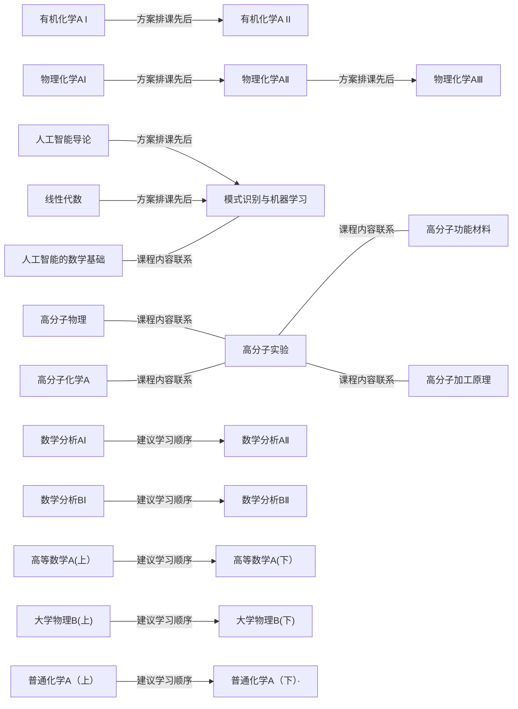

# 2025高分子材料与工程-信息与计算科学（人工智能方向）双学士学位项目培养方案

高分子科学系 · 高分子材料与工程-信息与计算科学(人工智能方向)(双学士学位项目) · 方案 97165 · 82 个不同课程或科研条目。

[官方 Word](../originals/plan-97165.docx) · [教务详情](https://fdjwgl.fudan.edu.cn/manager/bizType/2/major-program-search/info/97165?skipAuth=1) · [方案快照](../raw/plan-97165.json.gz) · [年级目录](../README.md)

## 修读导读

- **建议先学**　《人工智能导论》（`AIE310005`） → 《模式识别与机器学习》（`AIE410001`）。人工智能问题与模型类别可为学习模式识别作准备。方案分别列在第4、5学期。

- **可以对照着读**　《高分子物理》（`MASE30005`）与《高分子实验》（`MASE30006`）。两门课的题名都涉及高分子。选一种聚合物，比较链结构、材料形态和可观察到的性质。

- **查模块选课**　《高分子化学A》（`MASE30004`）、《分析化学AⅠ》（`CHEM20001`）列在“专业核心教育课程”中。模块说明写明“要求修读45学分（部分课程学分可用荣誉课程学分替换）”。原表见 `/courseModules/6`。

## 课程关系图

图中展示部分关系。下表保留全部已建立的课程对，来源位置使用本方案 JSON Pointer。

## 先修与内容联系

| 类型 | 起点 | 终点 | 依据 | 原表定位 |
| --- | --- | --- | --- | --- |
| 建议学习顺序 | 人工智能导论 (AIE310005) | 模式识别与机器学习 (AIE410001) | 人工智能问题与模型类别可为学习模式识别作准备。  | `/courseModules/6/planCourses/13`、`/courseModules/6/planCourses/15` |
| 建议学习顺序 | 普通化学A（上） (CHEM10003) | 普通化学A（下） (CHEM10004) | 同方案的课程题名具有连续分册或序号。  | `/courseModules/5/planCourses/12`、`/courseModules/5/planCourses/13` |
| 建议学习顺序 | 合成化学实验(上) (CHEM20004) | 合成化学实验(下) (CHEM30003) | 同方案的课程题名具有连续分册或序号。  | `/courseModules/17/planCourses/2`、`/courseModules/17/planCourses/5` |
| 建议学习顺序 | 物理化学AⅠ (CHEM20005) | 物理化学AⅡ (CHEM20006) | 同方案的课程题名具有连续分册或序号。  | `/courseModules/6/planCourses/2`、`/courseModules/6/planCourses/3` |
| 建议学习顺序 | 物理化学AⅡ (CHEM20006) | 物理化学AⅢ (CHEM30004) | 同方案的课程题名具有连续分册或序号。  | `/courseModules/6/planCourses/3`、`/courseModules/6/planCourses/6` |
| 建议学习顺序 | 物理化学A II(H) (CHEM20006h) | 物理化学A III(H) (CHEM30004h) | 同方案的课程题名具有连续分册或序号。  | `/courseModules/12/planCourses/3`、`/courseModules/12/planCourses/4` |
| 建议学习顺序 | 有机化学A I (CHEM20013) | 有机化学A II (CHEM20014) | 同方案的课程题名具有连续分册或序号。  | `/courseModules/6/planCourses/1`、`/courseModules/6/planCourses/5` |
| 建议学习顺序 | 物理化学实验（上） (CHEM30031) | 物理化学实验（下） (CHEM30032) | 同方案的课程题名具有连续分册或序号。  | `/courseModules/17/planCourses/7`、`/courseModules/17/planCourses/9` |
| 建议学习顺序 | 线性代数 (CS10003) | 模式识别与机器学习 (AIE410001) | 向量表示和矩阵运算支持理解分类、回归等模型。  | `/courseModules/5/planCourses/6`、`/courseModules/6/planCourses/15` |
| 建议学习顺序 | 数学分析AⅠ (MATH10010) | 数学分析AⅡ (MATH10011) | 同方案的课程题名具有连续分册或序号。  | `/courseModules/5/planCourses/0`、`/courseModules/5/planCourses/1` |
| 建议学习顺序 | 数学分析BⅠ (MATH10012) | 数学分析BⅡ (MATH10013) | 同方案的课程题名具有连续分册或序号。  | `/courseModules/5/planCourses/2`、`/courseModules/5/planCourses/3` |
| 建议学习顺序 | 高等数学A(上） (MATH10015) | 高等数学A(下） (MATH10016) | 同方案的课程题名具有连续分册或序号。  | `/courseModules/5/planCourses/4`、`/courseModules/5/planCourses/5` |
| 建议学习顺序 | 大学物理B(上) (PHYS10003) | 大学物理B(下) (PHYS10004) | 同方案的课程题名具有连续分册或序号。  | `/courseModules/5/planCourses/9`、`/courseModules/5/planCourses/10` |
| 方案排课先后 | 人工智能导论 (AIE310005) | 模式识别与机器学习 (AIE410001) | 同方案该课程全部明确数字学期均早于后者。  | `/courseModules/6/planCourses/13`、`/courseModules/6/planCourses/15` |
| 方案排课先后 | 普通化学A（上） (CHEM10003) | 普通化学A（下） (CHEM10004) | 同方案该课程全部明确数字学期均早于后者。  | `/courseModules/5/planCourses/12`、`/courseModules/5/planCourses/13` |
| 方案排课先后 | 合成化学实验(上) (CHEM20004) | 合成化学实验(下) (CHEM30003) | 同方案该课程全部明确数字学期均早于后者。  | `/courseModules/17/planCourses/2`、`/courseModules/17/planCourses/5` |
| 方案排课先后 | 物理化学AⅠ (CHEM20005) | 物理化学AⅡ (CHEM20006) | 同方案该课程全部明确数字学期均早于后者。  | `/courseModules/6/planCourses/2`、`/courseModules/6/planCourses/3` |
| 方案排课先后 | 物理化学AⅡ (CHEM20006) | 物理化学AⅢ (CHEM30004) | 同方案该课程全部明确数字学期均早于后者。  | `/courseModules/6/planCourses/3`、`/courseModules/6/planCourses/6` |
| 方案排课先后 | 物理化学A II(H) (CHEM20006h) | 物理化学A III(H) (CHEM30004h) | 同方案该课程全部明确数字学期均早于后者。  | `/courseModules/12/planCourses/3`、`/courseModules/12/planCourses/4` |
| 方案排课先后 | 有机化学A I (CHEM20013) | 有机化学A II (CHEM20014) | 同方案该课程全部明确数字学期均早于后者。  | `/courseModules/6/planCourses/1`、`/courseModules/6/planCourses/5` |
| 方案排课先后 | 物理化学实验（上） (CHEM30031) | 物理化学实验（下） (CHEM30032) | 同方案该课程全部明确数字学期均早于后者。  | `/courseModules/17/planCourses/7`、`/courseModules/17/planCourses/9` |
| 方案排课先后 | 线性代数 (CS10003) | 模式识别与机器学习 (AIE410001) | 同方案该课程全部明确数字学期均早于后者。  | `/courseModules/5/planCourses/6`、`/courseModules/6/planCourses/15` |
| 方案排课先后 | 大学物理B(上) (PHYS10003) | 大学物理B(下) (PHYS10004) | 同方案该课程全部明确数字学期均早于后者。  | `/courseModules/5/planCourses/9`、`/courseModules/5/planCourses/10` |
| 课程内容联系 | 计算机系统基础 (AIE210006) | 计算机组成与体系结构 (CS30052) | 处理器、存储与系统执行模型具有共同内容。  | `/courseModules/6/planCourses/12`、`/courseModules/10/planCourses/1` |
| 课程内容联系 | 人工智能导论 (AIE310005) | 人工智能安全 (AIE831001) | 本方案两门课程的题名均含“人工智能”，可据此对照这一主题。  | `/courseModules/6/planCourses/13`、`/courseModules/6/planCourses/16` |
| 课程内容联系 | 人工智能的编程基础 (AIE310006) | 人工智能安全 (AIE831001) | 本方案两门课程的题名均含“人工智能”，可据此对照这一主题。  | `/courseModules/6/planCourses/9`、`/courseModules/6/planCourses/16` |
| 课程内容联系 | 人工智能的软件基础 (AIE310008) | 人工智能安全 (AIE831001) | 本方案两门课程的题名均含“人工智能”，可据此对照这一主题。  | `/courseModules/6/planCourses/14`、`/courseModules/6/planCourses/16` |
| 课程内容联系 | 人工智能的数学基础 (AIE310009) | 模式识别与机器学习 (AIE410001) | 数学表达与学习模型的统计、优化工具可对照。  | `/courseModules/6/planCourses/11`、`/courseModules/6/planCourses/15` |
| 课程内容联系 | 人工智能的数学基础 (AIE310009) | 人工智能安全 (AIE831001) | 本方案两门课程的题名均含“人工智能”，可据此对照这一主题。  | `/courseModules/6/planCourses/11`、`/courseModules/6/planCourses/16` |
| 课程内容联系 | 模式识别与机器学习 (AIE410001) | 机器学习系统 (CS30058) | 本方案两门课程的题名均含“机器学习”，可据此对照这一主题。  | `/courseModules/6/planCourses/15`、`/courseModules/10/planCourses/5` |
| 课程内容联系 | 人工智能在分析化学中的应用 (AIT310024) | 分析化学AⅠ (CHEM20001) | 本方案两门课程的题名均含“分析化学”，可据此对照这一主题。  | `/courseModules/10/planCourses/8`、`/courseModules/6/planCourses/0` |
| 课程内容联系 | 物理化学AⅠ (CHEM20005) | 物理化学AⅡ (CHEM20006) | 本方案两门课程的题名均含“物理化学”，可据此对照这一主题。  | `/courseModules/6/planCourses/2`、`/courseModules/6/planCourses/3` |
| 课程内容联系 | 物理化学AⅠ (CHEM20005) | 物理化学AⅢ (CHEM30004) | 本方案两门课程的题名均含“物理化学”，可据此对照这一主题。  | `/courseModules/6/planCourses/2`、`/courseModules/6/planCourses/6` |
| 课程内容联系 | 物理化学AⅠ (CHEM20005) | 物理化学实验（上） (CHEM30031) | 本方案两门课程的题名均含“物理化学”，可据此对照这一主题。  | `/courseModules/6/planCourses/2`、`/courseModules/17/planCourses/7` |
| 课程内容联系 | 物理化学AⅠ (CHEM20005) | 物理化学实验（下） (CHEM30032) | 本方案两门课程的题名均含“物理化学”，可据此对照这一主题。  | `/courseModules/6/planCourses/2`、`/courseModules/17/planCourses/9` |
| 课程内容联系 | 有机化学A I (CHEM20013) | 有机化学A II (CHEM20014) | 本方案两门课程的题名均含“有机化学”，可据此对照这一主题。  | `/courseModules/6/planCourses/1`、`/courseModules/6/planCourses/5` |
| 课程内容联系 | 有机化学A I (CHEM20013) | 有机化学A II (H) (CHEM20014h) | 本方案两门课程的题名均含“有机化学”，可据此对照这一主题。  | `/courseModules/6/planCourses/1`、`/courseModules/12/planCourses/5` |
| 课程内容联系 | 线性代数 (CS10003) | 线性代数（理工类） (MATH10014) | 本方案两门课程的题名均含“线性代数”，可据此对照这一主题。  | `/courseModules/5/planCourses/6`、`/courseModules/5/planCourses/8` |
| 课程内容联系 | 高分子化学A (MASE30004) | 高分子实验 (MASE30006) | 本方案两门课程的题名均含“高分子”，可据此对照这一主题。  | `/courseModules/6/planCourses/7`、`/courseModules/17/planCourses/11` |
| 课程内容联系 | 高分子物理 (MASE30005) | 高分子实验 (MASE30006) | 本方案两门课程的题名均含“高分子”，可据此对照这一主题。  | `/courseModules/6/planCourses/8`、`/courseModules/17/planCourses/11` |
| 课程内容联系 | 高分子实验 (MASE30006) | 高分子加工原理 (MASE50007) | 本方案两门课程的题名均含“高分子”，可据此对照这一主题。  | `/courseModules/17/planCourses/11`、`/courseModules/9/planCourses/6` |
| 课程内容联系 | 高分子实验 (MASE30006) | 高分子功能材料 (MASE50011) | 本方案两门课程的题名均含“高分子”，可据此对照这一主题。  | `/courseModules/17/planCourses/11`、`/courseModules/9/planCourses/5` |

本次未从可定位的明确表述中确认课程对课程预修。学期安排、系列分册与编辑建议均保留各自的依据。

## 按原方案模块阅读

同一模块展示原表中的课程归属。模块内课程之间的先后仍须逐项查阅。

- **工学基础课程**　现代生物科学导论A、现代生物科学实验、普通化学A（上）、普通化学A（下）、普通化学实验I、线性代数、程序设计、模拟电子学基础、电子系统导论、普通化学、数学分析AⅠ、数学分析AⅡ、数学分析BⅠ、数学分析BⅡ、线性代数（理工类）、高等数学A(上）、高等数学A(下）、大学物理B(上)等20项（原表模块 5）
- **荣誉项目课程组**　生物化学(H)、物理化学A II(H)、有机化学A II (H)、物理化学A III(H)、高分子化学A(H)、高分子物理(H)、高分子实验(H)、高分子反应工程(H)、高等高分子化学(H)、热力学与统计物理I(H)、数学物理方法A(H)（原表模块 12）

## 课程表

同一课程在不同模块分别出现时，按原表逐行列出。季节字段保留原值。

| 课程 | 代码 | 学分 | 学期 | 模块 |
| --- | --- | ---: | --- | --- |
| 数学分析AⅠ | MATH10010 | 5.0 | AUTUMN | 培养方案 / 专业培养课程 / 大类基础课程 / 工学基础课程 |
| 数学分析AⅡ | MATH10011 | 5.0 | SPRING | 培养方案 / 专业培养课程 / 大类基础课程 / 工学基础课程 |
| 数学分析BⅠ | MATH10012 | 5.0 | AUTUMN | 培养方案 / 专业培养课程 / 大类基础课程 / 工学基础课程 |
| 数学分析BⅡ | MATH10013 | 5.0 | SPRING | 培养方案 / 专业培养课程 / 大类基础课程 / 工学基础课程 |
| 高等数学A(上） | MATH10015 | 5.0 | AUTUMN | 培养方案 / 专业培养课程 / 大类基础课程 / 工学基础课程 |
| 高等数学A(下） | MATH10016 | 5.0 | SPRING | 培养方案 / 专业培养课程 / 大类基础课程 / 工学基础课程 |
| 线性代数 | CS10003 | 3.0 | 第2学期 | 培养方案 / 专业培养课程 / 大类基础课程 / 工学基础课程 |
| 程序设计 | CS10004 | 4.0 | 第1学期 | 培养方案 / 专业培养课程 / 大类基础课程 / 工学基础课程 |
| 线性代数（理工类） | MATH10014 | 3.0 | SPRING、AUTUMN | 培养方案 / 专业培养课程 / 大类基础课程 / 工学基础课程 |
| 大学物理B(上) | PHYS10003 | 4.0 | 第1学期 | 培养方案 / 专业培养课程 / 大类基础课程 / 工学基础课程 |
| 大学物理B(下) | PHYS10004 | 4.0 | 第2学期 | 培养方案 / 专业培养课程 / 大类基础课程 / 工学基础课程 |
| 基础物理实验 | PHYS10005 | 2.0 | 第2学期 | 培养方案 / 专业培养课程 / 大类基础课程 / 工学基础课程 |
| 普通化学A（上） | CHEM10003 | 2.0 | 第1学期 | 培养方案 / 专业培养课程 / 大类基础课程 / 工学基础课程 |
| 普通化学A（下） | CHEM10004 | 2.0 | 第2学期 | 培养方案 / 专业培养课程 / 大类基础课程 / 工学基础课程 |
| 普通化学实验I | CHEM10005 | 1.0 | 第1学期 | 培养方案 / 专业培养课程 / 大类基础课程 / 工学基础课程 |
| 现代生物科学导论A | BIOL10001 | 3.0 | SPRING、AUTUMN | 培养方案 / 专业培养课程 / 大类基础课程 / 工学基础课程 |
| 现代生物科学实验 | BIOL10003 | 1.0 | 第1学期 | 培养方案 / 专业培养课程 / 大类基础课程 / 工学基础课程 |
| 模拟电子学基础 | EST10002 | 4.0 | 第2学期 | 培养方案 / 专业培养课程 / 大类基础课程 / 工学基础课程 |
| 电子系统导论 | EST10003 | 3.0 | 第2学期 | 培养方案 / 专业培养课程 / 大类基础课程 / 工学基础课程 |
| 普通化学 | MASE20001 | 2.0 | 第3学期 | 培养方案 / 专业培养课程 / 大类基础课程 / 工学基础课程 |
| 分析化学AⅠ | CHEM20001 | 2.0 | 第3学期 | 培养方案 / 专业培养课程 / 专业核心教育课程 |
| 有机化学A I | CHEM20013 | 4.0 | 第3学期 | 培养方案 / 专业培养课程 / 专业核心教育课程 |
| 物理化学AⅠ | CHEM20005 | 3.0 | 第3学期 | 培养方案 / 专业培养课程 / 专业核心教育课程 |
| 物理化学AⅡ | CHEM20006 | 3.0 | 第4学期 | 培养方案 / 专业培养课程 / 专业核心教育课程 |
| 化工原理 | CHEM30015 | 2.0 | 第4学期 | 培养方案 / 专业培养课程 / 专业核心教育课程 |
| 有机化学A II | CHEM20014 | 2.0 | 第4学期 | 培养方案 / 专业培养课程 / 专业核心教育课程 |
| 物理化学AⅢ | CHEM30004 | 3.0 | 第5学期 | 培养方案 / 专业培养课程 / 专业核心教育课程 |
| 高分子化学A | MASE30004 | 3.0 | 第5学期 | 培养方案 / 专业培养课程 / 专业核心教育课程 |
| 高分子物理 | MASE30005 | 3.0 | 第6学期 | 培养方案 / 专业培养课程 / 专业核心教育课程 |
| 人工智能的编程基础 | AIE310006 | 2.0 | 第2学期 | 培养方案 / 专业培养课程 / 专业核心教育课程 |
| 数据结构 | AIE310007 | 4.0 | 第3学期 | 培养方案 / 专业培养课程 / 专业核心教育课程 |
| 人工智能的数学基础 | AIE310009 | 3.0 | 第3学期 | 培养方案 / 专业培养课程 / 专业核心教育课程 |
| 计算机系统基础 | AIE210006 | 3.0 | 第3学期 | 培养方案 / 专业培养课程 / 专业核心教育课程 |
| 人工智能导论 | AIE310005 | 3.0 | 第4学期 | 培养方案 / 专业培养课程 / 专业核心教育课程 |
| 人工智能的软件基础 | AIE310008 | 3.0 | 第4学期 | 培养方案 / 专业培养课程 / 专业核心教育课程 |
| 模式识别与机器学习 | AIE410001 | 3.0 | 第5学期 | 培养方案 / 专业培养课程 / 专业核心教育课程 |
| 人工智能安全 | AIE831001 | 3.0 | 第5学期 | 培养方案 / 专业培养课程 / 专业核心教育课程 |
| 人工智能的伦理与治理 | PHIL50006 | 2.0 | SPRING | 培养方案 / 专业培养课程 / 专业核心教育课程 |
| 自然语言处理与大语言模型 | AIE410002 | 3.0 | 第6学期 | 培养方案 / 专业培养课程 / 专业核心教育课程 |
| 计算机视觉 | AIE310004 | 3.0 | 第7学期 | 培养方案 / 专业培养课程 / 专业核心教育课程 |
| 人工智能前沿探索实践 | AIE531001 | 3.0 | 第7学期 | 培养方案 / 专业培养课程 / 专业核心教育课程 |
| 谱学导论 | CHEM20007 | 3.0 | 第4学期 | 培养方案 / 专业培养课程 / 专业核心教育课程 |
| 材料科学导论 | MASE50016 | 3.0 | 第3学期 | 培养方案 / 专业进阶模块I |
| 高分子反应工程 | MASE50006 | 2.0 | 第6学期 | 培养方案 / 专业进阶模块I |
| 高分子建模与设计 | MASE50008 | 2.0 | 第7学期 | 培养方案 / 专业进阶模块I |
| 学术伦理、科技写作与科技沟通 | MASE50009 | 2.0 | 第5学期 | 培养方案 / 专业进阶模块I |
| 高分子结构材料 | MASE50010 | 2.0 | 第7学期 | 培养方案 / 专业进阶模块I |
| 高分子功能材料 | MASE50011 | 2.0 | 第6学期 | 培养方案 / 专业进阶模块I |
| 高分子加工原理 | MASE50007 | 2.0 | 第7学期 | 培养方案 / 专业进阶模块I |
| 集合与图论 | CS30043 | 3.0 | 第3学期 | 培养方案 / 专业进阶模块II |
| 计算机组成与体系结构 | CS30052 | 4.0 | 第4学期 | 培养方案 / 专业进阶模块II |
| 数据库引论 | CS20010 | 3.0 | 第4学期 | 培养方案 / 专业进阶模块II |
| 计算机网络 | CS30036 | 3.0 | 第5学期 | 培养方案 / 专业进阶模块II |
| 软件工程 | CS30018 | 3.0 | 第6学期 | 培养方案 / 专业进阶模块II |
| 机器学习系统 | CS30058 | 3.0 | 第6学期 | 培养方案 / 专业进阶模块II |
| 计算机图形学A | CS30019 | 3.0 | 第6学期 | 培养方案 / 专业进阶模块II |
| 人工智能赋能高分子科学 | AIS310016 | 2.0 | AUTUMN | 培养方案 / 专业进阶模块II |
| 人工智能在分析化学中的应用 | AIT310024 | 2.0 | AUTUMN | 培养方案 / 专业进阶模块II |
| AI在生物分子结构中的研究及应用 | AIS410014 | 2.0 | AUTUMN | 培养方案 / 专业进阶模块II |
| 高分子化学A(H) | MASE30004h | 4.0 | 第5学期 | 培养方案 / 荣誉项目课程组 |
| 高分子物理(H) | MASE30005h | 4.0 | 第6学期 | 培养方案 / 荣誉项目课程组 |
| 高分子实验(H) | MASE30006h | 5.0 | 第6学期 | 培养方案 / 荣誉项目课程组 |
| 物理化学A II(H) | CHEM20006h | 4.0 | 第4学期 | 培养方案 / 荣誉项目课程组 |
| 物理化学A III(H) | CHEM30004h | 4.0 | 第5学期 | 培养方案 / 荣誉项目课程组 |
| 有机化学A II (H) | CHEM20014h | 4.0 | 第4学期 | 培养方案 / 荣誉项目课程组 |
| 高分子反应工程(H) | MASE50006h | 3.0 | 第6学期 | 培养方案 / 荣誉项目课程组 |
| 热力学与统计物理I(H) | PHYS130007h | 4.0 | 第4学期 | 培养方案 / 荣誉项目课程组 |
| 数学物理方法A(H) | PHYS20006h | 5.0 | 第4学期 | 培养方案 / 荣誉项目课程组 |
| 生物化学(H) | BIOL30024h | 6.0 | 第6学期 | 培养方案 / 荣誉项目课程组 |
| 高等高分子化学(H) | MASE60001h | 4.0 | 第7学期 | 培养方案 / 荣誉项目课程组 |
| 复芏计划(FDUROP) | 102 | 0.0 |  | 融合创新能力 |
| 国际交流 | 7 | 0.0 |  | 融合创新能力 |
| 合成化学实验(上) | CHEM20004 | 2.0 | 第4学期 | 融合创新能力 |
| 高分子学术前沿讲座 | MASE30008 | 2.0 | 第3学期 | 融合创新能力 |
| 生产实习 | MASE30009 | 2.0 | 第6学期 | 融合创新能力 |
| 合成化学实验(下) | CHEM30003 | 2.0 | 第5学期 | 融合创新能力 |
| 科研实践 | MASE30003 | 3.0 | 第5学期 | 融合创新能力 |
| 物理化学实验（上） | CHEM30031 | 2.0 | 第5学期 | 融合创新能力 |
| 毕业论文 | MASE40013 | 2.0 | 第8学期 | 融合创新能力 |
| 物理化学实验（下） | CHEM30032 | 2.0 | 第6学期 | 融合创新能力 |
| 仪器分析实验 | CHEM20020 | 2.0 | 第4学期 | 融合创新能力 |
| 高分子实验 | MASE30006 | 4.0 | 第6学期 | 融合创新能力 |
