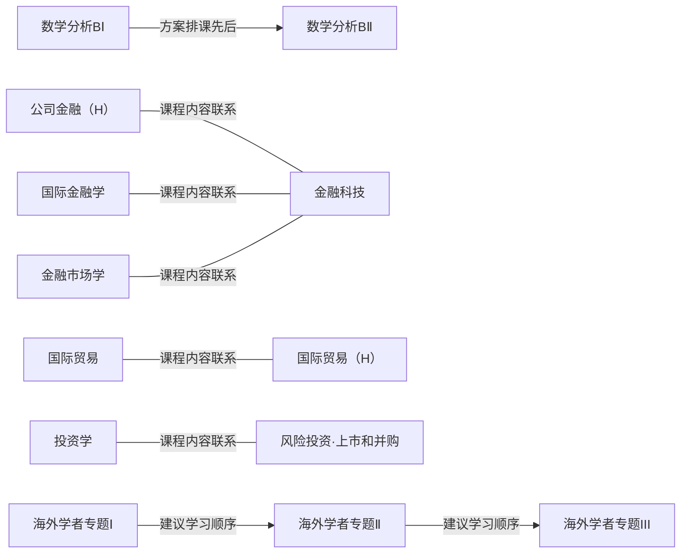

# 2023经济学专业(国际项目)“2+X”培养方案（留学生）

经济学院 · 经济学(国际项目) · 方案 67422 · 68 个不同课程或科研条目。

[官方 Word](../originals/plan-67422.docx) · [教务详情](https://fdjwgl.fudan.edu.cn/manager/bizType/2/major-program-search/info/67422?skipAuth=1) · [方案快照](../raw/plan-67422.json.gz) · [年级目录](../README.md)

## 修读导读

- **建议先学**　《海外学者专题Ⅰ》（`ECON50002`） → 《海外学者专题Ⅱ》（`ECON50003`） → 《海外学者专题III》（`ECON50005`）。题名列出连续册次或级别。可按编号整理各次讨论的问题、证据和待查文献，再比较专题之间的联系。

- **可以对照着读**　《公司金融（H）》（`ECON30144h`）与《金融科技》（`ECON30162`）。两门课的题名都涉及金融。用同一个融资案例比较谁提供资金、谁承担风险，以及从哪个市场观察它。

- **查模块选课**　《计量经济学（H）》（`ECON30137h`）、《国际经济学》（`ECON30140`）列在“专业核心教育课程”中。原表见 `/courseModules/7`。

## 课程关系图

图中展示部分关系。下表保留全部已建立的课程对，来源位置使用本方案 JSON Pointer。

## 先修与内容联系

| 类型 | 起点 | 终点 | 依据 | 原表定位 |
| --- | --- | --- | --- | --- |
| 建议学习顺序 | 海外学者专题Ⅰ (ECON50002) | 海外学者专题Ⅱ (ECON50003) | 同方案的课程题名具有连续分册或序号。  | `/courseModules/9/planCourses/9`、`/courseModules/9/planCourses/10` |
| 建议学习顺序 | 海外学者专题Ⅱ (ECON50003) | 海外学者专题III (ECON50005) | 同方案的课程题名具有连续分册或序号。  | `/courseModules/9/planCourses/10`、`/courseModules/9/planCourses/18` |
| 建议学习顺序 | 数学分析BⅠ (MATH10012) | 数学分析BⅡ (MATH10013) | 同方案的课程题名具有连续分册或序号。  | `/courseModules/6/planCourses/1`、`/courseModules/6/planCourses/2` |
| 方案排课先后 | 数学分析BⅠ (MATH10012) | 数学分析BⅡ (MATH10013) | 同方案该课程全部明确数字学期均早于后者。  | `/courseModules/6/planCourses/1`、`/courseModules/6/planCourses/2` |
| 课程内容联系 | 国际贸易 (ECON30018) | 国际贸易（H） (ECON40034h) | 本方案两门课程的题名均含“国际贸易”，可据此对照这一主题。  | `/courseModules/12/planCourses/1`、`/courseModules/9/planCourses/16` |
| 课程内容联系 | 金融市场学 (ECON30036) | 金融科技 (ECON30162) | 本方案两门课程的题名均含“金融”，可据此对照这一主题。  | `/courseModules/12/planCourses/2`、`/courseModules/12/planCourses/16` |
| 课程内容联系 | 风险管理学 (ECON30040) | 金融风险管理与金融工程 (ECON40019) | 本方案两门课程的题名均含“风险管理”，可据此对照这一主题。  | `/courseModules/12/planCourses/4`、`/courseModules/12/planCourses/3` |
| 课程内容联系 | 投资学 (ECON30126) | 风险投资，上市和并购 (MIB70010) | 本方案两门课程的题名均含“投资”，可据此对照这一主题。  | `/courseModules/12/planCourses/7`、`/courseModules/12/planCourses/19` |
| 课程内容联系 | 公司金融（H） (ECON30144h) | 金融科技 (ECON30162) | 本方案两门课程的题名均含“金融”，可据此对照这一主题。  | `/courseModules/7/planCourses/8`、`/courseModules/12/planCourses/16` |
| 课程内容联系 | 国际金融学 (ECON30149) | 金融科技 (ECON30162) | 本方案两门课程的题名均含“金融”，可据此对照这一主题。  | `/courseModules/9/planCourses/12`、`/courseModules/12/planCourses/16` |
| 课程内容联系 | 金融科技 (ECON30162) | 中国金融体系 (ECON40038) | 本方案两门课程的题名均含“金融”，可据此对照这一主题。  | `/courseModules/12/planCourses/16`、`/courseModules/9/planCourses/22` |

本次未从可定位的明确表述中确认课程对课程预修。学期安排、系列分册与编辑建议均保留各自的依据。

## 按原方案模块阅读

同一模块展示原表中的课程归属。模块内课程之间的先后仍须逐项查阅。

- **多元发展模块—专业进阶课程**　数据科学算法、博弈论、国际商务、应用微观经济学、产业组织、应用经济学、国际金融学、城市经济学、经济全球化与中国、经济超级大国的形成：1850年以来的中国、时间序列分析的方法、数量分析软件应用、经济学经典文献选读与写作、资产定价、资产定价、经济学前沿专题(H)、优化营商环境的法律对策、国际贸易（H）等27项（原表模块 9）
- **II组**　图像处理与可视化、人工智能、国际贸易、财政学、发展经济学、金融市场学、风险管理学、财务管理、国际营销学、微分方程、动态优化、劳动经济学、投资学、公共财政政策分析、金融科技、随机过程、中级财务会计、金融风险管理与金融工程等21项（原表模块 12）

## 课程表

同一课程在不同模块分别出现时，按原表逐行列出。季节字段保留原值。

| 课程 | 代码 | 学分 | 学期 | 模块 |
| --- | --- | ---: | --- | --- |
| 复旦大学英语水平测试 | GEEF30031 | 2.0 | SPRING、AUTUMN | 培养方案 / 通识教育课程 / 通识教育专项教育课程 / 复旦大学英语水平测试 |
| 概率论和数理统计 | ECON30157 | 5.0 | 第2学期 | 培养方案 / 专业培养课程 / 大类基础课程 |
| 数学分析BⅠ | MATH10012 | 5.0 | 第1学期 | 培养方案 / 专业培养课程 / 大类基础课程 |
| 数学分析BⅡ | MATH10013 | 5.0 | 第2学期 | 培养方案 / 专业培养课程 / 大类基础课程 |
| 线性代数 | MATH10017 | 3.0 | 第1学期 | 培养方案 / 专业培养课程 / 大类基础课程 |
| 微观经济学原理 | ECON20007 | 5.0 | 第1学期 | 培养方案 / 专业培养课程 / 大类基础课程 |
| 宏观经济学原理 | ECON20008 | 5.0 | 第2学期 | 培养方案 / 专业培养课程 / 大类基础课程 |
| 毕业论文 | ECON40014 | 6.0 | 第8学期 | 培养方案 / 专业培养课程 / 专业核心教育课程 |
| 计量经济学（H） | ECON30137h | 4.0 | 第3学期 | 培养方案 / 专业培养课程 / 专业核心教育课程 |
| 社会实习 | ECON30154 | 2.0 | 第7学期 | 培养方案 / 专业培养课程 / 专业核心教育课程 |
| 学术实习 | ECON30166 | 2.0 | SPRING、AUTUMN | 培养方案 / 专业培养课程 / 专业核心教育课程 |
| 国际经济学 | ECON30140 | 4.0 | 第4学期 | 培养方案 / 专业培养课程 / 专业核心教育课程 |
| 中级微观经济学 | ECON30141 | 5.0 | 第3学期 | 培养方案 / 专业培养课程 / 专业核心教育课程 |
| 中级宏观经济学 | ECON30142 | 5.0 | 第3学期 | 培养方案 / 专业培养课程 / 专业核心教育课程 |
| 当代中国经济 | ECON30143 | 4.0 | 第6学期 | 培养方案 / 专业培养课程 / 专业核心教育课程 |
| 公司金融（H） | ECON30144h | 4.0 | 第4学期 | 培养方案 / 专业培养课程 / 专业核心教育课程 |
| 经济史 | ECON30145 | 4.0 | 第3学期 | 培养方案 / 专业培养课程 / 专业核心教育课程 |
| 发展经济学（H） | ECON30148h | 4.0 | 第5学期 | 培养方案 / 专业培养课程 / 专业核心教育课程 |
| 货币银行学 | ECON30151 | 4.0 | 第4学期 | 培养方案 / 专业培养课程 / 专业核心教育课程 |
| 截面与面板数据分析（H） | ECON40035h | 4.0 | 第4学期 | 培养方案 / 专业培养课程 / 专业核心教育课程 |
| 博弈论 | ECON30054 | 3.0 | 第4学期 | 培养方案 / 多元发展模块—专业进阶课程 |
| 资产定价 | ECON40017 | 3.0 | 第6学期 | 培养方案 / 多元发展模块—专业进阶课程 |
| 资产定价 | ECON40024 | 4.0 | 第6学期 | 培养方案 / 多元发展模块—专业进阶课程 |
| 时间序列分析的方法 | ECON40004 | 3.0 | 第5学期 | 培养方案 / 多元发展模块—专业进阶课程 |
| 数量分析软件应用 | ECON40013 | 3.0 | 第6学期 | 培养方案 / 多元发展模块—专业进阶课程 |
| 应用微观经济学 | ECON30118 | 3.0 | 第6学期 | 培养方案 / 多元发展模块—专业进阶课程 |
| 经济学经典文献选读与写作 | ECON40016 | 2.0 | 第7学期 | 培养方案 / 多元发展模块—专业进阶课程 |
| 经济学前沿专题(H) | ECON40032h | 4.0 | 第6学期 | 培养方案 / 多元发展模块—专业进阶课程 |
| 产业组织 | ECON30139 | 4.0 | 第6学期 | 培养方案 / 多元发展模块—专业进阶课程 |
| 海外学者专题Ⅰ | ECON50002 | 4.0 | 第6学期 | 培养方案 / 多元发展模块—专业进阶课程 |
| 海外学者专题Ⅱ | ECON50003 | 4.0 | 第6学期 | 培养方案 / 多元发展模块—专业进阶课程 |
| 应用经济学 | ECON30146 | 4.0 | 第4学期 | 培养方案 / 多元发展模块—专业进阶课程 |
| 国际金融学 | ECON30149 | 4.0 | 第6学期 | 培养方案 / 多元发展模块—专业进阶课程 |
| 城市经济学 | ECON30150 | 4.0 | 第5学期 | 培养方案 / 多元发展模块—专业进阶课程 |
| 劳动经济学（H） | ECON40036h | 4.0 | 第5学期 | 培养方案 / 多元发展模块—专业进阶课程 |
| 经济全球化与中国 | ECON30152 | 4.0 | 第6学期 | 培养方案 / 多元发展模块—专业进阶课程 |
| 国际贸易（H） | ECON40034h | 4.0 | 第6学期 | 培养方案 / 多元发展模块—专业进阶课程 |
| 海外学者专题 | ECON50004 | 2.0 | 第6学期 | 培养方案 / 多元发展模块—专业进阶课程 |
| 海外学者专题III | ECON50005 | 2.0 | 第6学期 | 培养方案 / 多元发展模块—专业进阶课程 |
| 优化营商环境的法律对策 | ECON40033 | 2.0 | SPRING | 培养方案 / 多元发展模块—专业进阶课程 |
| 经济超级大国的形成：1850年以来的中国 | ECON30177 | 3.0 | AUTUMN | 培养方案 / 多元发展模块—专业进阶课程 |
| 经济数据分析与机器学习 | ECON40039 | 3.0 | AUTUMN | 培养方案 / 多元发展模块—专业进阶课程 |
| 中国金融体系 | ECON40038 | 3.0 | AUTUMN | 培养方案 / 多元发展模块—专业进阶课程 |
| 跨国公司 | ECON40037 | 3.0 | SPRING | 培养方案 / 多元发展模块—专业进阶课程 |
| 数据科学算法 | CS20007 | 3.0 | AUTUMN | 培养方案 / 多元发展模块—专业进阶课程 |
| 统计计算 | STAT30016 | 3.0 | AUTUMN | 培养方案 / 多元发展模块—专业进阶课程 |
| 国际商务 | ECON30069 | 3.0 | AUTUMN | 培养方案 / 多元发展模块—专业进阶课程 |
| 博弈论 | ECON30054 | 3.0 | 第4学期 | 培养方案 / 专业进阶课程 / I组 |
| 资产定价 | ECON40017 | 3.0 | 第6学期 | 培养方案 / 专业进阶课程 / I组 |
| 资产定价 | ECON40024 | 4.0 | 第6学期 | 培养方案 / 专业进阶课程 / I组 |
| 时间序列分析的方法 | ECON40004 | 3.0 | 第5学期 | 培养方案 / 专业进阶课程 / I组 |
| 数量分析软件应用 | ECON40013 | 3.0 | 第6学期 | 培养方案 / 专业进阶课程 / I组 |
| 应用微观经济学 | ECON30118 | 3.0 | 第6学期 | 培养方案 / 专业进阶课程 / I组 |
| 经济学经典文献选读与写作 | ECON40016 | 2.0 | 第7学期 | 培养方案 / 专业进阶课程 / I组 |
| 经济学前沿专题(H) | ECON40032h | 4.0 | 第6学期 | 培养方案 / 专业进阶课程 / I组 |
| 产业组织 | ECON30139 | 4.0 |  | 培养方案 / 专业进阶课程 / I组 |
| 海外学者专题Ⅰ | ECON50002 | 4.0 | 第6学期 | 培养方案 / 专业进阶课程 / I组 |
| 海外学者专题Ⅱ | ECON50003 | 4.0 | 第6学期 | 培养方案 / 专业进阶课程 / I组 |
| 应用经济学 | ECON30146 | 4.0 | 第4学期 | 培养方案 / 专业进阶课程 / I组 |
| 国际金融学 | ECON30149 | 4.0 |  | 培养方案 / 专业进阶课程 / I组 |
| 城市经济学 | ECON30150 | 4.0 | 第5学期 | 培养方案 / 专业进阶课程 / I组 |
| 劳动经济学（H） | ECON40036h | 4.0 | 第5学期 | 培养方案 / 专业进阶课程 / I组 |
| 经济全球化与中国 | ECON30152 | 4.0 | 第6学期 | 培养方案 / 专业进阶课程 / I组 |
| 国际贸易（H） | ECON40034h | 4.0 | 第6学期 | 培养方案 / 专业进阶课程 / I组 |
| 海外学者专题 | ECON50004 | 2.0 | 第6学期 | 培养方案 / 专业进阶课程 / I组 |
| 海外学者专题III | ECON50005 | 2.0 | 第6学期 | 培养方案 / 专业进阶课程 / I组 |
| 优化营商环境的法律对策 | ECON40033 | 2.0 | SPRING | 培养方案 / 专业进阶课程 / I组 |
| 经济超级大国的形成：1850年以来的中国 | ECON30177 | 3.0 | AUTUMN | 培养方案 / 专业进阶课程 / I组 |
| 经济数据分析与机器学习 | ECON40039 | 3.0 | AUTUMN | 培养方案 / 专业进阶课程 / I组 |
| 中国金融体系 | ECON40038 | 3.0 | AUTUMN | 培养方案 / 专业进阶课程 / I组 |
| 跨国公司 | ECON40037 | 3.0 | SPRING | 培养方案 / 专业进阶课程 / I组 |
| 数据科学算法 | CS20007 | 3.0 | AUTUMN | 培养方案 / 专业进阶课程 / I组 |
| 统计计算 | STAT30016 | 3.0 | AUTUMN | 培养方案 / 专业进阶课程 / I组 |
| 国际商务 | ECON30069 | 3.0 | AUTUMN | 培养方案 / 专业进阶课程 / I组 |
| 财政学 | ECON30019 | 3.0 | SPRING、AUTUMN | 培养方案 / 专业进阶课程 / II组 |
| 国际贸易 | ECON30018 | 3.0 | SPRING、AUTUMN | 培养方案 / 专业进阶课程 / II组 |
| 金融市场学 | ECON30036 | 3.0 | SPRING、AUTUMN | 培养方案 / 专业进阶课程 / II组 |
| 金融风险管理与金融工程 | ECON40019 | 3.0 | SPRING、AUTUMN | 培养方案 / 专业进阶课程 / II组 |
| 风险管理学 | ECON30040 | 3.0 | SPRING、AUTUMN | 培养方案 / 专业进阶课程 / II组 |
| 财务管理 | ECON30045 | 3.0 | SPRING、AUTUMN | 培养方案 / 专业进阶课程 / II组 |
| 图像处理与可视化 | CS30065 | 3.0 | SPRING、AUTUMN | 培养方案 / 专业进阶课程 / II组 |
| 投资学 | ECON30126 | 3.0 | SPRING、AUTUMN | 培养方案 / 专业进阶课程 / II组 |
| 劳动经济学 | ECON30113 | 3.0 | SPRING、AUTUMN | 培养方案 / 专业进阶课程 / II组 |
| 发展经济学 | ECON30026 | 3.0 | SPRING、AUTUMN | 培养方案 / 专业进阶课程 / II组 |
| 微分方程 | ECON30067 | 3.0 | SPRING、AUTUMN | 培养方案 / 专业进阶课程 / II组 |
| 动态优化 | ECON30094 | 3.0 | SPRING、AUTUMN | 培养方案 / 专业进阶课程 / II组 |
| 随机过程 | ECON40006 | 3.0 | SPRING、AUTUMN | 培养方案 / 专业进阶课程 / II组 |
| 人工智能 | CS50020 | 3.0 | SPRING、AUTUMN | 培养方案 / 专业进阶课程 / II组 |
| 国际营销学 | ECON30053 | 3.0 | SPRING、AUTUMN | 培养方案 / 专业进阶课程 / II组 |
| 中级财务会计 | ECON40009 | 3.0 | SPRING、AUTUMN | 培养方案 / 专业进阶课程 / II组 |
| 金融科技 | ECON30162 | 3.0 | SPRING、AUTUMN | 培养方案 / 专业进阶课程 / II组 |
| 公共财政政策分析 | ECON30130 | 3.0 | SPRING、AUTUMN | 培养方案 / 专业进阶课程 / II组 |
| 中国税收制度与财政政策 | MF70009 | 3.0 | SPRING | 培养方案 / 专业进阶课程 / II组 |
| 风险投资，上市和并购 | MIB70010 | 3.0 | SPRING | 培养方案 / 专业进阶课程 / II组 |
| 货币银行学 | MIB70015 | 3.0 | SPRING | 培养方案 / 专业进阶课程 / II组 |
