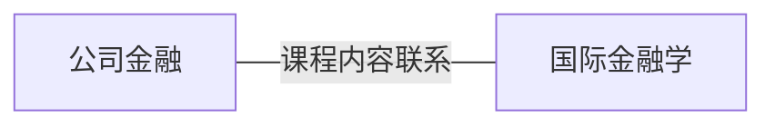

# 2024级经济学（国际项目）双学位教学培养方案（蒙特雷留学生）

经济学院 · 经济学(国际项目) · 方案 153732 · 23 个不同课程或科研条目。

[官方 Word](../originals/plan-153732.docx) · [教务详情](https://fdjwgl.fudan.edu.cn/manager/bizType/2/major-program-search/info/153732?skipAuth=1) · [方案快照](../raw/plan-153732.json.gz) · [年级目录](../README.md)

## 修读导读

- **可以对照着读**　《公司金融》（`ECON30144`）与《国际金融学》（`ECON30149`）。两门课的题名都涉及金融。用同一个融资案例比较谁提供资金、谁承担风险，以及从哪个市场观察它。

- **查模块选课**　《国际经济学》（`ECON30140`）、《中级微观经济学》（`ECON30141`）列在“专业核心教育课程”中。模块说明写明“要求修读30学分（部分课程学分可用荣誉课程学分替换）”。原表见 `/courseModules/2`。

## 课程关系图

图中展示部分关系。下表保留全部已建立的课程对，来源位置使用本方案 JSON Pointer。

## 先修与内容联系

| 类型 | 起点 | 终点 | 依据 | 原表定位 |
| --- | --- | --- | --- | --- |
| 课程内容联系 | 公司金融 (ECON30144) | 国际金融学 (ECON30149) | 本方案两门课程的题名均含“金融”，可据此对照这一主题。  | `/courseModules/2/planCourses/0`、`/courseModules/5/planCourses/1` |

本次未从可定位的明确表述中确认课程对课程预修。学期安排、系列分册与编辑建议均保留各自的依据。

## 课程表

同一课程在不同模块分别出现时，按原表逐行列出。季节字段保留原值。

| 课程 | 代码 | 学分 | 学期 | 模块 |
| --- | --- | ---: | --- | --- |
| 公司金融 | ECON30144 | 4.0 | 第2学期 | 培养方案 / 专业培养课程 / 专业核心教育课程 |
| 国际经济学 | ECON30140 | 4.0 | 第4学期 | 培养方案 / 专业培养课程 / 专业核心教育课程 |
| 经济史 | ECON30145 | 4.0 | 第3学期 | 培养方案 / 专业培养课程 / 专业核心教育课程 |
| 当代中国经济 | ECON30143 | 4.0 | 第6学期 | 培养方案 / 专业培养课程 / 专业核心教育课程 |
| 中级微观经济学 | ECON30141 | 5.0 | 第3学期 | 培养方案 / 专业培养课程 / 专业核心教育课程 |
| 计量经济学 | ECON30121 | 4.0 | 第4学期 | 培养方案 / 专业培养课程 / 专业核心教育课程 |
| 截面与面板数据分析 | ECON40001 | 4.0 | 第5学期 | 培养方案 / 专业培养课程 / 专业核心教育课程 |
| 发展经济学（H） | ECON30148h | 4.0 | 第5学期 | 培养方案 / 专业培养课程 / 专业核心教育课程 |
| 资产定价 | ECON40017 | 3.0 | 第6学期 | 培养方案 / 专业培养课程 / 专业核心教育课程 |
| 经济学前沿专题(H) | ECON40032h | 4.0 | 第6学期 | 培养方案 / 专业培养课程 / 专业核心教育课程 |
| 国际贸易（H） | ECON40034h | 4.0 | 第6学期 | 培养方案 / 专业培养课程 / 专业核心教育课程 |
| 应用微观经济学 | ECON30118 | 3.0 | 第6学期 | 培养方案 / 专业进阶1组 |
| 国际金融学 | ECON30149 | 4.0 | 第6学期 | 培养方案 / 专业进阶1组 |
| 博弈论 | ECON30054 | 3.0 | 第4学期 | 培养方案 / 专业进阶1组 |
| 经济数据分析与机器学习 | ECON40039 | 3.0 | 第7学期 | 培养方案 / 专业进阶1组 |
| 城市经济学 | ECON30150 | 4.0 | 第5学期 | 培养方案 / 专业进阶1组 |
| 经济全球化与中国 | ECON30152 | 4.0 | 第5学期 | 培养方案 / 专业进阶1组 |
| 时间序列分析的方法 | ECON40004 | 3.0 | 第5学期 | 培养方案 / 专业进阶1组 |
| 产业组织 | ECON30139 | 4.0 | 第6学期 | 培养方案 / 专业进阶1组 |
| 经济学经典文献选读与写作 | ECON40016 | 2.0 | 第7学期 | 培养方案 / 专业进阶1组 |
| 劳动经济学（H） | ECON40036h | 4.0 | 第5学期 | 培养方案 / 专业进阶1组 |
| 社会实践 | ECON30004 | 1.0 | 第7学期 | 融合创新能力 |
| 毕业论文 | ECON40014 | 6.0 | SPRING | 融合创新能力 |
