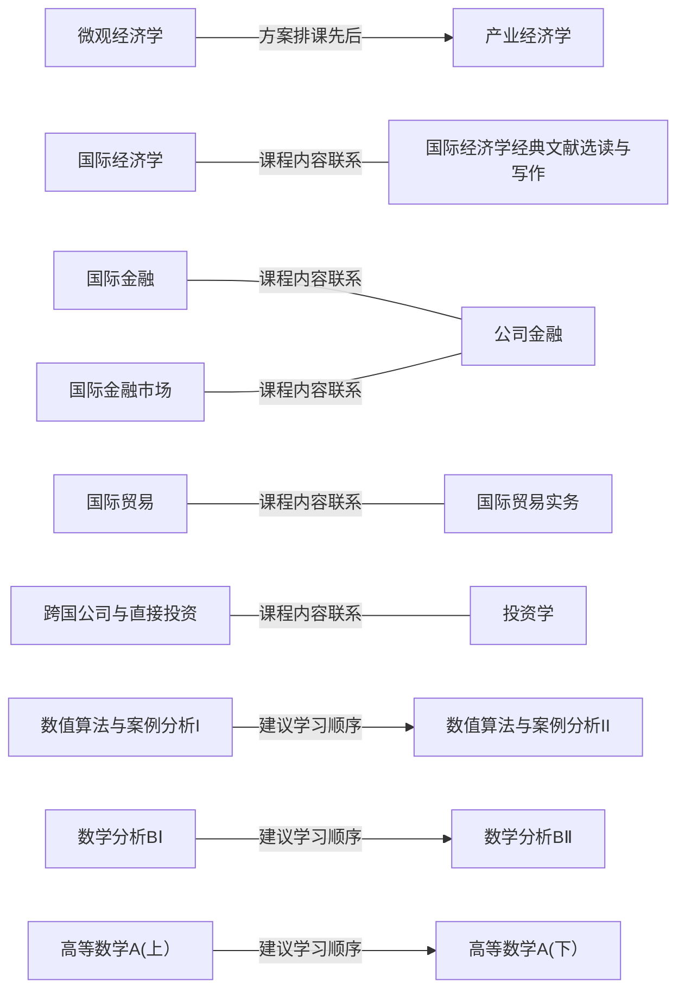

# 2024级国际经济与贸易-数据科学与大数据技术(双学士学位项目)专业“2+X”教学培养方案

经济学院 · 国际经济与贸易-数据科学与大数据技术(双学士学位项目) · 方案 72738 · 69 个不同课程或科研条目。

[官方 Word](../originals/plan-72738.docx) · [教务详情](https://fdjwgl.fudan.edu.cn/manager/bizType/2/major-program-search/info/72738?skipAuth=1) · [方案快照](../raw/plan-72738.json.gz) · [年级目录](../README.md)

## 课程关系图

图中展示部分关系。下表保留全部已建立的课程对，来源位置使用本方案 JSON Pointer。

## 先修与内容联系

| 类型 | 起点 | 终点 | 依据 | 原表定位 |
| --- | --- | --- | --- | --- |
| 建议学习顺序 | 微观经济学 (ECON20003) | 产业经济学 (ECON30025) | 企业和市场结构是产业经济分析的基础。  | `/courseModules/8/planCourses/2`、`/courseModules/10/planCourses/5` |
| 建议学习顺序 | 数学分析BⅠ (MATH10012) | 数学分析BⅡ (MATH10013) | 同方案的课程题名具有连续分册或序号。  | `/courseModules/6/planCourses/0`、`/courseModules/6/planCourses/1` |
| 建议学习顺序 | 高等数学A(上） (MATH10015) | 高等数学A(下） (MATH10016) | 同方案的课程题名具有连续分册或序号。  | `/courseModules/7/planCourses/1`、`/courseModules/7/planCourses/0` |
| 建议学习顺序 | 数值算法与案例分析I (MATH20007) | 数值算法与案例分析II (MATH50009) | 同方案的课程题名具有连续分册或序号。  | `/courseModules/12/planCourses/2`、`/courseModules/21/planCourses/0` |
| 方案排课先后 | 微观经济学 (ECON20003) | 产业经济学 (ECON30025) | 同方案该课程全部明确数字学期均早于后者。  | `/courseModules/8/planCourses/2`、`/courseModules/10/planCourses/5` |
| 课程内容联系 | 人工智能与应用经济学 (AIS410005) | 人工智能 (CS50020) | 本方案两门课程的题名均含“人工智能”，可据此对照这一主题。  | `/courseModules/19/planCourses/3`、`/courseModules/12/planCourses/7` |
| 课程内容联系 | 人工智能中的稀疏理论与应用 (AIS631010) | 人工智能 (CS50020) | 本方案两门课程的题名均含“人工智能”，可据此对照这一主题。  | `/courseModules/21/planCourses/6`、`/courseModules/12/planCourses/7` |
| 课程内容联系 | 国际金融 (ECON30017) | 公司金融 (ECON30122) | 本方案两门课程的题名均含“金融”，可据此对照这一主题。  | `/courseModules/11/planCourses/2`、`/courseModules/10/planCourses/2` |
| 课程内容联系 | 国际贸易 (ECON30018) | 国际贸易实务 (ECON30052) | 本方案两门课程的题名均含“国际贸易”，可据此对照这一主题。  | `/courseModules/11/planCourses/1`、`/courseModules/18/planCourses/4` |
| 课程内容联系 | 国际经济学 (ECON30029) | 国际经济学经典文献选读与写作 (ECON30125) | 本方案两门课程的题名均含“国际经济”，可据此对照这一主题。  | `/courseModules/10/planCourses/3`、`/courseModules/11/planCourses/4` |
| 课程内容联系 | 跨国公司与直接投资 (ECON30033) | 投资学 (ECON30126) | 本方案两门课程的题名均含“投资”，可据此对照这一主题。  | `/courseModules/18/planCourses/3`、`/courseModules/18/planCourses/0` |
| 课程内容联系 | 国际金融市场 (ECON30116) | 公司金融 (ECON30122) | 本方案两门课程的题名均含“金融”，可据此对照这一主题。  | `/courseModules/18/planCourses/5`、`/courseModules/10/planCourses/2` |
| 课程内容联系 | 公司金融 (ECON30122) | 金融工程 (STAT50022) | 本方案两门课程的题名均含“金融”，可据此对照这一主题。  | `/courseModules/10/planCourses/2`、`/courseModules/22/planCourses/2` |
| 课程内容联系 | 高等线性代数 (MATH10003) | 线性代数 (MATH10017) | 本方案两门课程的题名均含“线性代数”，可据此对照这一主题。  | `/courseModules/12/planCourses/0`、`/courseModules/8/planCourses/5` |
| 课程内容联系 | 统计学基础：原理、方法及R应用 (I) (STAT20010) | 统计学基础II：回归分析 (STAT50024) | 本方案两门课程的题名均含“统计学”，可据此对照这一主题。  | `/courseModules/12/planCourses/4`、`/courseModules/21/planCourses/3` |

本次未从可定位的明确表述中确认课程对课程预修。学期安排、系列分册与编辑建议均保留各自的依据。

## 按原方案模块阅读

同一模块展示原表中的课程归属。模块内课程之间的先后仍须逐项查阅。

- **数学分析B**　数学分析BⅠ、数学分析BⅡ（原表模块 6）
- **高等数学A**　高等数学A(上）、高等数学A(下）（原表模块 7）
- **专业基础课程**　会计学、程序设计、微观经济学、宏观经济学、政治经济学、线性代数（原表模块 8）
- **核心课程**　财政学、当代中国经济、产业经济学、国际经济学、经济史、计量经济学、公司金融、概率论基础（原表模块 10）
- **核心课程**　国际金融、国际贸易、社会实践、国际商务、企业国际化、世界经济、国际经济学经典文献选读与写作、社会实习、毕业论文（原表模块 11）
- **核心课程**　数据结构、数据库及实现、神经网络与深度学习、图像处理与可视化、人工智能、高等线性代数、数值算法与案例分析I、最优化方法、统计学基础：原理、方法及R应用 (I)、统计（机器）学习概论、统计计算（原表模块 12）
- **应用模块**　发展经济学、比较经济学、国际政治经济学、国际货币经济学（原表模块 17）
- **应用模块**　跨国公司与直接投资、国别和地区经济、国际贸易实务、国际营销学、国际金融市场、投资学（原表模块 18）
- **方法模块**　人工智能与应用经济学、时间序列分析的方法、截面与面板数据分析、数量分析软件应用（原表模块 19）

## 课程表

同一课程在不同模块分别出现时，按原表逐行列出。季节字段保留原值。

| 课程 | 代码 | 学分 | 学期 | 模块 |
| --- | --- | ---: | --- | --- |
| 数学分析BⅠ | MATH10012 | 5.0 | SPRING、AUTUMN | 培养方案 / 大类基础课程 / 数学类基础课程 / 数学分析B |
| 数学分析BⅡ | MATH10013 | 5.0 | SPRING、AUTUMN | 培养方案 / 大类基础课程 / 数学类基础课程 / 数学分析B |
| 高等数学A(下） | MATH10016 | 5.0 | SPRING、AUTUMN | 培养方案 / 大类基础课程 / 数学类基础课程 / 高等数学A |
| 高等数学A(上） | MATH10015 | 5.0 | SPRING、AUTUMN | 培养方案 / 大类基础课程 / 数学类基础课程 / 高等数学A |
| 政治经济学 | ECON20006 | 3.0 | 第1学期 | 培养方案 / 大类基础课程 / 专业基础课程 |
| 程序设计 | CS10004 | 4.0 | 第1学期 | 培养方案 / 大类基础课程 / 专业基础课程 |
| 微观经济学 | ECON20003 | 3.0 | 第2学期 | 培养方案 / 大类基础课程 / 专业基础课程 |
| 宏观经济学 | ECON20004 | 3.0 | 第3学期 | 培养方案 / 大类基础课程 / 专业基础课程 |
| 会计学 | BA10003 | 3.0 | 第2学期 | 培养方案 / 大类基础课程 / 专业基础课程 |
| 线性代数 | MATH10017 | 3.0 | 第2学期 | 培养方案 / 大类基础课程 / 专业基础课程 |
| 概率论基础 | STAT20011 | 3.0 | 第3学期 | 培养方案 / 专业核心教育课程 / 核心课程 |
| 计量经济学 | ECON30121 | 4.0 | 第4学期 | 培养方案 / 专业核心教育课程 / 核心课程 |
| 公司金融 | ECON30122 | 3.0 | 第3学期 | 培养方案 / 专业核心教育课程 / 核心课程 |
| 国际经济学 | ECON30029 | 3.0 | 第4学期 | 培养方案 / 专业核心教育课程 / 核心课程 |
| 财政学 | ECON30019 | 3.0 | 第4学期 | 培养方案 / 专业核心教育课程 / 核心课程 |
| 产业经济学 | ECON30025 | 3.0 | 第6学期 | 培养方案 / 专业核心教育课程 / 核心课程 |
| 经济史 | ECON30120 | 3.0 | 第3学期 | 培养方案 / 专业核心教育课程 / 核心课程 |
| 当代中国经济 | ECON30024 | 3.0 | 第5学期 | 培养方案 / 专业核心教育课程 / 核心课程 |
| 世界经济 | ECON30124 | 3.0 | 第3学期 | 培养方案 / 专业核心教育课程 / 核心课程 |
| 国际贸易 | ECON30018 | 3.0 | 第5学期 | 培养方案 / 专业核心教育课程 / 核心课程 |
| 国际金融 | ECON30017 | 3.0 | 第5学期 | 培养方案 / 专业核心教育课程 / 核心课程 |
| 企业国际化 | ECON30114 | 3.0 | 第6学期 | 培养方案 / 专业核心教育课程 / 核心课程 |
| 国际经济学经典文献选读与写作 | ECON30125 | 2.0 | 第6学期 | 培养方案 / 专业核心教育课程 / 核心课程 |
| 国际商务 | ECON30069 | 3.0 | 第6学期 | 培养方案 / 专业核心教育课程 / 核心课程 |
| 社会实践 | ECON30027 | 2.0 | 第6学期 | 培养方案 / 专业核心教育课程 / 核心课程 |
| 社会实习 | ECON30154 | 2.0 | 第6学期 | 培养方案 / 专业核心教育课程 / 核心课程 |
| 毕业论文 | ECON40003 | 4.0 | 第8学期 | 培养方案 / 专业核心教育课程 / 核心课程 |
| 高等线性代数 | MATH10003 | 3.0 | 第3学期 | 培养方案 / 专业核心教育课程 / 核心课程 |
| 数据结构 | CS20017 | 4.0 | 第3学期 | 培养方案 / 专业核心教育课程 / 核心课程 |
| 数值算法与案例分析I | MATH20007 | 3.0 | 第3学期 | 培养方案 / 专业核心教育课程 / 核心课程 |
| 数据库及实现 | CS20019 | 3.0 | 第4学期 | 培养方案 / 专业核心教育课程 / 核心课程 |
| 统计学基础：原理、方法及R应用 (I) | STAT20010 | 3.0 | 第4学期 | 培养方案 / 专业核心教育课程 / 核心课程 |
| 最优化方法 | MATH20008 | 3.0 | 第4学期 | 培养方案 / 专业核心教育课程 / 核心课程 |
| 统计（机器）学习概论 | STAT30015 | 3.0 | 第5学期 | 培养方案 / 专业核心教育课程 / 核心课程 |
| 人工智能 | CS50020 | 3.0 | 第7学期 | 培养方案 / 专业核心教育课程 / 核心课程 |
| 神经网络与深度学习 | CS30064 | 3.0 | 第8学期 | 培养方案 / 专业核心教育课程 / 核心课程 |
| 图像处理与可视化 | CS30065 | 3.0 | 第5学期 | 培养方案 / 专业核心教育课程 / 核心课程 |
| 统计计算 | STAT30016 | 3.0 | 第7学期 | 培养方案 / 专业核心教育课程 / 核心课程 |
| 博弈论 | ECON30054 | 3.0 | 第4学期 | 培养方案 / 专业进阶I组 / A组 |
| 货币经济学 | ECON30032 | 3.0 | 第5学期 | 培养方案 / 专业进阶I组 / A组 |
| 比较经济学 | ECON30031 | 3.0 | 第5学期 | 培养方案 / 专业进阶I组 / B组 / 应用模块 |
| 发展经济学 | ECON30026 | 3.0 | 第7学期 | 培养方案 / 专业进阶I组 / B组 / 应用模块 |
| 国际政治经济学 | ECON30050 | 3.0 | 第7学期 | 培养方案 / 专业进阶I组 / B组 / 应用模块 |
| 国际货币经济学 | ECON30117 | 2.0 | 第6学期 | 培养方案 / 专业进阶I组 / B组 / 应用模块 |
| 投资学 | ECON30126 | 3.0 | 第4学期 | 培养方案 / 专业进阶I组 / B组 / 应用模块 |
| 国别和地区经济 | ECON30051 | 3.0 | 第4学期 | 培养方案 / 专业进阶I组 / B组 / 应用模块 |
| 国际营销学 | ECON30053 | 3.0 | 第5学期 | 培养方案 / 专业进阶I组 / B组 / 应用模块 |
| 跨国公司与直接投资 | ECON30033 | 3.0 | 第6学期 | 培养方案 / 专业进阶I组 / B组 / 应用模块 |
| 国际贸易实务 | ECON30052 | 3.0 | 第6学期 | 培养方案 / 专业进阶I组 / B组 / 应用模块 |
| 国际金融市场 | ECON30116 | 2.0 | 第8学期 | 培养方案 / 专业进阶I组 / B组 / 应用模块 |
| 截面与面板数据分析 | ECON40012 | 3.0 | SPRING、AUTUMN | 培养方案 / 专业进阶I组 / B组 / 方法模块 |
| 数量分析软件应用 | ECON40013 | 3.0 | SPRING、AUTUMN | 培养方案 / 专业进阶I组 / B组 / 方法模块 |
| 时间序列分析的方法 | ECON40004 | 3.0 | SPRING、AUTUMN | 培养方案 / 专业进阶I组 / B组 / 方法模块 |
| 人工智能与应用经济学 | AIS410005 | 3.0 | AUTUMN | 培养方案 / 专业进阶I组 / B组 / 方法模块 |
| 数值算法与案例分析II | MATH50009 | 3.0 | SPRING、AUTUMN | 培养方案 / 专业进阶II组 / A组 |
| 计算机原理 | CS20018 | 3.0 | SPRING、AUTUMN | 培养方案 / 专业进阶II组 / A组 |
| 随机过程导论 | STAT50017 | 3.0 | SPRING、AUTUMN | 培养方案 / 专业进阶II组 / A组 |
| 统计学基础II：回归分析 | STAT50024 | 3.0 | SPRING、AUTUMN | 培养方案 / 专业进阶II组 / A组 |
| 时间序列与空间统计 | STAT50016 | 3.0 | SPRING、AUTUMN | 培养方案 / 专业进阶II组 / A组 |
| 多模态数据同化 | AIS410010 | 3.0 | SPRING、AUTUMN | 培养方案 / 专业进阶II组 / A组 |
| 人工智能中的稀疏理论与应用 | AIS631010 | 3.0 | SPRING、AUTUMN | 培养方案 / 专业进阶II组 / A组 |
| 多元统计分析 | STAT50023 | 3.0 | SPRING、AUTUMN | 培养方案 / 专业进阶II组 / A组 |
| 因果推断与因果学习 | STAT50026 | 3.0 | SPRING、AUTUMN | 培养方案 / 专业进阶II组 / A组 |
| 图像处理与可视化 | CS30065 | 3.0 | SPRING、AUTUMN | 培养方案 / 专业进阶II组 / B组 |
| 大规模分布式系统 | CS50022 | 3.0 | SPRING、AUTUMN | 培养方案 / 专业进阶II组 / B组 |
| 金融工程 | STAT50022 | 3.0 | SPRING、AUTUMN | 培养方案 / 专业进阶II组 / B组 |
| 自然语言处理 | CS50023 | 3.0 | SPRING、AUTUMN | 培养方案 / 专业进阶II组 / B组 |
| 计算机视觉 | CS50028 | 3.0 | SPRING、AUTUMN | 培养方案 / 专业进阶II组 / B组 |
| 认知智能前沿技术与实践 | AIT531023 | 3.0 | SPRING、AUTUMN | 培养方案 / 专业进阶II组 / B组 |
| 社交网络挖掘 | CS50019 | 3.0 | SPRING、AUTUMN | 培养方案 / 专业进阶II组 / B组 |
