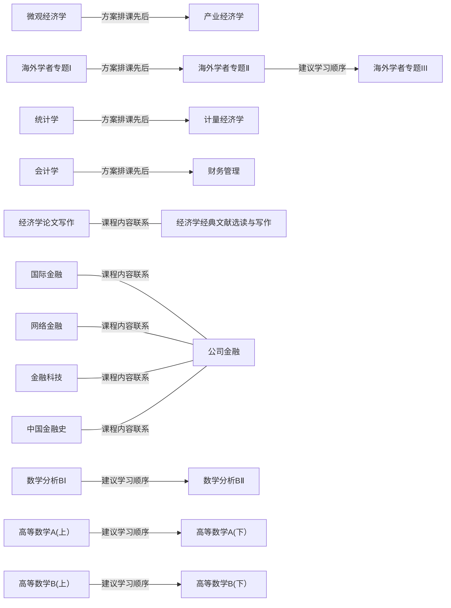

# 2024级经济学专业“2+X”教学培养方案（留学生）

经济学院 · 经济学 · 方案 72781 · 151 个不同课程或科研条目。

[官方 Word](../originals/plan-72781.docx) · [教务详情](https://fdjwgl.fudan.edu.cn/manager/bizType/2/major-program-search/info/72781?skipAuth=1) · [方案快照](../raw/plan-72781.json.gz) · [年级目录](../README.md)

## 课程关系图

图中展示部分关系。下表保留全部已建立的课程对，来源位置使用本方案 JSON Pointer。

## 先修与内容联系

| 类型 | 起点 | 终点 | 依据 | 原表定位 |
| --- | --- | --- | --- | --- |
| 建议学习顺序 | 会计学 (BA10003) | 财务管理 (ECON30045) | 会计报表和核算概念可用于理解财务决策。  | `/courseModules/9/planCourses/4`、`/courseModules/20/planCourses/10` |
| 建议学习顺序 | 微观经济学 (ECON20003) | 产业经济学 (ECON30025) | 企业和市场结构是产业经济分析的基础。  | `/courseModules/9/planCourses/1`、`/courseModules/11/planCourses/7` |
| 建议学习顺序 | 海外学者专题Ⅰ (ECON50002) | 海外学者专题Ⅱ (ECON50003) | 同方案的课程题名具有连续分册或序号。  | `/courseModules/20/planCourses/75`、`/courseModules/20/planCourses/76` |
| 建议学习顺序 | 海外学者专题Ⅱ (ECON50003) | 海外学者专题III (ECON50005) | 同方案的课程题名具有连续分册或序号。  | `/courseModules/20/planCourses/76`、`/courseModules/20/planCourses/96` |
| 建议学习顺序 | 高等数学B(上） (MATH10004) | 高等数学B(下） (MATH10005) | 同方案的课程题名具有连续分册或序号。  | `/courseModules/8/planCourses/1`、`/courseModules/8/planCourses/0` |
| 建议学习顺序 | 数学分析BⅠ (MATH10012) | 数学分析BⅡ (MATH10013) | 同方案的课程题名具有连续分册或序号。  | `/courseModules/6/planCourses/0`、`/courseModules/6/planCourses/1` |
| 建议学习顺序 | 高等数学A(上） (MATH10015) | 高等数学A(下） (MATH10016) | 同方案的课程题名具有连续分册或序号。  | `/courseModules/7/planCourses/1`、`/courseModules/7/planCourses/0` |
| 建议学习顺序 | 统计学 (SOCI20003) | 计量经济学 (ECON30121) | 统计推断为计量模型的估计与检验提供基础。  | `/courseModules/9/planCourses/3`、`/courseModules/11/planCourses/2` |
| 方案排课先后 | 会计学 (BA10003) | 财务管理 (ECON30045) | 同方案该课程全部明确数字学期均早于后者。  | `/courseModules/9/planCourses/4`、`/courseModules/20/planCourses/10` |
| 方案排课先后 | 微观经济学 (ECON20003) | 产业经济学 (ECON30025) | 同方案该课程全部明确数字学期均早于后者。  | `/courseModules/9/planCourses/1`、`/courseModules/11/planCourses/7` |
| 方案排课先后 | 海外学者专题Ⅰ (ECON50002) | 海外学者专题Ⅱ (ECON50003) | 同方案该课程全部明确数字学期均早于后者。  | `/courseModules/20/planCourses/75`、`/courseModules/20/planCourses/76` |
| 方案排课先后 | 统计学 (SOCI20003) | 计量经济学 (ECON30121) | 同方案该课程全部明确数字学期均早于后者。  | `/courseModules/9/planCourses/3`、`/courseModules/11/planCourses/2` |
| 课程内容联系 | 人工智能与应用经济学 (AIS410005) | 人工智能 (CS30057) | 本方案两门课程的题名均含“人工智能”，可据此对照这一主题。  | `/courseModules/18/planCourses/3`、`/courseModules/20/planCourses/89` |
| 课程内容联系 | 金融科技 (AIS531008) | 公司金融 (ECON30122) | 本方案两门课程的题名均含“金融”，可据此对照这一主题。  | `/courseModules/20/planCourses/85`、`/courseModules/11/planCourses/4` |
| 课程内容联系 | 会计学 (BA10003) | 财务管理 (ECON30045) | 会计信息与企业融资、投资决策存在应用联系。  | `/courseModules/9/planCourses/4`、`/courseModules/20/planCourses/10` |
| 课程内容联系 | 会计学 (BA10003) | 中级财务会计 (ECON40009) | 本方案两门课程的题名均含“会计”，可据此对照这一主题。  | `/courseModules/9/planCourses/4`、`/courseModules/20/planCourses/33` |
| 课程内容联系 | 国际金融 (ECON30017) | 公司金融 (ECON30122) | 本方案两门课程的题名均含“金融”，可据此对照这一主题。  | `/courseModules/17/planCourses/8`、`/courseModules/11/planCourses/4` |
| 课程内容联系 | 国际贸易 (ECON30018) | 国际贸易实务 (ECON30052) | 本方案两门课程的题名均含“国际贸易”，可据此对照这一主题。  | `/courseModules/17/planCourses/7`、`/courseModules/20/planCourses/13` |
| 课程内容联系 | 跨国公司与直接投资 (ECON30033) | 投资学 (ECON30126) | 本方案两门课程的题名均含“投资”，可据此对照这一主题。  | `/courseModules/20/planCourses/2`、`/courseModules/16/planCourses/0` |
| 课程内容联系 | 风险管理学 (ECON30040) | 金融风险管理 (ECON30102) | 本方案两门课程的题名均含“风险管理”，可据此对照这一主题。  | `/courseModules/20/planCourses/5`、`/courseModules/20/planCourses/46` |
| 课程内容联系 | 风险管理学 (ECON30040) | 企业风险管理 (ECON30134) | 本方案两门课程的题名均含“风险管理”，可据此对照这一主题。  | `/courseModules/20/planCourses/5`、`/courseModules/20/planCourses/70` |
| 课程内容联系 | 风险管理学 (ECON30040) | 金融风险管理与金融工程 (ECON40019) | 本方案两门课程的题名均含“风险管理”，可据此对照这一主题。  | `/courseModules/20/planCourses/5`、`/courseModules/20/planCourses/60` |
| 课程内容联系 | 投资银行理论与实务 (ECON30058) | 投资学 (ECON30126) | 本方案两门课程的题名均含“投资”，可据此对照这一主题。  | `/courseModules/20/planCourses/18`、`/courseModules/16/planCourses/0` |
| 课程内容联系 | 风险投资导论 (ECON30060) | 投资学 (ECON30126) | 本方案两门课程的题名均含“投资”，可据此对照这一主题。  | `/courseModules/20/planCourses/19`、`/courseModules/16/planCourses/0` |
| 课程内容联系 | 网络金融 (ECON30061) | 公司金融 (ECON30122) | 本方案两门课程的题名均含“金融”，可据此对照这一主题。  | `/courseModules/20/planCourses/21`、`/courseModules/11/planCourses/4` |
| 课程内容联系 | 人口与社会保障经济学 (ECON30077) | 社会保障 (ECON30090) | 本方案两门课程的题名均含“社会保障”，可据此对照这一主题。  | `/courseModules/17/planCourses/16`、`/courseModules/20/planCourses/38` |
| 课程内容联系 | 中国金融史 (ECON30080) | 公司金融 (ECON30122) | 本方案两门课程的题名均含“金融”，可据此对照这一主题。  | `/courseModules/20/planCourses/34`、`/courseModules/11/planCourses/4` |
| 课程内容联系 | 计量经济学 (ECON30121) | 空间计量经济学 (ECON40020) | 本方案两门课程的题名均含“计量经济”，可据此对照这一主题。  | `/courseModules/11/planCourses/2`、`/courseModules/20/planCourses/62` |
| 课程内容联系 | 经济学论文写作 (ECON30147) | 经济学经典文献选读与写作 (ECON40016) | 本方案两门课程的题名均含“写作”，可据此对照这一主题。  | `/courseModules/20/planCourses/78`、`/courseModules/12/planCourses/5` |
| 课程内容联系 | 精算统计学 (ECON30158) | 统计学 (SOCI20003) | 本方案两门课程的题名均含“统计学”，可据此对照这一主题。  | `/courseModules/20/planCourses/83`、`/courseModules/9/planCourses/3` |

本次未从可定位的明确表述中确认课程对课程预修。学期安排、系列分册与编辑建议均保留各自的依据。

## 按原方案模块阅读

同一模块展示原表中的课程归属。模块内课程之间的先后仍须逐项查阅。

- **数学分析B**　数学分析BⅠ、数学分析BⅡ（原表模块 6）
- **高等数学A**　高等数学A(上）、高等数学A(下）（原表模块 7）
- **高等数学B**　高等数学B(上）、高等数学B(下）（原表模块 8）
- **专业基础课程**　会计学、微观经济学、宏观经济学、政治经济学、线性代数、统计学（原表模块 9）
- **B组方法**　人工智能与应用经济学、时间序列分析的方法、截面与面板数据分析、数量分析软件应用（原表模块 18）
- **B组方法**　人工智能与应用经济学、时间序列分析的方法、截面与面板数据分析、数量分析软件应用（原表模块 25）

## 课程表

同一课程在不同模块分别出现时，按原表逐行列出。季节字段保留原值。

| 课程 | 代码 | 学分 | 学期 | 模块 |
| --- | --- | ---: | --- | --- |
| 数学分析BⅠ | MATH10012 | 5.0 | SPRING、AUTUMN | 培养方案 / 大类基础课程 / 数学类基础课程 / 数学分析B |
| 数学分析BⅡ | MATH10013 | 5.0 | SPRING、AUTUMN | 培养方案 / 大类基础课程 / 数学类基础课程 / 数学分析B |
| 高等数学A(下） | MATH10016 | 5.0 | SPRING、AUTUMN | 培养方案 / 大类基础课程 / 数学类基础课程 / 高等数学A |
| 高等数学A(上） | MATH10015 | 5.0 | SPRING、AUTUMN | 培养方案 / 大类基础课程 / 数学类基础课程 / 高等数学A |
| 高等数学B(下） | MATH10005 | 5.0 | SPRING、AUTUMN | 培养方案 / 大类基础课程 / 数学类基础课程 / 高等数学B |
| 高等数学B(上） | MATH10004 | 5.0 | SPRING、AUTUMN | 培养方案 / 大类基础课程 / 数学类基础课程 / 高等数学B |
| 政治经济学 | ECON20006 | 3.0 | 第1学期 | 培养方案 / 大类基础课程 / 专业基础课程 |
| 微观经济学 | ECON20003 | 3.0 | 第2学期 | 培养方案 / 大类基础课程 / 专业基础课程 |
| 宏观经济学 | ECON20004 | 3.0 | 第3学期 | 培养方案 / 大类基础课程 / 专业基础课程 |
| 统计学 | SOCI20003 | 3.0 | 第1学期 | 培养方案 / 大类基础课程 / 专业基础课程 |
| 会计学 | BA10003 | 3.0 | 第2学期 | 培养方案 / 大类基础课程 / 专业基础课程 |
| 线性代数 | MATH10017 | 3.0 | 第2学期 | 培养方案 / 大类基础课程 / 专业基础课程 |
| 概率论与数理统计 | ECON30016 | 3.0 | 第3学期 | 培养方案 / 专业核心教育课程 / 专业核心教育课程 |
| 经济史 | ECON30120 | 3.0 | 第3学期 | 培养方案 / 专业核心教育课程 / 专业核心教育课程 |
| 计量经济学 | ECON30121 | 4.0 | 第4学期 | 培养方案 / 专业核心教育课程 / 专业核心教育课程 |
| 当代中国经济 | ECON30024 | 3.0 | 第5学期 | 培养方案 / 专业核心教育课程 / 专业核心教育课程 |
| 公司金融 | ECON30122 | 3.0 | 第3学期 | 培养方案 / 专业核心教育课程 / 专业核心教育课程 |
| 国际经济学 | ECON30029 | 3.0 | 第4学期 | 培养方案 / 专业核心教育课程 / 专业核心教育课程 |
| 财政学 | ECON30019 | 3.0 | 第4学期 | 培养方案 / 专业核心教育课程 / 专业核心教育课程 |
| 产业经济学 | ECON30025 | 3.0 | 第6学期 | 培养方案 / 专业核心教育课程 / 专业核心教育课程 |
| 制度经济学 | ECON30074 | 3.0 | 第3学期 | 培养方案 / 专业核心教育课程 / 专业核心教育课程 |
| 外国经济思想史 | ECON30075 | 3.0 | 第3学期 | 培养方案 / 专业核心教育课程 / 专业核心教育课程 |
| 博弈论 | ECON30054 | 3.0 | 第4学期 | 培养方案 / 专业核心教育课程 / 专业核心教育课程 |
| 资本论 | ECON30023 | 3.0 | 第6学期 | 培养方案 / 专业核心教育课程 / 专业核心教育课程 |
| 资源环境经济学 | ECON30136 | 3.0 | 第6学期 | 培养方案 / 专业核心教育课程 / 专业核心教育课程 |
| 经济学经典文献选读与写作 | ECON40016 | 2.0 | 第7学期 | 培养方案 / 专业核心教育课程 / 专业核心教育课程 |
| 社会实践 | ECON30027 | 2.0 | 第6学期 | 培养方案 / 专业核心教育课程 / 专业核心教育课程 |
| 社会实习 | ECON30154 | 2.0 | 第6学期 | 培养方案 / 专业核心教育课程 / 专业核心教育课程 |
| 毕业论文 | ECON40003 | 4.0 | 第8学期 | 培养方案 / 专业核心教育课程 / 专业核心教育课程 |
| 投资学 | ECON30126 | 3.0 | 第6学期 | 培养方案 / 专业进阶路径 / 专业进阶I组 / A组 |
| 数量经济学 | ECON30107 | 3.0 | 第4学期 | 培养方案 / 专业进阶路径 / 专业进阶I组 / A组 |
| 中国经济思想史 | ECON30088 | 2.0 | 第5学期 | 培养方案 / 专业进阶路径 / 专业进阶I组 / B组 |
| 信息经济学 | ECON30081 | 2.0 | 第5学期 | 培养方案 / 专业进阶路径 / 专业进阶I组 / B组 |
| 当代政治经济学前沿(H) | ECON40031h | 4.0 | 第6学期 | 培养方案 / 专业进阶路径 / 专业进阶I组 / B组 |
| 发展经济学 | ECON30026 | 3.0 | 第7学期 | 培养方案 / 专业进阶路径 / 专业进阶I组 / B组 |
| 中国政府与经济 | ECON30159 | 3.0 | 第7学期 | 培养方案 / 专业进阶路径 / 专业进阶I组 / B组 |
| 当代经济学前沿 | ECON40015 | 3.0 | 第7学期 | 培养方案 / 专业进阶路径 / 专业进阶I组 / B组 |
| 企业管理 | ECON30046 | 3.0 | 第4学期 | 培养方案 / 专业进阶路径 / 专业进阶I组 / B组 |
| 国际贸易 | ECON30018 | 3.0 | 第4学期 | 培养方案 / 专业进阶路径 / 专业进阶I组 / B组 |
| 国际金融 | ECON30017 | 3.0 | 第5学期 | 培养方案 / 专业进阶路径 / 专业进阶I组 / B组 |
| 农村和农业经济学 | ECON30048 | 2.0 | 第5学期 | 培养方案 / 专业进阶路径 / 专业进阶I组 / B组 |
| 能源与气候变化经济学 | ECON30104 | 3.0 | 第5学期 | 培养方案 / 专业进阶路径 / 专业进阶I组 / B组 |
| 货币银行学 | ECON30021 | 3.0 | 第5学期 | 培养方案 / 专业进阶路径 / 专业进阶I组 / B组 |
| 公司财务学 | ECON30034 | 3.0 | 第6学期 | 培养方案 / 专业进阶路径 / 专业进阶I组 / B组 |
| 劳动经济学 | ECON30113 | 3.0 | 第6学期 | 培养方案 / 专业进阶路径 / 专业进阶I组 / B组 |
| 区域经济学 | ECON30047 | 2.0 | 第7学期 | 培养方案 / 专业进阶路径 / 专业进阶I组 / B组 |
| 城市经济学 | ECON30049 | 3.0 | 第7学期 | 培养方案 / 专业进阶路径 / 专业进阶I组 / B组 |
| 人口与社会保障经济学 | ECON30077 | 2.0 | 第7学期 | 培养方案 / 专业进阶路径 / 专业进阶I组 / B组 |
| 时间序列分析的方法 | ECON40004 | 3.0 | SPRING、AUTUMN | 培养方案 / 专业进阶路径 / 专业进阶I组 / B组方法 |
| 截面与面板数据分析 | ECON40012 | 3.0 | SPRING、AUTUMN | 培养方案 / 专业进阶路径 / 专业进阶I组 / B组方法 |
| 数量分析软件应用 | ECON40013 | 3.0 | SPRING、AUTUMN | 培养方案 / 专业进阶路径 / 专业进阶I组 / B组方法 |
| 人工智能与应用经济学 | AIS410005 | 3.0 | SPRING、AUTUMN | 培养方案 / 专业进阶路径 / 专业进阶I组 / B组方法 |
| 比较经济学 | ECON30031 | 3.0 | 第5学期 | 培养方案 / 专业进阶路径 / 专业进阶II组 / A组 |
| 货币经济学 | ECON30032 | 3.0 | 第5学期 | 培养方案 / 专业进阶路径 / 专业进阶II组 / A组 |
| 跨国公司与直接投资 | ECON30033 | 3.0 | 第6学期 | 培养方案 / 专业进阶路径 / 专业进阶II组 / A组 |
| 商业银行业务与管理 | ECON30035 | 3.0 | 第7学期 | 培养方案 / 专业进阶路径 / 专业进阶II组 / A组 |
| 金融市场学 | ECON30036 | 3.0 | 第3学期 | 培养方案 / 专业进阶路径 / 专业进阶II组 / A组 |
| 风险管理学 | ECON30040 | 3.0 | 第4学期 | 培养方案 / 专业进阶路径 / 专业进阶II组 / A组 |
| 税收学 | ECON30041 | 3.0 | 第3学期 | 培养方案 / 专业进阶路径 / 专业进阶II组 / A组 |
| 国际税收 | ECON30042 | 3.0 | 第6学期 | 培养方案 / 专业进阶路径 / 专业进阶II组 / A组 |
| 国有资产管理 | ECON30043 | 3.0 | 第6学期 | 培养方案 / 专业进阶路径 / 专业进阶II组 / A组 |
| 国家预算 | ECON30044 | 3.0 | 第5学期 | 培养方案 / 专业进阶路径 / 专业进阶II组 / A组 |
| 财务管理 | ECON30045 | 3.0 | 第4学期 | 培养方案 / 专业进阶路径 / 专业进阶II组 / A组 |
| 国际政治经济学 | ECON30050 | 3.0 | 第7学期 | 培养方案 / 专业进阶路径 / 专业进阶II组 / A组 |
| 国别和地区经济 | ECON30051 | 3.0 | 第4学期 | 培养方案 / 专业进阶路径 / 专业进阶II组 / A组 |
| 国际贸易实务 | ECON30052 | 3.0 | 第6学期 | 培养方案 / 专业进阶路径 / 专业进阶II组 / A组 |
| 国际营销学 | ECON30053 | 3.0 | 第5学期 | 培养方案 / 专业进阶路径 / 专业进阶II组 / A组 |
| 公司财务分析 | ECON30055 | 2.0 | 第6学期 | 培养方案 / 专业进阶路径 / 专业进阶II组 / A组 |
| 欧美金融史 | ECON30056 | 2.0 | 第6学期 | 培养方案 / 专业进阶路径 / 专业进阶II组 / A组 |
| 项目评估 | ECON30057 | 2.0 | 第6学期 | 培养方案 / 专业进阶路径 / 专业进阶II组 / A组 |
| 投资银行理论与实务 | ECON30058 | 3.0 | 第7学期 | 培养方案 / 专业进阶路径 / 专业进阶II组 / A组 |
| 风险投资导论 | ECON30060 | 3.0 | 第4学期 | 培养方案 / 专业进阶路径 / 专业进阶II组 / A组 |
| 兼并和收购 | ECON130087 | 2.0 | 第5学期 | 培养方案 / 专业进阶路径 / 专业进阶II组 / A组 |
| 网络金融 | ECON30061 | 3.0 | 第8学期 | 培养方案 / 专业进阶路径 / 专业进阶II组 / A组 |
| 金融经济学 | ECON40005 | 2.0 | 第6学期 | 培养方案 / 专业进阶路径 / 专业进阶II组 / A组 |
| 海上保险 | ECON30062 | 2.0 | 第3学期 | 培养方案 / 专业进阶路径 / 专业进阶II组 / A组 |
| 再保险 | ECON30063 | 2.0 | 第6学期 | 培养方案 / 专业进阶路径 / 专业进阶II组 / A组 |
| 社会保险比较研究 | ECON30064 | 2.0 | 第6学期 | 培养方案 / 专业进阶路径 / 专业进阶II组 / A组 |
| 保险法 | ECON30065 | 2.0 | 第5学期 | 培养方案 / 专业进阶路径 / 专业进阶II组 / A组 |
| 微分方程 | ECON30067 | 3.0 | 第4学期 | 培养方案 / 专业进阶路径 / 专业进阶II组 / A组 |
| 国际商务 | ECON30069 | 3.0 | 第6学期 | 培养方案 / 专业进阶路径 / 专业进阶II组 / A组 |
| 税收筹划 | ECON30070 | 2.0 | 第4学期 | 培养方案 / 专业进阶路径 / 专业进阶II组 / A组 |
| 比较财政学 | ECON30071 | 2.0 | 第5学期 | 培养方案 / 专业进阶路径 / 专业进阶II组 / A组 |
| 人寿与健康保险 | ECON30073 | 3.0 | 第5学期 | 培养方案 / 专业进阶路径 / 专业进阶II组 / A组 |
| 随机过程 | ECON40006 | 3.0 | 第5学期 | 培养方案 / 专业进阶路径 / 专业进阶II组 / A组 |
| 中级财务会计 | ECON40009 | 3.0 | 第4学期 | 培养方案 / 专业进阶路径 / 专业进阶II组 / A组 |
| 中国金融史 | ECON30080 | 2.0 | 第3学期 | 培养方案 / 专业进阶路径 / 专业进阶II组 / A组 |
| 公司治理 | ECON30082 | 2.0 | 第7学期 | 培养方案 / 专业进阶路径 / 专业进阶II组 / A组 |
| 行为金融学 | ECON40010 | 2.0 | 第7学期 | 培养方案 / 专业进阶路径 / 专业进阶II组 / A组 |
| 中国货币政策 | ECON30083 | 2.0 | 第5学期 | 培养方案 / 专业进阶路径 / 专业进阶II组 / A组 |
| 社会保障 | ECON30090 | 3.0 | 第5学期 | 培养方案 / 专业进阶路径 / 专业进阶II组 / A组 |
| 保险公司财务管理 | ECON30091 | 2.0 | 第5学期 | 培养方案 / 专业进阶路径 / 专业进阶II组 / A组 |
| 国际商务谈判 | ECON30092 | 2.0 | 第7学期 | 培养方案 / 专业进阶路径 / 专业进阶II组 / A组 |
| 国际商务管理 | ECON30093 | 2.0 | 第8学期 | 培养方案 / 专业进阶路径 / 专业进阶II组 / A组 |
| 动态优化 | ECON30094 | 3.0 | 第6学期 | 培养方案 / 专业进阶路径 / 专业进阶II组 / A组 |
| 反洗钱与金融犯罪 | ECON30097 | 2.0 | 第8学期 | 培养方案 / 专业进阶路径 / 专业进阶II组 / A组 |
| 国际金融管理 | ECON30099 | 2.0 | 第7学期 | 培养方案 / 专业进阶路径 / 专业进阶II组 / A组 |
| 供应链金融 | ECON40011 | 2.0 | 第5学期 | 培养方案 / 专业进阶路径 / 专业进阶II组 / A组 |
| 金融风险管理 | ECON30102 | 3.0 | SPRING、AUTUMN | 培养方案 / 专业进阶路径 / 专业进阶II组 / A组 |
| 中级微观经济学 | ECON30109 | 3.0 | 第4学期 | 培养方案 / 专业进阶路径 / 专业进阶II组 / A组 |
| 中级宏观经济学 | ECON30110 | 3.0 | 第5学期 | 培养方案 / 专业进阶路径 / 专业进阶II组 / A组 |
| 税收管理 | ECON30111 | 3.0 | 第7学期 | 培养方案 / 专业进阶路径 / 专业进阶II组 / A组 |
| 税法 | ECON30112 | 3.0 | 第4学期 | 培养方案 / 专业进阶路径 / 专业进阶II组 / A组 |
| 企业国际化 | ECON30114 | 3.0 | 第6学期 | 培养方案 / 专业进阶路径 / 专业进阶II组 / A组 |
| 国际投入产出分析 | ECON30115 | 3.0 | 第6学期 | 培养方案 / 专业进阶路径 / 专业进阶II组 / A组 |
| 国际金融市场 | ECON30116 | 2.0 | 第8学期 | 培养方案 / 专业进阶路径 / 专业进阶II组 / A组 |
| 国际货币经济学 | ECON30117 | 2.0 | 第7学期 | 培养方案 / 专业进阶路径 / 专业进阶II组 / A组 |
| 应用微观经济学 | ECON30118 | 3.0 | 第4学期 | 培养方案 / 专业进阶路径 / 专业进阶II组 / A组 |
| 保险经济学 | ECON30119 | 3.0 | 第6学期 | 培养方案 / 专业进阶路径 / 专业进阶II组 / A组 |
| 经济学前沿专题(H) | ECON40032h | 4.0 | 第6学期 | 培养方案 / 专业进阶路径 / 专业进阶II组 / A组 |
| 资产定价 | ECON40017 | 3.0 | 第6学期 | 培养方案 / 专业进阶路径 / 专业进阶II组 / A组 |
| 经济金融中的随机分析方法 | ECON40018 | 3.0 | 第7学期 | 培养方案 / 专业进阶路径 / 专业进阶II组 / A组 |
| 金融风险管理与金融工程 | ECON40019 | 3.0 | 第6学期 | 培养方案 / 专业进阶路径 / 专业进阶II组 / A组 |
| 世界经济 | ECON30124 | 3.0 | 第3学期 | 培养方案 / 专业进阶路径 / 专业进阶II组 / A组 |
| 空间计量经济学 | ECON40020 | 3.0 | 第7学期 | 培养方案 / 专业进阶路径 / 专业进阶II组 / A组 |
| 财政管理 | ECON30127 | 3.0 | 第5学期 | 培养方案 / 专业进阶路径 / 专业进阶II组 / A组 |
| 公共支出分析 | ECON30129 | 3.0 | 第5学期 | 培养方案 / 专业进阶路径 / 专业进阶II组 / A组 |
| 公共财政政策分析 | ECON30130 | 3.0 | 第7学期 | 培养方案 / 专业进阶路径 / 专业进阶II组 / A组 |
| 保险学 | ECON30131 | 3.0 | 第3学期 | 培养方案 / 专业进阶路径 / 专业进阶II组 / A组 |
| 风险理论与精算建模 | ECON40021 | 3.0 | 第6学期 | 培养方案 / 专业进阶路径 / 专业进阶II组 / A组 |
| 财产与责任保险 | ECON30133 | 3.0 | 第5学期 | 培养方案 / 专业进阶路径 / 专业进阶II组 / A组 |
| 精算数学 | ECON40022 | 3.0 | 第5学期 | 培养方案 / 专业进阶路径 / 专业进阶II组 / A组 |
| 企业风险管理 | ECON30134 | 2.0 | 第7学期 | 培养方案 / 专业进阶路径 / 专业进阶II组 / A组 |
| 国际风险与保险研究 | ECON30135 | 2.0 | 第7学期 | 培养方案 / 专业进阶路径 / 专业进阶II组 / A组 |
| 金融工程和损失准备金 | ECON40023 | 3.0 | 第7学期 | 培养方案 / 专业进阶路径 / 专业进阶II组 / A组 |
| 中级微观经济学 | ECON30141 | 5.0 | 第3学期 | 培养方案 / 专业进阶路径 / 专业进阶II组 / A组 |
| 中级宏观经济学 | ECON30142 | 5.0 | 第4学期 | 培养方案 / 专业进阶路径 / 专业进阶II组 / A组 |
| 海外学者专题Ⅰ | ECON50002 | 4.0 | 第4学期 | 培养方案 / 专业进阶路径 / 专业进阶II组 / A组 |
| 海外学者专题Ⅱ | ECON50003 | 4.0 | 第6学期 | 培养方案 / 专业进阶路径 / 专业进阶II组 / A组 |
| 应用经济学 | ECON30146 | 4.0 | 第3学期 | 培养方案 / 专业进阶路径 / 专业进阶II组 / A组 |
| 经济学论文写作 | ECON30147 | 4.0 | 第3学期 | 培养方案 / 专业进阶路径 / 专业进阶II组 / A组 |
| 国际金融学 | ECON30149 | 4.0 | 第4学期 | 培养方案 / 专业进阶路径 / 专业进阶II组 / A组 |
| 城市经济学 | ECON30150 | 4.0 | 第4学期 | 培养方案 / 专业进阶路径 / 专业进阶II组 / A组 |
| 经济全球化与中国 | ECON30152 | 4.0 | 第6学期 | 培养方案 / 专业进阶路径 / 专业进阶II组 / A组 |
| 资产定价 | ECON40024 | 4.0 | 第5学期 | 培养方案 / 专业进阶路径 / 专业进阶II组 / A组 |
| 精算统计学 | ECON30158 | 3.0 | 第4学期 | 培养方案 / 专业进阶路径 / 专业进阶II组 / A组 |
| 保险科技 | AIT531021 | 2.0 | SPRING | 培养方案 / 专业进阶路径 / 专业进阶II组 / A组 |
| 金融科技 | AIS531008 | 3.0 | SPRING | 培养方案 / 专业进阶路径 / 专业进阶II组 / A组 |
| 中国金融学 | ECON30165 | 3.0 | SPRING | 培养方案 / 专业进阶路径 / 专业进阶II组 / A组 |
| 统计（机器）学习概论 | STAT30015 | 3.0 | SPRING | 培养方案 / 专业进阶路径 / 专业进阶II组 / A组 |
| 国际贸易 | ECON30018 | 3.0 | SPRING | 培养方案 / 专业进阶路径 / 专业进阶II组 / A组 |
| 人工智能 | CS30057 | 3.0 | SPRING、AUTUMN | 培养方案 / 专业进阶路径 / 专业进阶II组 / A组 |
| 发展经济学(H) | ECON30026h | 4.0 | SPRING、AUTUMN | 培养方案 / 专业进阶路径 / 专业进阶II组 / A组 |
| 兼并与收购 | ECON30103 | 3.0 | SPRING、AUTUMN | 培养方案 / 专业进阶路径 / 专业进阶II组 / A组 |
| 货币银行学 | ECON30151 | 4.0 | SPRING、AUTUMN | 培养方案 / 专业进阶路径 / 专业进阶II组 / A组 |
| 劳动经济学（H） | ECON40036h | 4.0 | SPRING、AUTUMN | 培养方案 / 专业进阶路径 / 专业进阶II组 / A组 |
| 海外学者专题 | ECON50004 | 2.0 | SPRING、AUTUMN | 培养方案 / 专业进阶路径 / 专业进阶II组 / A组 |
| 数据结构 | CS20017 | 4.0 | SPRING、AUTUMN | 培养方案 / 专业进阶路径 / 专业进阶II组 / A组 |
| 海外学者专题III | ECON50005 | 2.0 | SPRING、AUTUMN | 培养方案 / 专业进阶路径 / 专业进阶II组 / A组 |
| 区域经济学研究 | ECON50012 | 2.0 | SPRING、AUTUMN | 培养方案 / 专业进阶路径 / 专业进阶II组 / A组 |
| 习近平经济思想概论 | ECON30175 | 2.0 | SPRING、AUTUMN | 培养方案 / 专业进阶路径 / 专业进阶II组 / A组 |
| 社会保险比较研究 | ECON30163 | 3.0 | SPRING、AUTUMN | 培养方案 / 专业进阶路径 / 专业进阶II组 / A组 |
| 投资学 | ECON30126 | 3.0 | 第6学期 | 培养方案 / 专业进阶I组 / A组 |
| 数量经济学 | ECON30107 | 3.0 | 第4学期 | 培养方案 / 专业进阶I组 / A组 |
| 中国经济思想史 | ECON30088 | 2.0 | 第5学期 | 培养方案 / 专业进阶I组 / B组 |
| 信息经济学 | ECON30081 | 2.0 | 第5学期 | 培养方案 / 专业进阶I组 / B组 |
| 当代政治经济学前沿(H) | ECON40031h | 4.0 | 第6学期 | 培养方案 / 专业进阶I组 / B组 |
| 发展经济学 | ECON30026 | 3.0 | 第7学期 | 培养方案 / 专业进阶I组 / B组 |
| 中国政府与经济 | ECON30159 | 3.0 | 第7学期 | 培养方案 / 专业进阶I组 / B组 |
| 当代经济学前沿 | ECON40015 | 3.0 | 第7学期 | 培养方案 / 专业进阶I组 / B组 |
| 企业管理 | ECON30046 | 3.0 | 第4学期 | 培养方案 / 专业进阶I组 / B组 |
| 国际贸易 | ECON30018 | 3.0 | 第4学期 | 培养方案 / 专业进阶I组 / B组 |
| 国际金融 | ECON30017 | 3.0 | 第5学期 | 培养方案 / 专业进阶I组 / B组 |
| 农村和农业经济学 | ECON30048 | 2.0 | 第5学期 | 培养方案 / 专业进阶I组 / B组 |
| 能源与气候变化经济学 | ECON30104 | 3.0 | 第5学期 | 培养方案 / 专业进阶I组 / B组 |
| 货币银行学 | ECON30021 | 3.0 | 第5学期 | 培养方案 / 专业进阶I组 / B组 |
| 公司财务学 | ECON30034 | 3.0 | 第6学期 | 培养方案 / 专业进阶I组 / B组 |
| 劳动经济学 | ECON30113 | 3.0 | 第6学期 | 培养方案 / 专业进阶I组 / B组 |
| 区域经济学 | ECON30047 | 2.0 | 第7学期 | 培养方案 / 专业进阶I组 / B组 |
| 城市经济学 | ECON30049 | 3.0 | 第7学期 | 培养方案 / 专业进阶I组 / B组 |
| 人口与社会保障经济学 | ECON30077 | 2.0 | 第7学期 | 培养方案 / 专业进阶I组 / B组 |
| 时间序列分析的方法 | ECON40004 | 3.0 | SPRING、AUTUMN | 培养方案 / 专业进阶I组 / B组方法 |
| 截面与面板数据分析 | ECON40012 | 3.0 | SPRING、AUTUMN | 培养方案 / 专业进阶I组 / B组方法 |
| 数量分析软件应用 | ECON40013 | 3.0 | SPRING、AUTUMN | 培养方案 / 专业进阶I组 / B组方法 |
| 人工智能与应用经济学 | AIS410005 | 3.0 | SPRING、AUTUMN | 培养方案 / 专业进阶I组 / B组方法 |
