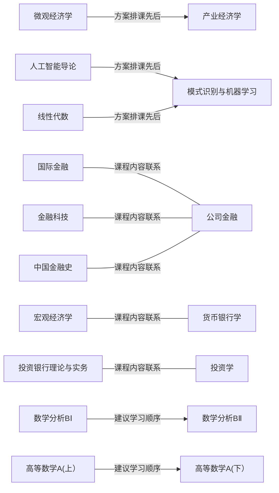

# 2024级金融学-人工智能双学士学位项目“2+X”教学培养方案

经济学院 · 金融学-人工智能(双学士学位项目) · 方案 72963 · 67 个不同课程或科研条目。

[官方 Word](../originals/plan-72963.docx) · [教务详情](https://fdjwgl.fudan.edu.cn/manager/bizType/2/major-program-search/info/72963?skipAuth=1) · [方案快照](../raw/plan-72963.json.gz) · [年级目录](../README.md)

## 修读导读

- **建议先学**　《微观经济学》（`ECON20003`） → 《产业经济学》（`ECON30025`）。企业和市场结构是产业经济分析的基础。方案分别列在第2、6学期。

- **可以对照着读**　《宏观经济学》（`ECON20004`）与《货币银行学》（`ECON30021`）。共同主题为货币政策与宏观经济运行。

- **查模块选课**　《金融学学经典文献选读与写作》（`ECON30123`）、《金融市场学》（`ECON30036`）列在“核心课程”中。原表见 `/courseModules/11`。

## 课程关系图

图中展示部分关系。下表保留全部已建立的课程对，来源位置使用本方案 JSON Pointer。

## 先修与内容联系

| 类型 | 起点 | 终点 | 依据 | 原表定位 |
| --- | --- | --- | --- | --- |
| 建议学习顺序 | 人工智能导论 (AIE310005) | 模式识别与机器学习 (AIE410001) | 人工智能问题与模型类别可为学习模式识别作准备。  | `/courseModules/12/planCourses/4`、`/courseModules/12/planCourses/6` |
| 建议学习顺序 | 微观经济学 (ECON20003) | 产业经济学 (ECON30025) | 企业和市场结构是产业经济分析的基础。  | `/courseModules/8/planCourses/1`、`/courseModules/10/planCourses/7` |
| 建议学习顺序 | 数学分析BⅠ (MATH10012) | 数学分析BⅡ (MATH10013) | 同方案的课程题名具有连续分册或序号。  | `/courseModules/6/planCourses/0`、`/courseModules/6/planCourses/1` |
| 建议学习顺序 | 高等数学A(上） (MATH10015) | 高等数学A(下） (MATH10016) | 同方案的课程题名具有连续分册或序号。  | `/courseModules/7/planCourses/1`、`/courseModules/7/planCourses/0` |
| 建议学习顺序 | 线性代数 (MATH10017) | 模式识别与机器学习 (AIE410001) | 向量表示和矩阵运算支持理解分类、回归等模型。  | `/courseModules/8/planCourses/4`、`/courseModules/12/planCourses/6` |
| 方案排课先后 | 人工智能导论 (AIE310005) | 模式识别与机器学习 (AIE410001) | 同方案该课程全部明确数字学期均早于后者。  | `/courseModules/12/planCourses/4`、`/courseModules/12/planCourses/6` |
| 方案排课先后 | 微观经济学 (ECON20003) | 产业经济学 (ECON30025) | 同方案该课程全部明确数字学期均早于后者。  | `/courseModules/8/planCourses/1`、`/courseModules/10/planCourses/7` |
| 方案排课先后 | 线性代数 (MATH10017) | 模式识别与机器学习 (AIE410001) | 同方案该课程全部明确数字学期均早于后者。  | `/courseModules/8/planCourses/4`、`/courseModules/12/planCourses/6` |
| 课程内容联系 | 计算机系统基础 (AIE210006) | 计算机组成与体系结构 (CS30052) | 处理器、存储与系统执行模型具有共同内容。  | `/courseModules/12/planCourses/3`、`/courseModules/19/planCourses/1` |
| 课程内容联系 | 人工智能导论 (AIE310005) | 人工智能安全 (AIE831001) | 本方案两门课程的题名均含“人工智能”，可据此对照这一主题。  | `/courseModules/12/planCourses/4`、`/courseModules/12/planCourses/7` |
| 课程内容联系 | 人工智能的编程基础 (AIE310006) | 人工智能安全 (AIE831001) | 本方案两门课程的题名均含“人工智能”，可据此对照这一主题。  | `/courseModules/12/planCourses/0`、`/courseModules/12/planCourses/7` |
| 课程内容联系 | 人工智能的软件基础 (AIE310008) | 人工智能安全 (AIE831001) | 本方案两门课程的题名均含“人工智能”，可据此对照这一主题。  | `/courseModules/12/planCourses/5`、`/courseModules/12/planCourses/7` |
| 课程内容联系 | 人工智能的数学基础 (AIE310009) | 模式识别与机器学习 (AIE410001) | 数学表达与学习模型的统计、优化工具可对照。  | `/courseModules/12/planCourses/2`、`/courseModules/12/planCourses/6` |
| 课程内容联系 | 人工智能的数学基础 (AIE310009) | 人工智能安全 (AIE831001) | 本方案两门课程的题名均含“人工智能”，可据此对照这一主题。  | `/courseModules/12/planCourses/2`、`/courseModules/12/planCourses/7` |
| 课程内容联系 | 模式识别与机器学习 (AIE410001) | 机器学习系统 (CS30058) | 本方案两门课程的题名均含“机器学习”，可据此对照这一主题。  | `/courseModules/12/planCourses/6`、`/courseModules/19/planCourses/5` |
| 课程内容联系 | 金融科技 (AIS531008) | 公司金融 (ECON30122) | 本方案两门课程的题名均含“金融”，可据此对照这一主题。  | `/courseModules/15/planCourses/5`、`/courseModules/10/planCourses/1` |
| 课程内容联系 | 宏观经济学 (ECON20004) | 货币银行学 (ECON30021) | 共同主题为货币政策与宏观经济运行。  | `/courseModules/8/planCourses/2`、`/courseModules/11/planCourses/1` |
| 课程内容联系 | 国际金融 (ECON30017) | 公司金融 (ECON30122) | 本方案两门课程的题名均含“金融”，可据此对照这一主题。  | `/courseModules/11/planCourses/3`、`/courseModules/10/planCourses/1` |
| 课程内容联系 | 投资银行理论与实务 (ECON30058) | 投资学 (ECON30126) | 本方案两门课程的题名均含“投资”，可据此对照这一主题。  | `/courseModules/15/planCourses/3`、`/courseModules/11/planCourses/2` |
| 课程内容联系 | 中国金融史 (ECON30080) | 公司金融 (ECON30122) | 本方案两门课程的题名均含“金融”，可据此对照这一主题。  | `/courseModules/17/planCourses/0`、`/courseModules/10/planCourses/1` |
| 课程内容联系 | 公司金融 (ECON30122) | 中国金融学 (ECON30165) | 本方案两门课程的题名均含“金融”，可据此对照这一主题。  | `/courseModules/10/planCourses/1`、`/courseModules/16/planCourses/3` |

本次未从可定位的明确表述中确认课程对课程预修。学期安排、系列分册与编辑建议均保留各自的依据。

## 按原方案模块阅读

同一模块展示原表中的课程归属。模块内课程之间的先后仍须逐项查阅。

- **数学分析B**　数学分析BⅠ、数学分析BⅡ（原表模块 6）
- **高等数学A**　高等数学A(上）、高等数学A(下）（原表模块 7）
- **专业基础课程**　会计学、程序设计、微观经济学、宏观经济学、政治经济学、线性代数（原表模块 8）
- **核心课程**　概率论与数理统计、财政学、当代中国经济、产业经济学、国际经济学、经济史、计量经济学、公司金融（原表模块 10）
- **核心课程**　国际金融、货币银行学、社会实践、金融市场学、金融学学经典文献选读与写作、投资学、社会实习、毕业论文、金融风险管理与金融工程（原表模块 11）
- **核心课程**　计算机系统基础、计算机视觉、人工智能导论、人工智能的编程基础、数据结构、人工智能的软件基础、人工智能的数学基础、模式识别与机器学习、自然语言处理与大语言模型、人工智能前沿探索实践、人工智能安全、人工智能的伦理与治理（原表模块 12）
- **实务模块**　金融科技、商业银行业务与管理、项目评估、投资银行理论与实务、中国货币政策、国际金融管理（原表模块 15）
- **拓展模块**　公司财务分析、公司治理、兼并与收购、中国金融学、金融经济学、行为金融学、经济金融中的随机分析方法（原表模块 16）
- **交叉模块**　欧美金融史、中国金融史、供应链金融（原表模块 17）
- **方法模块**　人工智能与应用经济学、时间序列分析的方法、截面与面板数据分析、数量分析软件应用（原表模块 18）

## 课程表

同一课程在不同模块分别出现时，按原表逐行列出。季节字段保留原值。

| 课程 | 代码 | 学分 | 学期 | 模块 |
| --- | --- | ---: | --- | --- |
| 数学分析BⅠ | MATH10012 | 5.0 | SPRING、AUTUMN | 培养方案 / 大类基础课程 / 数学类基础课程 / 数学分析B |
| 数学分析BⅡ | MATH10013 | 5.0 | SPRING、AUTUMN | 培养方案 / 大类基础课程 / 数学类基础课程 / 数学分析B |
| 高等数学A(下） | MATH10016 | 5.0 | SPRING、AUTUMN | 培养方案 / 大类基础课程 / 数学类基础课程 / 高等数学A |
| 高等数学A(上） | MATH10015 | 5.0 | SPRING、AUTUMN | 培养方案 / 大类基础课程 / 数学类基础课程 / 高等数学A |
| 政治经济学 | ECON20006 | 3.0 | 第1学期 | 培养方案 / 大类基础课程 / 专业基础课程 |
| 微观经济学 | ECON20003 | 3.0 | 第2学期 | 培养方案 / 大类基础课程 / 专业基础课程 |
| 宏观经济学 | ECON20004 | 3.0 | 第3学期 | 培养方案 / 大类基础课程 / 专业基础课程 |
| 会计学 | BA10003 | 3.0 | 第2学期 | 培养方案 / 大类基础课程 / 专业基础课程 |
| 线性代数 | MATH10017 | 3.0 | 第2学期 | 培养方案 / 大类基础课程 / 专业基础课程 |
| 程序设计 | CS10004 | 4.0 | 第1学期 | 培养方案 / 大类基础课程 / 专业基础课程 |
| 概率论与数理统计 | ECON30016 | 3.0 | 第3学期 | 培养方案 / 专业核心教育课程 / 核心课程 |
| 公司金融 | ECON30122 | 3.0 | 第3学期 | 培养方案 / 专业核心教育课程 / 核心课程 |
| 计量经济学 | ECON30121 | 4.0 | 第4学期 | 培养方案 / 专业核心教育课程 / 核心课程 |
| 当代中国经济 | ECON30024 | 3.0 | 第5学期 | 培养方案 / 专业核心教育课程 / 核心课程 |
| 经济史 | ECON30120 | 3.0 | 第3学期 | 培养方案 / 专业核心教育课程 / 核心课程 |
| 国际经济学 | ECON30029 | 3.0 | 第4学期 | 培养方案 / 专业核心教育课程 / 核心课程 |
| 财政学 | ECON30019 | 3.0 | 第4学期 | 培养方案 / 专业核心教育课程 / 核心课程 |
| 产业经济学 | ECON30025 | 3.0 | 第6学期 | 培养方案 / 专业核心教育课程 / 核心课程 |
| 金融市场学 | ECON30036 | 3.0 | 第3学期 | 培养方案 / 专业核心教育课程 / 核心课程 |
| 货币银行学 | ECON30021 | 3.0 | 第3学期 | 培养方案 / 专业核心教育课程 / 核心课程 |
| 投资学 | ECON30126 | 3.0 | 第4学期 | 培养方案 / 专业核心教育课程 / 核心课程 |
| 国际金融 | ECON30017 | 3.0 | 第5学期 | 培养方案 / 专业核心教育课程 / 核心课程 |
| 金融风险管理与金融工程 | ECON40019 | 3.0 | 第6学期 | 培养方案 / 专业核心教育课程 / 核心课程 |
| 金融学学经典文献选读与写作 | ECON30123 | 2.0 | 第6学期 | 培养方案 / 专业核心教育课程 / 核心课程 |
| 社会实践 | ECON30027 | 2.0 | 第6学期 | 培养方案 / 专业核心教育课程 / 核心课程 |
| 社会实习 | ECON30154 | 2.0 | 第6学期 | 培养方案 / 专业核心教育课程 / 核心课程 |
| 毕业论文 | ECON40003 | 4.0 | 第8学期 | 培养方案 / 专业核心教育课程 / 核心课程 |
| 人工智能的编程基础 | AIE310006 | 2.0 | 第2学期 | 培养方案 / 专业核心教育课程 / 核心课程 |
| 数据结构 | AIE310007 | 4.0 | 第3学期 | 培养方案 / 专业核心教育课程 / 核心课程 |
| 人工智能的数学基础 | AIE310009 | 3.0 | 第3学期 | 培养方案 / 专业核心教育课程 / 核心课程 |
| 计算机系统基础 | AIE210006 | 3.0 | 第3学期 | 培养方案 / 专业核心教育课程 / 核心课程 |
| 人工智能导论 | AIE310005 | 3.0 | 第4学期 | 培养方案 / 专业核心教育课程 / 核心课程 |
| 人工智能的软件基础 | AIE310008 | 3.0 | 第4学期 | 培养方案 / 专业核心教育课程 / 核心课程 |
| 模式识别与机器学习 | AIE410001 | 3.0 | 第5学期 | 培养方案 / 专业核心教育课程 / 核心课程 |
| 人工智能安全 | AIE831001 | 3.0 | 第5学期 | 培养方案 / 专业核心教育课程 / 核心课程 |
| 人工智能的伦理与治理 | PHIL50006 | 2.0 | 第4学期、第6学期 | 培养方案 / 专业核心教育课程 / 核心课程 |
| 自然语言处理与大语言模型 | AIE410002 | 3.0 | 第6学期 | 培养方案 / 专业核心教育课程 / 核心课程 |
| 计算机视觉 | AIE310004 | 3.0 | 第7学期 | 培养方案 / 专业核心教育课程 / 核心课程 |
| 人工智能前沿探索实践 | AIE531001 | 3.0 | 第7学期 | 培养方案 / 专业核心教育课程 / 核心课程 |
| 中国货币政策 | ECON30083 | 2.0 | 第5学期 | 培养方案 / 专业进阶I组 / 实务模块 |
| 项目评估 | ECON30057 | 2.0 | 第2学期 | 培养方案 / 专业进阶I组 / 实务模块 |
| 商业银行业务与管理 | ECON30035 | 3.0 | 第7学期 | 培养方案 / 专业进阶I组 / 实务模块 |
| 投资银行理论与实务 | ECON30058 | 3.0 | 第7学期 | 培养方案 / 专业进阶I组 / 实务模块 |
| 国际金融管理 | ECON30099 | 2.0 | 第7学期 | 培养方案 / 专业进阶I组 / 实务模块 |
| 金融科技 | AIS531008 | 3.0 | 第8学期 | 培养方案 / 专业进阶I组 / 实务模块 |
| 公司财务分析 | ECON30055 | 2.0 | 第4学期 | 培养方案 / 专业进阶I组 / 拓展模块 |
| 兼并与收购 | ECON30103 | 3.0 | 第5学期 | 培养方案 / 专业进阶I组 / 拓展模块 |
| 金融经济学 | ECON40005 | 2.0 | 第5学期 | 培养方案 / 专业进阶I组 / 拓展模块 |
| 中国金融学 | ECON30165 | 3.0 | 第6学期 | 培养方案 / 专业进阶I组 / 拓展模块 |
| 行为金融学 | ECON40010 | 2.0 | 第6学期 | 培养方案 / 专业进阶I组 / 拓展模块 |
| 经济金融中的随机分析方法 | ECON40018 | 3.0 | 第7学期 | 培养方案 / 专业进阶I组 / 拓展模块 |
| 公司治理 | ECON30082 | 2.0 | 第7学期 | 培养方案 / 专业进阶I组 / 拓展模块 |
| 中国金融史 | ECON30080 | 2.0 | 第3学期 | 培养方案 / 专业进阶I组 / 交叉模块 |
| 欧美金融史 | ECON30056 | 2.0 | 第6学期 | 培养方案 / 专业进阶I组 / 交叉模块 |
| 供应链金融 | ECON40011 | 2.0 | 第7学期 | 培养方案 / 专业进阶I组 / 交叉模块 |
| 时间序列分析的方法 | ECON40004 | 3.0 | SPRING、AUTUMN | 培养方案 / 专业进阶I组 / 方法模块 |
| 截面与面板数据分析 | ECON40012 | 3.0 | SPRING、AUTUMN | 培养方案 / 专业进阶I组 / 方法模块 |
| 数量分析软件应用 | ECON40013 | 3.0 | SPRING、AUTUMN | 培养方案 / 专业进阶I组 / 方法模块 |
| 人工智能与应用经济学 | AIS410005 | 3.0 | SPRING、AUTUMN | 培养方案 / 专业进阶I组 / 方法模块 |
| 集合与图论 | CS30043 | 3.0 | 第3学期 | 培养方案 / 专业进阶II组 |
| 计算机组成与体系结构 | CS30052 | 4.0 | 第4学期 | 培养方案 / 专业进阶II组 |
| 数据库引论 | CS20010 | 3.0 | 第4学期 | 培养方案 / 专业进阶II组 |
| 计算机网络 | CS30036 | 3.0 | 第5学期 | 培养方案 / 专业进阶II组 |
| 软件工程 | CS30018 | 3.0 | 第6学期 | 培养方案 / 专业进阶II组 |
| 机器学习系统 | CS30058 | 3.0 | 第6学期 | 培养方案 / 专业进阶II组 |
| 金融科技 | AIS531008 | 3.0 | 第8学期 | 培养方案 / 专业进阶II组 |
| 保险科技 | AIT531021 | 2.0 | 第3学期 | 培养方案 / 专业进阶II组 |
| 习近平经济思想概论 | ECON30175 | 2.0 | SPRING、AUTUMN | 培养方案 / 专业进阶II组 |
