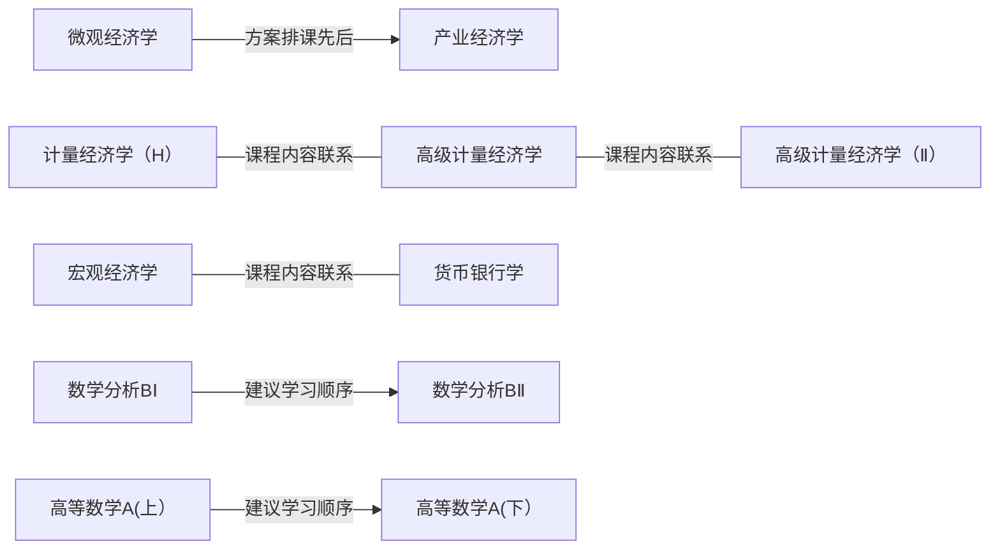

# 2025经济学（数理经济方向）专业本博融通培养方案（普通本科生）

经济学院 · 经济学(数理经济方向) · 方案 96699 · 71 个不同课程或科研条目。

[官方 Word](../originals/plan-96699.docx) · [教务详情](https://fdjwgl.fudan.edu.cn/manager/bizType/2/major-program-search/info/96699?skipAuth=1) · [方案快照](../raw/plan-96699.json.gz) · [年级目录](../README.md)

## 课程关系图

图中展示部分关系。下表保留全部已建立的课程对，来源位置使用本方案 JSON Pointer。

## 先修与内容联系

| 类型 | 起点 | 终点 | 依据 | 原表定位 |
| --- | --- | --- | --- | --- |
| 建议学习顺序 | 微观经济学 (ECON20003) | 产业经济学 (ECON30025) | 企业和市场结构是产业经济分析的基础。  | `/courseModules/11/planCourses/1`、`/courseModules/13/planCourses/7` |
| 建议学习顺序 | 数学分析BⅠ (MATH10012) | 数学分析BⅡ (MATH10013) | 同方案的课程题名具有连续分册或序号。  | `/courseModules/9/planCourses/0`、`/courseModules/9/planCourses/1` |
| 建议学习顺序 | 高等数学A(上） (MATH10015) | 高等数学A(下） (MATH10016) | 同方案的课程题名具有连续分册或序号。  | `/courseModules/10/planCourses/1`、`/courseModules/10/planCourses/0` |
| 方案排课先后 | 微观经济学 (ECON20003) | 产业经济学 (ECON30025) | 同方案该课程全部明确数字学期均早于后者。  | `/courseModules/11/planCourses/1`、`/courseModules/13/planCourses/7` |
| 课程内容联系 | 宏观经济学 (ECON20004) | 货币银行学 (ECON30021) | 共同主题为货币政策与宏观经济运行。  | `/courseModules/11/planCourses/2`、`/courseModules/20/planCourses/1` |
| 课程内容联系 | 计量经济学（H） (ECON30121h) | 高级计量经济学 (ECON40027) | 本方案两门课程的题名均含“计量经济”，可据此对照这一主题。  | `/courseModules/13/planCourses/3`、`/courseModules/21/planCourses/0` |
| 课程内容联系 | 高级计量经济学 (ECON40027) | 高级计量经济学（Ⅱ） (ECON60013) | 本方案两门课程的题名均含“计量经济”，可据此对照这一主题。  | `/courseModules/21/planCourses/0`、`/courseModules/21/planCourses/3` |

本次未从可定位的明确表述中确认课程对课程预修。学期安排、系列分册与编辑建议均保留各自的依据。

## 按原方案模块阅读

同一模块展示原表中的课程归属。模块内课程之间的先后仍须逐项查阅。

- **数学分析B**　数学分析BⅠ、数学分析BⅡ（原表模块 9）
- **高等数学A**　高等数学A(上）、高等数学A(下）（原表模块 10）
- **方法模块**　时间序列分析的方法、随机过程、数量分析软件应用、海外学者专题、海外学者专题III（原表模块 18）
- **理论模块**　发展经济学(H)、信息经济学、经济学前沿专题(H)、数字经济概论（原表模块 19）
- **应用模块**　创新经济学、国际贸易(H)、货币银行学、劳动经济学(H)、资产定价（原表模块 20）

## 课程表

同一课程在不同模块分别出现时，按原表逐行列出。季节字段保留原值。

| 课程 | 代码 | 学分 | 学期 | 模块 |
| --- | --- | ---: | --- | --- |
| 中国马克思主义与当代 | GEIP40001 | 2.0 | SPRING、AUTUMN | 培养方案 / 通识教育课程 / 通识教育核心课程 / 思想政治理论课模块 / 研究生政治课程 |
| 中国马克思主义与当代（文科） | GEIP40002 | 2.0 | SPRING、AUTUMN | 培养方案 / 通识教育课程 / 通识教育核心课程 / 思想政治理论课模块 / 研究生政治课程 |
| 数学分析BⅠ | MATH10012 | 5.0 | SPRING、AUTUMN | 培养方案 / 专业培养课程 / 学科基础课程 / 数学类基础课程 / 数学分析B |
| 数学分析BⅡ | MATH10013 | 5.0 | SPRING、AUTUMN | 培养方案 / 专业培养课程 / 学科基础课程 / 数学类基础课程 / 数学分析B |
| 高等数学A(下） | MATH10016 | 5.0 | SPRING、AUTUMN | 培养方案 / 专业培养课程 / 学科基础课程 / 数学类基础课程 / 高等数学A |
| 高等数学A(上） | MATH10015 | 5.0 | SPRING、AUTUMN | 培养方案 / 专业培养课程 / 学科基础课程 / 数学类基础课程 / 高等数学A |
| 政治经济学 | ECON20006 | 3.0 | 第1学期 | 培养方案 / 专业培养课程 / 学科基础课程 / 学科基础课程 |
| 微观经济学 | ECON20003 | 3.0 | 第1学期 | 培养方案 / 专业培养课程 / 学科基础课程 / 学科基础课程 |
| 宏观经济学 | ECON20004 | 3.0 | 第2学期 | 培养方案 / 专业培养课程 / 学科基础课程 / 学科基础课程 |
| 会计学 | BA10003 | 3.0 | 第2学期 | 培养方案 / 专业培养课程 / 学科基础课程 / 学科基础课程 |
| 线性代数 | MATH10017 | 3.0 | 第2学期 | 培养方案 / 专业培养课程 / 学科基础课程 / 学科基础课程 |
| 概率论与数理统计 | ECON30016 | 3.0 | 第3学期 | 培养方案 / 专业培养课程 / 专业核心教育课程 / 专业核心教育课程 |
| 公司金融(H) | ECON30122h | 4.0 | 第3学期 | 培养方案 / 专业培养课程 / 专业核心教育课程 / 专业核心教育课程 |
| 经济史 | ECON30120 | 3.0 | 第3学期 | 培养方案 / 专业培养课程 / 专业核心教育课程 / 专业核心教育课程 |
| 计量经济学（H） | ECON30121h | 4.0 | 第4学期 | 培养方案 / 专业培养课程 / 专业核心教育课程 / 专业核心教育课程 |
| 财政学 | ECON30019 | 3.0 | 第4学期 | 培养方案 / 专业培养课程 / 专业核心教育课程 / 专业核心教育课程 |
| 国际经济学 | ECON30029 | 3.0 | 第4学期 | 培养方案 / 专业培养课程 / 专业核心教育课程 / 专业核心教育课程 |
| 当代中国经济 | ECON30024 | 3.0 | 第5学期 | 培养方案 / 专业培养课程 / 专业核心教育课程 / 专业核心教育课程 |
| 产业经济学 | ECON30025 | 3.0 | 第6学期 | 培养方案 / 专业培养课程 / 专业核心教育课程 / 专业核心教育课程 |
| 博弈论(H) | ECON30054h | 4.0 | 第3学期 | 培养方案 / 专业培养课程 / 专业核心教育课程 / 专业核心教育课程 |
| 微分方程 | ECON30067 | 3.0 | 第4学期 | 培养方案 / 专业培养课程 / 专业核心教育课程 / 专业核心教育课程 |
| 截面与面板数据分析(H) | ECON40012h | 4.0 | 第5学期 | 培养方案 / 专业培养课程 / 专业核心教育课程 / 专业核心教育课程 |
| 统计（机器）学习概论 | STAT30015 | 3.0 | 第5学期 | 培养方案 / 专业培养课程 / 专业核心教育课程 / 专业核心教育课程 |
| 人工智能与应用经济学 | AIS410005 | 3.0 | 第6学期 | 培养方案 / 专业培养课程 / 专业核心教育课程 / 专业核心教育课程 |
| 经济学中的动态和优化方法 | ECON60002 | 3.0 | 第7学期 | 培养方案 / 专业培养课程 / 专业核心教育课程 / 专业核心教育课程 |
| 高级微观经济学 | ECON40026 | 3.0 | 第7学期 | 培养方案 / 专业培养课程 / 专业核心教育课程 / 专业核心教育课程 |
| 高级宏观经济学 | ECON60007 | 3.0 | 第8学期 | 培养方案 / 专业培养课程 / 专业核心教育课程 / 专业核心教育课程 |
| 时间序列分析的方法 | ECON40004 | 3.0 | SPRING、AUTUMN | 培养方案 / 专业进阶I组 / 方法模块 |
| 随机过程 | ECON40006 | 3.0 | 第1学期 | 培养方案 / 专业进阶I组 / 方法模块 |
| 数量分析软件应用 | ECON40013 | 3.0 | SPRING、AUTUMN | 培养方案 / 专业进阶I组 / 方法模块 |
| 海外学者专题 | ECON50004 | 2.0 | SUMMER | 培养方案 / 专业进阶I组 / 方法模块 |
| 海外学者专题III | ECON50005 | 2.0 | SUMMER | 培养方案 / 专业进阶I组 / 方法模块 |
| 发展经济学(H) | ECON30026h | 4.0 | 第6学期 | 培养方案 / 专业进阶I组 / 理论模块 |
| 信息经济学 | ECON30081 | 2.0 | 第5学期 | 培养方案 / 专业进阶I组 / 理论模块 |
| 经济学前沿专题(H) | ECON40032h | 4.0 | 第6学期 | 培养方案 / 专业进阶I组 / 理论模块 |
| 数字经济概论 | MDE60003 | 3.0 | 第6学期 | 培养方案 / 专业进阶I组 / 理论模块 |
| 国际贸易(H) | ECON30018h | 4.0 | 第5学期 | 培养方案 / 专业进阶I组 / 应用模块 |
| 货币银行学 | ECON30021 | 3.0 | 第5学期 | 培养方案 / 专业进阶I组 / 应用模块 |
| 劳动经济学(H) | ECON30113h | 4.0 | 第5学期 | 培养方案 / 专业进阶I组 / 应用模块 |
| 资产定价 | ECON40017 | 3.0 | 第5学期 | 培养方案 / 专业进阶I组 / 应用模块 |
| 创新经济学 | ECON30013 | 3.0 | 第5学期 | 培养方案 / 专业进阶I组 / 应用模块 |
| 高级计量经济学 | ECON40027 | 3.0 | 第8学期 | 培养方案 / 专业进阶II组 |
| 高级微观经济学（II） | ECON60014 | 3.0 | 第8学期 | 培养方案 / 专业进阶II组 |
| 高级宏观经济学（II） | ECON60015 | 3.0 | 第9学期 | 培养方案 / 专业进阶II组 |
| 高级计量经济学（Ⅱ） | ECON60013 | 3.0 | 第9学期 | 培养方案 / 专业进阶II组 |
| 走进经济学系列讲座 | ECON10001 | 0.0 | 第2学期 | 融合创新能力 |
| 研究生学术活动 | 4 | 1.0 |  | 融合创新能力 |
| 研究生实践活动 | 5 | 1.0 |  | 融合创新能力 |
| 博士学位论文开题 | 1 | 0.0 |  | 融合创新能力 |
| 博士论文中期考核 | 3 | 0.0 |  | 融合创新能力 |
| 博士学位论文预审 | 6 | 1.0 |  | 融合创新能力 |
| 博士生资格考核 | 2 | 0.0 |  | 融合创新能力 |
| 中国经济学系列讲座 | ECON20002 | 1.0 | 第4学期 | 融合创新能力 |
| 科研实践（复芏计划） | ECON30002 | 2.0 | 第7学期 | 融合创新能力 |
| 毕业论文 | ECON30006 | 2.0 | 第8学期 | 融合创新能力 |
| 经济学讲座一 | ECON80003 | 1.0 | SPRING、AUTUMN | 融合创新能力 |
| 经济学讲座二 | ECON80004 | 1.0 | SPRING、AUTUMN | 融合创新能力 |
| 经济学讲座三 | ECON80005 | 1.0 | SPRING、AUTUMN | 融合创新能力 |
| 经济学讲座四 | ECON80006 | 1.0 | SPRING、AUTUMN | 融合创新能力 |
| 经济学讲座五 | ECON80007 | 1.0 | SPRING、AUTUMN | 融合创新能力 |
| 经济学讲座六 | ECON80008 | 1.0 | SPRING、AUTUMN | 融合创新能力 |
| 经济学讲座七 | ECON80009 | 1.0 | SPRING、AUTUMN | 融合创新能力 |
| 经济学讲座八 | ECON80010 | 1.0 | SPRING、AUTUMN | 融合创新能力 |
| 经济学讲座九 | ECON80011 | 1.0 | SPRING、AUTUMN | 融合创新能力 |
| 经济学讲座十 | ECON80012 | 1.0 | SPRING、AUTUMN | 融合创新能力 |
| 经济学讲座十一 | ECON80013 | 1.0 | SPRING、AUTUMN | 融合创新能力 |
| 经济学讲座十二 | ECON80014 | 1.0 | SPRING、AUTUMN | 融合创新能力 |
| 经济学讲座十三 | ECON80015 | 1.0 | SPRING、AUTUMN | 融合创新能力 |
| 经济学讲座十四 | ECON80016 | 1.0 | SPRING、AUTUMN | 融合创新能力 |
| 经济学讲座十五 | ECON80017 | 1.0 | SPRING、AUTUMN | 融合创新能力 |
| 经济学讲座十六 | ECON80018 | 1.0 | SPRING、AUTUMN | 融合创新能力 |
