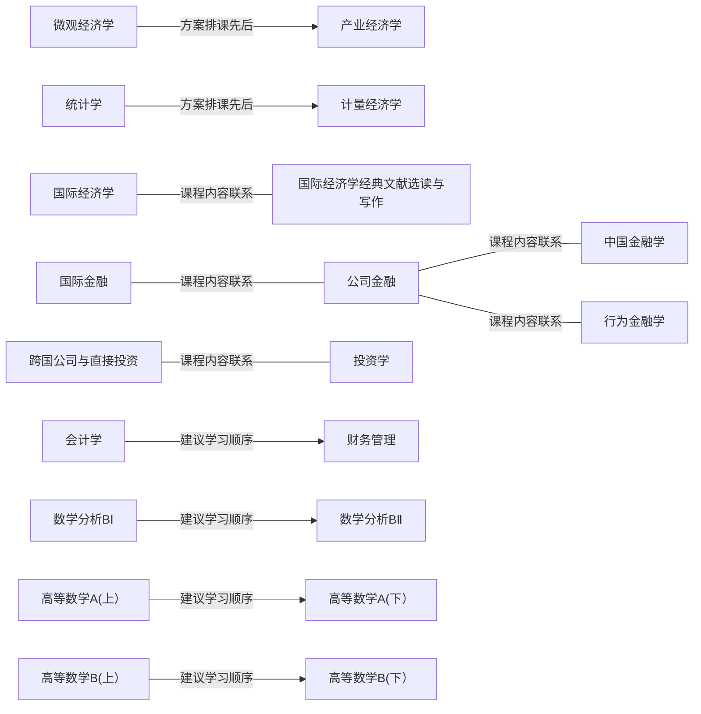

# 2025国际经济与贸易（国际经济学、全球大数据与人工智能）专业本科培养方案（普通本科生）

经济学院 · 国际经济与贸易(国际经济学) · 方案 96925 · 130 个不同课程或科研条目。

[官方 Word](../originals/plan-96925.docx) · [教务详情](https://fdjwgl.fudan.edu.cn/manager/bizType/2/major-program-search/info/96925?skipAuth=1) · [方案快照](../raw/plan-96925.json.gz) · [年级目录](../README.md)

## 修读导读

- **建议先学**　《微观经济学》（`ECON20003`） → 《产业经济学》（`ECON30025`）。企业和市场结构是产业经济分析的基础。方案分别列在第1、6学期。

- **可以对照着读**　《国际经济学》（`ECON30029`）与《国际经济学经典文献选读与写作》（`ECON30125`）。两门课的题名都涉及国际经济。用同一跨境交易案例，对照两门课分析的主体、价格和政策条件。

- **查模块选课**　《概率论与数理统计》（`ECON30016`）、《公司金融》（`ECON30122`）列在“专业核心教育课程”中。原表见 `/courseModules/12`。

## 课程关系图

图中展示部分关系。下表保留全部已建立的课程对，来源位置使用本方案 JSON Pointer。

## 先修与内容联系

| 类型 | 起点 | 终点 | 依据 | 原表定位 |
| --- | --- | --- | --- | --- |
| 建议学习顺序 | 会计学 (BA10003) | 财务管理 (ECON30045) | 会计报表和核算概念可用于理解财务决策。  | `/courseModules/10/planCourses/3`、`/courseModules/22/planCourses/20` |
| 建议学习顺序 | 微观经济学 (ECON20003) | 产业经济学 (ECON30025) | 企业和市场结构是产业经济分析的基础。  | `/courseModules/10/planCourses/1`、`/courseModules/12/planCourses/5` |
| 建议学习顺序 | 高等数学B(上） (MATH10004) | 高等数学B(下） (MATH10005) | 同方案的课程题名具有连续分册或序号。  | `/courseModules/9/planCourses/1`、`/courseModules/9/planCourses/0` |
| 建议学习顺序 | 数学分析BⅠ (MATH10012) | 数学分析BⅡ (MATH10013) | 同方案的课程题名具有连续分册或序号。  | `/courseModules/7/planCourses/0`、`/courseModules/7/planCourses/1` |
| 建议学习顺序 | 高等数学A(上） (MATH10015) | 高等数学A(下） (MATH10016) | 同方案的课程题名具有连续分册或序号。  | `/courseModules/8/planCourses/1`、`/courseModules/8/planCourses/0` |
| 建议学习顺序 | 统计学 (SOCI20003) | 计量经济学 (ECON30121) | 统计推断为计量模型的估计与检验提供基础。  | `/courseModules/10/planCourses/5`、`/courseModules/12/planCourses/2` |
| 方案排课先后 | 微观经济学 (ECON20003) | 产业经济学 (ECON30025) | 同方案该课程全部明确数字学期均早于后者。  | `/courseModules/10/planCourses/1`、`/courseModules/12/planCourses/5` |
| 方案排课先后 | 统计学 (SOCI20003) | 计量经济学 (ECON30121) | 同方案该课程全部明确数字学期均早于后者。  | `/courseModules/10/planCourses/5`、`/courseModules/12/planCourses/2` |
| 课程内容联系 | 人工智能与应用经济学 (AIS410005) | 人工智能中的稀疏理论与应用 (AIS631010) | 本方案两门课程的题名均含“人工智能”，可据此对照这一主题。  | `/courseModules/19/planCourses/3`、`/courseModules/18/planCourses/7` |
| 课程内容联系 | 人工智能与应用经济学 (AIS410005) | 人工智能与税收经济分析 (ECON30014) | 本方案两门课程的题名均含“人工智能”，可据此对照这一主题。  | `/courseModules/19/planCourses/3`、`/courseModules/22/planCourses/29` |
| 课程内容联系 | 智能风险管理实务 (AIT631018) | 企业风险管理 (ECON30134) | 本方案两门课程的题名均含“风险管理”，可据此对照这一主题。  | `/courseModules/22/planCourses/38`、`/courseModules/22/planCourses/36` |
| 课程内容联系 | 会计学 (BA10003) | 中级财务会计 (ECON30007) | 本方案两门课程的题名均含“会计”，可据此对照这一主题。  | `/courseModules/10/planCourses/3`、`/courseModules/22/planCourses/24` |
| 课程内容联系 | 会计学 (BA10003) | 财务管理 (ECON30045) | 会计信息与企业融资、投资决策存在应用联系。  | `/courseModules/10/planCourses/3`、`/courseModules/22/planCourses/20` |
| 课程内容联系 | 宏观经济学 (ECON20004) | 货币银行学 (ECON30021) | 共同主题为货币政策与宏观经济运行。  | `/courseModules/10/planCourses/2`、`/courseModules/22/planCourses/2` |
| 课程内容联系 | 国际金融 (ECON30017) | 公司金融 (ECON30122) | 本方案两门课程的题名均含“金融”，可据此对照这一主题。  | `/courseModules/13/planCourses/1`、`/courseModules/12/planCourses/1` |
| 课程内容联系 | 国际经济学 (ECON30029) | 国际经济学经典文献选读与写作 (ECON30125) | 本方案两门课程的题名均含“国际经济”，可据此对照这一主题。  | `/courseModules/12/planCourses/3`、`/courseModules/13/planCourses/7` |
| 课程内容联系 | 跨国公司与直接投资 (ECON30033) | 投资学 (ECON30126) | 本方案两门课程的题名均含“投资”，可据此对照这一主题。  | `/courseModules/17/planCourses/2`、`/courseModules/13/planCourses/3` |
| 课程内容联系 | 金融市场学 (ECON30036) | 公司金融 (ECON30122) | 本方案两门课程的题名均含“金融”，可据此对照这一主题。  | `/courseModules/22/planCourses/12`、`/courseModules/12/planCourses/1` |
| 课程内容联系 | 公司金融 (ECON30122) | 中国金融学 (ECON30165) | 本方案两门课程的题名均含“金融”，可据此对照这一主题。  | `/courseModules/12/planCourses/1`、`/courseModules/22/planCourses/17` |
| 课程内容联系 | 公司金融 (ECON30122) | 行为金融学 (ECON40010) | 本方案两门课程的题名均含“金融”，可据此对照这一主题。  | `/courseModules/12/planCourses/1`、`/courseModules/22/planCourses/18` |
| 课程内容联系 | 企业风险管理 (ECON30134) | 金融风险管理与金融工程 (ECON40019) | 本方案两门课程的题名均含“风险管理”，可据此对照这一主题。  | `/courseModules/22/planCourses/36`、`/courseModules/17/planCourses/4` |

本次未从可定位的明确表述中确认课程对课程预修。学期安排、系列分册与编辑建议均保留各自的依据。

## 按原方案模块阅读

同一模块展示原表中的课程归属。模块内课程之间的先后仍须逐项查阅。

- **数学分析B**　数学分析BⅠ、数学分析BⅡ（原表模块 7）
- **高等数学A**　高等数学A(上）、高等数学A(下）（原表模块 8）
- **高等数学B**　高等数学B(上）、高等数学B(下）（原表模块 9）
- **理论模块**　货币经济学、博弈论、企业国际化（原表模块 16）
- **经济金融模块**　发展经济学、跨国公司与直接投资、国别和地区经济、国际营销学、金融风险管理与金融工程（原表模块 17）
- **数字模块**　多模态数据同化、人工智能中的稀疏理论与应用、数据结构、数据库及实现、图像处理与可视化、自然语言处理、计算机视觉、数值算法与案例分析I、最优化方法、统计计算（原表模块 18）
- **融合模块**　人工智能与应用经济学、AI商贸数据分析与应用、数字贸易与贸易数字化、国际宏观经济与AI应用（原表模块 19）
- **方法模块**　时间序列分析的方法、截面与面板数据分析、数量分析软件应用、海外学者专题、海外学者专题III、因果推断与因果学习（原表模块 20）
- **理论模块**　货币经济学、博弈论、企业国际化（原表模块 25）
- **经济金融模块**　发展经济学、跨国公司与直接投资、国别和地区经济、国际营销学、金融风险管理与金融工程（原表模块 26）
- **数字模块**　多模态数据同化、人工智能中的稀疏理论与应用、数据结构、数据库及实现、图像处理与可视化、自然语言处理、计算机视觉、数值算法与案例分析I、最优化方法、统计计算（原表模块 27）
- **融合模块**　人工智能与应用经济学、AI商贸数据分析与应用、数字贸易与贸易数字化、国际宏观经济与AI应用（原表模块 28）
- **方法模块**　时间序列分析的方法、截面与面板数据分析、数量分析软件应用、海外学者专题、海外学者专题III、因果推断与因果学习（原表模块 29）

## 课程表

同一课程在不同模块分别出现时，按原表逐行列出。季节字段保留原值。

| 课程 | 代码 | 学分 | 学期 | 模块 |
| --- | --- | ---: | --- | --- |
| 数学分析BⅠ | MATH10012 | 5.0 | SPRING、AUTUMN | 培养方案 / 专业培养课程 / 学科基础课程 / 数学类基础课程 / 数学分析B |
| 数学分析BⅡ | MATH10013 | 5.0 | SPRING、AUTUMN | 培养方案 / 专业培养课程 / 学科基础课程 / 数学类基础课程 / 数学分析B |
| 高等数学A(下） | MATH10016 | 5.0 | SPRING、AUTUMN | 培养方案 / 专业培养课程 / 学科基础课程 / 数学类基础课程 / 高等数学A |
| 高等数学A(上） | MATH10015 | 5.0 | SPRING、AUTUMN | 培养方案 / 专业培养课程 / 学科基础课程 / 数学类基础课程 / 高等数学A |
| 高等数学B(下） | MATH10005 | 5.0 | SPRING、AUTUMN | 培养方案 / 专业培养课程 / 学科基础课程 / 数学类基础课程 / 高等数学B |
| 高等数学B(上） | MATH10004 | 5.0 | SPRING、AUTUMN | 培养方案 / 专业培养课程 / 学科基础课程 / 数学类基础课程 / 高等数学B |
| 政治经济学 | ECON20006 | 3.0 | 第1学期 | 培养方案 / 专业培养课程 / 学科基础课程 / 学科基础课程 |
| 微观经济学 | ECON20003 | 3.0 | 第1学期 | 培养方案 / 专业培养课程 / 学科基础课程 / 学科基础课程 |
| 宏观经济学 | ECON20004 | 3.0 | 第2学期 | 培养方案 / 专业培养课程 / 学科基础课程 / 学科基础课程 |
| 会计学 | BA10003 | 3.0 | 第2学期 | 培养方案 / 专业培养课程 / 学科基础课程 / 学科基础课程 |
| 线性代数 | MATH10017 | 3.0 | 第2学期 | 培养方案 / 专业培养课程 / 学科基础课程 / 学科基础课程 |
| 统计学 | SOCI20003 | 3.0 | 第1学期 | 培养方案 / 专业培养课程 / 学科基础课程 / 学科基础课程 |
| 程序设计 | CS10004 | 4.0 | 第1学期 | 培养方案 / 专业培养课程 / 学科基础课程 / 学科基础课程 |
| 概率论与数理统计 | ECON30016 | 3.0 | 第3学期 | 培养方案 / 专业培养课程 / 专业核心教育课程 / 专业核心教育课程 |
| 公司金融 | ECON30122 | 3.0 | 第3学期 | 培养方案 / 专业培养课程 / 专业核心教育课程 / 专业核心教育课程 |
| 计量经济学 | ECON30121 | 4.0 | 第4学期 | 培养方案 / 专业培养课程 / 专业核心教育课程 / 专业核心教育课程 |
| 国际经济学 | ECON30029 | 3.0 | 第4学期 | 培养方案 / 专业培养课程 / 专业核心教育课程 / 专业核心教育课程 |
| 财政学 | ECON30019 | 3.0 | 第4学期 | 培养方案 / 专业培养课程 / 专业核心教育课程 / 专业核心教育课程 |
| 产业经济学 | ECON30025 | 3.0 | 第6学期 | 培养方案 / 专业培养课程 / 专业核心教育课程 / 专业核心教育课程 |
| 经济史 | ECON30120 | 3.0 | 第3学期 | 培养方案 / 专业培养课程 / 专业核心教育课程 / 专业核心教育课程 |
| 当代中国经济 | ECON30024 | 3.0 | 第5学期 | 培养方案 / 专业培养课程 / 专业核心教育课程 / 专业核心教育课程 |
| 世界经济 | ECON20001 | 2.0 | 第3学期 | 培养方案 / 专业培养课程 / 专业核心教育课程 / 专业核心教育课程 |
| 国际金融 | ECON30017 | 3.0 | 第5学期 | 培养方案 / 专业培养课程 / 专业核心教育课程 / 专业核心教育课程 |
| 国际贸易 | ECON30018 | 3.0 | 第5学期 | 培养方案 / 专业培养课程 / 专业核心教育课程 / 专业核心教育课程 |
| 投资学 | ECON30126 | 3.0 | 第6学期 | 培养方案 / 专业培养课程 / 专业核心教育课程 / 专业核心教育课程 |
| 国际商务 | ECON30008 | 2.0 | 第6学期 | 培养方案 / 专业培养课程 / 专业核心教育课程 / 专业核心教育课程 |
| 神经网络与深度学习 | CS30064 | 3.0 | 第6学期 | 培养方案 / 专业培养课程 / 专业核心教育课程 / 专业核心教育课程 |
| 统计（机器）学习概论 | STAT30015 | 3.0 | 第6学期 | 培养方案 / 专业培养课程 / 专业核心教育课程 / 专业核心教育课程 |
| 国际经济学经典文献选读与写作 | ECON30125 | 2.0 | 第6学期 | 培养方案 / 专业培养课程 / 专业核心教育课程 / 专业核心教育课程 |
| 博弈论 | ECON30054 | 3.0 | 第3学期 | 培养方案 / 专业进阶I组 / 理论模块 |
| 货币经济学 | ECON30032 | 3.0 | 第5学期 | 培养方案 / 专业进阶I组 / 理论模块 |
| 企业国际化 | ECON30114 | 3.0 | 第6学期 | 培养方案 / 专业进阶I组 / 理论模块 |
| 发展经济学 | ECON30026 | 3.0 | 第7学期 | 培养方案 / 专业进阶I组 / 经济金融模块 |
| 国际营销学 | ECON30053 | 3.0 | 第5学期 | 培养方案 / 专业进阶I组 / 经济金融模块 |
| 跨国公司与直接投资 | ECON30033 | 3.0 | 第6学期 | 培养方案 / 专业进阶I组 / 经济金融模块 |
| 国别和地区经济 | ECON30051 | 3.0 | 第4学期 | 培养方案 / 专业进阶I组 / 经济金融模块 |
| 金融风险管理与金融工程 | ECON40019 | 3.0 | 第6学期 | 培养方案 / 专业进阶I组 / 经济金融模块 |
| 数据结构 | CS20017 | 4.0 | 第3学期 | 培养方案 / 专业进阶I组 / 数字模块 |
| 数值算法与案例分析I | MATH20007 | 3.0 | 第3学期 | 培养方案 / 专业进阶I组 / 数字模块 |
| 数据库及实现 | CS20019 | 3.0 | 第4学期 | 培养方案 / 专业进阶I组 / 数字模块 |
| 最优化方法 | MATH20008 | 3.0 | 第4学期 | 培养方案 / 专业进阶I组 / 数字模块 |
| 图像处理与可视化 | CS30065 | 3.0 | 第5学期 | 培养方案 / 专业进阶I组 / 数字模块 |
| 统计计算 | STAT30016 | 3.0 | 第5学期 | 培养方案 / 专业进阶I组 / 数字模块 |
| 多模态数据同化 | AIS410010 | 3.0 | 第3学期、第5学期、第7学期 | 培养方案 / 专业进阶I组 / 数字模块 |
| 人工智能中的稀疏理论与应用 | AIS631010 | 3.0 | 第3学期、第5学期、第7学期 | 培养方案 / 专业进阶I组 / 数字模块 |
| 自然语言处理 | CS50023 | 3.0 | 第4学期、第6学期、第8学期 | 培养方案 / 专业进阶I组 / 数字模块 |
| 计算机视觉 | CS50028 | 3.0 | 第4学期、第6学期、第8学期 | 培养方案 / 专业进阶I组 / 数字模块 |
| 数字贸易与贸易数字化 | ECON30012 | 3.0 | 第5学期 | 培养方案 / 专业进阶I组 / 融合模块 |
| 国际宏观经济与AI应用 | MIB30001 | 2.0 | 第5学期 | 培养方案 / 专业进阶I组 / 融合模块 |
| AI商贸数据分析与应用 | ECON30011 | 2.0 | 第6学期 | 培养方案 / 专业进阶I组 / 融合模块 |
| 人工智能与应用经济学 | AIS410005 | 3.0 | 第6学期 | 培养方案 / 专业进阶I组 / 融合模块 |
| 时间序列分析的方法 | ECON40004 | 3.0 | SPRING、AUTUMN | 培养方案 / 专业进阶I组 / 方法模块 |
| 截面与面板数据分析 | ECON40012 | 3.0 | SPRING、AUTUMN | 培养方案 / 专业进阶I组 / 方法模块 |
| 数量分析软件应用 | ECON40013 | 3.0 | SPRING、AUTUMN | 培养方案 / 专业进阶I组 / 方法模块 |
| 海外学者专题 | ECON50004 | 2.0 | SUMMER | 培养方案 / 专业进阶I组 / 方法模块 |
| 海外学者专题III | ECON50005 | 2.0 | SUMMER | 培养方案 / 专业进阶I组 / 方法模块 |
| 因果推断与因果学习 | STAT50026 | 3.0 | SPRING | 培养方案 / 专业进阶I组 / 方法模块 |
| 农村和农业经济学 | ECON30048 | 2.0 | SPRING、AUTUMN | 培养方案 / 专业进阶II组 / A组 |
| 能源与气候变化经济学 | ECON30104 | 3.0 | SPRING、AUTUMN | 培养方案 / 专业进阶II组 / A组 |
| 货币银行学 | ECON30021 | 3.0 | SPRING、AUTUMN | 培养方案 / 专业进阶II组 / A组 |
| 公司财务学 | ECON30034 | 3.0 | SPRING、AUTUMN | 培养方案 / 专业进阶II组 / A组 |
| 劳动经济学 | ECON30113 | 3.0 | SPRING、AUTUMN | 培养方案 / 专业进阶II组 / A组 |
| 区域经济学 | ECON30047 | 2.0 | SPRING、AUTUMN | 培养方案 / 专业进阶II组 / A组 |
| 城市经济学 | ECON30049 | 3.0 | SPRING、AUTUMN | 培养方案 / 专业进阶II组 / A组 |
| 数据分析与经济决策 | MDE60001 | 3.0 | SPRING、AUTUMN | 培养方案 / 专业进阶II组 / A组 |
| 中国经济思想史 | ECON30088 | 2.0 | SPRING、AUTUMN | 培养方案 / 专业进阶II组 / A组 |
| 发展经济学 | ECON30026 | 3.0 | SPRING、AUTUMN | 培养方案 / 专业进阶II组 / A组 |
| 数字经济概论 | MDE60003 | 3.0 | SPRING、AUTUMN | 培养方案 / 专业进阶II组 / A组 |
| 当代经济学前沿 | ECON40015 | 3.0 | SPRING、AUTUMN | 培养方案 / 专业进阶II组 / A组 |
| 金融市场学 | ECON30036 | 3.0 | SPRING、AUTUMN | 培养方案 / 专业进阶II组 / A组 |
| 投资学 | ECON30126 | 3.0 | SPRING、AUTUMN | 培养方案 / 专业进阶II组 / A组 |
| 商业银行业务与管理 | ECON30035 | 3.0 | SPRING、AUTUMN | 培养方案 / 专业进阶II组 / A组 |
| 公司财务分析 | ECON30055 | 2.0 | SPRING、AUTUMN | 培养方案 / 专业进阶II组 / A组 |
| 兼并与收购 | ECON30103 | 3.0 | SPRING、AUTUMN | 培养方案 / 专业进阶II组 / A组 |
| 中国金融学 | ECON30165 | 3.0 | SPRING、AUTUMN | 培养方案 / 专业进阶II组 / A组 |
| 行为金融学 | ECON40010 | 2.0 | SPRING、AUTUMN | 培养方案 / 专业进阶II组 / A组 |
| 税收学 | ECON30041 | 3.0 | SPRING、AUTUMN | 培养方案 / 专业进阶II组 / A组 |
| 财务管理 | ECON30045 | 3.0 | SPRING、AUTUMN | 培养方案 / 专业进阶II组 / A组 |
| 财政管理 | ECON30127 | 3.0 | SPRING、AUTUMN | 培养方案 / 专业进阶II组 / A组 |
| 国际税收 | ECON30042 | 3.0 | SPRING、AUTUMN | 培养方案 / 专业进阶II组 / A组 |
| AI和社会保障 | ECON40002 | 3.0 | SPRING、AUTUMN | 培养方案 / 专业进阶II组 / A组 |
| 中级财务会计 | ECON30007 | 2.0 | SPRING、AUTUMN | 培养方案 / 专业进阶II组 / A组 |
| 国际金融 | ECON30017 | 3.0 | SPRING、AUTUMN | 培养方案 / 专业进阶II组 / A组 |
| 比较财政学 | ECON30071 | 2.0 | SPRING、AUTUMN | 培养方案 / 专业进阶II组 / A组 |
| 数字时代的经济法律实践 | ECON30009 | 3.0 | SPRING、AUTUMN | 培养方案 / 专业进阶II组 / A组 |
| 税法详解与税务合规 | ECON30010 | 3.0 | SPRING、AUTUMN | 培养方案 / 专业进阶II组 / A组 |
| 人工智能与税收经济分析 | ECON30014 | 3.0 | SPRING、AUTUMN | 培养方案 / 专业进阶II组 / A组 |
| 公共财政政策分析 | ECON30130 | 3.0 | SPRING、AUTUMN | 培养方案 / 专业进阶II组 / A组 |
| 人寿与健康保险 | ECON30073 | 3.0 | SPRING、AUTUMN | 培养方案 / 专业进阶II组 / A组 |
| 保险经济学 | ECON30119 | 3.0 | SPRING、AUTUMN | 培养方案 / 专业进阶II组 / A组 |
| 精算数学 | ECON40022 | 3.0 | SPRING、AUTUMN | 培养方案 / 专业进阶II组 / A组 |
| 保险公司财务管理 | ECON30091 | 2.0 | SPRING、AUTUMN | 培养方案 / 专业进阶II组 / A组 |
| 风险理论与精算建模 | ECON40021 | 3.0 | SPRING、AUTUMN | 培养方案 / 专业进阶II组 / A组 |
| 企业风险管理 | ECON30134 | 2.0 | SPRING、AUTUMN | 培养方案 / 专业进阶II组 / A组 |
| 金融工程和损失准备金 | ECON40023 | 3.0 | SPRING、AUTUMN | 培养方案 / 专业进阶II组 / A组 |
| 智能风险管理实务 | AIT631018 | 3.0 | SPRING、AUTUMN | 培养方案 / 专业进阶II组 / A组 |
| 保险法 | ECON30065 | 2.0 | SPRING、AUTUMN | 培养方案 / 专业进阶II组 / A组 |
| 财产与责任保险 | ECON30133 | 3.0 | SPRING、AUTUMN | 培养方案 / 专业进阶II组 / A组 |
| 再保险 | ECON30063 | 2.0 | SPRING、AUTUMN | 培养方案 / 专业进阶II组 / A组 |
| 社会保险比较研究 | ECON30163 | 3.0 | SPRING、AUTUMN | 培养方案 / 专业进阶II组 / A组 |
| 经济学中的动态和优化方法 | ECON60002 | 3.0 | SPRING、AUTUMN | 培养方案 / 专业进阶II组 / A组 |
| 高级宏观经济学 | ECON60007 | 3.0 | SPRING、AUTUMN | 培养方案 / 专业进阶II组 / A组 |
| 高级微观经济学 | ECON40026 | 3.0 | SPRING、AUTUMN | 培养方案 / 专业进阶II组 / A组 |
| 随机过程 | ECON40006 | 3.0 | SPRING、AUTUMN | 培养方案 / 专业进阶II组 / A组 |
| 信息经济学 | ECON30081 | 2.0 | SPRING、AUTUMN | 培养方案 / 专业进阶II组 / A组 |
| 经济学前沿专题(H) | ECON40032h | 4.0 | SPRING、AUTUMN | 培养方案 / 专业进阶II组 / A组 |
| 创新经济学 | ECON30013 | 3.0 | SPRING、AUTUMN | 培养方案 / 专业进阶II组 / A组 |
| 资产定价 | ECON40017 | 3.0 | SPRING、AUTUMN | 培养方案 / 专业进阶II组 / A组 |
| 经济全球化与中国 | ECON30152 | 4.0 | SPRING、AUTUMN | 培养方案 / 专业进阶II组 / A组 |
| 应用微观经济学 | ECON30118 | 3.0 | SPRING、AUTUMN | 培养方案 / 专业进阶II组 / A组 |
| 经济学讲座一 | ECON80003 | 1.0 | SPRING、AUTUMN | 培养方案 / 专业进阶II组 / A组 |
| 经济学讲座二 | ECON80004 | 1.0 | SPRING、AUTUMN | 培养方案 / 专业进阶II组 / A组 |
| 经济学讲座三 | ECON80005 | 1.0 | SPRING、AUTUMN | 培养方案 / 专业进阶II组 / A组 |
| 经济学讲座四 | ECON80006 | 1.0 | SPRING、AUTUMN | 培养方案 / 专业进阶II组 / A组 |
| 经济学讲座五 | ECON80007 | 1.0 | SPRING、AUTUMN | 培养方案 / 专业进阶II组 / A组 |
| 经济学讲座六 | ECON80008 | 1.0 | SPRING、AUTUMN | 培养方案 / 专业进阶II组 / A组 |
| 经济学讲座七 | ECON80009 | 1.0 | SPRING、AUTUMN | 培养方案 / 专业进阶II组 / A组 |
| 经济学讲座八 | ECON80010 | 1.0 | SPRING、AUTUMN | 培养方案 / 专业进阶II组 / A组 |
| 经济学讲座九 | ECON80011 | 1.0 | SPRING、AUTUMN | 培养方案 / 专业进阶II组 / A组 |
| 经济学讲座十 | ECON80012 | 1.0 | SPRING、AUTUMN | 培养方案 / 专业进阶II组 / A组 |
| 经济学讲座十一 | ECON80013 | 1.0 | SPRING、AUTUMN | 培养方案 / 专业进阶II组 / A组 |
| 经济学讲座十二 | ECON80014 | 1.0 | SPRING、AUTUMN | 培养方案 / 专业进阶II组 / A组 |
| 经济学讲座十三 | ECON80015 | 1.0 | SPRING、AUTUMN | 培养方案 / 专业进阶II组 / A组 |
| 经济学讲座十四 | ECON80016 | 1.0 | SPRING、AUTUMN | 培养方案 / 专业进阶II组 / A组 |
| 经济学讲座十五 | ECON80017 | 1.0 | SPRING、AUTUMN | 培养方案 / 专业进阶II组 / A组 |
| 经济学讲座十六 | ECON80018 | 1.0 | SPRING、AUTUMN | 培养方案 / 专业进阶II组 / A组 |
| 博弈论 | ECON30054 | 3.0 | 第3学期 | 培养方案 / 专业进阶（多元发展） / 理论模块 |
| 货币经济学 | ECON30032 | 3.0 | 第5学期 | 培养方案 / 专业进阶（多元发展） / 理论模块 |
| 企业国际化 | ECON30114 | 3.0 | 第6学期 | 培养方案 / 专业进阶（多元发展） / 理论模块 |
| 发展经济学 | ECON30026 | 3.0 | 第7学期 | 培养方案 / 专业进阶（多元发展） / 经济金融模块 |
| 国际营销学 | ECON30053 | 3.0 | 第5学期 | 培养方案 / 专业进阶（多元发展） / 经济金融模块 |
| 跨国公司与直接投资 | ECON30033 | 3.0 | 第6学期 | 培养方案 / 专业进阶（多元发展） / 经济金融模块 |
| 国别和地区经济 | ECON30051 | 3.0 | 第4学期 | 培养方案 / 专业进阶（多元发展） / 经济金融模块 |
| 金融风险管理与金融工程 | ECON40019 | 3.0 | 第6学期 | 培养方案 / 专业进阶（多元发展） / 经济金融模块 |
| 数据结构 | CS20017 | 4.0 | 第3学期 | 培养方案 / 专业进阶（多元发展） / 数字模块 |
| 数值算法与案例分析I | MATH20007 | 3.0 | 第3学期 | 培养方案 / 专业进阶（多元发展） / 数字模块 |
| 数据库及实现 | CS20019 | 3.0 | 第4学期 | 培养方案 / 专业进阶（多元发展） / 数字模块 |
| 最优化方法 | MATH20008 | 3.0 | 第4学期 | 培养方案 / 专业进阶（多元发展） / 数字模块 |
| 图像处理与可视化 | CS30065 | 3.0 | 第5学期 | 培养方案 / 专业进阶（多元发展） / 数字模块 |
| 统计计算 | STAT30016 | 3.0 | 第5学期 | 培养方案 / 专业进阶（多元发展） / 数字模块 |
| 多模态数据同化 | AIS410010 | 3.0 | 第3学期、第5学期、第7学期 | 培养方案 / 专业进阶（多元发展） / 数字模块 |
| 人工智能中的稀疏理论与应用 | AIS631010 | 3.0 | 第3学期、第5学期、第7学期 | 培养方案 / 专业进阶（多元发展） / 数字模块 |
| 自然语言处理 | CS50023 | 3.0 | 第4学期、第6学期、第8学期 | 培养方案 / 专业进阶（多元发展） / 数字模块 |
| 计算机视觉 | CS50028 | 3.0 | 第4学期、第6学期、第8学期 | 培养方案 / 专业进阶（多元发展） / 数字模块 |
| 数字贸易与贸易数字化 | ECON30012 | 3.0 | 第5学期 | 培养方案 / 专业进阶（多元发展） / 融合模块 |
| 国际宏观经济与AI应用 | MIB30001 | 2.0 | 第5学期 | 培养方案 / 专业进阶（多元发展） / 融合模块 |
| AI商贸数据分析与应用 | ECON30011 | 2.0 | 第6学期 | 培养方案 / 专业进阶（多元发展） / 融合模块 |
| 人工智能与应用经济学 | AIS410005 | 3.0 | 第6学期 | 培养方案 / 专业进阶（多元发展） / 融合模块 |
| 时间序列分析的方法 | ECON40004 | 3.0 | SPRING、AUTUMN | 培养方案 / 专业进阶（多元发展） / 方法模块 |
| 截面与面板数据分析 | ECON40012 | 3.0 | SPRING、AUTUMN | 培养方案 / 专业进阶（多元发展） / 方法模块 |
| 数量分析软件应用 | ECON40013 | 3.0 | SPRING、AUTUMN | 培养方案 / 专业进阶（多元发展） / 方法模块 |
| 海外学者专题 | ECON50004 | 2.0 | SUMMER | 培养方案 / 专业进阶（多元发展） / 方法模块 |
| 海外学者专题III | ECON50005 | 2.0 | SUMMER | 培养方案 / 专业进阶（多元发展） / 方法模块 |
| 因果推断与因果学习 | STAT50026 | 3.0 | SPRING | 培养方案 / 专业进阶（多元发展） / 方法模块 |
| 走进经济学系列讲座 | ECON10001 | 0.0 | 第2学期 | 融合创新能力 |
| 中国经济学系列讲座 | ECON20002 | 1.0 | 第4学期 | 融合创新能力 |
| 科研实践（复芏计划） | ECON30002 | 2.0 | 第8学期 | 融合创新能力 |
| 创新实践 | ECON30003 | 2.0 | 第6学期 | 融合创新能力 |
| 学术实践 | ECON30005 | 1.0 | 第7学期 | 融合创新能力 |
| 社会实践 | ECON30004 | 1.0 | 第7学期 | 融合创新能力 |
| 毕业论文 | ECON40003 | 4.0 | 第8学期 | 融合创新能力 |
