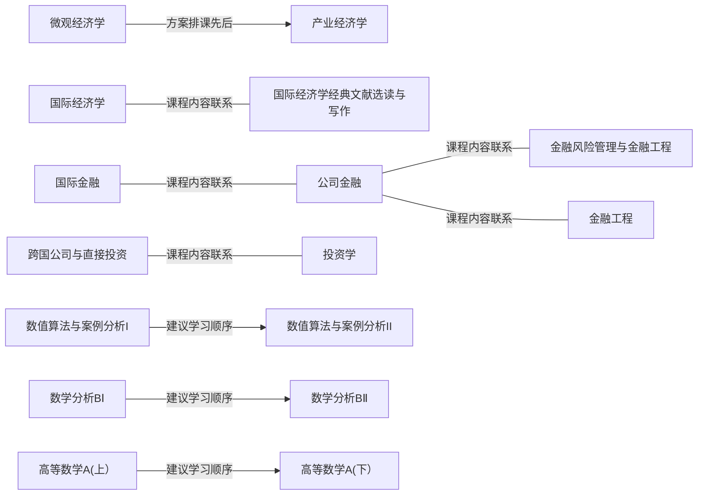

# 2025国际经济与贸易+数据科学与大数据技术双学士学位项目本科培养方案（普通本科生）

经济学院 · 国际经济与贸易-数据科学与大数据技术(双学士学位项目) · 方案 96956 · 75 个不同课程或科研条目。

[官方 Word](../originals/plan-96956.docx) · [教务详情](https://fdjwgl.fudan.edu.cn/manager/bizType/2/major-program-search/info/96956?skipAuth=1) · [方案快照](../raw/plan-96956.json.gz) · [年级目录](../README.md)

## 修读导读

- **建议先学**　《微观经济学》（`ECON20003`） → 《产业经济学》（`ECON30025`）。企业和市场结构是产业经济分析的基础。方案分别列在第1、6学期。

- **可以对照着读**　《国际经济学》（`ECON30029`）与《国际经济学经典文献选读与写作》（`ECON30125`）。两门课的题名都涉及国际经济。用同一跨境交易案例，对照两门课分析的主体、价格和政策条件。

- **查模块选课**　《公司金融》（`ECON30122`）、《计量经济学》（`ECON30121`）列在“专业核心教育课程”中。原表见 `/courseModules/11`。

## 课程关系图

图中展示部分关系。下表保留全部已建立的课程对，来源位置使用本方案 JSON Pointer。

## 先修与内容联系

| 类型 | 起点 | 终点 | 依据 | 原表定位 |
| --- | --- | --- | --- | --- |
| 建议学习顺序 | 微观经济学 (ECON20003) | 产业经济学 (ECON30025) | 企业和市场结构是产业经济分析的基础。  | `/courseModules/9/planCourses/1`、`/courseModules/11/planCourses/5` |
| 建议学习顺序 | 数学分析BⅠ (MATH10012) | 数学分析BⅡ (MATH10013) | 同方案的课程题名具有连续分册或序号。  | `/courseModules/7/planCourses/0`、`/courseModules/7/planCourses/1` |
| 建议学习顺序 | 高等数学A(上） (MATH10015) | 高等数学A(下） (MATH10016) | 同方案的课程题名具有连续分册或序号。  | `/courseModules/8/planCourses/1`、`/courseModules/8/planCourses/0` |
| 建议学习顺序 | 数值算法与案例分析I (MATH20007) | 数值算法与案例分析II (MATH50009) | 同方案的课程题名具有连续分册或序号。  | `/courseModules/13/planCourses/2`、`/courseModules/21/planCourses/1` |
| 方案排课先后 | 微观经济学 (ECON20003) | 产业经济学 (ECON30025) | 同方案该课程全部明确数字学期均早于后者。  | `/courseModules/9/planCourses/1`、`/courseModules/11/planCourses/5` |
| 课程内容联系 | 人工智能与应用经济学 (AIS410005) | 人工智能 (CS50020) | 本方案两门课程的题名均含“人工智能”，可据此对照这一主题。  | `/courseModules/19/planCourses/3`、`/courseModules/13/planCourses/8` |
| 课程内容联系 | 人工智能中的稀疏理论与应用 (AIS631010) | 人工智能 (CS50020) | 本方案两门课程的题名均含“人工智能”，可据此对照这一主题。  | `/courseModules/21/planCourses/7`、`/courseModules/13/planCourses/8` |
| 课程内容联系 | 国际金融 (ECON30017) | 公司金融 (ECON30122) | 本方案两门课程的题名均含“金融”，可据此对照这一主题。  | `/courseModules/12/planCourses/0`、`/courseModules/11/planCourses/1` |
| 课程内容联系 | 国际经济学 (ECON30029) | 国际经济学经典文献选读与写作 (ECON30125) | 本方案两门课程的题名均含“国际经济”，可据此对照这一主题。  | `/courseModules/11/planCourses/3`、`/courseModules/12/planCourses/4` |
| 课程内容联系 | 跨国公司与直接投资 (ECON30033) | 投资学 (ECON30126) | 本方案两门课程的题名均含“投资”，可据此对照这一主题。  | `/courseModules/18/planCourses/2`、`/courseModules/12/planCourses/2` |
| 课程内容联系 | 公司金融 (ECON30122) | 金融风险管理与金融工程 (ECON40019) | 本方案两门课程的题名均含“金融”，可据此对照这一主题。  | `/courseModules/11/planCourses/1`、`/courseModules/18/planCourses/4` |
| 课程内容联系 | 公司金融 (ECON30122) | 金融工程 (STAT50022) | 本方案两门课程的题名均含“金融”，可据此对照这一主题。  | `/courseModules/11/planCourses/1`、`/courseModules/21/planCourses/12` |
| 课程内容联系 | 高等线性代数 (MATH10003) | 线性代数 (MATH10017) | 本方案两门课程的题名均含“线性代数”，可据此对照这一主题。  | `/courseModules/13/planCourses/1`、`/courseModules/9/planCourses/4` |

本次未从可定位的明确表述中确认课程对课程预修。学期安排、系列分册与编辑建议均保留各自的依据。

## 按原方案模块阅读

同一模块展示原表中的课程归属。模块内课程之间的先后仍须逐项查阅。

- **数学分析B**　数学分析BⅠ、数学分析BⅡ（原表模块 7）
- **高等数学A**　高等数学A(上）、高等数学A(下）（原表模块 8）
- **理论模块**　货币经济学、博弈论、企业国际化（原表模块 17）
- **经济金融模块**　世界经济、发展经济学、跨国公司与直接投资、国别和地区经济、国际营销学、金融风险管理与金融工程（原表模块 18）
- **融合模块**　人工智能与应用经济学、AI商贸数据分析与应用、数字贸易与贸易数字化、国际宏观经济与AI应用（原表模块 19）
- **方法模块**　时间序列分析的方法、截面与面板数据分析、数量分析软件应用、海外学者专题、海外学者专题III、因果推断与因果学习（原表模块 20）

## 课程表

同一课程在不同模块分别出现时，按原表逐行列出。季节字段保留原值。

| 课程 | 代码 | 学分 | 学期 | 模块 |
| --- | --- | ---: | --- | --- |
| 数学分析BⅠ | MATH10012 | 5.0 | SPRING、AUTUMN | 培养方案 / 专业培养课程 / 学科基础课程 / 数学类基础课程 / 数学分析B |
| 数学分析BⅡ | MATH10013 | 5.0 | SPRING、AUTUMN | 培养方案 / 专业培养课程 / 学科基础课程 / 数学类基础课程 / 数学分析B |
| 高等数学A(下） | MATH10016 | 5.0 | SPRING、AUTUMN | 培养方案 / 专业培养课程 / 学科基础课程 / 数学类基础课程 / 高等数学A |
| 高等数学A(上） | MATH10015 | 5.0 | SPRING、AUTUMN | 培养方案 / 专业培养课程 / 学科基础课程 / 数学类基础课程 / 高等数学A |
| 政治经济学 | ECON20006 | 3.0 | 第1学期 | 培养方案 / 专业培养课程 / 学科基础课程 / 学科基础课程 |
| 微观经济学 | ECON20003 | 3.0 | 第1学期 | 培养方案 / 专业培养课程 / 学科基础课程 / 学科基础课程 |
| 宏观经济学 | ECON20004 | 3.0 | 第2学期 | 培养方案 / 专业培养课程 / 学科基础课程 / 学科基础课程 |
| 会计学 | BA10003 | 3.0 | 第2学期 | 培养方案 / 专业培养课程 / 学科基础课程 / 学科基础课程 |
| 线性代数 | MATH10017 | 3.0 | 第2学期 | 培养方案 / 专业培养课程 / 学科基础课程 / 学科基础课程 |
| 程序设计 | CS10004 | 4.0 | 第1学期 | 培养方案 / 专业培养课程 / 学科基础课程 / 学科基础课程 |
| 概率论基础 | STAT20006 | 4.0 | 第3学期 | 培养方案 / 专业培养课程 / 专业核心教育课程 / 专业核心教育课程 |
| 公司金融 | ECON30122 | 3.0 | 第3学期 | 培养方案 / 专业培养课程 / 专业核心教育课程 / 专业核心教育课程 |
| 计量经济学 | ECON30121 | 4.0 | 第4学期 | 培养方案 / 专业培养课程 / 专业核心教育课程 / 专业核心教育课程 |
| 国际经济学 | ECON30029 | 3.0 | 第4学期 | 培养方案 / 专业培养课程 / 专业核心教育课程 / 专业核心教育课程 |
| 财政学 | ECON30019 | 3.0 | 第4学期 | 培养方案 / 专业培养课程 / 专业核心教育课程 / 专业核心教育课程 |
| 产业经济学 | ECON30025 | 3.0 | 第6学期 | 培养方案 / 专业培养课程 / 专业核心教育课程 / 专业核心教育课程 |
| 经济史 | ECON30120 | 3.0 | 第3学期 | 培养方案 / 专业培养课程 / 专业核心教育课程 / 专业核心教育课程 |
| 当代中国经济 | ECON30024 | 3.0 | 第5学期 | 培养方案 / 专业培养课程 / 专业核心教育课程 / 专业核心教育课程 |
| 国际金融 | ECON30017 | 3.0 | 第5学期 | 培养方案 / 专业培养课程 / 专业核心教育课程 / 专业核心教育课程 |
| 国际贸易 | ECON30018 | 3.0 | 第5学期 | 培养方案 / 专业培养课程 / 专业核心教育课程 / 专业核心教育课程 |
| 投资学 | ECON30126 | 3.0 | 第6学期 | 培养方案 / 专业培养课程 / 专业核心教育课程 / 专业核心教育课程 |
| 国际商务 | ECON30008 | 2.0 | 第6学期 | 培养方案 / 专业培养课程 / 专业核心教育课程 / 专业核心教育课程 |
| 国际经济学经典文献选读与写作 | ECON30125 | 2.0 | 第6学期 | 培养方案 / 专业培养课程 / 专业核心教育课程 / 专业核心教育课程 |
| 数据结构 | CS20017 | 4.0 | 第3学期 | 培养方案 / 专业培养课程 / 专业核心教育课程 / 专业核心教育课程 |
| 高等线性代数 | MATH10003 | 3.0 | 第3学期 | 培养方案 / 专业培养课程 / 专业核心教育课程 / 专业核心教育课程 |
| 数值算法与案例分析I | MATH20007 | 3.0 | 第3学期 | 培养方案 / 专业培养课程 / 专业核心教育课程 / 专业核心教育课程 |
| 数据库及实现 | CS20019 | 3.0 | 第4学期 | 培养方案 / 专业培养课程 / 专业核心教育课程 / 专业核心教育课程 |
| 最优化方法 | MATH20008 | 3.0 | 第4学期 | 培养方案 / 专业培养课程 / 专业核心教育课程 / 专业核心教育课程 |
| 统计学基础原理与方法 | STAT20004 | 4.0 | 第4学期 | 培养方案 / 专业培养课程 / 专业核心教育课程 / 专业核心教育课程 |
| 图像处理与可视化 | CS30065 | 3.0 | 第5学期 | 培养方案 / 专业培养课程 / 专业核心教育课程 / 专业核心教育课程 |
| 统计（机器）学习概论 | STAT30015 | 3.0 | 第5学期 | 培养方案 / 专业培养课程 / 专业核心教育课程 / 专业核心教育课程 |
| 人工智能 | CS50020 | 3.0 | 第7学期 | 培养方案 / 专业培养课程 / 专业核心教育课程 / 专业核心教育课程 |
| 神经网络与深度学习 | CS30064 | 3.0 | 第8学期 | 培养方案 / 专业培养课程 / 专业核心教育课程 / 专业核心教育课程 |
| 博弈论 | ECON30054 | 3.0 | 第3学期 | 培养方案 / 专业进阶I组 / 理论模块 |
| 货币经济学 | ECON30032 | 3.0 | 第5学期 | 培养方案 / 专业进阶I组 / 理论模块 |
| 企业国际化 | ECON30114 | 3.0 | 第6学期 | 培养方案 / 专业进阶I组 / 理论模块 |
| 发展经济学 | ECON30026 | 3.0 | 第7学期 | 培养方案 / 专业进阶I组 / 经济金融模块 |
| 国际营销学 | ECON30053 | 3.0 | 第5学期 | 培养方案 / 专业进阶I组 / 经济金融模块 |
| 跨国公司与直接投资 | ECON30033 | 3.0 | 第6学期 | 培养方案 / 专业进阶I组 / 经济金融模块 |
| 国别和地区经济 | ECON30051 | 3.0 | 第4学期 | 培养方案 / 专业进阶I组 / 经济金融模块 |
| 金融风险管理与金融工程 | ECON40019 | 3.0 | 第6学期 | 培养方案 / 专业进阶I组 / 经济金融模块 |
| 世界经济 | ECON20001 | 2.0 | 第3学期 | 培养方案 / 专业进阶I组 / 经济金融模块 |
| 数字贸易与贸易数字化 | ECON30012 | 3.0 | 第5学期 | 培养方案 / 专业进阶I组 / 融合模块 |
| 国际宏观经济与AI应用 | MIB30001 | 2.0 | 第5学期 | 培养方案 / 专业进阶I组 / 融合模块 |
| AI商贸数据分析与应用 | ECON30011 | 2.0 | 第6学期 | 培养方案 / 专业进阶I组 / 融合模块 |
| 人工智能与应用经济学 | AIS410005 | 3.0 | 第6学期 | 培养方案 / 专业进阶I组 / 融合模块 |
| 时间序列分析的方法 | ECON40004 | 3.0 | SPRING、AUTUMN | 培养方案 / 专业进阶I组 / 方法模块 |
| 截面与面板数据分析 | ECON40012 | 3.0 | SPRING、AUTUMN | 培养方案 / 专业进阶I组 / 方法模块 |
| 数量分析软件应用 | ECON40013 | 3.0 | SPRING、AUTUMN | 培养方案 / 专业进阶I组 / 方法模块 |
| 海外学者专题 | ECON50004 | 2.0 | SUMMER | 培养方案 / 专业进阶I组 / 方法模块 |
| 海外学者专题III | ECON50005 | 2.0 | SUMMER | 培养方案 / 专业进阶I组 / 方法模块 |
| 因果推断与因果学习 | STAT50026 | 3.0 | SPRING | 培养方案 / 专业进阶I组 / 方法模块 |
| 统计计算 | STAT30016 | 3.0 | SPRING | 培养方案 / 专业进阶II组 |
| 数值算法与案例分析II | MATH50009 | 3.0 | SPRING | 培养方案 / 专业进阶II组 |
| 计算机原理 | CS20018 | 3.0 | AUTUMN | 培养方案 / 专业进阶II组 |
| 随机过程导论 | STAT50017 | 3.0 | SPRING | 培养方案 / 专业进阶II组 |
| 统计回归分析 | STAT30003 | 3.0 | AUTUMN | 培养方案 / 专业进阶II组 |
| 时间序列与空间统计 | STAT50016 | 3.0 | SPRING | 培养方案 / 专业进阶II组 |
| 多模态数据同化 | AIS410010 | 3.0 | SPRING | 培养方案 / 专业进阶II组 |
| 人工智能中的稀疏理论与应用 | AIS631010 | 3.0 | SPRING | 培养方案 / 专业进阶II组 |
| 多元统计分析 | STAT50023 | 3.0 | SPRING | 培养方案 / 专业进阶II组 |
| 大规模分布式系统 | CS50022 | 3.0 | SPRING | 培养方案 / 专业进阶II组 |
| 自然语言处理与大语言模型 | CS40008 | 3.0 | SPRING | 培养方案 / 专业进阶II组 |
| 因果推断与因果学习 | STAT50026 | 3.0 | SPRING | 培养方案 / 专业进阶II组 |
| 金融工程 | STAT50022 | 3.0 | SPRING | 培养方案 / 专业进阶II组 |
| 计算机视觉 | CS50028 | 3.0 | SPRING | 培养方案 / 专业进阶II组 |
| 认知智能前沿技术与实践 | AIT531023 | 3.0 | SPRING | 培养方案 / 专业进阶II组 |
| 社交网络挖掘 | CS50019 | 3.0 | SPRING | 培养方案 / 专业进阶II组 |
| 社会科学数据挖掘 | STAT50021 | 3.0 | SPRING | 培养方案 / 专业进阶II组 |
| 走进经济学系列讲座 | ECON10001 | 0.0 | 第2学期 | 融合创新能力 |
| 中国经济学系列讲座 | ECON20002 | 1.0 | 第4学期 | 融合创新能力 |
| 科研实践（复芏计划） | ECON30002 | 2.0 | 第8学期 | 融合创新能力 |
| 创新实践 | ECON30003 | 2.0 | 第6学期 | 融合创新能力 |
| 学术实践 | ECON30005 | 1.0 | 第7学期 | 融合创新能力 |
| 社会实践 | ECON30004 | 1.0 | 第7学期 | 融合创新能力 |
| 毕业论文 | ECON40003 | 4.0 | 第8学期 | 融合创新能力 |
