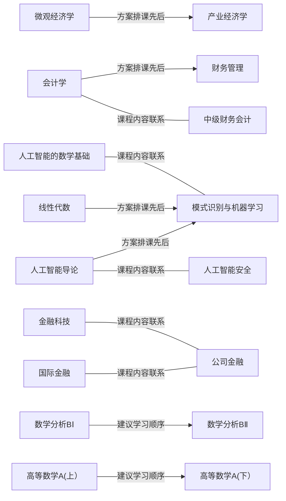

# 2025财政学+人工智能双学士学位项目本科培养方案（普通本科生）

经济学院 · 财政学-人工智能(双学士学位项目) · 方案 96965 · 71 个不同课程或科研条目。

[官方 Word](../originals/plan-96965.docx) · [教务详情](https://fdjwgl.fudan.edu.cn/manager/bizType/2/major-program-search/info/96965?skipAuth=1) · [方案快照](../raw/plan-96965.json.gz) · [年级目录](../README.md)

## 课程关系图

图中展示部分关系。下表保留全部已建立的课程对，来源位置使用本方案 JSON Pointer。

## 先修与内容联系

| 类型 | 起点 | 终点 | 依据 | 原表定位 |
| --- | --- | --- | --- | --- |
| 建议学习顺序 | 人工智能导论 (AIE310005) | 模式识别与机器学习 (AIE410001) | 人工智能问题与模型类别可为学习模式识别作准备。  | `/courseModules/13/planCourses/4`、`/courseModules/13/planCourses/6` |
| 建议学习顺序 | 会计学 (BA10003) | 财务管理 (ECON30045) | 会计报表和核算概念可用于理解财务决策。  | `/courseModules/9/planCourses/3`、`/courseModules/12/planCourses/1` |
| 建议学习顺序 | 微观经济学 (ECON20003) | 产业经济学 (ECON30025) | 企业和市场结构是产业经济分析的基础。  | `/courseModules/9/planCourses/1`、`/courseModules/11/planCourses/7` |
| 建议学习顺序 | 数学分析BⅠ (MATH10012) | 数学分析BⅡ (MATH10013) | 同方案的课程题名具有连续分册或序号。  | `/courseModules/7/planCourses/0`、`/courseModules/7/planCourses/1` |
| 建议学习顺序 | 高等数学A(上） (MATH10015) | 高等数学A(下） (MATH10016) | 同方案的课程题名具有连续分册或序号。  | `/courseModules/8/planCourses/1`、`/courseModules/8/planCourses/0` |
| 建议学习顺序 | 线性代数 (MATH10017) | 模式识别与机器学习 (AIE410001) | 向量表示和矩阵运算支持理解分类、回归等模型。  | `/courseModules/9/planCourses/4`、`/courseModules/13/planCourses/6` |
| 方案排课先后 | 人工智能导论 (AIE310005) | 模式识别与机器学习 (AIE410001) | 同方案该课程全部明确数字学期均早于后者。  | `/courseModules/13/planCourses/4`、`/courseModules/13/planCourses/6` |
| 方案排课先后 | 会计学 (BA10003) | 财务管理 (ECON30045) | 同方案该课程全部明确数字学期均早于后者。  | `/courseModules/9/planCourses/3`、`/courseModules/12/planCourses/1` |
| 方案排课先后 | 微观经济学 (ECON20003) | 产业经济学 (ECON30025) | 同方案该课程全部明确数字学期均早于后者。  | `/courseModules/9/planCourses/1`、`/courseModules/11/planCourses/7` |
| 方案排课先后 | 线性代数 (MATH10017) | 模式识别与机器学习 (AIE410001) | 同方案该课程全部明确数字学期均早于后者。  | `/courseModules/9/planCourses/4`、`/courseModules/13/planCourses/6` |
| 课程内容联系 | 计算机系统基础 (AIE210006) | 计算机组成与体系结构 (CS30052) | 处理器、存储与系统执行模型具有共同内容。  | `/courseModules/13/planCourses/3`、`/courseModules/20/planCourses/1` |
| 课程内容联系 | 人工智能导论 (AIE310005) | 人工智能安全 (AIE831001) | 本方案两门课程的题名均含“人工智能”，可据此对照这一主题。  | `/courseModules/13/planCourses/4`、`/courseModules/13/planCourses/7` |
| 课程内容联系 | 人工智能的编程基础 (AIE310006) | 人工智能安全 (AIE831001) | 本方案两门课程的题名均含“人工智能”，可据此对照这一主题。  | `/courseModules/13/planCourses/0`、`/courseModules/13/planCourses/7` |
| 课程内容联系 | 人工智能的软件基础 (AIE310008) | 人工智能安全 (AIE831001) | 本方案两门课程的题名均含“人工智能”，可据此对照这一主题。  | `/courseModules/13/planCourses/5`、`/courseModules/13/planCourses/7` |
| 课程内容联系 | 人工智能的数学基础 (AIE310009) | 模式识别与机器学习 (AIE410001) | 数学表达与学习模型的统计、优化工具可对照。  | `/courseModules/13/planCourses/2`、`/courseModules/13/planCourses/6` |
| 课程内容联系 | 人工智能的数学基础 (AIE310009) | 人工智能安全 (AIE831001) | 本方案两门课程的题名均含“人工智能”，可据此对照这一主题。  | `/courseModules/13/planCourses/2`、`/courseModules/13/planCourses/7` |
| 课程内容联系 | 模式识别与机器学习 (AIE410001) | 机器学习系统 (CS30058) | 本方案两门课程的题名均含“机器学习”，可据此对照这一主题。  | `/courseModules/13/planCourses/6`、`/courseModules/20/planCourses/6` |
| 课程内容联系 | 金融科技 (AIS531008) | 公司金融 (ECON30122) | 本方案两门课程的题名均含“金融”，可据此对照这一主题。  | `/courseModules/20/planCourses/7`、`/courseModules/11/planCourses/2` |
| 课程内容联系 | 会计学 (BA10003) | 中级财务会计 (ECON30007) | 本方案两门课程的题名均含“会计”，可据此对照这一主题。  | `/courseModules/9/planCourses/3`、`/courseModules/16/planCourses/2` |
| 课程内容联系 | 会计学 (BA10003) | 财务管理 (ECON30045) | 会计信息与企业融资、投资决策存在应用联系。  | `/courseModules/9/planCourses/3`、`/courseModules/12/planCourses/1` |
| 课程内容联系 | 国际金融 (ECON30017) | 公司金融 (ECON30122) | 本方案两门课程的题名均含“金融”，可据此对照这一主题。  | `/courseModules/17/planCourses/0`、`/courseModules/11/planCourses/2` |

本次未从可定位的明确表述中确认课程对课程预修。学期安排、系列分册与编辑建议均保留各自的依据。

## 按原方案模块阅读

同一模块展示原表中的课程归属。模块内课程之间的先后仍须逐项查阅。

- **数学分析B**　数学分析BⅠ、数学分析BⅡ（原表模块 7）
- **高等数学A**　高等数学A(上）、高等数学A(下）（原表模块 8）
- **B组理论模块**　数字时代的经济法律实践、国际金融、发展经济学、比较财政学、制度经济学（原表模块 17）
- **B组实务模块**　税法详解与税务合规、人工智能与税收经济分析、公司财务分析、公共财政政策分析（原表模块 18）
- **B组方法模块**　人工智能与应用经济学、时间序列分析的方法、截面与面板数据分析、数量分析软件应用、海外学者专题、海外学者专题III（原表模块 19）

## 课程表

同一课程在不同模块分别出现时，按原表逐行列出。季节字段保留原值。

| 课程 | 代码 | 学分 | 学期 | 模块 |
| --- | --- | ---: | --- | --- |
| 数学分析BⅠ | MATH10012 | 5.0 | SPRING、AUTUMN | 培养方案 / 专业培养课程 / 学科基础课程 / 数学类基础课程 / 数学分析B |
| 数学分析BⅡ | MATH10013 | 5.0 | SPRING、AUTUMN | 培养方案 / 专业培养课程 / 学科基础课程 / 数学类基础课程 / 数学分析B |
| 高等数学A(下） | MATH10016 | 5.0 | SPRING、AUTUMN | 培养方案 / 专业培养课程 / 学科基础课程 / 数学类基础课程 / 高等数学A |
| 高等数学A(上） | MATH10015 | 5.0 | SPRING、AUTUMN | 培养方案 / 专业培养课程 / 学科基础课程 / 数学类基础课程 / 高等数学A |
| 政治经济学 | ECON20006 | 3.0 | 第1学期 | 培养方案 / 专业培养课程 / 学科基础课程 / 学科基础课程 |
| 微观经济学 | ECON20003 | 3.0 | 第1学期 | 培养方案 / 专业培养课程 / 学科基础课程 / 学科基础课程 |
| 宏观经济学 | ECON20004 | 3.0 | 第2学期 | 培养方案 / 专业培养课程 / 学科基础课程 / 学科基础课程 |
| 会计学 | BA10003 | 3.0 | 第2学期 | 培养方案 / 专业培养课程 / 学科基础课程 / 学科基础课程 |
| 线性代数 | MATH10017 | 3.0 | 第2学期 | 培养方案 / 专业培养课程 / 学科基础课程 / 学科基础课程 |
| 程序设计 | CS10004 | 4.0 | 第1学期 | 培养方案 / 专业培养课程 / 学科基础课程 / 学科基础课程 |
| 概率论与数理统计 | ECON30016 | 3.0 | 第3学期 | 培养方案 / 专业培养课程 / 专业核心教育课程 / 专业核心教育课程 |
| 经济史 | ECON30120 | 3.0 | 第3学期 | 培养方案 / 专业培养课程 / 专业核心教育课程 / 专业核心教育课程 |
| 公司金融 | ECON30122 | 3.0 | 第3学期 | 培养方案 / 专业培养课程 / 专业核心教育课程 / 专业核心教育课程 |
| 计量经济学 | ECON30121 | 4.0 | 第4学期 | 培养方案 / 专业培养课程 / 专业核心教育课程 / 专业核心教育课程 |
| 国际经济学 | ECON30029 | 3.0 | 第4学期 | 培养方案 / 专业培养课程 / 专业核心教育课程 / 专业核心教育课程 |
| 财政学 | ECON30019 | 3.0 | 第4学期 | 培养方案 / 专业培养课程 / 专业核心教育课程 / 专业核心教育课程 |
| 当代中国经济 | ECON30024 | 3.0 | 第5学期 | 培养方案 / 专业培养课程 / 专业核心教育课程 / 专业核心教育课程 |
| 产业经济学 | ECON30025 | 3.0 | 第6学期 | 培养方案 / 专业培养课程 / 专业核心教育课程 / 专业核心教育课程 |
| 税收学 | ECON30041 | 3.0 | 第3学期 | 培养方案 / 专业培养课程 / 专业核心教育课程 / 专业核心教育课程 |
| 财务管理 | ECON30045 | 3.0 | 第3学期 | 培养方案 / 专业培养课程 / 专业核心教育课程 / 专业核心教育课程 |
| 公共支出分析 | ECON30129 | 3.0 | 第4学期 | 培养方案 / 专业培养课程 / 专业核心教育课程 / 专业核心教育课程 |
| 财政管理 | ECON30127 | 3.0 | 第6学期 | 培养方案 / 专业培养课程 / 专业核心教育课程 / 专业核心教育课程 |
| 国际税收 | ECON30042 | 3.0 | 第6学期 | 培养方案 / 专业培养课程 / 专业核心教育课程 / 专业核心教育课程 |
| 财政学经典文献选读与写作 | ECON30128 | 2.0 | 第7学期 | 培养方案 / 专业培养课程 / 专业核心教育课程 / 专业核心教育课程 |
| 人工智能的编程基础 | AIE310006 | 2.0 | 第2学期 | 培养方案 / 专业培养课程 / 专业核心教育课程 / 专业核心教育课程 |
| 数据结构 | AIE310007 | 4.0 | 第3学期 | 培养方案 / 专业培养课程 / 专业核心教育课程 / 专业核心教育课程 |
| 人工智能的数学基础 | AIE310009 | 3.0 | 第3学期 | 培养方案 / 专业培养课程 / 专业核心教育课程 / 专业核心教育课程 |
| 计算机系统基础 | AIE210006 | 3.0 | 第3学期 | 培养方案 / 专业培养课程 / 专业核心教育课程 / 专业核心教育课程 |
| 人工智能导论 | AIE310005 | 3.0 | 第4学期 | 培养方案 / 专业培养课程 / 专业核心教育课程 / 专业核心教育课程 |
| 人工智能的软件基础 | AIE310008 | 3.0 | 第4学期 | 培养方案 / 专业培养课程 / 专业核心教育课程 / 专业核心教育课程 |
| 模式识别与机器学习 | AIE410001 | 3.0 | 第5学期 | 培养方案 / 专业培养课程 / 专业核心教育课程 / 专业核心教育课程 |
| 人工智能安全 | AIE831001 | 3.0 | 第5学期 | 培养方案 / 专业培养课程 / 专业核心教育课程 / 专业核心教育课程 |
| 人工智能的伦理与治理 | PHIL50006 | 2.0 | 第4学期、第6学期 | 培养方案 / 专业培养课程 / 专业核心教育课程 / 专业核心教育课程 |
| 自然语言处理与大语言模型 | AIE410002 | 3.0 | 第6学期 | 培养方案 / 专业培养课程 / 专业核心教育课程 / 专业核心教育课程 |
| 计算机视觉 | AIE310004 | 3.0 | 第7学期 | 培养方案 / 专业培养课程 / 专业核心教育课程 / 专业核心教育课程 |
| 人工智能前沿探索实践 | AIE531001 | 3.0 | 第7学期 | 培养方案 / 专业培养课程 / 专业核心教育课程 / 专业核心教育课程 |
| 国家预算 | ECON30044 | 3.0 | 第4学期 | 培养方案 / 专业进阶I组 / A组 |
| AI和社会保障 | ECON40002 | 3.0 | 第5学期 | 培养方案 / 专业进阶I组 / A组 |
| 中级财务会计 | ECON30007 | 2.0 | 第5学期 | 培养方案 / 专业进阶I组 / A组 |
| 国际金融 | ECON30017 | 3.0 | 第5学期 | 培养方案 / 专业进阶I组 / B组理论模块 |
| 比较财政学 | ECON30071 | 2.0 | 第6学期 | 培养方案 / 专业进阶I组 / B组理论模块 |
| 制度经济学 | ECON30074 | 3.0 | 第7学期 | 培养方案 / 专业进阶I组 / B组理论模块 |
| 数字时代的经济法律实践 | ECON30009 | 3.0 | 第6学期 | 培养方案 / 专业进阶I组 / B组理论模块 |
| 发展经济学 | ECON30026 | 3.0 | 第7学期 | 培养方案 / 专业进阶I组 / B组理论模块 |
| 税法详解与税务合规 | ECON30010 | 3.0 | 第5学期 | 培养方案 / 专业进阶I组 / B组实务模块 |
| 公司财务分析 | ECON30055 | 2.0 | 第6学期 | 培养方案 / 专业进阶I组 / B组实务模块 |
| 人工智能与税收经济分析 | ECON30014 | 3.0 | 第8学期 | 培养方案 / 专业进阶I组 / B组实务模块 |
| 公共财政政策分析 | ECON30130 | 3.0 | 第6学期 | 培养方案 / 专业进阶I组 / B组实务模块 |
| 时间序列分析的方法 | ECON40004 | 3.0 | 第5学期 | 培养方案 / 专业进阶I组 / B组方法模块 |
| 截面与面板数据分析 | ECON40012 | 3.0 | 第6学期 | 培养方案 / 专业进阶I组 / B组方法模块 |
| 数量分析软件应用 | ECON40013 | 3.0 | 第7学期 | 培养方案 / 专业进阶I组 / B组方法模块 |
| 人工智能与应用经济学 | AIS410005 | 3.0 | 第6学期 | 培养方案 / 专业进阶I组 / B组方法模块 |
| 海外学者专题 | ECON50004 | 2.0 | SUMMER | 培养方案 / 专业进阶I组 / B组方法模块 |
| 海外学者专题III | ECON50005 | 2.0 | SUMMER | 培养方案 / 专业进阶I组 / B组方法模块 |
| 集合与图论 | CS30043 | 3.0 | 第3学期 | 培养方案 / 专业进阶II组 |
| 计算机组成与体系结构 | CS30052 | 4.0 | 第4学期 | 培养方案 / 专业进阶II组 |
| 数据库引论 | CS20010 | 3.0 | 第4学期 | 培养方案 / 专业进阶II组 |
| 计算机网络 | CS30036 | 3.0 | 第5学期 | 培养方案 / 专业进阶II组 |
| 软件工程 | CS30018 | 3.0 | 第6学期 | 培养方案 / 专业进阶II组 |
| 计算机图形学A | CS30019 | 3.0 | 第6学期 | 培养方案 / 专业进阶II组 |
| 机器学习系统 | CS30058 | 3.0 | 第6学期 | 培养方案 / 专业进阶II组 |
| 金融科技 | AIS531008 | 3.0 | 第8学期 | 培养方案 / 专业进阶II组 |
| 保险科技 | AIT531021 | 2.0 | 第3学期 | 培养方案 / 专业进阶II组 |
| 习近平经济思想概论 | ECON30175 | 2.0 | SPRING、AUTUMN | 培养方案 / 专业进阶II组 |
| 走进经济学系列讲座 | ECON10001 | 0.0 | 第2学期 | 融合创新能力 |
| 中国经济学系列讲座 | ECON20002 | 1.0 | 第4学期 | 融合创新能力 |
| 科研实践（复芏计划） | ECON30002 | 2.0 | 第8学期 | 融合创新能力 |
| 创新实践 | ECON30003 | 2.0 | 第6学期 | 融合创新能力 |
| 学术实践 | ECON30005 | 1.0 | 第7学期 | 融合创新能力 |
| 社会实践 | ECON30004 | 1.0 | 第7学期 | 融合创新能力 |
| 毕业论文 | ECON40003 | 4.0 | 第8学期 | 融合创新能力 |
