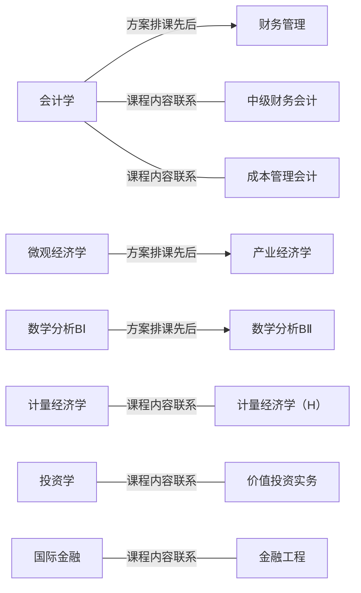

# 2023会计学专业“2+X”教学培养方案

管理学院 · 会计学 · 方案 67321 · 794 个不同课程或科研条目。

[官方 Word](../originals/plan-67321.docx) · [教务详情](https://fdjwgl.fudan.edu.cn/manager/bizType/2/major-program-search/info/67321?skipAuth=1) · [方案快照](../raw/plan-67321.json.gz) · [年级目录](../README.md)

## 课程关系图

图中展示部分关系。下表保留全部已建立的课程对，来源位置使用本方案 JSON Pointer。

## 先修与内容联系

| 类型 | 起点 | 终点 | 依据 | 原表定位 |
| --- | --- | --- | --- | --- |
| 建议学习顺序 | 会计学 (BA10003) | 财务管理 (BA20009) | 会计报表和核算概念可用于理解财务决策。  | `/courseModules/3/planCourses/5`、`/courseModules/6/planCourses/1` |
| 建议学习顺序 | 微观经济学 (ECON20003) | 产业经济学 (ECON30168) | 企业和市场结构是产业经济分析的基础。  | `/courseModules/3/planCourses/3`、`/courseModules/53/planCourses/8` |
| 建议学习顺序 | 数学分析BⅠ (MATH10012) | 数学分析BⅡ (MATH10013) | 同方案的课程题名具有连续分册或序号。  | `/courseModules/3/planCourses/0`、`/courseModules/3/planCourses/1` |
| 方案排课先后 | 会计学 (BA10003) | 财务管理 (BA20009) | 同方案该课程全部明确数字学期均早于后者。  | `/courseModules/3/planCourses/5`、`/courseModules/6/planCourses/1` |
| 方案排课先后 | 微观经济学 (ECON20003) | 产业经济学 (ECON30168) | 同方案该课程全部明确数字学期均早于后者。  | `/courseModules/3/planCourses/3`、`/courseModules/53/planCourses/8` |
| 方案排课先后 | 数学分析BⅠ (MATH10012) | 数学分析BⅡ (MATH10013) | 同方案该课程全部明确数字学期均早于后者。  | `/courseModules/3/planCourses/0`、`/courseModules/3/planCourses/1` |
| 课程内容联系 | 会计学 (BA10003) | 财务管理 (BA20009) | 会计信息与企业融资、投资决策存在应用联系。  | `/courseModules/3/planCourses/5`、`/courseModules/6/planCourses/1` |
| 课程内容联系 | 会计学 (BA10003) | 中级财务会计 (BA20013) | 本方案两门课程的题名均含“会计”，可据此对照这一主题。  | `/courseModules/3/planCourses/5`、`/courseModules/7/planCourses/8` |
| 课程内容联系 | 会计学 (BA10003) | 成本管理会计 (BA30014) | 本方案两门课程的题名均含“会计”，可据此对照这一主题。  | `/courseModules/3/planCourses/5`、`/courseModules/7/planCourses/1` |
| 课程内容联系 | 会计学 (BA10003) | 国际会计 (BA30017) | 本方案两门课程的题名均含“会计”，可据此对照这一主题。  | `/courseModules/3/planCourses/5`、`/courseModules/53/planCourses/4` |
| 课程内容联系 | 会计学 (BA10003) | 会计专题研究 (BA30037) | 本方案两门课程的题名均含“会计”，可据此对照这一主题。  | `/courseModules/3/planCourses/5`、`/courseModules/53/planCourses/14` |
| 课程内容联系 | 投资学 (BA30012) | 价值投资实务 (BA30053) | 本方案两门课程的题名均含“投资”，可据此对照这一主题。  | `/courseModules/46/planCourses/0`、`/courseModules/53/planCourses/29` |
| 课程内容联系 | 中国金融市场 (BA30023) | 国际金融 (BA30042) | 本方案两门课程的题名均含“金融”，可据此对照这一主题。  | `/courseModules/53/planCourses/6`、`/courseModules/53/planCourses/23` |
| 课程内容联系 | 行为金融学 (BA30039) | 国际金融 (BA30042) | 本方案两门课程的题名均含“金融”，可据此对照这一主题。  | `/courseModules/53/planCourses/15`、`/courseModules/53/planCourses/23` |
| 课程内容联系 | 国际金融 (BA30042) | 房地产金融 (BA30056) | 本方案两门课程的题名均含“金融”，可据此对照这一主题。  | `/courseModules/53/planCourses/23`、`/courseModules/53/planCourses/32` |
| 课程内容联系 | 国际金融 (BA30042) | 金融工程 (MSE30011) | 本方案两门课程的题名均含“金融”，可据此对照这一主题。  | `/courseModules/53/planCourses/23`、`/courseModules/45/planCourses/2` |
| 课程内容联系 | 供应链管理 (MSE20007) | 供应链管理导论 (MSE30026) | 本方案两门课程的题名均含“供应链”，可据此对照这一主题。  | `/courseModules/45/planCourses/1`、`/courseModules/55/planCourses/4` |
| 课程内容联系 | 计量经济学 (STAT30021) | 计量经济学（H） (STAT30021h) | 本方案两门课程的题名均含“计量经济”，可据此对照这一主题。  | `/courseModules/6/planCourses/7`、`/courseModules/52/planCourses/3` |

本次未从可定位的明确表述中确认课程对课程预修。学期安排、系列分册与编辑建议均保留各自的依据。

## 按原方案模块阅读

同一模块展示原表中的课程归属。模块内课程之间的先后仍须逐项查阅。

- **管理学院大类基础课程（必修）**　会计学、管理学导论、微观经济学、宏观经济学、数学分析BⅠ、数学分析BⅡ、线性代数、社会研究方法B（原表模块 3）
- **管理学院大类基础课程（三选一）**　法理学导论、政治学原理、社会学导论（原表模块 4）
- **A组（必修7或8学分）**　战略管理、国际商务管理、组织沟通与社会环境、职业责任与领导力（原表模块 43）
- **管理科学专业必修课**　供应链管理、随机运筹学、金融工程、最优化方法及应用（原表模块 45）
- **财务管理（金融与财务）专业必修课**　投资学、衍生证券、公司财务理论与实务、金融市场与金融机构（原表模块 46）
- **工商管理专业必修课**　国别经营环境、人力资源管理、东方管理、公司治理（原表模块 47）
- **信息管理与信息系统专业必修课**　数据库与企业数据管理、数据挖掘原理与技术、互联网应用分析与设计、大数据商务分析与应用（原表模块 48）
- **市场营销专业必修课**　消费者行为学、营销研究、服务营销、数字化营销（原表模块 49）
- **统计学专业必修课**　回归分析、时间序列分析、多元分析、随机过程、抽样调查、统计推断、非参数统计、属性数据分析（原表模块 50）

## 课程表

同一课程在不同模块分别出现时，按原表逐行列出。季节字段保留原值。

| 课程 | 代码 | 学分 | 学期 | 模块 |
| --- | --- | ---: | --- | --- |
| 数学分析BⅠ | MATH10012 | 5.0 | 第1学期 | 培养方案 / 专业培养课程 / 大类基础课程 / 管理学院大类基础课程（必修） |
| 数学分析BⅡ | MATH10013 | 5.0 | 第2学期 | 培养方案 / 专业培养课程 / 大类基础课程 / 管理学院大类基础课程（必修） |
| 线性代数 | MATH10017 | 3.0 | 第2学期 | 培养方案 / 专业培养课程 / 大类基础课程 / 管理学院大类基础课程（必修） |
| 微观经济学 | ECON20003 | 3.0 | 第2学期 | 培养方案 / 专业培养课程 / 大类基础课程 / 管理学院大类基础课程（必修） |
| 宏观经济学 | ECON20004 | 3.0 | 第3学期 | 培养方案 / 专业培养课程 / 大类基础课程 / 管理学院大类基础课程（必修） |
| 会计学 | BA10003 | 3.0 | 第2学期 | 培养方案 / 专业培养课程 / 大类基础课程 / 管理学院大类基础课程（必修） |
| 社会研究方法B | MSE30029 | 3.0 | 第6学期 | 培养方案 / 专业培养课程 / 大类基础课程 / 管理学院大类基础课程（必修） |
| 管理学导论 | BA10004 | 3.0 | 第1学期 | 培养方案 / 专业培养课程 / 大类基础课程 / 管理学院大类基础课程（必修） |
| 政治学原理 | POLI10007 | 3.0 | 第1学期 | 培养方案 / 专业培养课程 / 大类基础课程 / 管理学院大类基础课程（三选一） |
| 社会学导论 | SOCI20001 | 3.0 | 第1学期 | 培养方案 / 专业培养课程 / 大类基础课程 / 管理学院大类基础课程（三选一） |
| 法理学导论 | LAW10004 | 3.0 | 第1学期 | 培养方案 / 专业培养课程 / 大类基础课程 / 管理学院大类基础课程（三选一） |
| 概率论与数理统计 | STAT20012 | 4.0 | 第3学期 | 培养方案 / 专业培养课程 / 专业核心教育课程 / A组 |
| 财务管理 | BA20009 | 3.0 | 第3学期 | 培养方案 / 专业培养课程 / 专业核心教育课程 / A组 |
| 运筹学 | MSE20005 | 4.0 | 第3学期 | 培养方案 / 专业培养课程 / 专业核心教育课程 / A组 |
| 营销管理 | BA20010 | 3.0 | 第4学期 | 培养方案 / 专业培养课程 / 专业核心教育课程 / A组 |
| 管理信息系统 | MSE20006 | 3.0 | 第3学期 | 培养方案 / 专业培养课程 / 专业核心教育课程 / A组 |
| 组织行为学 | BA20011 | 2.0 | 第4学期 | 培养方案 / 专业培养课程 / 专业核心教育课程 / A组 |
| 统计软件 | STAT20013 | 3.0 | 第4学期 | 培养方案 / 专业培养课程 / 专业核心教育课程 / A组 |
| 计量经济学 | STAT30021 | 3.0 | 第5学期 | 培养方案 / 专业培养课程 / 专业核心教育课程 / A组 |
| 商业伦理学 | BA10002 | 2.0 | 第1学期 | 培养方案 / 专业培养课程 / 专业核心教育课程 / A组 |
| 经济学原理 | ECON30171 | 3.0 | 第1学期 | 培养方案 / 专业培养课程 / 专业核心教育课程 / A组 |
| 毕业论文 | BA40001 | 4.0 | 第8学期 | 培养方案 / 专业培养课程 / 专业核心教育课程 / B组 |
| 成本管理会计 | BA30014 | 3.0 | 第5学期 | 培养方案 / 专业培养课程 / 专业核心教育课程 / B组 |
| 审计学 | BA30016 | 3.0 | 第6学期 | 培养方案 / 专业培养课程 / 专业核心教育课程 / B组 |
| 法律、商业与社会 | BA30030 | 2.0 | 第7学期 | 培养方案 / 专业培养课程 / 专业核心教育课程 / B组 |
| 毕业实习 | BA40002 | 1.0 | 第4学期、第8学期 | 培养方案 / 专业培养课程 / 专业核心教育课程 / B组 |
| 高级财务会计 | BA30040 | 3.0 | 第6学期 | 培养方案 / 专业培养课程 / 专业核心教育课程 / B组 |
| 社会调查 | BA30055 | 2.0 | 第5学期 | 培养方案 / 专业培养课程 / 专业核心教育课程 / B组 |
| 财务报告 | BA30057 | 3.0 | 第5学期 | 培养方案 / 专业培养课程 / 专业核心教育课程 / B组 |
| 中级财务会计 | BA20013 | 3.0 | 第4学期 | 培养方案 / 专业培养课程 / 专业核心教育课程 / B组 |
| 职业规划与发展 | BA20014 | 1.0 | 第4学期 | 培养方案 / 专业培养课程 / 专业核心教育课程 / B组 |
| 大学英语III | ENGL110070 | 2.0 | SPRING、AUTUMN | 培养方案 / 通识教育课程 / 通识教育专项教育课程 / 大学外语 / 大学英语基础课程 |
| 大学英语I | ENGL110050 | 2.0 | SPRING、AUTUMN | 培养方案 / 通识教育课程 / 通识教育专项教育课程 / 大学外语 / 大学英语基础课程 |
| 大学英语II | ENGL110051 | 2.0 | SPRING、AUTUMN | 培养方案 / 通识教育课程 / 通识教育专项教育课程 / 大学外语 / 大学英语基础课程 |
| 综合英语 | GEEF10001 | 2.0 | SPRING、AUTUMN | 培养方案 / 通识教育课程 / 通识教育专项教育课程 / 大学外语 / 大学英语基础课程 |
| 实用交际英语口语 | GEEF20006 | 2.0 | SPRING、AUTUMN | 培养方案 / 通识教育课程 / 通识教育专项教育课程 / 大学外语 / 大学英语进阶课程 / 通用学术英语课程 |
| 英语论说文写作 | GEEF20011 | 2.0 | SPRING、AUTUMN | 培养方案 / 通识教育课程 / 通识教育专项教育课程 / 大学外语 / 大学英语进阶课程 / 通用学术英语课程 |
| 高级英语 | GEEF20012 | 2.0 | SPRING、AUTUMN | 培养方案 / 通识教育课程 / 通识教育专项教育课程 / 大学外语 / 大学英语进阶课程 / 通用学术英语课程 |
| 英语视听 | GEEF20004 | 2.0 | SPRING、AUTUMN | 培养方案 / 通识教育课程 / 通识教育专项教育课程 / 大学外语 / 大学英语进阶课程 / 通用学术英语课程 |
| 英语应用文写作 | ENGL110064 | 2.0 | SPRING、AUTUMN | 培养方案 / 通识教育课程 / 通识教育专项教育课程 / 大学外语 / 大学英语进阶课程 / 通用学术英语课程 |
| 英语笔译 | GEEF20007 | 2.0 | SPRING、AUTUMN | 培养方案 / 通识教育课程 / 通识教育专项教育课程 / 大学外语 / 大学英语进阶课程 / 通用学术英语课程 |
| 英语发音 | ENGL110074 | 2.0 | SPRING、AUTUMN | 培养方案 / 通识教育课程 / 通识教育专项教育课程 / 大学外语 / 大学英语进阶课程 / 通用学术英语课程 |
| 学术英语视听说 | GEEF30026 | 2.0 | SPRING、AUTUMN | 培养方案 / 通识教育课程 / 通识教育专项教育课程 / 大学外语 / 大学英语进阶课程 / 通用学术英语课程 |
| 英美报刊选读 | ENGL110025 | 2.0 | SPRING、AUTUMN | 培养方案 / 通识教育课程 / 通识教育专项教育课程 / 大学外语 / 大学英语进阶课程 / 通用学术英语课程 |
| 英语口译 | GEEF20008 | 2.0 | SPRING、AUTUMN | 培养方案 / 通识教育课程 / 通识教育专项教育课程 / 大学外语 / 大学英语进阶课程 / 通用学术英语课程 |
| 数智化实用英文写作 | GEEF20002 | 2.0 |  | 培养方案 / 通识教育课程 / 通识教育专项教育课程 / 大学外语 / 大学英语进阶课程 / 通用学术英语课程 |
| 商务英语沟通 | GEEF30022 | 2.0 | SPRING、AUTUMN | 培养方案 / 通识教育课程 / 通识教育专项教育课程 / 大学外语 / 大学英语进阶课程 / 专用学术英语课程 |
| 医学英语视听说 | GEEF30025 | 2.0 | SPRING、AUTUMN | 培养方案 / 通识教育课程 / 通识教育专项教育课程 / 大学外语 / 大学英语进阶课程 / 专用学术英语课程 |
| 医学英语术语及应用 | GEEF30027 | 2.0 | SPRING、AUTUMN | 培养方案 / 通识教育课程 / 通识教育专项教育课程 / 大学外语 / 大学英语进阶课程 / 专用学术英语课程 |
| 英国文学欣赏指南 | GEEF20010 | 2.0 | SPRING、AUTUMN | 培养方案 / 通识教育课程 / 通识教育专项教育课程 / 大学外语 / 大学英语进阶课程 / 英语文化类课程 |
| 影视与英美文化讨论 | GEEF20005 | 2.0 | SPRING、AUTUMN | 培养方案 / 通识教育课程 / 通识教育专项教育课程 / 大学外语 / 大学英语进阶课程 / 英语文化类课程 |
| 中外大学文化对比研究 | GEEF30024 | 2.0 | SPRING、AUTUMN | 培养方案 / 通识教育课程 / 通识教育专项教育课程 / 大学外语 / 大学英语进阶课程 / 英语文化类课程 |
| 英美文化概论 | GEEF20003 | 2.0 | SPRING、AUTUMN | 培养方案 / 通识教育课程 / 通识教育专项教育课程 / 大学外语 / 大学英语进阶课程 / 英语文化类课程 |
| 美国文学选读 | GEEF20014 | 2.0 | SPRING、AUTUMN | 培养方案 / 通识教育课程 / 通识教育专项教育课程 / 大学外语 / 大学英语进阶课程 / 英语文化类课程 |
| 英文歌曲与文化 | ENGL110076 | 2.0 | SPRING、AUTUMN | 培养方案 / 通识教育课程 / 通识教育专项教育课程 / 大学外语 / 大学英语进阶课程 / 英语文化类课程 |
| 文化阅读 | GEEF20009 | 2.0 | SPRING、AUTUMN | 培养方案 / 通识教育课程 / 通识教育专项教育课程 / 大学外语 / 大学英语进阶课程 / 英语文化类课程 |
| 西方儒学研究名著导读 | GEEF30021 | 2.0 | SPRING、AUTUMN | 培养方案 / 通识教育课程 / 通识教育专项教育课程 / 大学外语 / 大学英语进阶课程 / 英语文化类课程 |
| 文学翻译鉴赏 | GEEF20013 | 2.0 | SPRING、AUTUMN | 培养方案 / 通识教育课程 / 通识教育专项教育课程 / 大学外语 / 大学英语进阶课程 / 英语文化类课程 |
| 中国文化理解与传播 | GEEF20001 | 2.0 |  | 培养方案 / 通识教育课程 / 通识教育专项教育课程 / 大学外语 / 大学英语进阶课程 / 英语文化类课程 |
| 学术英语（综合） | GEEF30023 | 2.0 | SPRING、AUTUMN | 培养方案 / 通识教育课程 / 通识教育专项教育课程 / 大学外语 / 大学英语高阶课程 / 通用学术英语课程 |
| 英语公众演说 | GEEF30012 | 2.0 | SPRING、AUTUMN | 培养方案 / 通识教育课程 / 通识教育专项教育课程 / 大学外语 / 大学英语高阶课程 / 通用学术英语课程 |
| 研究论文写作 | GEEF30020 | 2.0 | SPRING、AUTUMN | 培养方案 / 通识教育课程 / 通识教育专项教育课程 / 大学外语 / 大学英语高阶课程 / 通用学术英语课程 |
| 英语论辩与思辨 | GEEF30018 | 2.0 | SPRING、AUTUMN | 培养方案 / 通识教育课程 / 通识教育专项教育课程 / 大学外语 / 大学英语高阶课程 / 通用学术英语课程 |
| 国际学术交流 | GEEF30019 | 2.0 | SPRING、AUTUMN | 培养方案 / 通识教育课程 / 通识教育专项教育课程 / 大学外语 / 大学英语高阶课程 / 通用学术英语课程 |
| 学术英语沟通与写作 | GEEF30002 | 2.0 |  | 培养方案 / 通识教育课程 / 通识教育专项教育课程 / 大学外语 / 大学英语高阶课程 / 通用学术英语课程 |
| AI赋能学术英语读写 | GEEF30030 | 2.0 | SPRING、AUTUMN | 培养方案 / 通识教育课程 / 通识教育专项教育课程 / 大学外语 / 大学英语高阶课程 / 通用学术英语课程 |
| AI赋能英语写作与思辨 | GEEF20018 | 2.0 | SPRING、AUTUMN | 培养方案 / 通识教育课程 / 通识教育专项教育课程 / 大学外语 / 大学英语高阶课程 / 通用学术英语课程 |
| 学术英语（医学） | GEEF30017 | 2.0 | SPRING、AUTUMN | 培养方案 / 通识教育课程 / 通识教育专项教育课程 / 大学外语 / 大学英语高阶课程 / 专用学术英语课程 |
| 学术英语（社会科学） | GEEF30014 | 2.0 | SPRING、AUTUMN | 培养方案 / 通识教育课程 / 通识教育专项教育课程 / 大学外语 / 大学英语高阶课程 / 专用学术英语课程 |
| 学术英语（管理科学） | GEEF30016 | 2.0 | SPRING、AUTUMN | 培养方案 / 通识教育课程 / 通识教育专项教育课程 / 大学外语 / 大学英语高阶课程 / 专用学术英语课程 |
| 医学英语论文写作 | GEEF30028 | 2.0 | SPRING、AUTUMN | 培养方案 / 通识教育课程 / 通识教育专项教育课程 / 大学外语 / 大学英语高阶课程 / 专用学术英语课程 |
| 学术英语（文史哲） | GEEF30015 | 2.0 | SPRING、AUTUMN | 培养方案 / 通识教育课程 / 通识教育专项教育课程 / 大学外语 / 大学英语高阶课程 / 专用学术英语课程 |
| 学术英语（科学技术） | GEEF30013 | 2.0 | SPRING、AUTUMN | 培养方案 / 通识教育课程 / 通识教育专项教育课程 / 大学外语 / 大学英语高阶课程 / 专用学术英语课程 |
| 科技人才英语沟通 | GEEF30003 | 2.0 |  | 培养方案 / 通识教育课程 / 通识教育专项教育课程 / 大学外语 / 大学英语高阶课程 / 专用学术英语课程 |
| 学术英语阅读与思辨（科学技术） | GEEF30004 | 2.0 |  | 培养方案 / 通识教育课程 / 通识教育专项教育课程 / 大学外语 / 大学英语高阶课程 / 专用学术英语课程 |
| 科技与人文：英语语境下的深度思辨 | GEEF30006 | 2.0 |  | 培养方案 / 通识教育课程 / 通识教育专项教育课程 / 大学外语 / 大学英语高阶课程 / 专用学术英语课程 |
| 医学英语（医学人文） | GEEF30007 | 2.0 |  | 培养方案 / 通识教育课程 / 通识教育专项教育课程 / 大学外语 / 大学英语高阶课程 / 专用学术英语课程 |
| 医学英语（社会医学） | GEEF30008 | 2.0 |  | 培养方案 / 通识教育课程 / 通识教育专项教育课程 / 大学外语 / 大学英语高阶课程 / 专用学术英语课程 |
| 医学英语（基础医学） | GEEF30009 | 2.0 |  | 培养方案 / 通识教育课程 / 通识教育专项教育课程 / 大学外语 / 大学英语高阶课程 / 专用学术英语课程 |
| 医学英语（临床医学） | GEEF30010 | 2.0 |  | 培养方案 / 通识教育课程 / 通识教育专项教育课程 / 大学外语 / 大学英语高阶课程 / 专用学术英语课程 |
| 科技英语写作 | GEEF30011 | 2.0 |  | 培养方案 / 通识教育课程 / 通识教育专项教育课程 / 大学外语 / 大学英语高阶课程 / 专用学术英语课程 |
| 跨文化交际 | GEEF30029 | 2.0 | SPRING、AUTUMN | 培养方案 / 通识教育课程 / 通识教育专项教育课程 / 大学外语 / 大学英语高阶课程 / 英语文化类课程 |
| 英语诗歌选读 | GEEF20015 | 2.0 | SPRING、AUTUMN | 培养方案 / 通识教育课程 / 通识教育专项教育课程 / 大学外语 / 大学英语高阶课程 / 英语文化类课程 |
| 中美文化对比研究 | GEEF30001 | 2.0 |  | 培养方案 / 通识教育课程 / 通识教育专项教育课程 / 大学外语 / 大学英语高阶课程 / 英语文化类课程 |
| 数智时代的翻译与跨文化传播 | GEEF30005 | 2.0 |  | 培养方案 / 通识教育课程 / 通识教育专项教育课程 / 大学外语 / 大学英语高阶课程 / 英语文化类课程 |
| 基础韩语Ⅰ | GESF10008 | 2.0 | SPRING、AUTUMN | 培养方案 / 通识教育课程 / 通识教育专项教育课程 / 大学外语 / 第二外语课程 |
| 波斯语II | GESF20011 | 4.0 | SPRING、AUTUMN | 培养方案 / 通识教育课程 / 通识教育专项教育课程 / 大学外语 / 第二外语课程 |
| 丹麦语III | FORE110088 | 4.0 | SPRING、AUTUMN | 培养方案 / 通识教育课程 / 通识教育专项教育课程 / 大学外语 / 第二外语课程 |
| 现代希伯来语II | GESF20008 | 4.0 | SPRING、AUTUMN | 培养方案 / 通识教育课程 / 通识教育专项教育课程 / 大学外语 / 第二外语课程 |
| 基础瑞典语Ⅲ | FORE110056 | 4.0 | SPRING、AUTUMN | 培养方案 / 通识教育课程 / 通识教育专项教育课程 / 大学外语 / 第二外语课程 |
| 梵语Ⅲ | GESF40006 | 2.0 | SPRING、AUTUMN | 培养方案 / 通识教育课程 / 通识教育专项教育课程 / 大学外语 / 第二外语课程 |
| 泰语Ⅰ | GESF10019 | 4.0 | SPRING、AUTUMN | 培养方案 / 通识教育课程 / 通识教育专项教育课程 / 大学外语 / 第二外语课程 |
| 基础日语Ⅰ | GESF10007 | 2.0 | SPRING、AUTUMN | 培养方案 / 通识教育课程 / 通识教育专项教育课程 / 大学外语 / 第二外语课程 |
| 阿拉伯语II | GESF20009 | 4.0 | SPRING、AUTUMN | 培养方案 / 通识教育课程 / 通识教育专项教育课程 / 大学外语 / 第二外语课程 |
| 荷兰语I | GESF10015 | 4.0 | SPRING、AUTUMN | 培养方案 / 通识教育课程 / 通识教育专项教育课程 / 大学外语 / 第二外语课程 |
| 基础德语Ⅱ | GESF20005 | 2.0 | SPRING、AUTUMN | 培养方案 / 通识教育课程 / 通识教育专项教育课程 / 大学外语 / 第二外语课程 |
| 土耳其语II | GESF20012 | 4.0 | SPRING、AUTUMN | 培养方案 / 通识教育课程 / 通识教育专项教育课程 / 大学外语 / 第二外语课程 |
| 丹麦语 II | GESF20007 | 4.0 | SPRING、AUTUMN | 培养方案 / 通识教育课程 / 通识教育专项教育课程 / 大学外语 / 第二外语课程 |
| 基础西班牙语Ⅰ | GESF10010 | 4.0 | SPRING、AUTUMN | 培养方案 / 通识教育课程 / 通识教育专项教育课程 / 大学外语 / 第二外语课程 |
| 匈牙利语I | GESF10018 | 4.0 | SPRING、AUTUMN | 培养方案 / 通识教育课程 / 通识教育专项教育课程 / 大学外语 / 第二外语课程 |
| 基础日语 II | GESF20003 | 2.0 | SPRING、AUTUMN | 培养方案 / 通识教育课程 / 通识教育专项教育课程 / 大学外语 / 第二外语课程 |
| 基础葡萄牙语I | FORE110064 | 4.0 | SPRING、AUTUMN | 培养方案 / 通识教育课程 / 通识教育专项教育课程 / 大学外语 / 第二外语课程 |
| 荷兰语II | GESF20010 | 4.0 | SPRING、AUTUMN | 培养方案 / 通识教育课程 / 通识教育专项教育课程 / 大学外语 / 第二外语课程 |
| 土耳其语I | GESF10017 | 4.0 | SPRING、AUTUMN | 培养方案 / 通识教育课程 / 通识教育专项教育课程 / 大学外语 / 第二外语课程 |
| 匈牙利语III | GESF30005 | 4.0 | SPRING、AUTUMN | 培养方案 / 通识教育课程 / 通识教育专项教育课程 / 大学外语 / 第二外语课程 |
| 波斯语I | GESF10016 | 4.0 | SPRING、AUTUMN | 培养方案 / 通识教育课程 / 通识教育专项教育课程 / 大学外语 / 第二外语课程 |
| 匈牙利语II | GESF20013 | 4.0 | SPRING、AUTUMN | 培养方案 / 通识教育课程 / 通识教育专项教育课程 / 大学外语 / 第二外语课程 |
| 基础韩语Ⅱ | GESF20004 | 2.0 | SPRING、AUTUMN | 培养方案 / 通识教育课程 / 通识教育专项教育课程 / 大学外语 / 第二外语课程 |
| 基础俄语Ⅰ | GESF10005 | 2.0 | SPRING、AUTUMN | 培养方案 / 通识教育课程 / 通识教育专项教育课程 / 大学外语 / 第二外语课程 |
| 基础法语Ⅰ | GESF10006 | 2.0 | SPRING、AUTUMN | 培养方案 / 通识教育课程 / 通识教育专项教育课程 / 大学外语 / 第二外语课程 |
| 基础葡萄牙语III | FORE110092 | 4.0 | SPRING、AUTUMN | 培养方案 / 通识教育课程 / 通识教育专项教育课程 / 大学外语 / 第二外语课程 |
| 阿拉伯语III | GESF30001 | 4.0 | SPRING、AUTUMN | 培养方案 / 通识教育课程 / 通识教育专项教育课程 / 大学外语 / 第二外语课程 |
| 基础瑞典语Ⅰ | GESF10011 | 4.0 | SPRING、AUTUMN | 培养方案 / 通识教育课程 / 通识教育专项教育课程 / 大学外语 / 第二外语课程 |
| 基础德语Ⅰ | GESF10009 | 2.0 | SPRING、AUTUMN | 培养方案 / 通识教育课程 / 通识教育专项教育课程 / 大学外语 / 第二外语课程 |
| 基础瑞典语Ⅱ | FORE110055 | 4.0 | SPRING、AUTUMN | 培养方案 / 通识教育课程 / 通识教育专项教育课程 / 大学外语 / 第二外语课程 |
| 现代希伯来语I | GESF10013 | 4.0 | SPRING、AUTUMN | 培养方案 / 通识教育课程 / 通识教育专项教育课程 / 大学外语 / 第二外语课程 |
| 泰语Ⅲ | GESF30006 | 4.0 | SPRING、AUTUMN | 培养方案 / 通识教育课程 / 通识教育专项教育课程 / 大学外语 / 第二外语课程 |
| 基础法语Ⅱ | GESF20002 | 2.0 | SPRING、AUTUMN | 培养方案 / 通识教育课程 / 通识教育专项教育课程 / 大学外语 / 第二外语课程 |
| 基础俄语Ⅱ | GESF20001 | 2.0 | SPRING、AUTUMN | 培养方案 / 通识教育课程 / 通识教育专项教育课程 / 大学外语 / 第二外语课程 |
| 丹麦语 I | GESF10012 | 4.0 | SPRING、AUTUMN | 培养方案 / 通识教育课程 / 通识教育专项教育课程 / 大学外语 / 第二外语课程 |
| 梵语Ⅰ | GESF40004 | 2.0 | SPRING、AUTUMN | 培养方案 / 通识教育课程 / 通识教育专项教育课程 / 大学外语 / 第二外语课程 |
| 泰语Ⅱ | GESF20014 | 4.0 | SPRING、AUTUMN | 培养方案 / 通识教育课程 / 通识教育专项教育课程 / 大学外语 / 第二外语课程 |
| 荷兰语III | GESF30002 | 4.0 | SPRING、AUTUMN | 培养方案 / 通识教育课程 / 通识教育专项教育课程 / 大学外语 / 第二外语课程 |
| 基础葡萄牙语II | FORE110065 | 4.0 | SPRING、AUTUMN | 培养方案 / 通识教育课程 / 通识教育专项教育课程 / 大学外语 / 第二外语课程 |
| 波斯语III | GESF30003 | 4.0 | SPRING、AUTUMN | 培养方案 / 通识教育课程 / 通识教育专项教育课程 / 大学外语 / 第二外语课程 |
| 梵语Ⅳ | GESF40007 | 2.0 | SPRING、AUTUMN | 培养方案 / 通识教育课程 / 通识教育专项教育课程 / 大学外语 / 第二外语课程 |
| 土耳其语III | GESF30004 | 4.0 | SPRING、AUTUMN | 培养方案 / 通识教育课程 / 通识教育专项教育课程 / 大学外语 / 第二外语课程 |
| 梵语Ⅱ | GESF40005 | 2.0 | SPRING、AUTUMN | 培养方案 / 通识教育课程 / 通识教育专项教育课程 / 大学外语 / 第二外语课程 |
| 基础西班牙语Ⅱ | GESF20006 | 4.0 | SPRING、AUTUMN | 培养方案 / 通识教育课程 / 通识教育专项教育课程 / 大学外语 / 第二外语课程 |
| 阿拉伯语I | GESF10014 | 4.0 | SPRING、AUTUMN | 培养方案 / 通识教育课程 / 通识教育专项教育课程 / 大学外语 / 第二外语课程 |
| 基础瑞典语Ⅰ | GESF10001 | 2.0 |  | 培养方案 / 通识教育课程 / 通识教育专项教育课程 / 大学外语 / 第二外语课程 |
| 基础瑞典语Ⅱ | GESF10002 | 2.0 |  | 培养方案 / 通识教育课程 / 通识教育专项教育课程 / 大学外语 / 第二外语课程 |
| 基础阿拉伯语Ⅰ | GESF10003 | 2.0 |  | 培养方案 / 通识教育课程 / 通识教育专项教育课程 / 大学外语 / 第二外语课程 |
| 基础阿拉伯语Ⅱ | GESF10004 | 2.0 |  | 培养方案 / 通识教育课程 / 通识教育专项教育课程 / 大学外语 / 第二外语课程 |
| 大学计算机基础 | GEEC10073 | 1.0 | SPRING、AUTUMN | 培养方案 / 通识教育课程 / 通识教育专项教育课程 / 计算机 |
| 计算机基础与数据库 | GEEC10062 | 1.0 | SPRING、AUTUMN | 培养方案 / 通识教育课程 / 通识教育专项教育课程 / 计算机 |
| 计算机网络与网页制作 | GEEC10061 | 1.0 | SPRING、AUTUMN | 培养方案 / 通识教育课程 / 通识教育专项教育课程 / 计算机 |
| C程序设计 | GEEC10067 | 2.0 | SPRING、AUTUMN | 培养方案 / 通识教育课程 / 通识教育专项教育课程 / 计算机 / 程序设计类 |
| 分布式账本（区块链）技术 | GEEC10074 | 2.0 | SPRING、AUTUMN | 培养方案 / 通识教育课程 / 通识教育专项教育课程 / 计算机 / 程序设计类 |
| VB程序设计 | GEEC10068 | 2.0 | SPRING、AUTUMN | 培养方案 / 通识教育课程 / 通识教育专项教育课程 / 计算机 / 程序设计类 |
| Python程序设计 | GEEC10072 | 2.0 | SPRING、AUTUMN | 培养方案 / 通识教育课程 / 通识教育专项教育课程 / 计算机 / 程序设计类 |
| 健康体适能（一） | GEPE10077 | 1.0 | SPRING | 培养方案 / 通识教育课程 / 通识教育专项教育课程 / 体育课程 |
| 高级体育训练（三） | GEPE40003 | 1.0 | AUTUMN | 培养方案 / 通识教育课程 / 通识教育专项教育课程 / 体育课程 |
| 排球（提高一） | GEPE20005 | 1.0 | AUTUMN | 培养方案 / 通识教育课程 / 通识教育专项教育课程 / 体育课程 |
| 长拳三段 | GEPE10012 | 1.0 | SPRING | 培养方案 / 通识教育课程 / 通识教育专项教育课程 / 体育课程 |
| 棒球（一） | GEPE10033 | 1.0 | AUTUMN | 培养方案 / 通识教育课程 / 通识教育专项教育课程 / 体育课程 |
| 传统体育养生-八段锦 | GEPE10055 | 1.0 | SPRING | 培养方案 / 通识教育课程 / 通识教育专项教育课程 / 体育课程 |
| 手球（一） | GEPE10059 | 1.0 | AUTUMN | 培养方案 / 通识教育课程 / 通识教育专项教育课程 / 体育课程 |
| 气排球（一） | GEPE10061 | 1.0 | AUTUMN | 培养方案 / 通识教育课程 / 通识教育专项教育课程 / 体育课程 |
| 导引养生（一） | GEPE10071 | 1.0 | AUTUMN | 培养方案 / 通识教育课程 / 通识教育专项教育课程 / 体育课程 |
| 网球（提高一） | GEPE20009 | 1.0 | AUTUMN | 培养方案 / 通识教育课程 / 通识教育专项教育课程 / 体育课程 |
| 乒乓球（提高二） | GEPE20014 | 1.0 | SPRING | 培养方案 / 通识教育课程 / 通识教育专项教育课程 / 体育课程 |
| 健康体适能（二） | GEPE10078 | 1.0 | AUTUMN | 培养方案 / 通识教育课程 / 通识教育专项教育课程 / 体育课程 |
| 篮球（提高二） | GEPE20004 | 1.0 | SPRING | 培养方案 / 通识教育课程 / 通识教育专项教育课程 / 体育课程 |
| 太极推手（一） | GEPE10015 | 1.0 | AUTUMN | 培养方案 / 通识教育课程 / 通识教育专项教育课程 / 体育课程 |
| 传统体育养生-五禽戏 | GEPE10057 | 1.0 | SPRING | 培养方案 / 通识教育课程 / 通识教育专项教育课程 / 体育课程 |
| 体育舞蹈（一） | GEPE10039 | 1.0 | AUTUMN | 培养方案 / 通识教育课程 / 通识教育专项教育课程 / 体育课程 |
| 长拳二段 | GEPE10011 | 1.0 | AUTUMN | 培养方案 / 通识教育课程 / 通识教育专项教育课程 / 体育课程 |
| 导引养生（二） | GEPE10072 | 1.0 | SPRING | 培养方案 / 通识教育课程 / 通识教育专项教育课程 / 体育课程 |
| 棒球（二） | GEPE10034 | 1.0 | SPRING | 培养方案 / 通识教育课程 / 通识教育专项教育课程 / 体育课程 |
| 乒乓球（一） | GEPE10027 | 1.0 | AUTUMN | 培养方案 / 通识教育课程 / 通识教育专项教育课程 / 体育课程 |
| 足球（二） | GEPE10026 | 1.0 | SPRING | 培养方案 / 通识教育课程 / 通识教育专项教育课程 / 体育课程 |
| 高尔夫（一） | GEPE10019 | 1.0 | AUTUMN | 培养方案 / 通识教育课程 / 通识教育专项教育课程 / 体育课程 |
| 健美操（二） | GEPE10050 | 1.0 | SPRING | 培养方案 / 通识教育课程 / 通识教育专项教育课程 / 体育课程 |
| 足球（提高一） | GEPE20007 | 1.0 | AUTUMN | 培养方案 / 通识教育课程 / 通识教育专项教育课程 / 体育课程 |
| 太极推手（二） | GEPE10016 | 1.0 | SPRING | 培养方案 / 通识教育课程 / 通识教育专项教育课程 / 体育课程 |
| 手球（二） | GEPE10060 | 1.0 | SPRING | 培养方案 / 通识教育课程 / 通识教育专项教育课程 / 体育课程 |
| 防身术（二） | GEPE10074 | 1.0 | SPRING | 培养方案 / 通识教育课程 / 通识教育专项教育课程 / 体育课程 |
| 高级体育训练（二） | GEPE40002 | 1.0 | SPRING | 培养方案 / 通识教育课程 / 通识教育专项教育课程 / 体育课程 |
| 足球（提高二） | GEPE20008 | 1.0 | SPRING | 培养方案 / 通识教育课程 / 通识教育专项教育课程 / 体育课程 |
| 健美（一） | GEPE10051 | 1.0 | AUTUMN | 培养方案 / 通识教育课程 / 通识教育专项教育课程 / 体育课程 |
| 防身术（一） | GEPE10073 | 1.0 | AUTUMN | 培养方案 / 通识教育课程 / 通识教育专项教育课程 / 体育课程 |
| 游泳救生（二） | GEPE10066 | 1.0 | SPRING | 培养方案 / 通识教育课程 / 通识教育专项教育课程 / 体育课程 |
| 形体健美（一） | GEPE10047 | 1.0 | AUTUMN | 培养方案 / 通识教育课程 / 通识教育专项教育课程 / 体育课程 |
| 篮球（二） | GEPE10022 | 1.0 | SPRING | 培养方案 / 通识教育课程 / 通识教育专项教育课程 / 体育课程 |
| 射艺（一） | GEPE10069 | 1.0 | AUTUMN | 培养方案 / 通识教育课程 / 通识教育专项教育课程 / 体育课程 |
| 足球（一） | GEPE10025 | 1.0 | AUTUMN | 培养方案 / 通识教育课程 / 通识教育专项教育课程 / 体育课程 |
| 羽毛球（提高一） | GEPE20011 | 1.0 | AUTUMN | 培养方案 / 通识教育课程 / 通识教育专项教育课程 / 体育课程 |
| 击剑（一） | GEPE10041 | 1.0 | AUTUMN | 培养方案 / 通识教育课程 / 通识教育专项教育课程 / 体育课程 |
| 游泳（一） | GEPE10053 | 1.0 | AUTUMN | 培养方案 / 通识教育课程 / 通识教育专项教育课程 / 体育课程 |
| 乒乓球（提高一） | GEPE20013 | 1.0 | AUTUMN | 培养方案 / 通识教育课程 / 通识教育专项教育课程 / 体育课程 |
| 篮球（提高一） | GEPE20003 | 1.0 | AUTUMN | 培养方案 / 通识教育课程 / 通识教育专项教育课程 / 体育课程 |
| 高级体育训练（一） | GEPE40001 | 1.0 | AUTUMN | 培养方案 / 通识教育课程 / 通识教育专项教育课程 / 体育课程 |
| 射艺（二） | GEPE10070 | 1.0 | SPRING | 培养方案 / 通识教育课程 / 通识教育专项教育课程 / 体育课程 |
| 羽毛球（一） | GEPE10029 | 1.0 | AUTUMN | 培养方案 / 通识教育课程 / 通识教育专项教育课程 / 体育课程 |
| 击剑（二） | GEPE10042 | 1.0 | SPRING | 培养方案 / 通识教育课程 / 通识教育专项教育课程 / 体育课程 |
| 综合体育（二） | GEPE10044 | 1.0 | SPRING | 培养方案 / 通识教育课程 / 通识教育专项教育课程 / 体育课程 |
| 健美操（提高二） | GEPE20016 | 1.0 | SPRING | 培养方案 / 通识教育课程 / 通识教育专项教育课程 / 体育课程 |
| 十六式太极拳 | GEPE10009 | 1.0 | AUTUMN | 培养方案 / 通识教育课程 / 通识教育专项教育课程 / 体育课程 |
| 传统体育养生-易筋经 | GEPE10056 | 1.0 | AUTUMN | 培养方案 / 通识教育课程 / 通识教育专项教育课程 / 体育课程 |
| 板球（二） | GEPE10038 | 1.0 | SPRING | 培养方案 / 通识教育课程 / 通识教育专项教育课程 / 体育课程 |
| 龙狮运动（一） | GEPE10067 | 1.0 | AUTUMN | 培养方案 / 通识教育课程 / 通识教育专项教育课程 / 体育课程 |
| 木兰扇 | GEPE10008 | 1.0 | SPRING | 培养方案 / 通识教育课程 / 通识教育专项教育课程 / 体育课程 |
| 游泳（二） | GEPE10054 | 1.0 | SPRING | 培养方案 / 通识教育课程 / 通识教育专项教育课程 / 体育课程 |
| 网球（提高二） | GEPE20010 | 1.0 | SPRING | 培养方案 / 通识教育课程 / 通识教育专项教育课程 / 体育课程 |
| 排球（提高二） | GEPE20006 | 1.0 | SPRING | 培养方案 / 通识教育课程 / 通识教育专项教育课程 / 体育课程 |
| 健美操（一） | GEPE10049 | 1.0 | AUTUMN | 培养方案 / 通识教育课程 / 通识教育专项教育课程 / 体育课程 |
| 羽毛球（二） | GEPE10030 | 1.0 | SPRING | 培养方案 / 通识教育课程 / 通识教育专项教育课程 / 体育课程 |
| 气排球（二） | GEPE10062 | 1.0 | SPRING | 培养方案 / 通识教育课程 / 通识教育专项教育课程 / 体育课程 |
| 艺术体操（二） | GEPE10046 | 1.0 | SPRING | 培养方案 / 通识教育课程 / 通识教育专项教育课程 / 体育课程 |
| 健美（二） | GEPE10052 | 1.0 | SPRING | 培养方案 / 通识教育课程 / 通识教育专项教育课程 / 体育课程 |
| 乒乓球（二） | GEPE10028 | 1.0 | SPRING | 培养方案 / 通识教育课程 / 通识教育专项教育课程 / 体育课程 |
| 龙狮运动（二） | GEPE10068 | 1.0 | SPRING | 培养方案 / 通识教育课程 / 通识教育专项教育课程 / 体育课程 |
| 羽毛球（提高二） | GEPE20012 | 1.0 | SPRING | 培养方案 / 通识教育课程 / 通识教育专项教育课程 / 体育课程 |
| 综合体育（一） | GEPE10043 | 1.0 | AUTUMN | 培养方案 / 通识教育课程 / 通识教育专项教育课程 / 体育课程 |
| 垒球（一） | GEPE10035 | 1.0 | AUTUMN | 培养方案 / 通识教育课程 / 通识教育专项教育课程 / 体育课程 |
| 高级体育训练（四） | GEPE40004 | 1.0 | SPRING | 培养方案 / 通识教育课程 / 通识教育专项教育课程 / 体育课程 |
| 排球（一） | GEPE10023 | 1.0 | AUTUMN | 培养方案 / 通识教育课程 / 通识教育专项教育课程 / 体育课程 |
| 咏春拳（二） | GEPE10018 | 1.0 | SPRING | 培养方案 / 通识教育课程 / 通识教育专项教育课程 / 体育课程 |
| 健美操（提高一） | GEPE20015 | 1.0 | AUTUMN | 培养方案 / 通识教育课程 / 通识教育专项教育课程 / 体育课程 |
| 陈式太极拳 | GEPE10010 | 1.0 | SPRING | 培养方案 / 通识教育课程 / 通识教育专项教育课程 / 体育课程 |
| 旱地冰球（二） | GEPE10076 | 1.0 | AUTUMN | 培养方案 / 通识教育课程 / 通识教育专项教育课程 / 体育课程 |
| 游泳救生（一） | GEPE10065 | 1.0 | AUTUMN | 培养方案 / 通识教育课程 / 通识教育专项教育课程 / 体育课程 |
| 体育舞蹈（二） | GEPE10040 | 1.0 | SPRING | 培养方案 / 通识教育课程 / 通识教育专项教育课程 / 体育课程 |
| 咏春拳（一） | GEPE10017 | 1.0 | AUTUMN | 培养方案 / 通识教育课程 / 通识教育专项教育课程 / 体育课程 |
| 垒球（二） | GEPE10036 | 1.0 | SPRING | 培养方案 / 通识教育课程 / 通识教育专项教育课程 / 体育课程 |
| 段位剑术二段 | GEPE10013 | 1.0 | AUTUMN | 培养方案 / 通识教育课程 / 通识教育专项教育课程 / 体育课程 |
| 形体健美（二） | GEPE10048 | 1.0 | SPRING | 培养方案 / 通识教育课程 / 通识教育专项教育课程 / 体育课程 |
| 有氧塑身（二） | GEPE10064 | 1.0 | SPRING | 培养方案 / 通识教育课程 / 通识教育专项教育课程 / 体育课程 |
| 高尔夫（二） | GEPE10020 | 1.0 | SPRING | 培养方案 / 通识教育课程 / 通识教育专项教育课程 / 体育课程 |
| 艺术体操（一） | GEPE10045 | 1.0 | AUTUMN | 培养方案 / 通识教育课程 / 通识教育专项教育课程 / 体育课程 |
| 篮球（一） | GEPE10021 | 1.0 | AUTUMN | 培养方案 / 通识教育课程 / 通识教育专项教育课程 / 体育课程 |
| 旱地冰球（一） | GEPE10075 | 1.0 | SPRING | 培养方案 / 通识教育课程 / 通识教育专项教育课程 / 体育课程 |
| 传统体育养生-六字诀 | GEPE10058 | 1.0 | AUTUMN | 培养方案 / 通识教育课程 / 通识教育专项教育课程 / 体育课程 |
| 排球（二） | GEPE10024 | 1.0 | SPRING | 培养方案 / 通识教育课程 / 通识教育专项教育课程 / 体育课程 |
| 段位剑术三段 | GEPE10014 | 1.0 | SPRING | 培养方案 / 通识教育课程 / 通识教育专项教育课程 / 体育课程 |
| 板球（一） | GEPE10037 | 1.0 | AUTUMN | 培养方案 / 通识教育课程 / 通识教育专项教育课程 / 体育课程 |
| 网球（一） | GEPE10031 | 1.0 | AUTUMN | 培养方案 / 通识教育课程 / 通识教育专项教育课程 / 体育课程 |
| 有氧塑身（一） | GEPE10063 | 1.0 | AUTUMN | 培养方案 / 通识教育课程 / 通识教育专项教育课程 / 体育课程 |
| 网球（二） | GEPE10032 | 1.0 | SPRING | 培养方案 / 通识教育课程 / 通识教育专项教育课程 / 体育课程 |
| 木兰拳 | GEPE10007 | 1.0 | AUTUMN | 培养方案 / 通识教育课程 / 通识教育专项教育课程 / 体育课程 |
| 篮球 | GEEC10318 | 1.0 | SPRING、AUTUMN | 培养方案 / 通识教育课程 / 通识教育专项教育课程 / 体育课程 |
| 棒球 | GEEC10311 | 1.0 | SPRING、AUTUMN | 培养方案 / 通识教育课程 / 通识教育专项教育课程 / 体育课程 |
| 运动训练（一） | GEEC40005 | 1.0 | AUTUMN | 培养方案 / 通识教育课程 / 通识教育专项教育课程 / 体育课程 |
| 攻防格斗 | GEEC10299 | 1.0 | SPRING、AUTUMN | 培养方案 / 通识教育课程 / 通识教育专项教育课程 / 体育课程 |
| 足球 | GEEC10316 | 1.0 | SPRING、AUTUMN | 培养方案 / 通识教育课程 / 通识教育专项教育课程 / 体育课程 |
| 乒乓球 | GEEC10313 | 1.0 | SPRING、AUTUMN | 培养方案 / 通识教育课程 / 通识教育专项教育课程 / 体育课程 |
| 段位长拳 | GEEC10300 | 1.0 | SPRING、AUTUMN | 培养方案 / 通识教育课程 / 通识教育专项教育课程 / 体育课程 |
| 新编木兰拳 | GEEC10298 | 1.0 | SPRING、AUTUMN | 培养方案 / 通识教育课程 / 通识教育专项教育课程 / 体育课程 |
| 游泳 | GEEC10303 | 1.0 | SPRING、AUTUMN | 培养方案 / 通识教育课程 / 通识教育专项教育课程 / 体育课程 |
| 形体健美 | GEEC10306 | 1.0 | SPRING、AUTUMN | 培养方案 / 通识教育课程 / 通识教育专项教育课程 / 体育课程 |
| 太极拳 | GEEC10301 | 1.0 | SPRING、AUTUMN | 培养方案 / 通识教育课程 / 通识教育专项教育课程 / 体育课程 |
| 围棋（二） | GEEC10292 | 1.0 | SPRING、AUTUMN | 培养方案 / 通识教育课程 / 通识教育专项教育课程 / 体育课程 |
| 气排球 | GEEC10309 | 1.0 | SPRING、AUTUMN | 培养方案 / 通识教育课程 / 通识教育专项教育课程 / 体育课程 |
| 健康体适能 | GEEC10288 | 1.0 | SPRING、AUTUMN | 培养方案 / 通识教育课程 / 通识教育专项教育课程 / 体育课程 |
| 桥牌（二） | GEEC10290 | 1.0 | SPRING、AUTUMN | 培养方案 / 通识教育课程 / 通识教育专项教育课程 / 体育课程 |
| 龙狮运动 | GEEC10294 | 1.0 | SPRING、AUTUMN | 培养方案 / 通识教育课程 / 通识教育专项教育课程 / 体育课程 |
| 运动训练（三） | GEEC40003 | 1.0 | AUTUMN | 培养方案 / 通识教育课程 / 通识教育专项教育课程 / 体育课程 |
| 排球 | GEEC10317 | 1.0 | SPRING、AUTUMN | 培养方案 / 通识教育课程 / 通识教育专项教育课程 / 体育课程 |
| 高尔夫 | GEEC10319 | 1.0 | SPRING、AUTUMN | 培养方案 / 通识教育课程 / 通识教育专项教育课程 / 体育课程 |
| 桥牌（一） | GEEC10291 | 1.0 | SPRING、AUTUMN | 培养方案 / 通识教育课程 / 通识教育专项教育课程 / 体育课程 |
| 围棋（一） | GEEC10293 | 1.0 | SPRING、AUTUMN | 培养方案 / 通识教育课程 / 通识教育专项教育课程 / 体育课程 |
| 运动训练（二） | GEEC40004 | 1.0 | SPRING | 培养方案 / 通识教育课程 / 通识教育专项教育课程 / 体育课程 |
| 二十四式太极拳 | GEEC10302 | 1.0 | SPRING、AUTUMN | 培养方案 / 通识教育课程 / 通识教育专项教育课程 / 体育课程 |
| 综合体育 | GEEC10307 | 1.0 | SPRING、AUTUMN | 培养方案 / 通识教育课程 / 通识教育专项教育课程 / 体育课程 |
| 板球 | GEEC10310 | 1.0 | SPRING、AUTUMN | 培养方案 / 通识教育课程 / 通识教育专项教育课程 / 体育课程 |
| 垒球 | GEEC10312 | 1.0 | SPRING、AUTUMN | 培养方案 / 通识教育课程 / 通识教育专项教育课程 / 体育课程 |
| 有氧塑身 | GEEC10297 | 1.0 | SPRING、AUTUMN | 培养方案 / 通识教育课程 / 通识教育专项教育课程 / 体育课程 |
| 网球 | GEEC10315 | 1.0 | SPRING、AUTUMN | 培养方案 / 通识教育课程 / 通识教育专项教育课程 / 体育课程 |
| 射艺 | GEEC10296 | 1.0 | SPRING、AUTUMN | 培养方案 / 通识教育课程 / 通识教育专项教育课程 / 体育课程 |
| 导引养生 | GEEC10295 | 1.0 | SPRING、AUTUMN | 培养方案 / 通识教育课程 / 通识教育专项教育课程 / 体育课程 |
| 旱地冰球 | GEEC10289 | 1.0 | SPRING、AUTUMN | 培养方案 / 通识教育课程 / 通识教育专项教育课程 / 体育课程 |
| 中国龙舞表演与赏析 | GEEC10287 | 1.0 | SPRING、AUTUMN | 培养方案 / 通识教育课程 / 通识教育专项教育课程 / 体育课程 |
| 健美 | GEEC10305 | 1.0 | SPRING、AUTUMN | 培养方案 / 通识教育课程 / 通识教育专项教育课程 / 体育课程 |
| 羽毛球 | GEEC10314 | 1.0 | SPRING、AUTUMN | 培养方案 / 通识教育课程 / 通识教育专项教育课程 / 体育课程 |
| 击剑 | GEEC10304 | 1.0 | SPRING、AUTUMN | 培养方案 / 通识教育课程 / 通识教育专项教育课程 / 体育课程 |
| 健美操 | GEEC10308 | 1.0 | SPRING、AUTUMN | 培养方案 / 通识教育课程 / 通识教育专项教育课程 / 体育课程 |
| 运动训练（四） | GEEC40002 | 1.0 | SPRING | 培养方案 / 通识教育课程 / 通识教育专项教育课程 / 体育课程 |
| 中国传统舞蹈（一） | GEPE10087 | 1.0 |  | 培养方案 / 通识教育课程 / 通识教育专项教育课程 / 体育课程 |
| 中国传统舞蹈 | GEEC10433 | 1.0 |  | 培养方案 / 通识教育课程 / 通识教育专项教育课程 / 体育课程 |
| 匹克球 | GEEC10434 | 1.0 |  | 培养方案 / 通识教育课程 / 通识教育专项教育课程 / 体育课程 |
| 武术短兵 | GEEC10435 | 1.0 |  | 培养方案 / 通识教育课程 / 通识教育专项教育课程 / 体育课程 |
| 瑜伽（一） | GEPE10079 | 1.0 | AUTUMN | 培养方案 / 通识教育课程 / 通识教育专项教育课程 / 体育课程 |
| 瑜伽（二） | GEPE10080 | 1.0 | SPRING | 培养方案 / 通识教育课程 / 通识教育专项教育课程 / 体育课程 |
| 极限飞盘（一） | GEPE10081 | 1.0 | AUTUMN | 培养方案 / 通识教育课程 / 通识教育专项教育课程 / 体育课程 |
| 极限飞盘（二） | GEPE10082 | 1.0 | SPRING | 培养方案 / 通识教育课程 / 通识教育专项教育课程 / 体育课程 |
| 武术兵道（一） | GEPE10083 | 1.0 | AUTUMN | 培养方案 / 通识教育课程 / 通识教育专项教育课程 / 体育课程 |
| 武术兵道（二） | GEPE10084 | 1.0 | SPRING | 培养方案 / 通识教育课程 / 通识教育专项教育课程 / 体育课程 |
| 毽球（一） | GEPE10085 | 1.0 | AUTUMN | 培养方案 / 通识教育课程 / 通识教育专项教育课程 / 体育课程 |
| 毽球（二） | GEPE10086 | 1.0 | SPRING | 培养方案 / 通识教育课程 / 通识教育专项教育课程 / 体育课程 |
| 中国传统舞蹈（二） | GEPE10088 | 1.0 |  | 培养方案 / 通识教育课程 / 通识教育专项教育课程 / 体育课程 |
| 中国传统舞蹈（提高一） | GEPE10089 | 1.0 |  | 培养方案 / 通识教育课程 / 通识教育专项教育课程 / 体育课程 |
| 中国传统舞蹈（提高二） | GEPE10090 | 1.0 |  | 培养方案 / 通识教育课程 / 通识教育专项教育课程 / 体育课程 |
| 匹克球（一） | GEPE10091 | 1.0 |  | 培养方案 / 通识教育课程 / 通识教育专项教育课程 / 体育课程 |
| 匹克球（二） | GEPE10092 | 1.0 |  | 培养方案 / 通识教育课程 / 通识教育专项教育课程 / 体育课程 |
| 武术短兵（一） | GEPE10093 | 1.0 |  | 培养方案 / 通识教育课程 / 通识教育专项教育课程 / 体育课程 |
| 武术短兵（二） | GEPE10094 | 1.0 |  | 培养方案 / 通识教育课程 / 通识教育专项教育课程 / 体育课程 |
| 中国传统舞蹈（提高一） | GEPE20017 | 1.0 |  | 培养方案 / 通识教育课程 / 通识教育专项教育课程 / 体育课程 |
| 中国传统舞蹈（提高二） | GEPE20018 | 1.0 |  | 培养方案 / 通识教育课程 / 通识教育专项教育课程 / 体育课程 |
| 跆拳道（一） | GEPE10005 | 1.0 | SPRING、AUTUMN | 培养方案 / 通识教育课程 / 通识教育专项教育课程 / 体育课程 |
| 花样跳绳（一） | GEPE10003 | 1.0 | AUTUMN | 培养方案 / 通识教育课程 / 通识教育专项教育课程 / 体育课程 |
| 花样跳绳（二） | GEPE10004 | 1.0 | SPRING | 培养方案 / 通识教育课程 / 通识教育专项教育课程 / 体育课程 |
| 花样跳绳-提高（一） | GEPE20001 | 1.0 | AUTUMN | 培养方案 / 通识教育课程 / 通识教育专项教育课程 / 体育课程 |
| 花样跳绳-提高（二） | GEPE20002 | 1.0 | SPRING | 培养方案 / 通识教育课程 / 通识教育专项教育课程 / 体育课程 |
| 跆拳道（二） | GEPE10006 | 1.0 | SPRING | 培养方案 / 通识教育课程 / 通识教育专项教育课程 / 体育课程 |
| 射击（一） | GEPE10001 | 1.0 | AUTUMN | 培养方案 / 通识教育课程 / 通识教育专项教育课程 / 体育课程 |
| 射击（二） | GEPE10002 | 1.0 | SPRING | 培养方案 / 通识教育课程 / 通识教育专项教育课程 / 体育课程 |
| 中国传统舞蹈（一） | GEPE10087 | 1.0 | AUTUMN | 培养方案 / 通识教育课程 / 通识教育专项教育课程 / 体育课程 |
| 军事理论 | GEND10001 | 2.0 | SPRING、AUTUMN | 培养方案 / 通识教育课程 / 通识教育专项教育课程 / 军事理论 |
| 军事技能 | GEND10002 | 2.0 | SUMMER | 培养方案 / 通识教育课程 / 通识教育专项教育课程 / 军事理论 |
| 哲学视野下的价值关怀与创业实践 | GEIN10045 | 1.0 | SPRING、AUTUMN | 培养方案 / 通识教育课程 / 通识教育专项教育课程 / 创新创意创业 |
| 物理学的新启示 | GEIN20012 | 1.0 | SPRING、AUTUMN | 培养方案 / 通识教育课程 / 通识教育专项教育课程 / 创新创意创业 |
| 外语专业创新创业理论与实践 | GEIN10021 | 1.0 | SPRING、AUTUMN | 培养方案 / 通识教育课程 / 通识教育专项教育课程 / 创新创意创业 |
| 核事业与行业发展 | GEIN10054 | 1.0 | SPRING、AUTUMN | 培养方案 / 通识教育课程 / 通识教育专项教育课程 / 创新创意创业 |
| 大学生创新创意创业实践B(二) | GEIN30003 | 2.0 | SPRING、AUTUMN | 培养方案 / 通识教育课程 / 通识教育专项教育课程 / 创新创意创业 |
| 航空航天技术发展导论 | MECH115001 | 1.0 | SPRING、AUTUMN | 培养方案 / 通识教育课程 / 通识教育专项教育课程 / 创新创意创业 |
| 大学生创新创意创业实践B(三) | GEIN30004 | 2.0 | SPRING、AUTUMN | 培养方案 / 通识教育课程 / 通识教育专项教育课程 / 创新创意创业 |
| 人本视角下的创业实践 | NURS115001 | 1.0 | SPRING、AUTUMN | 培养方案 / 通识教育课程 / 通识教育专项教育课程 / 创新创意创业 |
| 人工智能在企业中的应用与创新A | DATA115003 | 2.0 | SPRING、AUTUMN | 培养方案 / 通识教育课程 / 通识教育专项教育课程 / 创新创意创业 |
| 大学生创业:思维、能力与方法 | GEIN10051 | 2.0 | SPRING、AUTUMN | 培养方案 / 通识教育课程 / 通识教育专项教育课程 / 创新创意创业 |
| 文物艺术品保护与修复 | GEIN10039 | 1.0 | SPRING、AUTUMN | 培养方案 / 通识教育课程 / 通识教育专项教育课程 / 创新创意创业 |
| 旅游创新创业理论与实践 | GEIN10055 | 1.0 | SPRING、AUTUMN | 培养方案 / 通识教育课程 / 通识教育专项教育课程 / 创新创意创业 |
| 大数据在健康产业中的应用 | GEIN10046 | 1.0 | SPRING、AUTUMN | 培养方案 / 通识教育课程 / 通识教育专项教育课程 / 创新创意创业 |
| 生物技术产业与大学生生涯发展 | GEIN20003 | 1.0 | SPRING、AUTUMN | 培养方案 / 通识教育课程 / 通识教育专项教育课程 / 创新创意创业 |
| 数字影视动画 | GEIN10018 | 2.0 | SPRING、AUTUMN | 培养方案 / 通识教育课程 / 通识教育专项教育课程 / 创新创意创业 |
| 大气与海洋科学的行业创新与创业 | GEIN20002 | 1.0 | SPRING、AUTUMN | 培养方案 / 通识教育课程 / 通识教育专项教育课程 / 创新创意创业 |
| 医学科学的前沿创新和实践 | GEIN10036 | 1.0 | SPRING、AUTUMN | 培养方案 / 通识教育课程 / 通识教育专项教育课程 / 创新创意创业 |
| 创意网络视频策划、制作与营销A | GEIN10019 | 2.0 | SPRING、AUTUMN | 培养方案 / 通识教育课程 / 通识教育专项教育课程 / 创新创意创业 |
| 工程创新思维与方法 | GEIN10014 | 1.0 | SPRING、AUTUMN | 培养方案 / 通识教育课程 / 通识教育专项教育课程 / 创新创意创业 |
| 设计色彩与创意思维 | GEIN10017 | 2.0 | SPRING、AUTUMN | 培养方案 / 通识教育课程 / 通识教育专项教育课程 / 创新创意创业 |
| 会计学原理 | GEIN10011 | 2.0 | SPRING、AUTUMN | 培养方案 / 通识教育课程 / 通识教育专项教育课程 / 创新创意创业 |
| 扩展现实艺术与数字人文 | GEIN10020 | 2.0 | SPRING、AUTUMN | 培养方案 / 通识教育课程 / 通识教育专项教育课程 / 创新创意创业 |
| 智能硬件创新与创业 | GEIN10037 | 1.0 | SPRING、AUTUMN | 培养方案 / 通识教育课程 / 通识教育专项教育课程 / 创新创意创业 |
| 创新创业大讲堂 | GEIN20007 | 2.0 | SPRING、AUTUMN | 培养方案 / 通识教育课程 / 通识教育专项教育课程 / 创新创意创业 |
| 设计思维 I | INFO115002 | 2.0 | SPRING、AUTUMN | 培养方案 / 通识教育课程 / 通识教育专项教育课程 / 创新创意创业 |
| 环境空间健康与生活安全 | CHEM115003 | 1.0 | SPRING、AUTUMN | 培养方案 / 通识教育课程 / 通识教育专项教育课程 / 创新创意创业 |
| 创业企业金融与会计 | GEIN10029 | 2.0 | SPRING、AUTUMN | 培养方案 / 通识教育课程 / 通识教育专项教育课程 / 创新创意创业 |
| 互联网公共服务创新创意 | POLI115002 | 1.0 | SPRING、AUTUMN | 培养方案 / 通识教育课程 / 通识教育专项教育课程 / 创新创意创业 |
| 心理健康教育行业创业与发展A | SOCI115006 | 2.0 | SPRING、AUTUMN | 培养方案 / 通识教育课程 / 通识教育专项教育课程 / 创新创意创业 |
| 生物医学信息技术的变革与展望 | MED115001 | 1.0 | SPRING、AUTUMN | 培养方案 / 通识教育课程 / 通识教育专项教育课程 / 创新创意创业 |
| 保险科技 | GEIN10009 | 2.0 | SPRING、AUTUMN | 培养方案 / 通识教育课程 / 通识教育专项教育课程 / 创新创意创业 |
| 像经济学家那样思考：信息、激励与政策 | GEIN10010 | 2.0 | SPRING、AUTUMN | 培养方案 / 通识教育课程 / 通识教育专项教育课程 / 创新创意创业 |
| 智慧医疗概论与案例解析 | MED115003 | 1.0 | SPRING、AUTUMN | 培养方案 / 通识教育课程 / 通识教育专项教育课程 / 创新创意创业 |
| 大数据在健康产业中的应用A | GEIN10047 | 2.0 | SPRING、AUTUMN | 培养方案 / 通识教育课程 / 通识教育专项教育课程 / 创新创意创业 |
| 社会问题和社会创新A | GEIN10052 | 2.0 | SPRING、AUTUMN | 培养方案 / 通识教育课程 / 通识教育专项教育课程 / 创新创意创业 |
| 社会问题和社会创新 | GEIN10049 | 1.0 | SPRING、AUTUMN | 培养方案 / 通识教育课程 / 通识教育专项教育课程 / 创新创意创业 |
| 传统文化资源的保护与利用 | GEIN10003 | 1.0 | SPRING、AUTUMN | 培养方案 / 通识教育课程 / 通识教育专项教育课程 / 创新创意创业 |
| 心理健康教育行业创业与发展 | GEIN10050 | 1.0 | SPRING、AUTUMN | 培养方案 / 通识教育课程 / 通识教育专项教育课程 / 创新创意创业 |
| 社会组织公益创新与创业设计 | GEIN40004 | 1.0 | SPRING、AUTUMN | 培养方案 / 通识教育课程 / 通识教育专项教育课程 / 创新创意创业 |
| 创意网络视频策划、制作与营销 | FINE115002 | 1.0 | SPRING、AUTUMN | 培养方案 / 通识教育课程 / 通识教育专项教育课程 / 创新创意创业 |
| 智慧医疗概论与案例解析A | GEIN20011 | 2.0 | SPRING | 培养方案 / 通识教育课程 / 通识教育专项教育课程 / 创新创意创业 |
| 科普创作 | GEIN10048 | 2.0 | SPRING、AUTUMN | 培养方案 / 通识教育课程 / 通识教育专项教育课程 / 创新创意创业 |
| 科技创新创业 | GEIN10012 | 2.0 | SPRING、AUTUMN | 培养方案 / 通识教育课程 / 通识教育专项教育课程 / 创新创意创业 |
| 智能硬件创新与创业A | GEIN10038 | 2.0 | SPRING | 培养方案 / 通识教育课程 / 通识教育专项教育课程 / 创新创意创业 |
| 电子信息与材料创新 | GEIN20010 | 2.0 | SPRING、AUTUMN | 培养方案 / 通识教育课程 / 通识教育专项教育课程 / 创新创意创业 |
| 留学生创新与创业 | GEIN30001 | 1.0 | SPRING、AUTUMN | 培养方案 / 通识教育课程 / 通识教育专项教育课程 / 创新创意创业 |
| 大学生创新创意创业实践A | GEIN20004 | 1.0 | SPRING、AUTUMN | 培养方案 / 通识教育课程 / 通识教育专项教育课程 / 创新创意创业 |
| 创新创业与职业伦理A | PTSS115002 | 2.0 | SPRING、AUTUMN | 培养方案 / 通识教育课程 / 通识教育专项教育课程 / 创新创意创业 |
| 计算机与互联网的未来 | GEIN10004 | 1.0 | SPRING、AUTUMN | 培养方案 / 通识教育课程 / 通识教育专项教育课程 / 创新创意创业 |
| 智能可穿戴材料导论 | GEIN10032 | 2.0 | SPRING、AUTUMN | 培养方案 / 通识教育课程 / 通识教育专项教育课程 / 创新创意创业 |
| 技术进步与专利制度发展 | GEIN10033 | 2.0 | SPRING、AUTUMN | 培养方案 / 通识教育课程 / 通识教育专项教育课程 / 创新创意创业 |
| 纳米艺术的思维、审美与创造 | FINE115004 | 1.0 | SPRING、AUTUMN | 培养方案 / 通识教育课程 / 通识教育专项教育课程 / 创新创意创业 |
| 大学生创业实训 | GEIN20005 | 2.0 | SPRING、AUTUMN | 培养方案 / 通识教育课程 / 通识教育专项教育课程 / 创新创意创业 |
| 行业大数据的应用与创新 | GEIN10005 | 1.0 | SPRING、AUTUMN | 培养方案 / 通识教育课程 / 通识教育专项教育课程 / 创新创意创业 |
| 思辨与创新 | GEIN10025 | 1.0 | SPRING、AUTUMN | 培养方案 / 通识教育课程 / 通识教育专项教育课程 / 创新创意创业 |
| 创业企业战略与机会选择 | GEIN10028 | 2.0 | SPRING、AUTUMN | 培养方案 / 通识教育课程 / 通识教育专项教育课程 / 创新创意创业 |
| 设计创新思维下的精益创业A | GEIN10027 | 2.0 | SPRING、AUTUMN | 培养方案 / 通识教育课程 / 通识教育专项教育课程 / 创新创意创业 |
| 营销创新 | GEIN10026 | 2.0 | SPRING、AUTUMN | 培养方案 / 通识教育课程 / 通识教育专项教育课程 / 创新创意创业 |
| 微电影编剧的方法与实践 | FINE115003 | 1.0 | SPRING、AUTUMN | 培养方案 / 通识教育课程 / 通识教育专项教育课程 / 创新创意创业 |
| 材料科学前沿与商业应用 | GEIN10030 | 1.0 | SPRING、AUTUMN | 培养方案 / 通识教育课程 / 通识教育专项教育课程 / 创新创意创业 |
| 信息科学技术的创新创业与发展 | GEIN10022 | 1.0 | SPRING、AUTUMN | 培养方案 / 通识教育课程 / 通识教育专项教育课程 / 创新创意创业 |
| 创意设计前沿 | GEIN10016 | 2.0 | SPRING、AUTUMN | 培养方案 / 通识教育课程 / 通识教育专项教育课程 / 创新创意创业 |
| 石墨烯：神奇材料的新机遇 | GEIN20009 | 1.0 | SPRING、AUTUMN | 培养方案 / 通识教育课程 / 通识教育专项教育课程 / 创新创意创业 |
| 大学生创业概论与实践 | MANA115002 | 2.0 | SPRING、AUTUMN | 培养方案 / 通识教育课程 / 通识教育专项教育课程 / 创新创意创业 |
| 保险企业经营管理 | GEIN10008 | 2.0 | SPRING、AUTUMN | 培养方案 / 通识教育课程 / 通识教育专项教育课程 / 创新创意创业 |
| 设计驱动创新与创业 | GEIN10013 | 2.0 | SPRING、AUTUMN | 培养方案 / 通识教育课程 / 通识教育专项教育课程 / 创新创意创业 |
| 互联网医药与大健康 | GEIN10043 | 2.0 | SPRING、AUTUMN | 培养方案 / 通识教育课程 / 通识教育专项教育课程 / 创新创意创业 |
| 人本视角下的创业实践A | GEIN10041 | 2.0 | SPRING、AUTUMN | 培养方案 / 通识教育课程 / 通识教育专项教育课程 / 创新创意创业 |
| 企业商战创新 | GEIN20006 | 2.0 | SPRING、AUTUMN | 培养方案 / 通识教育课程 / 通识教育专项教育课程 / 创新创意创业 |
| 基于数学建模的创新实践 | GEIN10035 | 2.0 | SPRING、AUTUMN | 培养方案 / 通识教育课程 / 通识教育专项教育课程 / 创新创意创业 |
| 设计创新思维下的精益创业 | MANA115001 | 1.0 | SPRING、AUTUMN | 培养方案 / 通识教育课程 / 通识教育专项教育课程 / 创新创意创业 |
| 文化创意产业 | GEIN10024 | 1.0 | SPRING、AUTUMN | 培养方案 / 通识教育课程 / 通识教育专项教育课程 / 创新创意创业 |
| 大学生创新创意创业实践B(一) | GEIN30002 | 2.0 | SPRING、AUTUMN | 培养方案 / 通识教育课程 / 通识教育专项教育课程 / 创新创意创业 |
| 产品设计与开发 | GEIN10031 | 2.0 | SPRING、AUTUMN | 培养方案 / 通识教育课程 / 通识教育专项教育课程 / 创新创意创业 |
| 天才引导的历程——数学史上的重大发现 | GEIN10034 | 1.0 | SPRING、AUTUMN | 培养方案 / 通识教育课程 / 通识教育专项教育课程 / 创新创意创业 |
| 生物医药的创新、转化与创业 | GEIN10042 | 1.0 | SPRING、AUTUMN | 培养方案 / 通识教育课程 / 通识教育专项教育课程 / 创新创意创业 |
| 批判性思维和有效沟通 | SOCI115004 | 2.0 | SPRING、AUTUMN | 培养方案 / 通识教育课程 / 通识教育专项教育课程 / 创新创意创业 |
| 微流控芯片实验室 | GEIN10002 | 2.0 | SPRING、AUTUMN | 培养方案 / 通识教育课程 / 通识教育专项教育课程 / 创新创意创业 |
| 个人基因组检测创业实践 | GEIN10040 | 2.0 | SPRING、AUTUMN | 培养方案 / 通识教育课程 / 通识教育专项教育课程 / 创新创意创业 |
| 金融创新 | GEIN10006 | 2.0 | SPRING、AUTUMN | 培养方案 / 通识教育课程 / 通识教育专项教育课程 / 创新创意创业 |
| 创意可视化设计 | GEIN10015 | 1.0 | SPRING、AUTUMN | 培养方案 / 通识教育课程 / 通识教育专项教育课程 / 创新创意创业 |
| 软件技术创新 | GEIN10053 | 1.0 | SPRING、AUTUMN | 培养方案 / 通识教育课程 / 通识教育专项教育课程 / 创新创意创业 |
| 创新与经济学 | GEIN10007 | 1.0 | SPRING、AUTUMN | 培养方案 / 通识教育课程 / 通识教育专项教育课程 / 创新创意创业 |
| 合同法的理论与实践 | GEEC10213 | 2.0 | SPRING、AUTUMN | 培养方案 / 通识教育课程 / 通识教育专项教育课程 / 创新创意创业 |
| 管理沟通 | GEEC10239 | 2.0 | SPRING、AUTUMN | 培养方案 / 通识教育课程 / 通识教育专项教育课程 / 创新创意创业 |
| 政策调研与写作 | GEXZ10024 | 2.0 | SPRING、AUTUMN | 培养方案 / 通识教育课程 / 通识教育专项教育课程 / 创新创意创业 |
| 外国经济思潮 | GEEC10081 | 2.0 | SPRING、AUTUMN | 培养方案 / 通识教育课程 / 通识教育专项教育课程 / 创新创意创业 |
| 博物教育与生态文明 | GEXZ10008 | 3.0 | SUMMER | 培养方案 / 通识教育课程 / 通识教育专项教育课程 / 创新创意创业 |
| 虚拟空间设计与表现 | GEEC10138 | 2.0 | SPRING、AUTUMN | 培养方案 / 通识教育课程 / 通识教育专项教育课程 / 创新创意创业 |
| 计算思维与信息素养 | GEXZ10032 | 3.0 | SPRING、AUTUMN | 培养方案 / 通识教育课程 / 通识教育专项教育课程 / 创新创意创业 |
| 国际财务 | GEEC10233 | 2.0 | SPRING、AUTUMN | 培养方案 / 通识教育课程 / 通识教育专项教育课程 / 创新创意创业 |
| 常见疾病与健康促进 | GEXZ30001 | 3.0 | SUMMER | 培养方案 / 通识教育课程 / 通识教育专项教育课程 / 创新创意创业 |
| 医疗救治与人文关怀 | GEXZ20002 | 3.0 | SPRING、AUTUMN | 培养方案 / 通识教育课程 / 通识教育专项教育课程 / 创新创意创业 |
| 中国传统书籍装帧艺术与实践 | GEXZ10021 | 3.0 | SPRING、AUTUMN | 培养方案 / 通识教育课程 / 通识教育专项教育课程 / 创新创意创业 |
| 人口、资源、环境与经济发展 | GEEC10080 | 2.0 | SPRING、AUTUMN | 培养方案 / 通识教育课程 / 通识教育专项教育课程 / 创新创意创业 |
| 质量管理 | GEEC10232 | 2.0 | SPRING、AUTUMN | 培养方案 / 通识教育课程 / 通识教育专项教育课程 / 创新创意创业 |
| 现代投资学 | GEEC10229 | 2.0 | SPRING、AUTUMN | 培养方案 / 通识教育课程 / 通识教育专项教育课程 / 创新创意创业 |
| 国际金融与贸易 | GEEC10084 | 2.0 | SPRING、AUTUMN | 培养方案 / 通识教育课程 / 通识教育专项教育课程 / 创新创意创业 |
| 产业经济学概论 | GEEC10226 | 2.0 | SPRING、AUTUMN | 培养方案 / 通识教育课程 / 通识教育专项教育课程 / 创新创意创业 |
| 艺术与心灵 | GEXZ10028 | 3.0 | SPRING、AUTUMN | 培养方案 / 通识教育课程 / 通识教育专项教育课程 / 创新创意创业 |
| 科技与伦理的追问 | GEXZ10020 | 2.0 | SPRING、AUTUMN | 培养方案 / 通识教育课程 / 通识教育专项教育课程 / 创新创意创业 |
| 智能芯片与社会 | GEXZ10019 | 3.0 | SPRING、AUTUMN | 培养方案 / 通识教育课程 / 通识教育专项教育课程 / 创新创意创业 |
| 成功心理素质训练 | GEMH10007 | 2.0 | SPRING、AUTUMN | 培养方案 / 通识教育课程 / 通识教育专项教育课程 / 创新创意创业 |
| 会计学原理 | GEIS10005 | 2.0 | SUMMER | 培养方案 / 通识教育课程 / 通识教育专项教育课程 / 创新创意创业 |
| 生态文明的理论与实践 | GEXZ10007 | 3.0 | SPRING、AUTUMN | 培养方案 / 通识教育课程 / 通识教育专项教育课程 / 创新创意创业 |
| 知识经济与知识产权管理 | GEEC10214 | 2.0 | SPRING、AUTUMN | 培养方案 / 通识教育课程 / 通识教育专项教育课程 / 创新创意创业 |
| 有效沟通和团队协作 | PHAR110034 | 3.0 | SPRING、AUTUMN | 培养方案 / 通识教育课程 / 通识教育专项教育课程 / 创新创意创业 |
| 交易法律制度 | GEEC10215 | 2.0 | SPRING、AUTUMN | 培养方案 / 通识教育课程 / 通识教育专项教育课程 / 创新创意创业 |
| 信息化与网络金融 | ECON110016 | 2.0 | SPRING、AUTUMN | 培养方案 / 通识教育课程 / 通识教育专项教育课程 / 创新创意创业 |
| 中国经济改革及社会政治变化 | ECON110030 | 3.0 | SPRING、AUTUMN | 培养方案 / 通识教育课程 / 通识教育专项教育课程 / 创新创意创业 |
| 市场营销导论 | GEEC10228 | 2.0 | SPRING、AUTUMN | 培养方案 / 通识教育课程 / 通识教育专项教育课程 / 创新创意创业 |
| 科技服务创新与智慧养老 | GEXZ10029 | 3.0 | SPRING、AUTUMN | 培养方案 / 通识教育课程 / 通识教育专项教育课程 / 创新创意创业 |
| 心理、决策与公共管理 | SOCI110045 | 2.0 | SPRING、AUTUMN | 培养方案 / 通识教育课程 / 通识教育专项教育课程 / 创新创意创业 |
| 人类骨骼考古前沿与实践 | GEEC10280 | 3.0 | SUMMER | 培养方案 / 通识教育课程 / 通识教育专项教育课程 / 创新创意创业 |
| 当代中国教育与社会发展 | GEXZ10025 | 2.0 | SPRING、AUTUMN | 培养方案 / 通识教育课程 / 通识教育专项教育课程 / 创新创意创业 |
| 大学生创业导论 | GEEC10391 | 2.0 | SPRING、AUTUMN | 培养方案 / 通识教育课程 / 通识教育专项教育课程 / 创新创意创业 |
| 国际经济学 | GEEC10087 | 2.0 | SPRING、AUTUMN | 培养方案 / 通识教育课程 / 通识教育专项教育课程 / 创新创意创业 |
| 现代物流管理 | GEEC10224 | 2.0 | SPRING、AUTUMN | 培养方案 / 通识教育课程 / 通识教育专项教育课程 / 创新创意创业 |
| 信息技术管理 | GEEC10230 | 2.0 | SPRING、AUTUMN | 培养方案 / 通识教育课程 / 通识教育专项教育课程 / 创新创意创业 |
| 知识产权法 | GEEC10211 | 2.0 | SPRING、AUTUMN | 培养方案 / 通识教育课程 / 通识教育专项教育课程 / 创新创意创业 |
| 志愿精神与社会服务 | SOCI110071 | 3.0 | SPRING、AUTUMN | 培养方案 / 通识教育课程 / 通识教育专项教育课程 / 创新创意创业 |
| 大学生就业指导 | GEEC10389 | 2.0 | SPRING、AUTUMN | 培养方案 / 通识教育课程 / 通识教育专项教育课程 / 创新创意创业 |
| 走进非物质文化遗产 | GEXZ10006 | 3.0 | SUMMER | 培养方案 / 通识教育课程 / 通识教育专项教育课程 / 创新创意创业 |
| 乡村振兴的教育赋能 | GEXZ10031 | 3.0 | SUMMER | 培养方案 / 通识教育课程 / 通识教育专项教育课程 / 创新创意创业 |
| 大学生生涯规划与发展 | GEEC10388 | 2.0 | SPRING、AUTUMN | 培养方案 / 通识教育课程 / 通识教育专项教育课程 / 创新创意创业 |
| 社会创新与设计思维 | GEXZ10027 | 3.0 | SPRING、AUTUMN | 培养方案 / 通识教育课程 / 通识教育专项教育课程 / 创新创意创业 |
| 货币与金融市场 | GEEC10085 | 2.0 | SPRING、AUTUMN | 培养方案 / 通识教育课程 / 通识教育专项教育课程 / 创新创意创业 |
| 走近红树林 | GEXZ10004 | 3.0 | SUMMER | 培养方案 / 通识教育课程 / 通识教育专项教育课程 / 创新创意创业 |
| 乡村振兴战略的理论与实践 | GEXZ10030 | 3.0 | SUMMER | 培养方案 / 通识教育课程 / 通识教育专项教育课程 / 创新创意创业 |
| 创新与创业 | GEEC10235 | 2.0 | SPRING、AUTUMN | 培养方案 / 通识教育课程 / 通识教育专项教育课程 / 创新创意创业 |
| 证券投资与技术分析 | GEEC10082 | 2.0 | SPRING、AUTUMN | 培养方案 / 通识教育课程 / 通识教育专项教育课程 / 创新创意创业 |
| 市场调研 | MANA110055 | 2.0 | SPRING、AUTUMN | 培养方案 / 通识教育课程 / 通识教育专项教育课程 / 创新创意创业 |
| 药学生涯规划与创新实践 | GEIN10044 | 2.0 | SPRING、AUTUMN | 培养方案 / 通识教育课程 / 通识教育专项教育课程 / 创新创意创业 |
| 科创法学 | GEIN30005 | 2.0 | SPRING、AUTUMN | 培养方案 / 通识教育课程 / 通识教育专项教育课程 / 创新创意创业 |
| 大学生创新实践A | GEIN40002 | 8.0 | SPRING、AUTUMN | 培养方案 / 通识教育课程 / 通识教育专项教育课程 / 创新创意创业 |
| 大学生创新实践B | GEIN40003 | 6.0 | SPRING、AUTUMN | 培养方案 / 通识教育课程 / 通识教育专项教育课程 / 创新创意创业 |
| 大学生创新实践C | GEIN20008 | 1.0 | SPRING、AUTUMN | 培养方案 / 通识教育课程 / 通识教育专项教育课程 / 创新创意创业 |
| 大学生创新实践D | GEIN10023 | 4.0 | SPRING、AUTUMN | 培养方案 / 通识教育课程 / 通识教育专项教育课程 / 创新创意创业 |
| 学术创新实践A | GEIN40006 | 8.0 |  | 培养方案 / 通识教育课程 / 通识教育专项教育课程 / 创新创意创业 |
| 学术创新实践B | GEIN40007 | 6.0 |  | 培养方案 / 通识教育课程 / 通识教育专项教育课程 / 创新创意创业 |
| 学术创新实践C | GEIN20013 | 1.0 |  | 培养方案 / 通识教育课程 / 通识教育专项教育课程 / 创新创意创业 |
| 朋辈心理辅导理论与实践 | GEMH10018 | 1.0 | SPRING | 培养方案 / 通识教育课程 / 通识教育专项教育课程 / 心理健康教育课程 |
| 国学涵养与心理成长 | GEMH10016 | 1.0 | AUTUMN | 培养方案 / 通识教育课程 / 通识教育专项教育课程 / 心理健康教育课程 |
| 健康行为心理 | GEMH10005 | 1.0 | SPRING、AUTUMN | 培养方案 / 通识教育课程 / 通识教育专项教育课程 / 心理健康教育课程 |
| 幸福心理学 | GEMH10008 | 2.0 | SPRING、AUTUMN | 培养方案 / 通识教育课程 / 通识教育专项教育课程 / 心理健康教育课程 |
| 大学生心理健康导论 | GEMH10010 | 2.0 | SPRING、AUTUMN | 培养方案 / 通识教育课程 / 通识教育专项教育课程 / 心理健康教育课程 |
| 儿童发展和社会适应 | GEMH10006 | 2.0 | SPRING、AUTUMN | 培养方案 / 通识教育课程 / 通识教育专项教育课程 / 心理健康教育课程 |
| 大学生心理健康与发展 | GEMH10014 | 2.0 | SPRING、AUTUMN | 培养方案 / 通识教育课程 / 通识教育专项教育课程 / 心理健康教育课程 |
| 咨询心理学与心智成长 | GEMH10015 | 2.0 | SPRING、AUTUMN | 培养方案 / 通识教育课程 / 通识教育专项教育课程 / 心理健康教育课程 |
| 成功心理素质训练 | GEMH10007 | 2.0 | SPRING | 培养方案 / 通识教育课程 / 通识教育专项教育课程 / 心理健康教育课程 |
| 从公共卫生视角看心理健康 | GEMH20001 | 2.0 | SPRING、AUTUMN | 培养方案 / 通识教育课程 / 通识教育专项教育课程 / 心理健康教育课程 |
| 沟通心理学 | GEMH10020 | 2.0 | AUTUMN | 培养方案 / 通识教育课程 / 通识教育专项教育课程 / 心理健康教育课程 |
| 心理健康与大学生活 | GEMH10013 | 1.0 | AUTUMN | 培养方案 / 通识教育课程 / 通识教育专项教育课程 / 心理健康教育课程 |
| 两性心理学 | GEMH10009 | 2.0 | SPRING | 培养方案 / 通识教育课程 / 通识教育专项教育课程 / 心理健康教育课程 |
| 静心冥想与心理健康 | GEMH10017 | 1.0 | SPRING | 培养方案 / 通识教育课程 / 通识教育专项教育课程 / 心理健康教育课程 |
| 领导力与自我管理 | GEMH10011 | 1.0 | SPRING、AUTUMN | 培养方案 / 通识教育课程 / 通识教育专项教育课程 / 心理健康教育课程 |
| 新生命教育与心理健康 | GEMH10001 | 2.0 |  | 培养方案 / 通识教育课程 / 通识教育专项教育课程 / 心理健康教育课程 |
| 媒介心理学 | GEMH10002 | 2.0 |  | 培养方案 / 通识教育课程 / 通识教育专项教育课程 / 心理健康教育课程 |
| 积极心理成长的理论与实践 | GEMH10003 | 2.0 |  | 培养方案 / 通识教育课程 / 通识教育专项教育课程 / 心理健康教育课程 |
| 自我与认同 | GEMH10004 | 1.0 |  | 培养方案 / 通识教育课程 / 通识教育专项教育课程 / 心理健康教育课程 |
| 复旦大学英语水平测试 | GEEF30031 | 2.0 | AUTUMN | 培养方案 / 通识教育课程 / 通识教育专项教育课程 / 复旦水平测试 |
| 毛泽东思想和中国特色社会主义理论体系概论 | GEIP30001 | 3.0 | SPRING、AUTUMN | 培养方案 / 通识教育课程 / 通识教育核心课程 / 思想政治理论课模块 / 思政A |
| 中国近现代史纲要 | GEIP20006 | 3.0 | SPRING、AUTUMN | 培养方案 / 通识教育课程 / 通识教育核心课程 / 思想政治理论课模块 / 思政A |
| 思想道德与法治 | GEIP20007 | 3.0 | SPRING、AUTUMN | 培养方案 / 通识教育课程 / 通识教育核心课程 / 思想政治理论课模块 / 思政A |
| 习近平新时代中国特色社会主义思想概论 | GEIP30002 | 3.0 | SPRING、AUTUMN | 培养方案 / 通识教育课程 / 通识教育核心课程 / 思想政治理论课模块 / 思政A |
| 马克思主义基本原理 | GEIP40012 | 3.0 | SPRING、AUTUMN | 培养方案 / 通识教育课程 / 通识教育核心课程 / 思想政治理论课模块 / 思政A |
| 强国之路：形势、政策与使命Ⅱ | GESP10004 | 0.5 | 第2学期 | 培养方案 / 通识教育课程 / 通识教育核心课程 / 思想政治理论课模块 / 思政A / 形势与政策 |
| 强国之路：形势、政策与使命Ⅳ | GESP20004 | 0.5 | 第4学期 | 培养方案 / 通识教育课程 / 通识教育核心课程 / 思想政治理论课模块 / 思政A / 形势与政策 |
| 强国之路：形势、政策与使命Ⅲ | GESP20003 | 0.5 | 第3学期 | 培养方案 / 通识教育课程 / 通识教育核心课程 / 思想政治理论课模块 / 思政A / 形势与政策 |
| 强国之路：形势、政策与使命Ⅰ | GESP10003 | 0.5 | AUTUMN | 培养方案 / 通识教育课程 / 通识教育核心课程 / 思想政治理论课模块 / 思政A / 形势与政策 |
| 新中国史 | GEIP20003 | 2.0 | SPRING、AUTUMN | 培养方案 / 通识教育课程 / 通识教育核心课程 / 思想政治理论课模块 / 思政B |
| 社会主义发展史 | GEIP20005 | 2.0 | SPRING、AUTUMN | 培养方案 / 通识教育课程 / 通识教育核心课程 / 思想政治理论课模块 / 思政B |
| 中国共产党历史 | GEIP20002 | 2.0 | SPRING、AUTUMN | 培养方案 / 通识教育课程 / 通识教育核心课程 / 思想政治理论课模块 / 思政B |
| 改革开放史 | GEIP20004 | 2.0 | SPRING、AUTUMN | 培养方案 / 通识教育课程 / 通识教育核心课程 / 思想政治理论课模块 / 思政B |
| 古典诗词导读 | GECC10004 | 2.0 | SPRING、AUTUMN | 培养方案 / 通识教育课程 / 通识教育核心课程 / 核心课程七大模块 / 文史经典与文化传承 |
| 《周易》与中华审美文化 | GECC10006 | 2.0 | SPRING、AUTUMN | 培养方案 / 通识教育课程 / 通识教育核心课程 / 核心课程七大模块 / 文史经典与文化传承 |
| 鲁迅与中国现代文化 | GECC10011 | 2.0 | SPRING、AUTUMN | 培养方案 / 通识教育课程 / 通识教育核心课程 / 核心课程七大模块 / 文史经典与文化传承 |
| 《红楼梦》与人生 | GECC10015 | 2.0 | SPRING、AUTUMN | 培养方案 / 通识教育课程 / 通识教育核心课程 / 核心课程七大模块 / 文史经典与文化传承 |
| 《孟子》导读 | GECC20017 | 2.0 | SPRING、AUTUMN | 培养方案 / 通识教育课程 / 通识教育核心课程 / 核心课程七大模块 / 文史经典与文化传承 |
| 《周易》的思维世界 | GECC10072 | 2.0 | SPRING、AUTUMN | 培养方案 / 通识教育课程 / 通识教育核心课程 / 核心课程七大模块 / 文史经典与文化传承 |
| 《资治通鉴》导读 | GECC10069 | 3.0 | SPRING、AUTUMN | 培养方案 / 通识教育课程 / 通识教育核心课程 / 核心课程七大模块 / 文史经典与文化传承 |
| 《论语》导读 | GECC20011 | 2.0 | SPRING、AUTUMN | 培养方案 / 通识教育课程 / 通识教育核心课程 / 核心课程七大模块 / 文史经典与文化传承 |
| 《春秋》三传选读 | GECC20036 | 3.0 | SPRING、AUTUMN | 培养方案 / 通识教育课程 / 通识教育核心课程 / 核心课程七大模块 / 文史经典与文化传承 |
| 《十三经》导读 | GECC10058 | 2.0 | SPRING、AUTUMN | 培养方案 / 通识教育课程 / 通识教育核心课程 / 核心课程七大模块 / 文史经典与文化传承 |
| 中国当代小说选读 | GECC10009 | 2.0 | SPRING、AUTUMN | 培养方案 / 通识教育课程 / 通识教育核心课程 / 核心课程七大模块 / 文史经典与文化传承 |
| 《史记》导读 | GECC10012 | 2.0 | SPRING、AUTUMN | 培养方案 / 通识教育课程 / 通识教育核心课程 / 核心课程七大模块 / 文史经典与文化传承 |
| 中国现代散文导读 | GECC10018 | 2.0 | SPRING、AUTUMN | 培养方案 / 通识教育课程 / 通识教育核心课程 / 核心课程七大模块 / 文史经典与文化传承 |
| 宋词导读 | GECC10013 | 2.0 | SPRING、AUTUMN | 培养方案 / 通识教育课程 / 通识教育核心课程 / 核心课程七大模块 / 文史经典与文化传承 |
| 唐宋八大家古文 | GECC10008 | 2.0 | SPRING、AUTUMN | 培养方案 / 通识教育课程 / 通识教育核心课程 / 核心课程七大模块 / 文史经典与文化传承 |
| 《荀子》导读 | GECC20012 | 2.0 | SPRING、AUTUMN | 培养方案 / 通识教育课程 / 通识教育核心课程 / 核心课程七大模块 / 文史经典与文化传承 |
| 唐诗经典与中国文化传统 | GECC10007 | 2.0 | SPRING、AUTUMN | 培养方案 / 通识教育课程 / 通识教育核心课程 / 核心课程七大模块 / 文史经典与文化传承 |
| 《说文解字》与汉字源流 | GECC10051 | 2.0 | SPRING、AUTUMN | 培养方案 / 通识教育课程 / 通识教育核心课程 / 核心课程七大模块 / 文史经典与文化传承 |
| 现代散文经典选读 | GECC10025 | 3.0 | SPRING、AUTUMN | 培养方案 / 通识教育课程 / 通识教育核心课程 / 核心课程七大模块 / 文史经典与文化传承 |
| 汉语方言与中国文化 | GECC10027 | 2.0 | SPRING、AUTUMN | 培养方案 / 通识教育课程 / 通识教育核心课程 / 核心课程七大模块 / 文史经典与文化传承 |
| 中国历史上的民族与国家 | GECC10087 | 2.0 | SPRING、AUTUMN | 培养方案 / 通识教育课程 / 通识教育核心课程 / 核心课程七大模块 / 文史经典与文化传承 |
| 中国新诗导读 | GECC10010 | 2.0 | SPRING、AUTUMN | 培养方案 / 通识教育课程 / 通识教育核心课程 / 核心课程七大模块 / 文史经典与文化传承 |
| 《老子》导读 | GECC20020 | 2.0 | SPRING、AUTUMN | 培养方案 / 通识教育课程 / 通识教育核心课程 / 核心课程七大模块 / 文史经典与文化传承 |
| 《尔雅》与中国古典语文 | GECC10020 | 2.0 | SPRING、AUTUMN | 培养方案 / 通识教育课程 / 通识教育核心课程 / 核心课程七大模块 / 文史经典与文化传承 |
| 《西游记》导读 | GECC10023 | 2.0 | SPRING、AUTUMN | 培养方案 / 通识教育课程 / 通识教育核心课程 / 核心课程七大模块 / 文史经典与文化传承 |
| 《三国志》导读 | GECC10016 | 2.0 | SPRING、AUTUMN | 培养方案 / 通识教育课程 / 通识教育核心课程 / 核心课程七大模块 / 文史经典与文化传承 |
| 中国现代文学名著选讲 | GECC10022 | 3.0 | SPRING、AUTUMN | 培养方案 / 通识教育课程 / 通识教育核心课程 / 核心课程七大模块 / 文史经典与文化传承 |
| 陶渊明精读 | GECC10024 | 2.0 | SPRING、AUTUMN | 培养方案 / 通识教育课程 / 通识教育核心课程 / 核心课程七大模块 / 文史经典与文化传承 |
| 庄子导读 | GECC10005 | 2.0 | SPRING、AUTUMN | 培养方案 / 通识教育课程 / 通识教育核心课程 / 核心课程七大模块 / 文史经典与文化传承 |
| 《三国志》与三国史 | GECC10083 | 3.0 | SPRING、AUTUMN | 培养方案 / 通识教育课程 / 通识教育核心课程 / 核心课程七大模块 / 文史经典与文化传承 |
| 《谈艺录》导读 | GECC10021 | 2.0 | SPRING、AUTUMN | 培养方案 / 通识教育课程 / 通识教育核心课程 / 核心课程七大模块 / 文史经典与文化传承 |
| 《文选》与中古社会 | GECC10017 | 2.0 | SPRING、AUTUMN | 培养方案 / 通识教育课程 / 通识教育核心课程 / 核心课程七大模块 / 文史经典与文化传承 |
| 诗经与传统文化 | GECC10014 | 2.0 | SPRING、AUTUMN | 培养方案 / 通识教育课程 / 通识教育核心课程 / 核心课程七大模块 / 文史经典与文化传承 |
| 批判性思维与论证问题 | GECC20029 | 2.0 | SPRING、AUTUMN | 培养方案 / 通识教育课程 / 通识教育核心课程 / 核心课程七大模块 / 哲学智慧与批判性思维 |
| 霍布斯论“利维坦” | GECC20041 | 3.0 | SPRING、AUTUMN | 培养方案 / 通识教育课程 / 通识教育核心课程 / 核心课程七大模块 / 哲学智慧与批判性思维 |
| 形而上学与知识论问题 | GECC20030 | 2.0 | SPRING、AUTUMN | 培养方案 / 通识教育课程 / 通识教育核心课程 / 核心课程七大模块 / 哲学智慧与批判性思维 |
| 《法华经》导读 | GECC20038 | 2.0 | SPRING、AUTUMN | 培养方案 / 通识教育课程 / 通识教育核心课程 / 核心课程七大模块 / 哲学智慧与批判性思维 |
| 《逻辑哲学论》导读 | GECC20018 | 2.0 | SPRING、AUTUMN | 培养方案 / 通识教育课程 / 通识教育核心课程 / 核心课程七大模块 / 哲学智慧与批判性思维 |
| 《尼各马可伦理学》导读 | GECC20016 | 2.0 | SPRING、AUTUMN | 培养方案 / 通识教育课程 / 通识教育核心课程 / 核心课程七大模块 / 哲学智慧与批判性思维 |
| 《第一哲学沉思集》导读 | GECC20024 | 2.0 | SPRING、AUTUMN | 培养方案 / 通识教育课程 / 通识教育核心课程 / 核心课程七大模块 / 哲学智慧与批判性思维 |
| 《论法的精神》导读 | GECC20014 | 2.0 | SPRING、AUTUMN | 培养方案 / 通识教育课程 / 通识教育核心课程 / 核心课程七大模块 / 哲学智慧与批判性思维 |
| 康德的哲学世界 | GECC20039 | 3.0 | SPRING、AUTUMN | 培养方案 / 通识教育课程 / 通识教育核心课程 / 核心课程七大模块 / 哲学智慧与批判性思维 |
| 《费尔巴哈论》研读 | GECC20022 | 2.0 | SPRING、AUTUMN | 培养方案 / 通识教育课程 / 通识教育核心课程 / 核心课程七大模块 / 哲学智慧与批判性思维 |
| 科学哲学与认知问题 | GECC20028 | 2.0 | SPRING、AUTUMN | 培养方案 / 通识教育课程 / 通识教育核心课程 / 核心课程七大模块 / 哲学智慧与批判性思维 |
| 哲学视野中的人工智能 | GECC20040 | 2.0 | SPRING、AUTUMN | 培养方案 / 通识教育课程 / 通识教育核心课程 / 核心课程七大模块 / 哲学智慧与批判性思维 |
| 卢梭著作选读 | POLI119002 | 2.0 | SPRING、AUTUMN | 培养方案 / 通识教育课程 / 通识教育核心课程 / 核心课程七大模块 / 哲学智慧与批判性思维 |
| 《新教伦理与资本主义精神》导读 | GECC20026 | 2.0 | SPRING、AUTUMN | 培养方案 / 通识教育课程 / 通识教育核心课程 / 核心课程七大模块 / 哲学智慧与批判性思维 |
| 《法哲学原理》导读 | GECC20015 | 2.0 | SPRING、AUTUMN | 培养方案 / 通识教育课程 / 通识教育核心课程 / 核心课程七大模块 / 哲学智慧与批判性思维 |
| 笛卡尔《谈谈方法》导读 | GECC20009 | 2.0 | SPRING、AUTUMN | 培养方案 / 通识教育课程 / 通识教育核心课程 / 核心课程七大模块 / 哲学智慧与批判性思维 |
| 卢梭论人类不平等的起源与基础 | GECC20037 | 3.0 | SPRING、AUTUMN | 培养方案 / 通识教育课程 / 通识教育核心课程 / 核心课程七大模块 / 哲学智慧与批判性思维 |
| 《理想国》导读 | GECC20034 | 3.0 | SPRING、AUTUMN | 培养方案 / 通识教育课程 / 通识教育核心课程 / 核心课程七大模块 / 哲学智慧与批判性思维 |
| 亚里士多德《政治学》导读 | GECC20051 | 2.0 | SPRING、AUTUMN | 培养方案 / 通识教育课程 / 通识教育核心课程 / 核心课程七大模块 / 哲学智慧与批判性思维 |
| 西方道德哲学原著选读 | GECC20023 | 2.0 | SPRING、AUTUMN | 培养方案 / 通识教育课程 / 通识教育核心课程 / 核心课程七大模块 / 哲学智慧与批判性思维 |
| 康德《实践理性批判》精读 | GECC20013 | 2.0 | SPRING、AUTUMN | 培养方案 / 通识教育课程 / 通识教育核心课程 / 核心课程七大模块 / 哲学智慧与批判性思维 |
| 艺术哲学与审美问题 | GECC20027 | 3.0 | SPRING、AUTUMN | 培养方案 / 通识教育课程 / 通识教育核心课程 / 核心课程七大模块 / 哲学智慧与批判性思维 |
| 《查拉图斯特拉如是说》导读 | GECC20021 | 2.0 | SPRING、AUTUMN | 培养方案 / 通识教育课程 / 通识教育核心课程 / 核心课程七大模块 / 哲学智慧与批判性思维 |
| 托克维尔论美国的民主 | GECC10112 | 3.0 | SPRING、AUTUMN | 培养方案 / 通识教育课程 / 通识教育核心课程 / 核心课程七大模块 / 哲学智慧与批判性思维 |
| 《艺术即经验》导读 | GECC10019 | 2.0 | SPRING、AUTUMN | 培养方案 / 通识教育课程 / 通识教育核心课程 / 核心课程七大模块 / 哲学智慧与批判性思维 |
| 《共产党宣言》导读 | GECC20042 | 3.0 | SPRING、AUTUMN | 培养方案 / 通识教育课程 / 通识教育核心课程 / 核心课程七大模块 / 哲学智慧与批判性思维 |
| 休谟《人性论》导读 | GECC20025 | 2.0 | SPRING、AUTUMN | 培养方案 / 通识教育课程 / 通识教育核心课程 / 核心课程七大模块 / 哲学智慧与批判性思维 |
| 《功利主义》研读 | GECC20043 | 2.0 | SPRING、AUTUMN | 培养方案 / 通识教育课程 / 通识教育核心课程 / 核心课程七大模块 / 哲学智慧与批判性思维 |
| 《共产党宣言》导读 | GECC20010 | 2.0 | SPRING | 培养方案 / 通识教育课程 / 通识教育核心课程 / 核心课程七大模块 / 哲学智慧与批判性思维 |
| 古代两河流域考古与艺术 | GECC10075 | 3.0 | SPRING、AUTUMN | 培养方案 / 通识教育课程 / 通识教育核心课程 / 核心课程七大模块 / 文明对话与世界视野 |
| 近现代中西文化交流 | GECC10084 | 2.0 | SPRING、AUTUMN | 培养方案 / 通识教育课程 / 通识教育核心课程 / 核心课程七大模块 / 文明对话与世界视野 |
| 英国中世纪文学与文化 | GECC10048 | 2.0 | SPRING、AUTUMN | 培养方案 / 通识教育课程 / 通识教育核心课程 / 核心课程七大模块 / 文明对话与世界视野 |
| 日本文明的历史变迁 | GECC10063 | 2.0 | SPRING、AUTUMN | 培养方案 / 通识教育课程 / 通识教育核心课程 / 核心课程七大模块 / 文明对话与世界视野 |
| 修昔底德战争史 | GECC10113 | 3.0 | SPRING、AUTUMN | 培养方案 / 通识教育课程 / 通识教育核心课程 / 核心课程七大模块 / 文明对话与世界视野 |
| 雅典-斯巴达战争年代的古希腊文学 | GECC10086 | 2.0 | SPRING、AUTUMN | 培养方案 / 通识教育课程 / 通识教育核心课程 / 核心课程七大模块 / 文明对话与世界视野 |
| 古希腊神话 | GECC10071 | 2.0 | SPRING、AUTUMN | 培养方案 / 通识教育课程 / 通识教育核心课程 / 核心课程七大模块 / 文明对话与世界视野 |
| 历史上的中国与世界 | GECC10060 | 2.0 | SPRING、AUTUMN | 培养方案 / 通识教育课程 / 通识教育核心课程 / 核心课程七大模块 / 文明对话与世界视野 |
| 东亚文明史 | GECC10065 | 3.0 | SPRING、AUTUMN | 培养方案 / 通识教育课程 / 通识教育核心课程 / 核心课程七大模块 / 文明对话与世界视野 |
| 《古兰经》与伊斯兰文明 | GECC20019 | 2.0 | SPRING、AUTUMN | 培养方案 / 通识教育课程 / 通识教育核心课程 / 核心课程七大模块 / 文明对话与世界视野 |
| 印度宗教经典导读 | GECC10064 | 2.0 | SPRING、AUTUMN | 培养方案 / 通识教育课程 / 通识教育核心课程 / 核心课程七大模块 / 文明对话与世界视野 |
| 《荷马史诗》导读 | GECC10055 | 2.0 | SPRING、AUTUMN | 培养方案 / 通识教育课程 / 通识教育核心课程 / 核心课程七大模块 / 文明对话与世界视野 |
| 欧洲文明的现代历程 | GECC10059 | 2.0 | SPRING、AUTUMN | 培养方案 / 通识教育课程 / 通识教育核心课程 / 核心课程七大模块 / 文明对话与世界视野 |
| 现代非洲与世界 | GECC10085 | 2.0 | SPRING、AUTUMN | 培养方案 / 通识教育课程 / 通识教育核心课程 / 核心课程七大模块 / 文明对话与世界视野 |
| 希伯来圣经 | GECC20031 | 2.0 | SPRING、AUTUMN | 培养方案 / 通识教育课程 / 通识教育核心课程 / 核心课程七大模块 / 文明对话与世界视野 |
| 现代欧洲思想观念 | GECC10077 | 2.0 | SPRING、AUTUMN | 培养方案 / 通识教育课程 / 通识教育核心课程 / 核心课程七大模块 / 文明对话与世界视野 |
| 古希腊文明 | GECC10080 | 3.0 | SPRING、AUTUMN | 培养方案 / 通识教育课程 / 通识教育核心课程 / 核心课程七大模块 / 文明对话与世界视野 |
| 基督教文明史 | GECC10057 | 2.0 | SPRING、AUTUMN | 培养方案 / 通识教育课程 / 通识教育核心课程 / 核心课程七大模块 / 文明对话与世界视野 |
| 中西文化交流史 | GECC10054 | 2.0 | SPRING、AUTUMN | 培养方案 / 通识教育课程 / 通识教育核心课程 / 核心课程七大模块 / 文明对话与世界视野 |
| 16-20世纪的欧洲殖民帝国 | GECC10067 | 2.0 | SPRING、AUTUMN | 培养方案 / 通识教育课程 / 通识教育核心课程 / 核心课程七大模块 / 文明对话与世界视野 |
| 希腊悲剧 | GECC10061 | 2.0 | SPRING、AUTUMN | 培养方案 / 通识教育课程 / 通识教育核心课程 / 核心课程七大模块 / 文明对话与世界视野 |
| 从特洛伊到漫威世界：西方叙事传统的演变与发展 | GECC10046 | 2.0 | SPRING、AUTUMN | 培养方案 / 通识教育课程 / 通识教育核心课程 / 核心课程七大模块 / 文明对话与世界视野 |
| 性别与历史 | GECC10062 | 2.0 | SPRING、AUTUMN | 培养方案 / 通识教育课程 / 通识教育核心课程 / 核心课程七大模块 / 文明对话与世界视野 |
| 莎士比亚作品撷英 | GECC10045 | 3.0 | SPRING、AUTUMN | 培养方案 / 通识教育课程 / 通识教育核心课程 / 核心课程七大模块 / 文明对话与世界视野 |
| 古代近东的英雄与神祇 | GECC10066 | 2.0 | SPRING、AUTUMN | 培养方案 / 通识教育课程 / 通识教育核心课程 / 核心课程七大模块 / 文明对话与世界视野 |
| 古埃及文明 | GECC10070 | 2.0 | SPRING、AUTUMN | 培养方案 / 通识教育课程 / 通识教育核心课程 / 核心课程七大模块 / 文明对话与世界视野 |
| 艺术与文明-公元1400年之前 | GECC10078 | 3.0 | SPRING、AUTUMN | 培养方案 / 通识教育课程 / 通识教育核心课程 / 核心课程七大模块 / 文明对话与世界视野 |
| 启蒙运动 | GECC20032 | 2.0 | SPRING、AUTUMN | 培养方案 / 通识教育课程 / 通识教育核心课程 / 核心课程七大模块 / 文明对话与世界视野 |
| 20世纪的中美关系与东亚世界 | GECC10073 | 2.0 | SPRING、AUTUMN | 培养方案 / 通识教育课程 / 通识教育核心课程 / 核心课程七大模块 / 文明对话与世界视野 |
| 新约历史、文学与宗教 | GECC20033 | 2.0 | SPRING、AUTUMN | 培养方案 / 通识教育课程 / 通识教育核心课程 / 核心课程七大模块 / 文明对话与世界视野 |
| 文艺复兴史 | GECC10052 | 2.0 | SPRING、AUTUMN | 培养方案 / 通识教育课程 / 通识教育核心课程 / 核心课程七大模块 / 文明对话与世界视野 |
| 中国现代学科的形成 | GECC10056 | 2.0 | SPRING、AUTUMN | 培养方案 / 通识教育课程 / 通识教育核心课程 / 核心课程七大模块 / 文明对话与世界视野 |
| 中世纪欧洲文明 | GECC10068 | 2.0 | SPRING、AUTUMN | 培养方案 / 通识教育课程 / 通识教育核心课程 / 核心课程七大模块 / 文明对话与世界视野 |
| 文学与跨文化阅读 | GECC10028 | 2.0 | SPRING、AUTUMN | 培养方案 / 通识教育课程 / 通识教育核心课程 / 核心课程七大模块 / 文明对话与世界视野 |
| 卡夫卡与全球现代性 | GECC10049 | 3.0 | SPRING、AUTUMN | 培养方案 / 通识教育课程 / 通识教育核心课程 / 核心课程七大模块 / 文明对话与世界视野 |
| 英国经典小说与19世纪社会 | GECC10050 | 2.0 | SPRING、AUTUMN | 培养方案 / 通识教育课程 / 通识教育核心课程 / 核心课程七大模块 / 文明对话与世界视野 |
| 欧洲公法发展与现代国家观念 | GECC20052 | 2.0 | SPRING、AUTUMN | 培养方案 / 通识教育课程 / 通识教育核心课程 / 核心课程七大模块 / 文明对话与世界视野 |
| 美国政治与对外政策 | GEIS10027 | 2.0 | SUMMER | 培养方案 / 通识教育课程 / 通识教育核心课程 / 核心课程七大模块 / 文明对话与世界视野 |
| 古希腊文明研究 | GECC10053 | 2.0 | SPRING、AUTUMN | 培养方案 / 通识教育课程 / 通识教育核心课程 / 核心课程七大模块 / 文明对话与世界视野 |
| 从计算到智能 | GECC10029 | 2.0 | SPRING、AUTUMN | 培养方案 / 通识教育课程 / 通识教育核心课程 / 核心课程七大模块 / 科学探索与技术创新 |
| 科学的演化 | PHYS119006 | 2.0 | SPRING、AUTUMN | 培养方案 / 通识教育课程 / 通识教育核心课程 / 核心课程七大模块 / 科学探索与技术创新 |
| 航空与航天 | GECC10098 | 2.0 | SPRING、AUTUMN | 培养方案 / 通识教育课程 / 通识教育核心课程 / 核心课程七大模块 / 科学探索与技术创新 |
| 化学与中国文明 | CHEM119009 | 2.0 | SPRING、AUTUMN | 培养方案 / 通识教育课程 / 通识教育核心课程 / 核心课程七大模块 / 科学探索与技术创新 |
| 随机现象与概率 | GECC10097 | 2.0 | SPRING、AUTUMN | 培养方案 / 通识教育课程 / 通识教育核心课程 / 核心课程七大模块 / 科学探索与技术创新 |
| 无处不在的大分子 | GECC10094 | 2.0 | SPRING、AUTUMN | 培养方案 / 通识教育课程 / 通识教育核心课程 / 核心课程七大模块 / 科学探索与技术创新 |
| 天体物理与宇宙论的演化 | GECC20047 | 2.0 | SPRING、AUTUMN | 培养方案 / 通识教育课程 / 通识教育核心课程 / 核心课程七大模块 / 科学探索与技术创新 |
| 量子科学与未来计算 | GECC20049 | 2.0 | SPRING、AUTUMN | 培养方案 / 通识教育课程 / 通识教育核心课程 / 核心课程七大模块 / 科学探索与技术创新 |
| 化学与人类 | GECC10002 | 2.0 | SPRING、AUTUMN | 培养方案 / 通识教育课程 / 通识教育核心课程 / 核心课程七大模块 / 科学探索与技术创新 |
| 数据的背后 | GECC10096 | 2.0 | SPRING、AUTUMN | 培养方案 / 通识教育课程 / 通识教育核心课程 / 核心课程七大模块 / 科学探索与技术创新 |
| 信号、信息与社会 | GECC10088 | 2.0 | SPRING、AUTUMN | 培养方案 / 通识教育课程 / 通识教育核心课程 / 核心课程七大模块 / 科学探索与技术创新 |
| 人文的物理学 | GECC20048 | 2.0 | SPRING、AUTUMN | 培养方案 / 通识教育课程 / 通识教育核心课程 / 核心课程七大模块 / 科学探索与技术创新 |
| 材料与社会 | GECC10095 | 2.0 | SPRING、AUTUMN | 培养方案 / 通识教育课程 / 通识教育核心课程 / 核心课程七大模块 / 科学探索与技术创新 |
| 智能社会与“元宇宙” | DATA119001 | 2.0 | SPRING、AUTUMN | 培养方案 / 通识教育课程 / 通识教育核心课程 / 核心课程七大模块 / 科学探索与技术创新 |
| 物理与文化 | GECC20046 | 2.0 | SPRING、AUTUMN | 培养方案 / 通识教育课程 / 通识教育核心课程 / 核心课程七大模块 / 科学探索与技术创新 |
| 计算思维 | GECC10030 | 2.0 | SPRING、AUTUMN | 培养方案 / 通识教育课程 / 通识教育核心课程 / 核心课程七大模块 / 科学探索与技术创新 |
| 化学与中国文明 | GECC10003 | 3.0 | SPRING、AUTUMN | 培养方案 / 通识教育课程 / 通识教育核心课程 / 核心课程七大模块 / 科学探索与技术创新 |
| 智能社会与“元宇宙” | AIB119004 | 2.0 | SPRING、AUTUMN | 培养方案 / 通识教育课程 / 通识教育核心课程 / 核心课程七大模块 / 科学探索与技术创新 |
| 超级智能与人类文明 | GECC20044 | 2.0 | SPRING、AUTUMN | 培养方案 / 通识教育课程 / 通识教育核心课程 / 核心课程七大模块 / 科学探索与技术创新 |
| 社会发展与健康 | GECC10108 | 2.0 | SPRING、AUTUMN | 培养方案 / 通识教育课程 / 通识教育核心课程 / 核心课程七大模块 / 生态环境与生命关怀 |
| 环境与人类 | GECC10033 | 2.0 | SPRING、AUTUMN | 培养方案 / 通识教育课程 / 通识教育核心课程 / 核心课程七大模块 / 生态环境与生命关怀 |
| 生态文明：人与自然和谐共生 | GECC10035 | 2.0 | SPRING、AUTUMN | 培养方案 / 通识教育课程 / 通识教育核心课程 / 核心课程七大模块 / 生态环境与生命关怀 |
| 医药伦理 | GECC10105 | 2.0 | SPRING、AUTUMN | 培养方案 / 通识教育课程 / 通识教育核心课程 / 核心课程七大模块 / 生态环境与生命关怀 |
| 生命科学中的伦理问题 | PTSS119001 | 2.0 | SPRING、AUTUMN | 培养方案 / 通识教育课程 / 通识教育核心课程 / 核心课程七大模块 / 生态环境与生命关怀 |
| 人类进化 | GECC20004 | 3.0 | SPRING、AUTUMN | 培养方案 / 通识教育课程 / 通识教育核心课程 / 核心课程七大模块 / 生态环境与生命关怀 |
| 元宇宙与未来医学 | GECC20053 | 2.0 | SPRING、AUTUMN | 培养方案 / 通识教育课程 / 通识教育核心课程 / 核心课程七大模块 / 生态环境与生命关怀 |
| 公共卫生应急与现代社会 | GECC10109 | 2.0 | SPRING、AUTUMN | 培养方案 / 通识教育课程 / 通识教育核心课程 / 核心课程七大模块 / 生态环境与生命关怀 |
| 生态学：管理大自然的经济学 | GECC20005 | 3.0 | SPRING、AUTUMN | 培养方案 / 通识教育课程 / 通识教育核心课程 / 核心课程七大模块 / 生态环境与生命关怀 |
| 生命进化论 | GECC20002 | 2.0 | SPRING、AUTUMN | 培养方案 / 通识教育课程 / 通识教育核心课程 / 核心课程七大模块 / 生态环境与生命关怀 |
| 医学的社会文化史 | GECC10076 | 3.0 | SPRING、AUTUMN | 培养方案 / 通识教育课程 / 通识教育核心课程 / 核心课程七大模块 / 生态环境与生命关怀 |
| 走近医学：历史与传承 | MED119001 | 2.0 | SPRING、AUTUMN | 培养方案 / 通识教育课程 / 通识教育核心课程 / 核心课程七大模块 / 生态环境与生命关怀 |
| 环境与人群健康 | GECC10107 | 2.0 | SPRING、AUTUMN | 培养方案 / 通识教育课程 / 通识教育核心课程 / 核心课程七大模块 / 生态环境与生命关怀 |
| 身边的基因科学 | GECC20007 | 3.0 | SPRING、AUTUMN | 培养方案 / 通识教育课程 / 通识教育核心课程 / 核心课程七大模块 / 生态环境与生命关怀 |
| 认识地球 | GECC10081 | 2.0 | SPRING、AUTUMN | 培养方案 / 通识教育课程 / 通识教育核心课程 / 核心课程七大模块 / 生态环境与生命关怀 |
| 环境灾害与启示 | GECC10034 | 2.0 | SPRING、AUTUMN | 培养方案 / 通识教育课程 / 通识教育核心课程 / 核心课程七大模块 / 生态环境与生命关怀 |
| 微生物与人类健康 | GECC20003 | 2.0 | SPRING、AUTUMN | 培养方案 / 通识教育课程 / 通识教育核心课程 / 核心课程七大模块 / 生态环境与生命关怀 |
| 生物技术与人类社会 | GECC20006 | 3.0 | SPRING、AUTUMN | 培养方案 / 通识教育课程 / 通识教育核心课程 / 核心课程七大模块 / 生态环境与生命关怀 |
| 宜居地球与人类未来 | GECC10001 | 2.0 | SPRING、AUTUMN | 培养方案 / 通识教育课程 / 通识教育核心课程 / 核心课程七大模块 / 生态环境与生命关怀 |
| 生命科学史 | GECC20050 | 2.0 | SPRING、AUTUMN | 培养方案 / 通识教育课程 / 通识教育核心课程 / 核心课程七大模块 / 生态环境与生命关怀 |
| 病原生物与人类 | GECC20055 | 2.0 | SPRING、AUTUMN | 培养方案 / 通识教育课程 / 通识教育核心课程 / 核心课程七大模块 / 生态环境与生命关怀 |
| 改变世界的流行病 | GECC30001 | 2.0 | SPRING、AUTUMN | 培养方案 / 通识教育课程 / 通识教育核心课程 / 核心课程七大模块 / 生态环境与生命关怀 |
| 药物·生命·社会 | GECC10106 | 2.0 | SPRING、AUTUMN | 培养方案 / 通识教育课程 / 通识教育核心课程 / 核心课程七大模块 / 生态环境与生命关怀 |
| 神经、心智与类脑智能 | BIOL119015 | 2.0 | SPRING、AUTUMN | 培养方案 / 通识教育课程 / 通识教育核心课程 / 核心课程七大模块 / 生态环境与生命关怀 |
| 可持续智能城镇化 | JWCH110026 | 1.0 | SPRING、AUTUMN | 培养方案 / 通识教育课程 / 通识教育核心课程 / 核心课程七大模块 / 生态环境与生命关怀 |
| 神经、认知与类脑智能 | AIB219005 | 3.0 | SPRING、AUTUMN | 培养方案 / 通识教育课程 / 通识教育核心课程 / 核心课程七大模块 / 生态环境与生命关怀 |
| 常见疾病与健康促进 | GEXZ30001 | 3.0 | SUMMER | 培养方案 / 通识教育课程 / 通识教育核心课程 / 核心课程七大模块 / 生态环境与生命关怀 |
| 二胡演奏艺术及技法 | GEEC10112 | 2.0 | SPRING、AUTUMN | 培养方案 / 通识教育课程 / 通识教育核心课程 / 核心课程七大模块 / 艺术创作与审美体验 |
| 美学与人生 | GEEC10114 | 2.0 | SPRING、AUTUMN | 培养方案 / 通识教育课程 / 通识教育核心课程 / 核心课程七大模块 / 艺术创作与审美体验 |
| 构成艺术与设计思维 | GEEC10117 | 2.0 | SPRING、AUTUMN | 培养方案 / 通识教育课程 / 通识教育核心课程 / 核心课程七大模块 / 艺术创作与审美体验 |
| 戏剧经典与表达·西方戏剧 | GECC10040 | 2.0 | SPRING、AUTUMN | 培养方案 / 通识教育课程 / 通识教育核心课程 / 核心课程七大模块 / 艺术创作与审美体验 |
| 合唱作品赏析与实践（中级） | GEEC20005 | 2.0 | SPRING、AUTUMN | 培养方案 / 通识教育课程 / 通识教育核心课程 / 核心课程七大模块 / 艺术创作与审美体验 |
| 合唱与指挥 | GEEC10135 | 2.0 | SPRING、AUTUMN | 培养方案 / 通识教育课程 / 通识教育核心课程 / 核心课程七大模块 / 艺术创作与审美体验 |
| 歌剧艺术 | FINE110008 | 2.0 | SPRING、AUTUMN | 培养方案 / 通识教育课程 / 通识教育核心课程 / 核心课程七大模块 / 艺术创作与审美体验 |
| 爵士乐赏析 | FINE110029 | 2.0 | SPRING、AUTUMN | 培养方案 / 通识教育课程 / 通识教育核心课程 / 核心课程七大模块 / 艺术创作与审美体验 |
| 中国古代物质文化·读懂青铜器 | GECC10102 | 3.0 | SPRING、AUTUMN | 培养方案 / 通识教育课程 / 通识教育核心课程 / 核心课程七大模块 / 艺术创作与审美体验 |
| 中国戏曲·京剧 | GECC10037 | 2.0 | SPRING、AUTUMN | 培养方案 / 通识教育课程 / 通识教育核心课程 / 核心课程七大模块 / 艺术创作与审美体验 |
| 中国传统建筑文化 | GEEC10134 | 2.0 | SPRING、AUTUMN | 培养方案 / 通识教育课程 / 通识教育核心课程 / 核心课程七大模块 / 艺术创作与审美体验 |
| 博物馆文化解读 | GECC10100 | 2.0 | SPRING、AUTUMN | 培养方案 / 通识教育课程 / 通识教育核心课程 / 核心课程七大模块 / 艺术创作与审美体验 |
| 虚拟空间设计与表现 | GEEC10138 | 2.0 | SPRING、AUTUMN | 培养方案 / 通识教育课程 / 通识教育核心课程 / 核心课程七大模块 / 艺术创作与审美体验 |
| 玺印赏析与篆刻实践 | GECC10079 | 2.0 | SPRING、AUTUMN | 培养方案 / 通识教育课程 / 通识教育核心课程 / 核心课程七大模块 / 艺术创作与审美体验 |
| 达芬奇笔记与绘画实践 | GECC10041 | 3.0 | SPRING、AUTUMN | 培养方案 / 通识教育课程 / 通识教育核心课程 / 核心课程七大模块 / 艺术创作与审美体验 |
| 中国民族器乐概论 | GEEC10140 | 2.0 | SPRING、AUTUMN | 培养方案 / 通识教育课程 / 通识教育核心课程 / 核心课程七大模块 / 艺术创作与审美体验 |
| 中国古代物质文化·生活美学 | GECC10104 | 3.0 | SPRING、AUTUMN | 培养方案 / 通识教育课程 / 通识教育核心课程 / 核心课程七大模块 / 艺术创作与审美体验 |
| 写生 | GEEC10131 | 2.0 | SPRING、AUTUMN | 培养方案 / 通识教育课程 / 通识教育核心课程 / 核心课程七大模块 / 艺术创作与审美体验 |
| 数码钢琴演奏（高级） | FINE110064 | 2.0 | SPRING、AUTUMN | 培养方案 / 通识教育课程 / 通识教育核心课程 / 核心课程七大模块 / 艺术创作与审美体验 |
| 外国代表性舞蹈表演与赏析 | GEEC10121 | 2.0 | SPRING、AUTUMN | 培养方案 / 通识教育课程 / 通识教育核心课程 / 核心课程七大模块 / 艺术创作与审美体验 |
| 室内设计基础 | FINE110048 | 2.0 | SPRING、AUTUMN | 培养方案 / 通识教育课程 / 通识教育核心课程 / 核心课程七大模块 / 艺术创作与审美体验 |
| 合唱作品赏析与实践（初级） | GEEC10111 | 2.0 | SPRING、AUTUMN | 培养方案 / 通识教育课程 / 通识教育核心课程 / 核心课程七大模块 / 艺术创作与审美体验 |
| 走进电影世界 | GECC10044 | 3.0 | SPRING、AUTUMN | 培养方案 / 通识教育课程 / 通识教育核心课程 / 核心课程七大模块 / 艺术创作与审美体验 |
| 微电影与微时代 | GEEC10132 | 2.0 | SPRING、AUTUMN | 培养方案 / 通识教育课程 / 通识教育核心课程 / 核心课程七大模块 / 艺术创作与审美体验 |
| 中国戏曲·昆曲 | GECC10038 | 2.0 | SPRING、AUTUMN | 培养方案 / 通识教育课程 / 通识教育核心课程 / 核心课程七大模块 / 艺术创作与审美体验 |
| 中国古代艺术史专题 | GECC10082 | 2.0 | SPRING、AUTUMN | 培养方案 / 通识教育课程 / 通识教育核心课程 / 核心课程七大模块 / 艺术创作与审美体验 |
| 视觉艺术流派解析 | GEEC10123 | 2.0 | SPRING、AUTUMN | 培养方案 / 通识教育课程 / 通识教育核心课程 / 核心课程七大模块 / 艺术创作与审美体验 |
| 色彩 | GEEC10130 | 2.0 | SPRING、AUTUMN | 培养方案 / 通识教育课程 / 通识教育核心课程 / 核心课程七大模块 / 艺术创作与审美体验 |
| 戏剧表演 | GEEC10136 | 2.0 | SPRING、AUTUMN | 培养方案 / 通识教育课程 / 通识教育核心课程 / 核心课程七大模块 / 艺术创作与审美体验 |
| 陶艺与雕塑 | GECC10039 | 2.0 | SPRING、AUTUMN | 培养方案 / 通识教育课程 / 通识教育核心课程 / 核心课程七大模块 / 艺术创作与审美体验 |
| 中外建筑与环境艺术 | GEEC10115 | 2.0 | SPRING、AUTUMN | 培养方案 / 通识教育课程 / 通识教育核心课程 / 核心课程七大模块 / 艺术创作与审美体验 |
| 数字影像艺术 | GEEC10139 | 2.0 | SPRING、AUTUMN | 培养方案 / 通识教育课程 / 通识教育核心课程 / 核心课程七大模块 / 艺术创作与审美体验 |
| 西方现代艺术：历史与理论 | GECC20035 | 2.0 | SPRING、AUTUMN | 培养方案 / 通识教育课程 / 通识教育核心课程 / 核心课程七大模块 / 艺术创作与审美体验 |
| 声乐（美声唱法） | GEEC10141 | 2.0 | SPRING、AUTUMN | 培养方案 / 通识教育课程 / 通识教育核心课程 / 核心课程七大模块 / 艺术创作与审美体验 |
| 影视剧艺术 | GEEC10099 | 2.0 | SPRING、AUTUMN | 培养方案 / 通识教育课程 / 通识教育核心课程 / 核心课程七大模块 / 艺术创作与审美体验 |
| 影片精读：方法与实践 | GEEC10126 | 2.0 | SPRING、AUTUMN | 培养方案 / 通识教育课程 / 通识教育核心课程 / 核心课程七大模块 / 艺术创作与审美体验 |
| 西方古典建筑 | GECC10042 | 3.0 | SPRING、AUTUMN | 培养方案 / 通识教育课程 / 通识教育核心课程 / 核心课程七大模块 / 艺术创作与审美体验 |
| 数码钢琴演奏（中级） | GEEC20004 | 2.0 | SPRING、AUTUMN | 培养方案 / 通识教育课程 / 通识教育核心课程 / 核心课程七大模块 / 艺术创作与审美体验 |
| 中外电影比较研究 | GEEC10110 | 2.0 | SPRING、AUTUMN | 培养方案 / 通识教育课程 / 通识教育核心课程 / 核心课程七大模块 / 艺术创作与审美体验 |
| 中国书法艺术 | GECC10110 | 2.0 | SPRING、AUTUMN | 培养方案 / 通识教育课程 / 通识教育核心课程 / 核心课程七大模块 / 艺术创作与审美体验 |
| 艺术与科学 | FINE110088 | 2.0 | SPRING、AUTUMN | 培养方案 / 通识教育课程 / 通识教育核心课程 / 核心课程七大模块 / 艺术创作与审美体验 |
| 当代电影美学 | GEEC10101 | 2.0 | SPRING、AUTUMN | 培养方案 / 通识教育课程 / 通识教育核心课程 / 核心课程七大模块 / 艺术创作与审美体验 |
| 现代设计思维 | GEEC10116 | 2.0 | SPRING、AUTUMN | 培养方案 / 通识教育课程 / 通识教育核心课程 / 核心课程七大模块 / 艺术创作与审美体验 |
| 后人类艺术观察 | GEEC10142 | 2.0 | SPRING、AUTUMN | 培养方案 / 通识教育课程 / 通识教育核心课程 / 核心课程七大模块 / 艺术创作与审美体验 |
| 考古与人类 | GECC10101 | 2.0 | SPRING、AUTUMN | 培养方案 / 通识教育课程 / 通识教育核心课程 / 核心课程七大模块 / 艺术创作与审美体验 |
| 游戏与文化 | GECC10026 | 2.0 | SPRING、AUTUMN | 培养方案 / 通识教育课程 / 通识教育核心课程 / 核心课程七大模块 / 艺术创作与审美体验 |
| 欧洲电影解析与实践 | GECC10047 | 3.0 | SPRING、AUTUMN | 培养方案 / 通识教育课程 / 通识教育核心课程 / 核心课程七大模块 / 艺术创作与审美体验 |
| 新媒体艺术 | GEEC10119 | 2.0 | SPRING、AUTUMN | 培养方案 / 通识教育课程 / 通识教育核心课程 / 核心课程七大模块 / 艺术创作与审美体验 |
| 中外音乐审美 | GEEC10102 | 2.0 | SPRING、AUTUMN | 培养方案 / 通识教育课程 / 通识教育核心课程 / 核心课程七大模块 / 艺术创作与审美体验 |
| 古琴艺术导赏与演奏入门 | GEEC10137 | 2.0 | SPRING、AUTUMN | 培养方案 / 通识教育课程 / 通识教育核心课程 / 核心课程七大模块 / 艺术创作与审美体验 |
| 数码艺术设计基础 | GEEC10118 | 2.0 | SPRING、AUTUMN | 培养方案 / 通识教育课程 / 通识教育核心课程 / 核心课程七大模块 / 艺术创作与审美体验 |
| 中国古代物质文化·玉与瓷的技艺之美 | GECC10103 | 3.0 | SPRING、AUTUMN | 培养方案 / 通识教育课程 / 通识教育核心课程 / 核心课程七大模块 / 艺术创作与审美体验 |
| 数字动画艺术与设计 | GEEC10120 | 2.0 | SPRING、AUTUMN | 培养方案 / 通识教育课程 / 通识教育核心课程 / 核心课程七大模块 / 艺术创作与审美体验 |
| 建筑空间艺术之旅 | GEEC10122 | 2.0 | SPRING、AUTUMN | 培养方案 / 通识教育课程 / 通识教育核心课程 / 核心课程七大模块 / 艺术创作与审美体验 |
| 素描 | GEEC10129 | 2.0 | SPRING、AUTUMN | 培养方案 / 通识教育课程 / 通识教育核心课程 / 核心课程七大模块 / 艺术创作与审美体验 |
| 中国音乐史 | GEEC10108 | 2.0 | SPRING、AUTUMN | 培养方案 / 通识教育课程 / 通识教育核心课程 / 核心课程七大模块 / 艺术创作与审美体验 |
| 建筑艺术创意解读 | GEEC10124 | 2.0 | SPRING、AUTUMN | 培养方案 / 通识教育课程 / 通识教育核心课程 / 核心课程七大模块 / 艺术创作与审美体验 |
| 文物赏析与体验 | GECC10099 | 2.0 | SPRING、AUTUMN | 培养方案 / 通识教育课程 / 通识教育核心课程 / 核心课程七大模块 / 艺术创作与审美体验 |
| 校园歌曲赏析和创作 | GEEC10100 | 2.0 | SPRING、AUTUMN | 培养方案 / 通识教育课程 / 通识教育核心课程 / 核心课程七大模块 / 艺术创作与审美体验 |
| 中国民族民间舞表演与赏析 | GEEC10127 | 2.0 | SPRING、AUTUMN | 培养方案 / 通识教育课程 / 通识教育核心课程 / 核心课程七大模块 / 艺术创作与审美体验 |
| 微影人的自我修养 | GEEC10133 | 2.0 | SPRING、AUTUMN | 培养方案 / 通识教育课程 / 通识教育核心课程 / 核心课程七大模块 / 艺术创作与审美体验 |
| 音乐美学与实践 | GEEC10125 | 2.0 | SPRING、AUTUMN | 培养方案 / 通识教育课程 / 通识教育核心课程 / 核心课程七大模块 / 艺术创作与审美体验 |
| 女声合唱艺术 | FINE110078 | 2.0 | SPRING、AUTUMN | 培养方案 / 通识教育课程 / 通识教育核心课程 / 核心课程七大模块 / 艺术创作与审美体验 |
| 世界民族音乐文化 | GEEC10113 | 2.0 | SPRING、AUTUMN | 培养方案 / 通识教育课程 / 通识教育核心课程 / 核心课程七大模块 / 艺术创作与审美体验 |
| 数码钢琴演奏（初级） | GEEC10109 | 2.0 | SPRING、AUTUMN | 培养方案 / 通识教育课程 / 通识教育核心课程 / 核心课程七大模块 / 艺术创作与审美体验 |
| 中西美术 | GEEC10103 | 2.0 | SPRING、AUTUMN | 培养方案 / 通识教育课程 / 通识教育核心课程 / 核心课程七大模块 / 艺术创作与审美体验 |
| 诗意的音画世界 | GECC10043 | 3.0 | SPRING、AUTUMN | 培养方案 / 通识教育课程 / 通识教育核心课程 / 核心课程七大模块 / 艺术创作与审美体验 |
| 音乐理论与实践 | GECC10036 | 2.0 | SPRING、AUTUMN | 培养方案 / 通识教育课程 / 通识教育核心课程 / 核心课程七大模块 / 艺术创作与审美体验 |
| 声乐（民族唱法） | GEEC10143 | 2.0 | SPRING、AUTUMN | 培养方案 / 通识教育课程 / 通识教育核心课程 / 核心课程七大模块 / 艺术创作与审美体验 |
| 普拉提器械初级 | GEEC10144 | 2.0 | SPRING、AUTUMN | 培养方案 / 通识教育课程 / 通识教育核心课程 / 核心课程七大模块 / 艺术创作与审美体验 |
| 丝绸之路与古陶瓷外销 | GEXZ10017 | 3.0 | SUMMER | 培养方案 / 通识教育课程 / 通识教育核心课程 / 核心课程七大模块 / 艺术创作与审美体验 |
| 时尚与跨界设计 | JWCH110024 | 2.0 | SPRING、AUTUMN | 培养方案 / 通识教育课程 / 通识教育核心课程 / 核心课程七大模块 / 艺术创作与审美体验 |
| 星期音乐会 | JWCH110025 | 2.0 | SPRING、AUTUMN | 培养方案 / 通识教育课程 / 通识教育核心课程 / 核心课程七大模块 / 艺术创作与审美体验 |
| 中国传统绘画工笔技法 | JWCH110027 | 2.0 | SPRING、AUTUMN | 培养方案 / 通识教育课程 / 通识教育核心课程 / 核心课程七大模块 / 艺术创作与审美体验 |
| 传承与创造:砖木雕的“技”与“艺” | JWCH110028 | 3.0 | SPRING、AUTUMN | 培养方案 / 通识教育课程 / 通识教育核心课程 / 核心课程七大模块 / 艺术创作与审美体验 |
| 城市色彩 | JWCH110029 | 2.0 | SPRING、AUTUMN | 培养方案 / 通识教育课程 / 通识教育核心课程 / 核心课程七大模块 / 艺术创作与审美体验 |
| 阅读当代中国建筑 | JWCH110030 | 2.0 | SPRING、AUTUMN | 培养方案 / 通识教育课程 / 通识教育核心课程 / 核心课程七大模块 / 艺术创作与审美体验 |
| 中国玉石及玉文化鉴赏 | JWCH110032 | 2.0 | SPRING、AUTUMN | 培养方案 / 通识教育课程 / 通识教育核心课程 / 核心课程七大模块 / 艺术创作与审美体验 |
| 木刻版画 | JWCH110033 | 3.0 | SPRING、AUTUMN | 培养方案 / 通识教育课程 / 通识教育核心课程 / 核心课程七大模块 / 艺术创作与审美体验 |
| 当代艺术评论 | JWCH110034 | 2.0 | SPRING、AUTUMN | 培养方案 / 通识教育课程 / 通识教育核心课程 / 核心课程七大模块 / 艺术创作与审美体验 |
| 文化遗产概览 | JWCH110035 | 2.0 | SPRING、AUTUMN | 培养方案 / 通识教育课程 / 通识教育核心课程 / 核心课程七大模块 / 艺术创作与审美体验 |
| 设计、生活与创新 | JWCH110036 | 2.0 | SPRING、AUTUMN | 培养方案 / 通识教育课程 / 通识教育核心课程 / 核心课程七大模块 / 艺术创作与审美体验 |
| 工匠文化 | JWCH110037 | 2.0 | SPRING、AUTUMN | 培养方案 / 通识教育课程 / 通识教育核心课程 / 核心课程七大模块 / 艺术创作与审美体验 |
| 植物文化与古典园林空间 | JWCH110038 | 2.0 | SPRING、AUTUMN | 培养方案 / 通识教育课程 / 通识教育核心课程 / 核心课程七大模块 / 艺术创作与审美体验 |
| 古村落的保护与开发 | GEXZ10010 | 3.0 | SUMMER | 培养方案 / 通识教育课程 / 通识教育核心课程 / 核心课程七大模块 / 艺术创作与审美体验 |
| 艺术与创造力（陶艺） | GEXZ10009 | 3.0 | SPRING、AUTUMN | 培养方案 / 通识教育课程 / 通识教育核心课程 / 核心课程七大模块 / 艺术创作与审美体验 |
| 人类政治的哲学原理 | GECC10118 | 0.5 | SPRING、AUTUMN | 培养方案 / 通识教育课程 / 通识教育核心课程 / 核心课程七大模块 / 通识微课 |
| 国家治理的科学逻辑 | GECC10119 | 0.5 | SPRING、AUTUMN | 培养方案 / 通识教育课程 / 通识教育核心课程 / 核心课程七大模块 / 通识微课 |
| 地球、城市与人类未来 | GECC10121 | 1.0 | SPRING、AUTUMN | 培养方案 / 通识教育课程 / 通识教育核心课程 / 核心课程七大模块 / 通识微课 |
| 动物考古与古代文明 | GECC10120 | 0.5 | SPRING、AUTUMN | 培养方案 / 通识教育课程 / 通识教育核心课程 / 核心课程七大模块 / 通识微课 |
| 战略管理 | BA20012 | 2.0 | 第5学期 | 培养方案 / 专业进阶I组 / A组（必修7或8学分） |
| 国际商务管理 | BA30018 | 2.0 | 第5学期 | 培养方案 / 专业进阶I组 / A组（必修7或8学分） |
| 组织沟通与社会环境 | BA30031 | 3.0 | 第6学期 | 培养方案 / 专业进阶I组 / A组（必修7或8学分） |
| 职业责任与领导力 | BA30032 | 3.0 | 第6学期 | 培养方案 / 专业进阶I组 / A组（必修7或8学分） |
| 随机运筹学 | MSE30009 | 3.0 | 第5学期 | 培养方案 / 专业进阶I组 / B组（必修8或7学分） / 管理科学专业必修课 |
| 供应链管理 | MSE20007 | 3.0 | 第4学期 | 培养方案 / 专业进阶I组 / B组（必修8或7学分） / 管理科学专业必修课 |
| 金融工程 | MSE30011 | 3.0 | 第6学期 | 培养方案 / 专业进阶I组 / B组（必修8或7学分） / 管理科学专业必修课 |
| 最优化方法及应用 | MSE30012 | 3.0 | 第5学期 | 培养方案 / 专业进阶I组 / B组（必修8或7学分） / 管理科学专业必修课 |
| 投资学 | BA30012 | 3.0 | 第5学期 | 培养方案 / 专业进阶I组 / B组（必修8或7学分） / 财务管理（金融与财务）专业必修课 |
| 衍生证券 | BA30027 | 3.0 | 第6学期 | 培养方案 / 专业进阶I组 / B组（必修8或7学分） / 财务管理（金融与财务）专业必修课 |
| 公司财务理论与实务 | BA30028 | 3.0 | 第6学期 | 培养方案 / 专业进阶I组 / B组（必修8或7学分） / 财务管理（金融与财务）专业必修课 |
| 金融市场与金融机构 | BA30033 | 3.0 | 第5学期 | 培养方案 / 专业进阶I组 / B组（必修8或7学分） / 财务管理（金融与财务）专业必修课 |
| 国别经营环境 | BA30024 | 3.0 | 第5学期 | 培养方案 / 专业进阶I组 / B组（必修8或7学分） / 工商管理专业必修课 |
| 人力资源管理 | BA30025 | 2.0 | 第5学期 | 培养方案 / 专业进阶I组 / B组（必修8或7学分） / 工商管理专业必修课 |
| 东方管理 | BA30026 | 2.0 | 第6学期 | 培养方案 / 专业进阶I组 / B组（必修8或7学分） / 工商管理专业必修课 |
| 公司治理 | BA30029 | 3.0 | 第6学期 | 培养方案 / 专业进阶I组 / B组（必修8或7学分） / 工商管理专业必修课 |
| 数据库与企业数据管理 | MSE30019 | 3.0 | 第5学期 | 培养方案 / 专业进阶I组 / B组（必修8或7学分） / 信息管理与信息系统专业必修课 |
| 数据挖掘原理与技术 | MSE30020 | 3.0 | 第5学期 | 培养方案 / 专业进阶I组 / B组（必修8或7学分） / 信息管理与信息系统专业必修课 |
| 互联网应用分析与设计 | MSE30021 | 4.0 | 第6学期 | 培养方案 / 专业进阶I组 / B组（必修8或7学分） / 信息管理与信息系统专业必修课 |
| 大数据商务分析与应用 | MSE30022 | 3.0 | 第6学期 | 培养方案 / 专业进阶I组 / B组（必修8或7学分） / 信息管理与信息系统专业必修课 |
| 消费者行为学 | BA30019 | 3.0 | 第5学期 | 培养方案 / 专业进阶I组 / B组（必修8或7学分） / 市场营销专业必修课 |
| 营销研究 | BA30020 | 3.0 | 第5学期 | 培养方案 / 专业进阶I组 / B组（必修8或7学分） / 市场营销专业必修课 |
| 服务营销 | BA30022 | 2.0 | 第5学期 | 培养方案 / 专业进阶I组 / B组（必修8或7学分） / 市场营销专业必修课 |
| 数字化营销 | BA30038 | 3.0 | 第6学期 | 培养方案 / 专业进阶I组 / B组（必修8或7学分） / 市场营销专业必修课 |
| 非参数统计 | STAT40014 | 3.0 | 第6学期 | 培养方案 / 专业进阶I组 / B组（必修8或7学分） / 统计学专业必修课 |
| 回归分析 | STAT30017 | 3.0 | 第5学期 | 培养方案 / 专业进阶I组 / B组（必修8或7学分） / 统计学专业必修课 |
| 时间序列分析 | STAT30018 | 3.0 | 第5学期 | 培养方案 / 专业进阶I组 / B组（必修8或7学分） / 统计学专业必修课 |
| 多元分析 | STAT30019 | 3.0 | 第6学期 | 培养方案 / 专业进阶I组 / B组（必修8或7学分） / 统计学专业必修课 |
| 随机过程 | STAT30020 | 3.0 | 第6学期 | 培养方案 / 专业进阶I组 / B组（必修8或7学分） / 统计学专业必修课 |
| 属性数据分析 | STAT40015 | 3.0 | 第7学期 | 培养方案 / 专业进阶I组 / B组（必修8或7学分） / 统计学专业必修课 |
| 抽样调查 | STAT30022 | 3.0 | 第6学期 | 培养方案 / 专业进阶I组 / B组（必修8或7学分） / 统计学专业必修课 |
| 统计推断 | STAT30023 | 3.0 | 第5学期 | 培养方案 / 专业进阶I组 / B组（必修8或7学分） / 统计学专业必修课 |
| 回归分析 | STAT30017 | 3.0 | 第5学期、第6学期 | 培养方案 / 专业进阶II组(必修15学分） / A组 |
| 时间序列分析 | STAT30018 | 3.0 | 第5学期、第6学期 | 培养方案 / 专业进阶II组(必修15学分） / A组 |
| 随机过程 | STAT30020 | 3.0 | 第5学期、第6学期 | 培养方案 / 专业进阶II组(必修15学分） / A组 |
| 计量经济学（H） | STAT30021h | 3.0 | 第5学期、第6学期 | 培养方案 / 专业进阶II组(必修15学分） / A组 |
| 高级微观经济学（H） | ECON30167h | 3.0 | 第5学期、第6学期 | 培养方案 / 专业进阶II组(必修15学分） / A组 |
| 仿真与模拟 | MSE30014 | 3.0 | 第5学期、第6学期 | 培养方案 / 专业进阶II组(必修15学分） / A组 |
| 博弈论 | MSE30016 | 3.0 | 第5学期、第6学期 | 培养方案 / 专业进阶II组(必修15学分） / A组 |
| 高等概率论 | STAT30025 | 3.0 | 第5学期、第6学期 | 培养方案 / 专业进阶II组(必修15学分） / A组 |
| 高等数理统计（一） | STAT30026 | 3.0 | 第5学期、第6学期 | 培养方案 / 专业进阶II组(必修15学分） / A组 |
| 程序设计与数据可视化 | MSE30023 | 3.0 | 第5学期、第6学期 | 培养方案 / 专业进阶II组(必修15学分） / A组 |
| 现代企业理论（H） | ECON30172h | 2.0 | 第5学期、第6学期 | 培养方案 / 专业进阶II组(必修15学分） / A组 |
| 运营管理 | MSE30008 | 3.0 | 第5学期、第6学期 | 培养方案 / 专业进阶II组(必修15学分） / B组 |
| 物流管理 | MSE30010 | 3.0 | 第5学期、第6学期 | 培养方案 / 专业进阶II组(必修15学分） / B组 |
| 国际财务管理 | BA30013 | 3.0 | 第5学期、第6学期 | 培养方案 / 专业进阶II组(必修15学分） / B组 |
| 税法 | BA30015 | 3.0 | 第5学期、第6学期 | 培养方案 / 专业进阶II组(必修15学分） / B组 |
| 国际会计 | BA30017 | 3.0 | 第5学期、第6学期 | 培养方案 / 专业进阶II组(必修15学分） / B组 |
| 营销渠道管理 | BA30021 | 2.0 | 第5学期、第6学期 | 培养方案 / 专业进阶II组(必修15学分） / B组 |
| 中国金融市场 | BA30023 | 3.0 | 第5学期、第6学期 | 培养方案 / 专业进阶II组(必修15学分） / B组 |
| 信息技术创新应用 | MSE30015 | 2.0 | 第5学期、第6学期 | 培养方案 / 专业进阶II组(必修15学分） / B组 |
| 产业经济学 | ECON30168 | 3.0 | 第5学期、第6学期 | 培养方案 / 专业进阶II组(必修15学分） / B组 |
| 规制经济学 | ECON30169 | 3.0 | 第5学期、第6学期 | 培养方案 / 专业进阶II组(必修15学分） / B组 |
| 产业组织与企业战略 | ECON30170 | 3.0 | 第5学期、第6学期 | 培养方案 / 专业进阶II组(必修15学分） / B组 |
| 基金管理 | BA30034 | 3.0 | 第5学期、第6学期 | 培养方案 / 专业进阶II组(必修15学分） / B组 |
| 经济与金融中的统计方法 | BA30035 | 3.0 | 第5学期、第6学期 | 培养方案 / 专业进阶II组(必修15学分） / B组 |
| 财务报表分析 | BA30036 | 3.0 | 第5学期、第6学期 | 培养方案 / 专业进阶II组(必修15学分） / B组 |
| 会计专题研究 | BA30037 | 3.0 | 第5学期、第6学期 | 培养方案 / 专业进阶II组(必修15学分） / B组 |
| 行为金融学 | BA30039 | 3.0 | 第5学期、第6学期 | 培养方案 / 专业进阶II组(必修15学分） / B组 |
| 财务报表与资本市场 | BA30041 | 3.0 | 第5学期、第6学期 | 培养方案 / 专业进阶II组(必修15学分） / B组 |
| 统计计算 | STAT30024 | 3.0 | 第5学期、第6学期 | 培养方案 / 专业进阶II组(必修15学分） / B组 |
| 企业应用系统与管理决策 | MSE30017 | 3.0 | 第5学期、第6学期 | 培养方案 / 专业进阶II组(必修15学分） / B组 |
| 电子商务与移动商务 | MSE30018 | 3.0 | 第5学期、第6学期 | 培养方案 / 专业进阶II组(必修15学分） / B组 |
| 社会化媒体分析 | MSE30024 | 3.0 | 第5学期、第6学期 | 培养方案 / 专业进阶II组(必修15学分） / B组 |
| 互联网经济学 | MSE30025 | 3.0 | 第5学期、第6学期 | 培养方案 / 专业进阶II组(必修15学分） / B组 |
| 信息安全与隐私保护 | MANA130381 | 3.0 | 第5学期、第6学期 | 培养方案 / 专业进阶II组(必修15学分） / B组 |
| 国际金融 | BA30042 | 3.0 | 第5学期、第6学期 | 培养方案 / 专业进阶II组(必修15学分） / B组 |
| 金融科技导论 | BA30043 | 3.0 | 第5学期、第6学期 | 培养方案 / 专业进阶II组(必修15学分） / B组 |
| 产品创新管理 | BA30044 | 2.0 | 第5学期、第6学期 | 培养方案 / 专业进阶II组(必修15学分） / B组 |
| 品牌传播管理 | BA30051 | 3.0 | 第5学期、第6学期 | 培养方案 / 专业进阶II组(必修15学分） / B组 |
| 营销工程 | BA30052 | 3.0 | 第5学期、第6学期 | 培养方案 / 专业进阶II组(必修15学分） / B组 |
| 全球营销战略 | MANA130395 | 2.0 | 第5学期、第6学期 | 培养方案 / 专业进阶II组(必修15学分） / B组 |
| 价值投资实务 | BA30053 | 2.0 | 第5学期、第6学期 | 培养方案 / 专业进阶II组(必修15学分） / B组 |
| 资本资产定价 | BA30054 | 3.0 | 第5学期、第6学期 | 培养方案 / 专业进阶II组(必修15学分） / B组 |
| 数据科学编程基础 | MSE30027 | 3.0 | 第5学期、第6学期 | 培养方案 / 专业进阶II组(必修15学分） / B组 |
| 房地产金融 | BA30056 | 3.0 | 第5学期、第6学期 | 培养方案 / 专业进阶II组(必修15学分） / B组 |
| 数据结构与算法导论 | MSE30028 | 3.0 | 第5学期、第6学期 | 培养方案 / 专业进阶II组(必修15学分） / B组 |
| 会计与人工智能 | BA30058 | 3.0 | 第5学期、第6学期 | 培养方案 / 专业进阶II组(必修15学分） / B组 |
| 营销科技与决策系统 | BA30059 | 3.0 | 第5学期、第6学期 | 培养方案 / 专业进阶II组(必修15学分） / B组 |
| 营销创意思维 | BA30061 | 3.0 | 第5学期、第6学期 | 培养方案 / 专业进阶II组(必修15学分） / B组 |
| 数字平台经济学 | ECON30173 | 3.0 | 第5学期、第6学期 | 培养方案 / 专业进阶II组(必修15学分） / B组 |
| 财务大数据分析与AI应用 | BA50006 | 3.0 | SPRING、AUTUMN | 培养方案 / 专业进阶II组(必修15学分） / B组 |
| 中国对外贸易发展 | BA30045 | 3.0 | 第5学期、第6学期 | 培养方案 / 任意选修 |
| 中国资本市场研究 | BA30046 | 3.0 | 第5学期、第6学期 | 培养方案 / 任意选修 |
| 中国商业物流 | BA30047 | 3.0 | 第5学期、第6学期 | 培养方案 / 任意选修 |
| 商业创新设计 | BA30048 | 3.0 | 第5学期、第6学期 | 培养方案 / 任意选修 |
| 供应链管理导论 | MSE30026 | 3.0 | 第5学期、第6学期 | 培养方案 / 任意选修 |
| 金融风险管理 | BA30049 | 3.0 | 第5学期、第6学期 | 培养方案 / 任意选修 |
| 国际财务管理 | MANA130391 | 3.0 | 第5学期、第6学期 | 培养方案 / 任意选修 |
| 中美金融市场简介 | BA30060 | 3.0 | AUTUMN | 培养方案 / 任意选修 |
