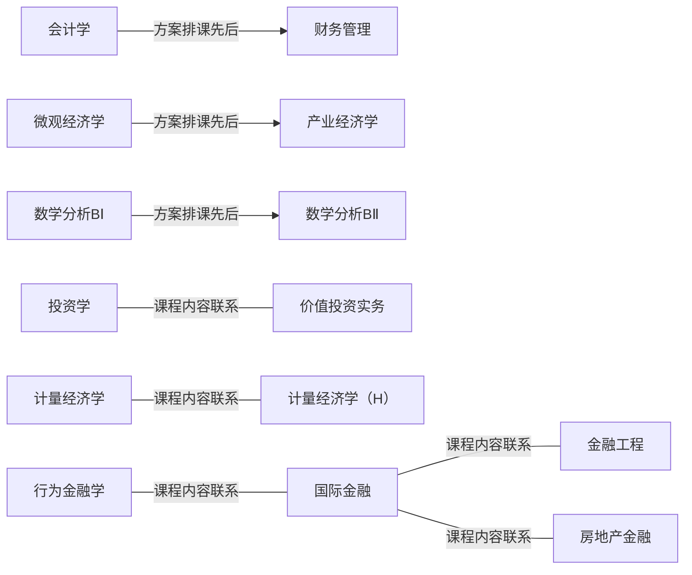

# 2023财务管理（金融与财务）专业“2+X”教学培养方案(港澳台侨生适用）

管理学院 · 财务管理 · 方案 67473 · 117 个不同课程或科研条目。

[官方 Word](../originals/plan-67473.docx) · [教务详情](https://fdjwgl.fudan.edu.cn/manager/bizType/2/major-program-search/info/67473?skipAuth=1) · [方案快照](../raw/plan-67473.json.gz) · [年级目录](../README.md)

## 课程关系图

图中展示部分关系。下表保留全部已建立的课程对，来源位置使用本方案 JSON Pointer。

## 先修与内容联系

| 类型 | 起点 | 终点 | 依据 | 原表定位 |
| --- | --- | --- | --- | --- |
| 建议学习顺序 | 会计学 (BA10003) | 财务管理 (BA20009) | 会计报表和核算概念可用于理解财务决策。  | `/courseModules/6/planCourses/5`、`/courseModules/9/planCourses/1` |
| 建议学习顺序 | 微观经济学 (ECON20003) | 产业经济学 (ECON30168) | 企业和市场结构是产业经济分析的基础。  | `/courseModules/6/planCourses/3`、`/courseModules/14/planCourses/8` |
| 建议学习顺序 | 数学分析BⅠ (MATH10012) | 数学分析BⅡ (MATH10013) | 同方案的课程题名具有连续分册或序号。  | `/courseModules/6/planCourses/0`、`/courseModules/6/planCourses/1` |
| 方案排课先后 | 会计学 (BA10003) | 财务管理 (BA20009) | 同方案该课程全部明确数字学期均早于后者。  | `/courseModules/6/planCourses/5`、`/courseModules/9/planCourses/1` |
| 方案排课先后 | 微观经济学 (ECON20003) | 产业经济学 (ECON30168) | 同方案该课程全部明确数字学期均早于后者。  | `/courseModules/6/planCourses/3`、`/courseModules/14/planCourses/8` |
| 方案排课先后 | 数学分析BⅠ (MATH10012) | 数学分析BⅡ (MATH10013) | 同方案该课程全部明确数字学期均早于后者。  | `/courseModules/6/planCourses/0`、`/courseModules/6/planCourses/1` |
| 课程内容联系 | 会计学 (BA10003) | 财务管理 (BA20009) | 会计信息与企业融资、投资决策存在应用联系。  | `/courseModules/6/planCourses/5`、`/courseModules/9/planCourses/1` |
| 课程内容联系 | 会计学 (BA10003) | 中级财务会计 (BA20013) | 本方案两门课程的题名均含“会计”，可据此对照这一主题。  | `/courseModules/6/planCourses/5`、`/courseModules/18/planCourses/4` |
| 课程内容联系 | 会计学 (BA10003) | 成本管理会计 (BA30014) | 本方案两门课程的题名均含“会计”，可据此对照这一主题。  | `/courseModules/6/planCourses/5`、`/courseModules/18/planCourses/0` |
| 课程内容联系 | 会计学 (BA10003) | 国际会计 (BA30017) | 本方案两门课程的题名均含“会计”，可据此对照这一主题。  | `/courseModules/6/planCourses/5`、`/courseModules/14/planCourses/4` |
| 课程内容联系 | 会计学 (BA10003) | 会计专题研究 (BA30037) | 本方案两门课程的题名均含“会计”，可据此对照这一主题。  | `/courseModules/6/planCourses/5`、`/courseModules/14/planCourses/14` |
| 课程内容联系 | 投资学 (BA30012) | 价值投资实务 (BA30053) | 本方案两门课程的题名均含“投资”，可据此对照这一主题。  | `/courseModules/10/planCourses/1`、`/courseModules/14/planCourses/29` |
| 课程内容联系 | 中国金融市场 (BA30023) | 国际金融 (BA30042) | 本方案两门课程的题名均含“金融”，可据此对照这一主题。  | `/courseModules/14/planCourses/6`、`/courseModules/14/planCourses/23` |
| 课程内容联系 | 行为金融学 (BA30039) | 国际金融 (BA30042) | 本方案两门课程的题名均含“金融”，可据此对照这一主题。  | `/courseModules/14/planCourses/15`、`/courseModules/14/planCourses/23` |
| 课程内容联系 | 国际金融 (BA30042) | 房地产金融 (BA30056) | 本方案两门课程的题名均含“金融”，可据此对照这一主题。  | `/courseModules/14/planCourses/23`、`/courseModules/14/planCourses/32` |
| 课程内容联系 | 国际金融 (BA30042) | 金融工程 (MSE30011) | 本方案两门课程的题名均含“金融”，可据此对照这一主题。  | `/courseModules/14/planCourses/23`、`/courseModules/19/planCourses/2` |
| 课程内容联系 | 供应链管理 (MSE20007) | 供应链管理导论 (MSE30026) | 本方案两门课程的题名均含“供应链”，可据此对照这一主题。  | `/courseModules/19/planCourses/1`、`/courseModules/25/planCourses/4` |
| 课程内容联系 | 计量经济学 (STAT30021) | 计量经济学（H） (STAT30021h) | 本方案两门课程的题名均含“计量经济”，可据此对照这一主题。  | `/courseModules/9/planCourses/7`、`/courseModules/13/planCourses/3` |

本次未从可定位的明确表述中确认课程对课程预修。学期安排、系列分册与编辑建议均保留各自的依据。

## 按原方案模块阅读

同一模块展示原表中的课程归属。模块内课程之间的先后仍须逐项查阅。

- **管理学院大类基础课程（必修）**　会计学、管理学导论、微观经济学、宏观经济学、数学分析BⅠ、数学分析BⅡ、线性代数、社会研究方法B（原表模块 6）
- **管理学院大类基础课程（三选一）**　法理学导论、政治学原理、社会学导论（原表模块 7）
- **A组（必修7或8学分）**　战略管理、国际商务管理、组织沟通与社会环境、职业责任与领导力（原表模块 16）
- **会计学专业必修课**　中级财务会计、成本管理会计、审计学、高级财务会计、财务报告（原表模块 18）
- **管理科学专业必修课**　供应链管理、随机运筹学、金融工程、最优化方法及应用（原表模块 19）
- **工商管理专业必修课**　国别经营环境、人力资源管理、东方管理、公司治理（原表模块 20）
- **信息管理与信息系统专业必修课**　数据库与企业数据管理、数据挖掘原理与技术、互联网应用分析与设计、大数据商务分析与应用（原表模块 21）
- **市场营销专业必修课**　消费者行为学、营销研究、服务营销、数字化营销（原表模块 22）
- **统计学专业必修课**　回归分析、时间序列分析、多元分析、随机过程、抽样调查、统计推断、非参数统计、属性数据分析（原表模块 23）

## 课程表

同一课程在不同模块分别出现时，按原表逐行列出。季节字段保留原值。

| 课程 | 代码 | 学分 | 学期 | 模块 |
| --- | --- | ---: | --- | --- |
| 数学分析BⅠ | MATH10012 | 5.0 | 第1学期 | 培养方案 / 专业培养课程 / 大类基础课程 / 管理学院大类基础课程（必修） |
| 数学分析BⅡ | MATH10013 | 5.0 | 第2学期 | 培养方案 / 专业培养课程 / 大类基础课程 / 管理学院大类基础课程（必修） |
| 线性代数 | MATH10017 | 3.0 | 第2学期 | 培养方案 / 专业培养课程 / 大类基础课程 / 管理学院大类基础课程（必修） |
| 微观经济学 | ECON20003 | 3.0 | 第2学期 | 培养方案 / 专业培养课程 / 大类基础课程 / 管理学院大类基础课程（必修） |
| 宏观经济学 | ECON20004 | 3.0 | 第3学期 | 培养方案 / 专业培养课程 / 大类基础课程 / 管理学院大类基础课程（必修） |
| 会计学 | BA10003 | 3.0 | 第2学期 | 培养方案 / 专业培养课程 / 大类基础课程 / 管理学院大类基础课程（必修） |
| 社会研究方法B | MSE30029 | 3.0 | 第6学期 | 培养方案 / 专业培养课程 / 大类基础课程 / 管理学院大类基础课程（必修） |
| 管理学导论 | BA10004 | 3.0 | 第1学期 | 培养方案 / 专业培养课程 / 大类基础课程 / 管理学院大类基础课程（必修） |
| 政治学原理 | POLI10007 | 3.0 | 第1学期 | 培养方案 / 专业培养课程 / 大类基础课程 / 管理学院大类基础课程（三选一） |
| 社会学导论 | SOCI20001 | 3.0 | 第1学期 | 培养方案 / 专业培养课程 / 大类基础课程 / 管理学院大类基础课程（三选一） |
| 法理学导论 | LAW10004 | 3.0 | 第1学期 | 培养方案 / 专业培养课程 / 大类基础课程 / 管理学院大类基础课程（三选一） |
| 概率论与数理统计 | STAT20012 | 4.0 | 第3学期 | 培养方案 / 专业培养课程 / 专业核心教育课程 / A组 |
| 财务管理 | BA20009 | 3.0 | 第3学期 | 培养方案 / 专业培养课程 / 专业核心教育课程 / A组 |
| 运筹学 | MSE20005 | 4.0 | 第3学期 | 培养方案 / 专业培养课程 / 专业核心教育课程 / A组 |
| 营销管理 | BA20010 | 3.0 | 第4学期 | 培养方案 / 专业培养课程 / 专业核心教育课程 / A组 |
| 管理信息系统 | MSE20006 | 3.0 | 第3学期 | 培养方案 / 专业培养课程 / 专业核心教育课程 / A组 |
| 组织行为学 | BA20011 | 2.0 | 第4学期 | 培养方案 / 专业培养课程 / 专业核心教育课程 / A组 |
| 统计软件 | STAT20013 | 3.0 | 第4学期 | 培养方案 / 专业培养课程 / 专业核心教育课程 / A组 |
| 计量经济学 | STAT30021 | 3.0 | 第5学期 | 培养方案 / 专业培养课程 / 专业核心教育课程 / A组 |
| 商业伦理学 | BA10002 | 2.0 | 第1学期 | 培养方案 / 专业培养课程 / 专业核心教育课程 / A组 |
| 经济学原理 | ECON30171 | 3.0 | 第1学期 | 培养方案 / 专业培养课程 / 专业核心教育课程 / A组 |
| 毕业论文 | BA40001 | 4.0 | 第8学期 | 培养方案 / 专业培养课程 / 专业核心教育课程 / B组 |
| 投资学 | BA30012 | 3.0 | 第4学期 | 培养方案 / 专业培养课程 / 专业核心教育课程 / B组 |
| 衍生证券 | BA30027 | 3.0 | 第6学期 | 培养方案 / 专业培养课程 / 专业核心教育课程 / B组 |
| 公司财务理论与实务 | BA30028 | 3.0 | 第6学期 | 培养方案 / 专业培养课程 / 专业核心教育课程 / B组 |
| 法律、商业与社会 | BA30030 | 2.0 | 第7学期 | 培养方案 / 专业培养课程 / 专业核心教育课程 / B组 |
| 金融市场与金融机构 | BA30033 | 3.0 | 第5学期 | 培养方案 / 专业培养课程 / 专业核心教育课程 / B组 |
| 毕业实习 | BA40002 | 1.0 | 第4学期、第8学期 | 培养方案 / 专业培养课程 / 专业核心教育课程 / B组 |
| 社会调查 | BA30055 | 2.0 | 第5学期 | 培养方案 / 专业培养课程 / 专业核心教育课程 / B组 |
| 职业规划与发展 | BA20014 | 1.0 | 第4学期 | 培养方案 / 专业培养课程 / 专业核心教育课程 / B组 |
| 回归分析 | STAT30017 | 3.0 | 第5学期、第6学期 | 培养方案 / 专业进阶II组(必修15学分） / A组 |
| 时间序列分析 | STAT30018 | 3.0 | 第5学期、第6学期 | 培养方案 / 专业进阶II组(必修15学分） / A组 |
| 随机过程 | STAT30020 | 3.0 | 第5学期、第6学期 | 培养方案 / 专业进阶II组(必修15学分） / A组 |
| 计量经济学（H） | STAT30021h | 3.0 | 第5学期、第6学期 | 培养方案 / 专业进阶II组(必修15学分） / A组 |
| 高级微观经济学（H） | ECON30167h | 3.0 | 第5学期、第6学期 | 培养方案 / 专业进阶II组(必修15学分） / A组 |
| 仿真与模拟 | MSE30014 | 3.0 | 第5学期、第6学期 | 培养方案 / 专业进阶II组(必修15学分） / A组 |
| 博弈论 | MSE30016 | 3.0 | 第5学期、第6学期 | 培养方案 / 专业进阶II组(必修15学分） / A组 |
| 高等概率论 | STAT30025 | 3.0 | 第5学期、第6学期 | 培养方案 / 专业进阶II组(必修15学分） / A组 |
| 高等数理统计（一） | STAT30026 | 3.0 | 第5学期、第6学期 | 培养方案 / 专业进阶II组(必修15学分） / A组 |
| 程序设计与数据可视化 | MSE30023 | 3.0 | 第5学期、第6学期 | 培养方案 / 专业进阶II组(必修15学分） / A组 |
| 现代企业理论（H） | ECON30172h | 2.0 | 第5学期、第6学期 | 培养方案 / 专业进阶II组(必修15学分） / A组 |
| 运营管理 | MSE30008 | 3.0 | 第5学期、第6学期 | 培养方案 / 专业进阶II组(必修15学分） / B组 |
| 物流管理 | MSE30010 | 3.0 | 第5学期、第6学期 | 培养方案 / 专业进阶II组(必修15学分） / B组 |
| 国际财务管理 | BA30013 | 3.0 | 第5学期、第6学期 | 培养方案 / 专业进阶II组(必修15学分） / B组 |
| 税法 | BA30015 | 3.0 | 第5学期、第6学期 | 培养方案 / 专业进阶II组(必修15学分） / B组 |
| 国际会计 | BA30017 | 3.0 | 第5学期、第6学期 | 培养方案 / 专业进阶II组(必修15学分） / B组 |
| 营销渠道管理 | BA30021 | 2.0 | 第5学期、第6学期 | 培养方案 / 专业进阶II组(必修15学分） / B组 |
| 中国金融市场 | BA30023 | 3.0 | 第5学期、第6学期 | 培养方案 / 专业进阶II组(必修15学分） / B组 |
| 信息技术创新应用 | MSE30015 | 2.0 | 第5学期、第6学期 | 培养方案 / 专业进阶II组(必修15学分） / B组 |
| 产业经济学 | ECON30168 | 3.0 | 第5学期、第6学期 | 培养方案 / 专业进阶II组(必修15学分） / B组 |
| 规制经济学 | ECON30169 | 3.0 | 第5学期、第6学期 | 培养方案 / 专业进阶II组(必修15学分） / B组 |
| 产业组织与企业战略 | ECON30170 | 3.0 | 第5学期、第6学期 | 培养方案 / 专业进阶II组(必修15学分） / B组 |
| 基金管理 | BA30034 | 3.0 | 第5学期、第6学期 | 培养方案 / 专业进阶II组(必修15学分） / B组 |
| 经济与金融中的统计方法 | BA30035 | 3.0 | 第5学期、第6学期 | 培养方案 / 专业进阶II组(必修15学分） / B组 |
| 财务报表分析 | BA30036 | 3.0 | 第5学期、第6学期 | 培养方案 / 专业进阶II组(必修15学分） / B组 |
| 会计专题研究 | BA30037 | 3.0 | 第5学期、第6学期 | 培养方案 / 专业进阶II组(必修15学分） / B组 |
| 行为金融学 | BA30039 | 3.0 | 第5学期、第6学期 | 培养方案 / 专业进阶II组(必修15学分） / B组 |
| 财务报表与资本市场 | BA30041 | 3.0 | 第5学期、第6学期 | 培养方案 / 专业进阶II组(必修15学分） / B组 |
| 统计计算 | STAT30024 | 3.0 | 第5学期、第6学期 | 培养方案 / 专业进阶II组(必修15学分） / B组 |
| 企业应用系统与管理决策 | MSE30017 | 3.0 | 第5学期、第6学期 | 培养方案 / 专业进阶II组(必修15学分） / B组 |
| 电子商务与移动商务 | MSE30018 | 3.0 | 第5学期、第6学期 | 培养方案 / 专业进阶II组(必修15学分） / B组 |
| 社会化媒体分析 | MSE30024 | 3.0 | 第5学期、第6学期 | 培养方案 / 专业进阶II组(必修15学分） / B组 |
| 互联网经济学 | MSE30025 | 3.0 | 第5学期、第6学期 | 培养方案 / 专业进阶II组(必修15学分） / B组 |
| 信息安全与隐私保护 | MANA130381 | 3.0 | 第5学期、第6学期 | 培养方案 / 专业进阶II组(必修15学分） / B组 |
| 国际金融 | BA30042 | 3.0 | 第5学期、第6学期 | 培养方案 / 专业进阶II组(必修15学分） / B组 |
| 金融科技导论 | BA30043 | 3.0 | 第5学期、第6学期 | 培养方案 / 专业进阶II组(必修15学分） / B组 |
| 产品创新管理 | BA30044 | 2.0 | 第5学期、第6学期 | 培养方案 / 专业进阶II组(必修15学分） / B组 |
| 品牌传播管理 | BA30051 | 3.0 | 第5学期、第6学期 | 培养方案 / 专业进阶II组(必修15学分） / B组 |
| 营销工程 | BA30052 | 3.0 | 第5学期、第6学期 | 培养方案 / 专业进阶II组(必修15学分） / B组 |
| 全球营销战略 | MANA130395 | 2.0 | 第5学期、第6学期 | 培养方案 / 专业进阶II组(必修15学分） / B组 |
| 价值投资实务 | BA30053 | 2.0 | 第5学期、第6学期 | 培养方案 / 专业进阶II组(必修15学分） / B组 |
| 资本资产定价 | BA30054 | 3.0 | 第5学期、第6学期 | 培养方案 / 专业进阶II组(必修15学分） / B组 |
| 数据科学编程基础 | MSE30027 | 3.0 | 第5学期、第6学期 | 培养方案 / 专业进阶II组(必修15学分） / B组 |
| 房地产金融 | BA30056 | 3.0 | 第5学期、第6学期 | 培养方案 / 专业进阶II组(必修15学分） / B组 |
| 数据结构与算法导论 | MSE30028 | 3.0 | 第5学期、第6学期 | 培养方案 / 专业进阶II组(必修15学分） / B组 |
| 会计与人工智能 | BA30058 | 3.0 | 第5学期、第6学期 | 培养方案 / 专业进阶II组(必修15学分） / B组 |
| 营销科技与决策系统 | BA30059 | 3.0 | 第5学期、第6学期 | 培养方案 / 专业进阶II组(必修15学分） / B组 |
| 营销创意思维 | BA30061 | 3.0 | 第5学期、第6学期 | 培养方案 / 专业进阶II组(必修15学分） / B组 |
| 数字平台经济学 | ECON30173 | 3.0 | 第5学期、第6学期 | 培养方案 / 专业进阶II组(必修15学分） / B组 |
| 战略管理 | BA20012 | 2.0 | 第5学期 | 培养方案 / 专业进阶I组 / A组（必修7或8学分） |
| 国际商务管理 | BA30018 | 2.0 | 第5学期 | 培养方案 / 专业进阶I组 / A组（必修7或8学分） |
| 组织沟通与社会环境 | BA30031 | 3.0 | 第6学期 | 培养方案 / 专业进阶I组 / A组（必修7或8学分） |
| 职业责任与领导力 | BA30032 | 3.0 | 第6学期 | 培养方案 / 专业进阶I组 / A组（必修7或8学分） |
| 成本管理会计 | BA30014 | 3.0 | 第5学期 | 培养方案 / 专业进阶I组 / B组（必修8或7学分） / 会计学专业必修课 |
| 审计学 | BA30016 | 3.0 | 第6学期 | 培养方案 / 专业进阶I组 / B组（必修8或7学分） / 会计学专业必修课 |
| 高级财务会计 | BA30040 | 3.0 | 第6学期 | 培养方案 / 专业进阶I组 / B组（必修8或7学分） / 会计学专业必修课 |
| 财务报告 | BA30057 | 3.0 | 第5学期 | 培养方案 / 专业进阶I组 / B组（必修8或7学分） / 会计学专业必修课 |
| 中级财务会计 | BA20013 | 3.0 | 第4学期 | 培养方案 / 专业进阶I组 / B组（必修8或7学分） / 会计学专业必修课 |
| 随机运筹学 | MSE30009 | 3.0 | 第5学期 | 培养方案 / 专业进阶I组 / B组（必修8或7学分） / 管理科学专业必修课 |
| 供应链管理 | MSE20007 | 3.0 | 第4学期 | 培养方案 / 专业进阶I组 / B组（必修8或7学分） / 管理科学专业必修课 |
| 金融工程 | MSE30011 | 3.0 | 第6学期 | 培养方案 / 专业进阶I组 / B组（必修8或7学分） / 管理科学专业必修课 |
| 最优化方法及应用 | MSE30012 | 3.0 | 第5学期 | 培养方案 / 专业进阶I组 / B组（必修8或7学分） / 管理科学专业必修课 |
| 国别经营环境 | BA30024 | 3.0 | 第5学期 | 培养方案 / 专业进阶I组 / B组（必修8或7学分） / 工商管理专业必修课 |
| 人力资源管理 | BA30025 | 2.0 | 第5学期 | 培养方案 / 专业进阶I组 / B组（必修8或7学分） / 工商管理专业必修课 |
| 东方管理 | BA30026 | 2.0 | 第6学期 | 培养方案 / 专业进阶I组 / B组（必修8或7学分） / 工商管理专业必修课 |
| 公司治理 | BA30029 | 3.0 | 第6学期 | 培养方案 / 专业进阶I组 / B组（必修8或7学分） / 工商管理专业必修课 |
| 数据库与企业数据管理 | MSE30019 | 3.0 | 第5学期 | 培养方案 / 专业进阶I组 / B组（必修8或7学分） / 信息管理与信息系统专业必修课 |
| 数据挖掘原理与技术 | MSE30020 | 3.0 | 第5学期 | 培养方案 / 专业进阶I组 / B组（必修8或7学分） / 信息管理与信息系统专业必修课 |
| 互联网应用分析与设计 | MSE30021 | 4.0 | 第6学期 | 培养方案 / 专业进阶I组 / B组（必修8或7学分） / 信息管理与信息系统专业必修课 |
| 大数据商务分析与应用 | MSE30022 | 3.0 | 第6学期 | 培养方案 / 专业进阶I组 / B组（必修8或7学分） / 信息管理与信息系统专业必修课 |
| 消费者行为学 | BA30019 | 3.0 | 第5学期 | 培养方案 / 专业进阶I组 / B组（必修8或7学分） / 市场营销专业必修课 |
| 营销研究 | BA30020 | 3.0 | 第5学期 | 培养方案 / 专业进阶I组 / B组（必修8或7学分） / 市场营销专业必修课 |
| 服务营销 | BA30022 | 2.0 | 第5学期 | 培养方案 / 专业进阶I组 / B组（必修8或7学分） / 市场营销专业必修课 |
| 数字化营销 | BA30038 | 3.0 | 第6学期 | 培养方案 / 专业进阶I组 / B组（必修8或7学分） / 市场营销专业必修课 |
| 非参数统计 | STAT40014 | 3.0 | 第6学期 | 培养方案 / 专业进阶I组 / B组（必修8或7学分） / 统计学专业必修课 |
| 回归分析 | STAT30017 | 3.0 | 第5学期 | 培养方案 / 专业进阶I组 / B组（必修8或7学分） / 统计学专业必修课 |
| 时间序列分析 | STAT30018 | 3.0 | 第5学期 | 培养方案 / 专业进阶I组 / B组（必修8或7学分） / 统计学专业必修课 |
| 多元分析 | STAT30019 | 3.0 | 第6学期 | 培养方案 / 专业进阶I组 / B组（必修8或7学分） / 统计学专业必修课 |
| 随机过程 | STAT30020 | 3.0 | 第6学期 | 培养方案 / 专业进阶I组 / B组（必修8或7学分） / 统计学专业必修课 |
| 属性数据分析 | STAT40015 | 3.0 | 第7学期 | 培养方案 / 专业进阶I组 / B组（必修8或7学分） / 统计学专业必修课 |
| 抽样调查 | STAT30022 | 3.0 | 第6学期 | 培养方案 / 专业进阶I组 / B组（必修8或7学分） / 统计学专业必修课 |
| 统计推断 | STAT30023 | 3.0 | 第5学期 | 培养方案 / 专业进阶I组 / B组（必修8或7学分） / 统计学专业必修课 |
| 中国对外贸易发展 | BA30045 | 3.0 | 第5学期、第6学期 | 培养方案 / 任意选修 |
| 中国资本市场研究 | BA30046 | 3.0 | 第5学期、第6学期 | 培养方案 / 任意选修 |
| 中国商业物流 | BA30047 | 3.0 | 第5学期、第6学期 | 培养方案 / 任意选修 |
| 商业创新设计 | BA30048 | 3.0 | 第5学期、第6学期 | 培养方案 / 任意选修 |
| 供应链管理导论 | MSE30026 | 3.0 | 第5学期、第6学期 | 培养方案 / 任意选修 |
| 金融风险管理 | BA30049 | 3.0 | 第5学期、第6学期 | 培养方案 / 任意选修 |
| 国际财务管理 | MANA130391 | 3.0 | 第5学期、第6学期 | 培养方案 / 任意选修 |
| 中美金融市场简介 | BA30060 | 3.0 | AUTUMN | 培养方案 / 任意选修 |
