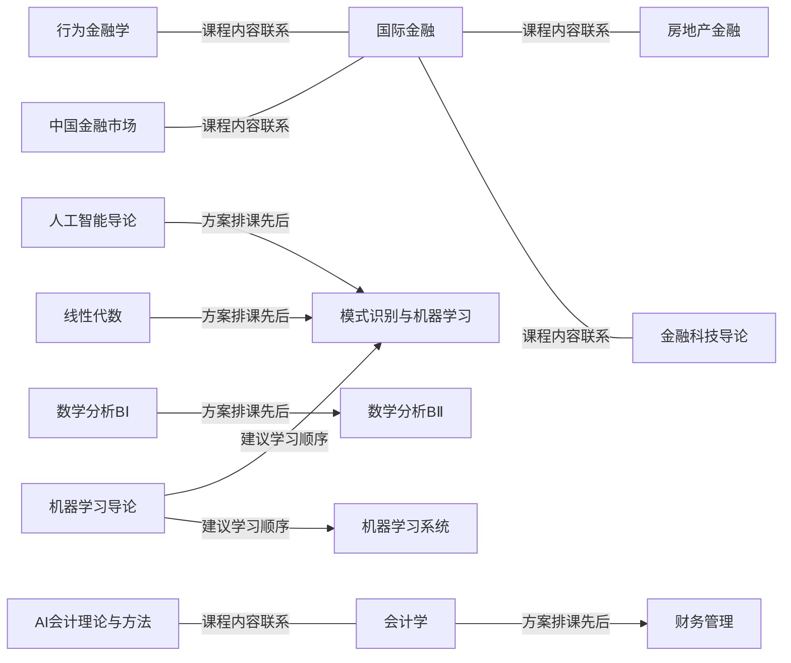

# 2024财务管理（金融与财务）+人工智能双学士学位专业教学培养方案（普通本科生）

管理学院 · 财务管理(金融与财务)-人工智能(双学士学位项目) · 方案 72964 · 61 个不同课程或科研条目。

[官方 Word](../originals/plan-72964.docx) · [教务详情](https://fdjwgl.fudan.edu.cn/manager/bizType/2/major-program-search/info/72964?skipAuth=1) · [方案快照](../raw/plan-72964.json.gz) · [年级目录](../README.md)

## 课程关系图

图中展示部分关系。下表保留全部已建立的课程对，来源位置使用本方案 JSON Pointer。

## 先修与内容联系

| 类型 | 起点 | 终点 | 依据 | 原表定位 |
| --- | --- | --- | --- | --- |
| 建议学习顺序 | 人工智能导论 (AIE310005) | 模式识别与机器学习 (AIE410001) | 人工智能问题与模型类别可为学习模式识别作准备。  | `/courseModules/10/planCourses/4`、`/courseModules/10/planCourses/6` |
| 建议学习顺序 | 会计学 (BA10003) | 财务管理 (BA20009) | 会计报表和核算概念可用于理解财务决策。  | `/courseModules/6/planCourses/4`、`/courseModules/8/planCourses/1` |
| 建议学习顺序 | 数学分析BⅠ (MATH10012) | 数学分析BⅡ (MATH10013) | 同方案的课程题名具有连续分册或序号。  | `/courseModules/6/planCourses/0`、`/courseModules/6/planCourses/1` |
| 建议学习顺序 | 线性代数 (MATH10017) | 模式识别与机器学习 (AIE410001) | 向量表示和矩阵运算支持理解分类、回归等模型。  | `/courseModules/6/planCourses/2`、`/courseModules/10/planCourses/6` |
| 建议学习顺序 | 机器学习导论 (STAT30027) | 模式识别与机器学习 (AIE410001) | “机器学习导论”题名标明基础层次，前置阅读可帮助了解“模式识别与机器学习”中的机器学习主题。  | `/courseModules/15/planCourses/2`、`/courseModules/10/planCourses/6` |
| 建议学习顺序 | 机器学习导论 (STAT30027) | 机器学习系统 (CS30058) | “机器学习导论”题名标明基础层次，前置阅读可帮助了解“机器学习系统”中的机器学习主题。  | `/courseModules/15/planCourses/2`、`/courseModules/14/planCourses/5` |
| 方案排课先后 | 人工智能导论 (AIE310005) | 模式识别与机器学习 (AIE410001) | 同方案该课程全部明确数字学期均早于后者。  | `/courseModules/10/planCourses/4`、`/courseModules/10/planCourses/6` |
| 方案排课先后 | 会计学 (BA10003) | 财务管理 (BA20009) | 同方案该课程全部明确数字学期均早于后者。  | `/courseModules/6/planCourses/4`、`/courseModules/8/planCourses/1` |
| 方案排课先后 | 数学分析BⅠ (MATH10012) | 数学分析BⅡ (MATH10013) | 同方案该课程全部明确数字学期均早于后者。  | `/courseModules/6/planCourses/0`、`/courseModules/6/planCourses/1` |
| 方案排课先后 | 线性代数 (MATH10017) | 模式识别与机器学习 (AIE410001) | 同方案该课程全部明确数字学期均早于后者。  | `/courseModules/6/planCourses/2`、`/courseModules/10/planCourses/6` |
| 课程内容联系 | 计算机系统基础 (AIE210006) | 计算机组成与体系结构 (CS30052) | 处理器、存储与系统执行模型具有共同内容。  | `/courseModules/10/planCourses/3`、`/courseModules/14/planCourses/1` |
| 课程内容联系 | 人工智能导论 (AIE310005) | 人工智能安全 (AIE831001) | 本方案两门课程的题名均含“人工智能”，可据此对照这一主题。  | `/courseModules/10/planCourses/4`、`/courseModules/10/planCourses/7` |
| 课程内容联系 | 人工智能的编程基础 (AIE310006) | 人工智能安全 (AIE831001) | 本方案两门课程的题名均含“人工智能”，可据此对照这一主题。  | `/courseModules/10/planCourses/0`、`/courseModules/10/planCourses/7` |
| 课程内容联系 | 人工智能的软件基础 (AIE310008) | 人工智能安全 (AIE831001) | 本方案两门课程的题名均含“人工智能”，可据此对照这一主题。  | `/courseModules/10/planCourses/5`、`/courseModules/10/planCourses/7` |
| 课程内容联系 | 人工智能的数学基础 (AIE310009) | 模式识别与机器学习 (AIE410001) | 数学表达与学习模型的统计、优化工具可对照。  | `/courseModules/10/planCourses/2`、`/courseModules/10/planCourses/6` |
| 课程内容联系 | 人工智能的数学基础 (AIE310009) | 人工智能安全 (AIE831001) | 本方案两门课程的题名均含“人工智能”，可据此对照这一主题。  | `/courseModules/10/planCourses/2`、`/courseModules/10/planCourses/7` |
| 课程内容联系 | 模式识别与机器学习 (AIE410001) | 机器学习导论 (STAT30027) | 本方案两门课程的题名均含“机器学习”，可据此对照这一主题。  | `/courseModules/10/planCourses/6`、`/courseModules/15/planCourses/2` |
| 课程内容联系 | AI会计理论与方法 (AIT410016) | 会计学 (BA10003) | 本方案两门课程的题名均含“会计”，可据此对照这一主题。  | `/courseModules/15/planCourses/8`、`/courseModules/6/planCourses/4` |
| 课程内容联系 | 会计学 (BA10003) | 财务管理 (BA20009) | 会计信息与企业融资、投资决策存在应用联系。  | `/courseModules/6/planCourses/4`、`/courseModules/8/planCourses/1` |
| 课程内容联系 | 中国金融市场 (BA30023) | 国际金融 (BA30042) | 本方案两门课程的题名均含“金融”，可据此对照这一主题。  | `/courseModules/13/planCourses/1`、`/courseModules/13/planCourses/5` |
| 课程内容联系 | 行为金融学 (BA30039) | 国际金融 (BA30042) | 本方案两门课程的题名均含“金融”，可据此对照这一主题。  | `/courseModules/13/planCourses/4`、`/courseModules/13/planCourses/5` |
| 课程内容联系 | 国际金融 (BA30042) | 金融科技导论 (BA30043) | 本方案两门课程的题名均含“金融”，可据此对照这一主题。  | `/courseModules/13/planCourses/5`、`/courseModules/13/planCourses/6` |
| 课程内容联系 | 国际金融 (BA30042) | 房地产金融 (BA30056) | 本方案两门课程的题名均含“金融”，可据此对照这一主题。  | `/courseModules/13/planCourses/5`、`/courseModules/13/planCourses/8` |
| 课程内容联系 | 机器学习系统 (CS30058) | 机器学习导论 (STAT30027) | 本方案两门课程的题名均含“机器学习”，可据此对照这一主题。  | `/courseModules/14/planCourses/5`、`/courseModules/15/planCourses/2` |

本次未从可定位的明确表述中确认课程对课程预修。学期安排、系列分册与编辑建议均保留各自的依据。

## 按原方案模块阅读

同一模块展示原表中的课程归属。模块内课程之间的先后仍须逐项查阅。

- **管理学院大类基础课程（必修）**　会计学、管理学导论、程序设计、微观经济学、宏观经济学、数学分析BⅠ、数学分析BⅡ、线性代数、社会研究方法B（原表模块 6）

## 课程表

同一课程在不同模块分别出现时，按原表逐行列出。季节字段保留原值。

| 课程 | 代码 | 学分 | 学期 | 模块 |
| --- | --- | ---: | --- | --- |
| 数学分析BⅠ | MATH10012 | 5.0 | 第1学期 | 培养方案 / 专业培养课程 / 大类基础课程 / 管理学院大类基础课程（必修） |
| 数学分析BⅡ | MATH10013 | 5.0 | 第2学期 | 培养方案 / 专业培养课程 / 大类基础课程 / 管理学院大类基础课程（必修） |
| 线性代数 | MATH10017 | 3.0 | 第2学期 | 培养方案 / 专业培养课程 / 大类基础课程 / 管理学院大类基础课程（必修） |
| 宏观经济学 | ECON20004 | 3.0 | 第3学期 | 培养方案 / 专业培养课程 / 大类基础课程 / 管理学院大类基础课程（必修） |
| 会计学 | BA10003 | 3.0 | 第2学期 | 培养方案 / 专业培养课程 / 大类基础课程 / 管理学院大类基础课程（必修） |
| 社会研究方法B | MSE30029 | 3.0 | 第6学期 | 培养方案 / 专业培养课程 / 大类基础课程 / 管理学院大类基础课程（必修） |
| 管理学导论 | BA10004 | 3.0 | 第1学期 | 培养方案 / 专业培养课程 / 大类基础课程 / 管理学院大类基础课程（必修） |
| 微观经济学 | ECON20003 | 3.0 | 第2学期 | 培养方案 / 专业培养课程 / 大类基础课程 / 管理学院大类基础课程（必修） |
| 程序设计 | CS10004 | 4.0 | AUTUMN | 培养方案 / 专业培养课程 / 大类基础课程 / 管理学院大类基础课程（必修） |
| 经济学原理 | ECON30171 | 3.0 | 第1学期 | 培养方案 / 专业培养课程 / 专业核心教育课程 / A组 |
| 财务管理 | BA20009 | 3.0 | 第3学期 | 培养方案 / 专业培养课程 / 专业核心教育课程 / A组 |
| 概率论与数理统计 | STAT20012 | 4.0 | 第3学期 | 培养方案 / 专业培养课程 / 专业核心教育课程 / A组 |
| 运筹学 | MSE20005 | 4.0 | 第3学期 | 培养方案 / 专业培养课程 / 专业核心教育课程 / A组 |
| 计量经济学 | STAT30021 | 3.0 | 第5学期 | 培养方案 / 专业培养课程 / 专业核心教育课程 / A组 |
| Python编程基础与数据分析入门 | MSE10001 | 2.0 | 第1学期 | 培养方案 / 专业培养课程 / 专业核心教育课程 / A组 |
| 职业规划与发展 | BA20014 | 1.0 | 第4学期 | 培养方案 / 专业培养课程 / 专业核心教育课程 / B组 |
| 毕业实习 | BA40002 | 1.0 | 第4学期、第8学期 | 培养方案 / 专业培养课程 / 专业核心教育课程 / B组 |
| 毕业论文 | BA40001 | 4.0 | 第8学期 | 培养方案 / 专业培养课程 / 专业核心教育课程 / B组 |
| 社会调查 | BA30055 | 2.0 | 第5学期 | 培养方案 / 专业培养课程 / 专业核心教育课程 / B组 |
| 投资学 | BA30012 | 3.0 | 第4学期 | 培养方案 / 专业培养课程 / 专业核心教育课程 / B组 |
| 金融市场与金融机构 | BA30033 | 3.0 | 第5学期 | 培养方案 / 专业培养课程 / 专业核心教育课程 / B组 |
| 衍生证券 | BA30027 | 3.0 | 第6学期 | 培养方案 / 专业培养课程 / 专业核心教育课程 / B组 |
| 公司财务理论与实务 | BA30028 | 3.0 | 第6学期 | 培养方案 / 专业培养课程 / 专业核心教育课程 / B组 |
| 人工智能的编程基础 | AIE310006 | 2.0 | 第2学期 | 培养方案 / 专业培养课程 / 专业核心教育课程 / C组 |
| 数据结构 | AIE310007 | 4.0 | 第3学期 | 培养方案 / 专业培养课程 / 专业核心教育课程 / C组 |
| 人工智能的数学基础 | AIE310009 | 3.0 | 第3学期 | 培养方案 / 专业培养课程 / 专业核心教育课程 / C组 |
| 计算机系统基础 | AIE210006 | 3.0 | 第3学期 | 培养方案 / 专业培养课程 / 专业核心教育课程 / C组 |
| 人工智能导论 | AIE310005 | 3.0 | 第4学期 | 培养方案 / 专业培养课程 / 专业核心教育课程 / C组 |
| 人工智能的软件基础 | AIE310008 | 3.0 | 第4学期 | 培养方案 / 专业培养课程 / 专业核心教育课程 / C组 |
| 模式识别与机器学习 | AIE410001 | 3.0 | 第5学期 | 培养方案 / 专业培养课程 / 专业核心教育课程 / C组 |
| 人工智能安全 | AIE831001 | 3.0 | 第5学期 | 培养方案 / 专业培养课程 / 专业核心教育课程 / C组 |
| 人工智能的伦理与治理 | PHIL50006 | 2.0 | 第4学期、第6学期 | 培养方案 / 专业培养课程 / 专业核心教育课程 / C组 |
| 自然语言处理与大语言模型 | AIE410002 | 3.0 | 第6学期 | 培养方案 / 专业培养课程 / 专业核心教育课程 / C组 |
| 计算机视觉 | AIE310004 | 3.0 | 第7学期 | 培养方案 / 专业培养课程 / 专业核心教育课程 / C组 |
| 人工智能前沿探索实践 | AIE531001 | 3.0 | 第7学期 | 培养方案 / 专业培养课程 / 专业核心教育课程 / C组 |
| 国际财务管理 | BA30013 | 3.0 | 第5学期、第6学期 | 培养方案 / 专业进阶I组（至少修9学分） |
| 中国金融市场 | BA30023 | 3.0 | 第5学期 | 培养方案 / 专业进阶I组（至少修9学分） |
| 基金管理 | BA30034 | 3.0 | 第5学期 | 培养方案 / 专业进阶I组（至少修9学分） |
| 经济与金融中的统计方法 | BA30035 | 3.0 | 第6学期 | 培养方案 / 专业进阶I组（至少修9学分） |
| 行为金融学 | BA30039 | 3.0 | 第6学期 | 培养方案 / 专业进阶I组（至少修9学分） |
| 国际金融 | BA30042 | 3.0 | 第5学期 | 培养方案 / 专业进阶I组（至少修9学分） |
| 金融科技导论 | BA30043 | 3.0 | 第5学期、第6学期 | 培养方案 / 专业进阶I组（至少修9学分） |
| 资本资产定价 | BA30054 | 3.0 | 第6学期 | 培养方案 / 专业进阶I组（至少修9学分） |
| 房地产金融 | BA30056 | 3.0 | 第5学期 | 培养方案 / 专业进阶I组（至少修9学分） |
| 集合与图论 | CS30043 | 3.0 | 第3学期 | 培养方案 / 专业进阶II组(至少修8学分） |
| 计算机组成与体系结构 | CS30052 | 4.0 | 第4学期 | 培养方案 / 专业进阶II组(至少修8学分） |
| 数据库引论 | CS20010 | 3.0 | 第4学期 | 培养方案 / 专业进阶II组(至少修8学分） |
| 计算机网络 | CS30036 | 3.0 | 第5学期 | 培养方案 / 专业进阶II组(至少修8学分） |
| 软件工程 | CS30018 | 3.0 | 第6学期 | 培养方案 / 专业进阶II组(至少修8学分） |
| 机器学习系统 | CS30058 | 3.0 | 第6学期 | 培养方案 / 专业进阶II组(至少修8学分） |
| 计算机图形学A | CS30019 | 3.0 | 第6学期 | 培养方案 / 专业进阶II组(至少修8学分） |
| 回归分析 | STAT30017 | 3.0 | 第5学期 | 培养方案 / 专业进阶III组（至少修12学分） |
| 时间序列分析 | STAT30018 | 3.0 | 第5学期 | 培养方案 / 专业进阶III组（至少修12学分） |
| 机器学习导论 | STAT30027 | 3.0 | 第6学期 | 培养方案 / 专业进阶III组（至少修12学分） |
| 统计推断 | STAT30023 | 3.0 | 第4学期 | 培养方案 / 专业进阶III组（至少修12学分） |
| 随机过程 | STAT30020 | 3.0 | 第6学期 | 培养方案 / 专业进阶III组（至少修12学分） |
| 统计计算 | STAT30024 | 3.0 | 第5学期 | 培养方案 / 专业进阶III组（至少修12学分） |
| 语言大数据与统计建模 | AIS210007 | 2.0 | SPRING | 培养方案 / 专业进阶III组（至少修12学分） |
| 人工智能（AI）营销 | AIT310026 | 3.0 | SPRING | 培养方案 / 专业进阶III组（至少修12学分） |
| AI会计理论与方法 | AIT410016 | 2.0 | SPRING | 培养方案 / 专业进阶III组（至少修12学分） |
| 人工智能与应用经济学 | AIS410005 | 3.0 | AUTUMN | 培养方案 / 专业进阶III组（至少修12学分） |
