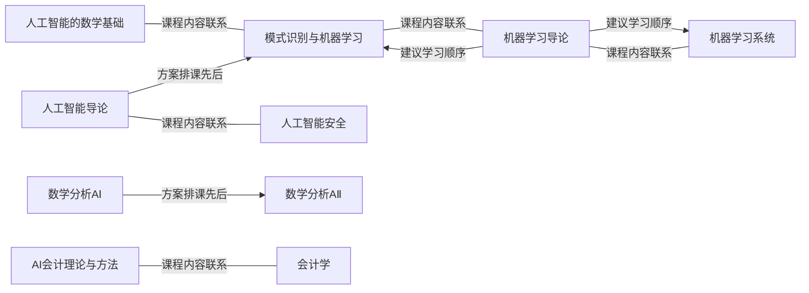

# 2025市场营销-人工智能双学士学位项目培养方案（留学生）

管理学院 · 市场营销-人工智能(双学士学位项目) · 方案 97120 · 62 个不同课程或科研条目。

[官方 Word](../originals/plan-97120.docx) · [教务详情](https://fdjwgl.fudan.edu.cn/manager/bizType/2/major-program-search/info/97120?skipAuth=1) · [方案快照](../raw/plan-97120.json.gz) · [年级目录](../README.md)

## 修读导读

- **建议先学**　《人工智能导论》（`AIE310005`） → 《模式识别与机器学习》（`AIE410001`）。人工智能问题与模型类别可为学习模式识别作准备。方案分别列在第4、5学期。

- **可以对照着读**　《AI会计理论与方法》（`AIT410016`）与《会计学》（`BA10003`）。两门课的题名都涉及会计。追踪同一笔业务在不同报表中的位置，比较各门课需要从数字中回答什么问题。

- **查模块选课**　《人工智能（AI）营销》（`AIT310026`）、《Python编程基础与数据分析入门》（`MSE10001`）列在“专业核心教育课程”中。原表见 `/courseModules/7`。

## 课程关系图

图中展示部分关系。下表保留全部已建立的课程对，来源位置使用本方案 JSON Pointer。

## 先修与内容联系

| 类型 | 起点 | 终点 | 依据 | 原表定位 |
| --- | --- | --- | --- | --- |
| 建议学习顺序 | 人工智能导论 (AIE310005) | 模式识别与机器学习 (AIE410001) | 人工智能问题与模型类别可为学习模式识别作准备。  | `/courseModules/7/planCourses/14`、`/courseModules/7/planCourses/16` |
| 建议学习顺序 | 数学分析AⅠ (MATH10010) | 数学分析AⅡ (MATH10011) | 同方案的课程题名具有连续分册或序号。  | `/courseModules/6/planCourses/0`、`/courseModules/6/planCourses/1` |
| 建议学习顺序 | 机器学习导论 (STAT30027) | 模式识别与机器学习 (AIE410001) | “机器学习导论”题名标明基础层次，前置阅读可帮助了解“模式识别与机器学习”中的机器学习主题。  | `/courseModules/12/planCourses/2`、`/courseModules/7/planCourses/16` |
| 建议学习顺序 | 机器学习导论 (STAT30027) | 机器学习系统 (CS30058) | “机器学习导论”题名标明基础层次，前置阅读可帮助了解“机器学习系统”中的机器学习主题。  | `/courseModules/12/planCourses/2`、`/courseModules/11/planCourses/5` |
| 方案排课先后 | 人工智能导论 (AIE310005) | 模式识别与机器学习 (AIE410001) | 同方案该课程全部明确数字学期均早于后者。  | `/courseModules/7/planCourses/14`、`/courseModules/7/planCourses/16` |
| 方案排课先后 | 数学分析AⅠ (MATH10010) | 数学分析AⅡ (MATH10011) | 同方案该课程全部明确数字学期均早于后者。  | `/courseModules/6/planCourses/0`、`/courseModules/6/planCourses/1` |
| 课程内容联系 | 计算机系统基础 (AIE210006) | 计算机组成与体系结构 (CS30052) | 处理器、存储与系统执行模型具有共同内容。  | `/courseModules/7/planCourses/13`、`/courseModules/11/planCourses/1` |
| 课程内容联系 | 人工智能导论 (AIE310005) | 人工智能安全 (AIE831001) | 本方案两门课程的题名均含“人工智能”，可据此对照这一主题。  | `/courseModules/7/planCourses/14`、`/courseModules/7/planCourses/17` |
| 课程内容联系 | 人工智能的编程基础 (AIE310006) | 人工智能安全 (AIE831001) | 本方案两门课程的题名均含“人工智能”，可据此对照这一主题。  | `/courseModules/7/planCourses/10`、`/courseModules/7/planCourses/17` |
| 课程内容联系 | 人工智能的软件基础 (AIE310008) | 人工智能安全 (AIE831001) | 本方案两门课程的题名均含“人工智能”，可据此对照这一主题。  | `/courseModules/7/planCourses/15`、`/courseModules/7/planCourses/17` |
| 课程内容联系 | 人工智能的数学基础 (AIE310009) | 模式识别与机器学习 (AIE410001) | 数学表达与学习模型的统计、优化工具可对照。  | `/courseModules/7/planCourses/12`、`/courseModules/7/planCourses/16` |
| 课程内容联系 | 人工智能的数学基础 (AIE310009) | 人工智能安全 (AIE831001) | 本方案两门课程的题名均含“人工智能”，可据此对照这一主题。  | `/courseModules/7/planCourses/12`、`/courseModules/7/planCourses/17` |
| 课程内容联系 | 模式识别与机器学习 (AIE410001) | 机器学习导论 (STAT30027) | 本方案两门课程的题名均含“机器学习”，可据此对照这一主题。  | `/courseModules/7/planCourses/16`、`/courseModules/12/planCourses/2` |
| 课程内容联系 | AI会计理论与方法 (AIT410016) | 会计学 (BA10003) | 本方案两门课程的题名均含“会计”，可据此对照这一主题。  | `/courseModules/12/planCourses/9`、`/courseModules/6/planCourses/7` |
| 课程内容联系 | 机器学习系统 (CS30058) | 机器学习导论 (STAT30027) | 本方案两门课程的题名均含“机器学习”，可据此对照这一主题。  | `/courseModules/11/planCourses/5`、`/courseModules/12/planCourses/2` |

本次未从可定位的明确表述中确认课程对课程预修。学期安排、系列分册与编辑建议均保留各自的依据。

## 课程表

同一课程在不同模块分别出现时，按原表逐行列出。季节字段保留原值。

| 课程 | 代码 | 学分 | 学期 | 模块 |
| --- | --- | ---: | --- | --- |
| 数学分析AⅠ | MATH10010 | 5.0 | 第1学期 | 培养方案 / 专业培养课程 / 学科基础课程 |
| 数学分析AⅡ | MATH10011 | 5.0 | 第2学期 | 培养方案 / 专业培养课程 / 学科基础课程 |
| 程序设计 | CS10004 | 4.0 | 第1学期 | 培养方案 / 专业培养课程 / 学科基础课程 |
| 线性代数Ⅰ | MATH10001 | 3.0 | 第1学期 | 培养方案 / 专业培养课程 / 学科基础课程 |
| 管理学导论 | BA10004 | 3.0 | 第1学期 | 培养方案 / 专业培养课程 / 学科基础课程 |
| 微观经济学 | ECON20003 | 3.0 | 第2学期 | 培养方案 / 专业培养课程 / 学科基础课程 |
| 宏观经济学 | ECON20004 | 3.0 | 第3学期 | 培养方案 / 专业培养课程 / 学科基础课程 |
| 会计学 | BA10003 | 3.0 | 第2学期 | 培养方案 / 专业培养课程 / 学科基础课程 |
| Python编程基础与数据分析入门 | MSE10001 | 2.0 | 第1学期 | 培养方案 / 专业培养课程 / 专业核心教育课程 |
| 营销管理 | BA20001 | 2.0 | 第4学期 | 培养方案 / 专业培养课程 / 专业核心教育课程 |
| 概率论与数理统计 | STAT20012 | 4.0 | 第3学期 | 培养方案 / 专业培养课程 / 专业核心教育课程 |
| 运筹学 | MSE20005 | 4.0 | 第3学期 | 培养方案 / 专业培养课程 / 专业核心教育课程 |
| 计量经济学 | STAT30021 | 3.0 | 第5学期 | 培养方案 / 专业培养课程 / 专业核心教育课程 |
| 消费者行为学 | BA30019 | 3.0 | 第5学期 | 培养方案 / 专业培养课程 / 专业核心教育课程 |
| 营销研究 | BA30020 | 3.0 | 第5学期 | 培养方案 / 专业培养课程 / 专业核心教育课程 |
| 服务营销 | BA30022 | 2.0 | 第5学期 | 培养方案 / 专业培养课程 / 专业核心教育课程 |
| 人工智能（AI）营销 | AIT310026 | 3.0 | 第6学期 | 培养方案 / 专业培养课程 / 专业核心教育课程 |
| 职业规划与发展 | BA20014 | 1.0 | 第4学期 | 培养方案 / 专业培养课程 / 专业核心教育课程 |
| 人工智能的编程基础 | AIE310006 | 2.0 | 第2学期 | 培养方案 / 专业培养课程 / 专业核心教育课程 |
| 数据结构 | AIE310007 | 4.0 | 第3学期 | 培养方案 / 专业培养课程 / 专业核心教育课程 |
| 人工智能的数学基础 | AIE310009 | 3.0 | 第3学期 | 培养方案 / 专业培养课程 / 专业核心教育课程 |
| 计算机系统基础 | AIE210006 | 3.0 | 第3学期 | 培养方案 / 专业培养课程 / 专业核心教育课程 |
| 人工智能导论 | AIE310005 | 3.0 | 第4学期 | 培养方案 / 专业培养课程 / 专业核心教育课程 |
| 人工智能的软件基础 | AIE310008 | 3.0 | 第4学期 | 培养方案 / 专业培养课程 / 专业核心教育课程 |
| 模式识别与机器学习 | AIE410001 | 3.0 | 第5学期 | 培养方案 / 专业培养课程 / 专业核心教育课程 |
| 人工智能安全 | AIE831001 | 3.0 | 第5学期 | 培养方案 / 专业培养课程 / 专业核心教育课程 |
| 人工智能的伦理与治理 | PHIL50006 | 2.0 | 第4学期 | 培养方案 / 专业培养课程 / 专业核心教育课程 |
| 自然语言处理与大语言模型 | AIE410002 | 3.0 | 第6学期 | 培养方案 / 专业培养课程 / 专业核心教育课程 |
| 计算机视觉 | AIE310004 | 3.0 | 第7学期 | 培养方案 / 专业培养课程 / 专业核心教育课程 |
| 人工智能前沿探索实践 | AIE531001 | 3.0 | 第7学期 | 培养方案 / 专业培养课程 / 专业核心教育课程 |
| 组织沟通与社会环境 | BA30003 | 2.0 | 第6学期 | 培养方案 / 专业进阶I组 |
| 财务报表与资本市场 | BA30041 | 3.0 | 第6学期 | 培养方案 / 专业进阶I组 |
| 产品创新管理 | BA30044 | 2.0 | 第5学期、第6学期 | 培养方案 / 专业进阶I组 |
| 品牌传播管理 | BA30051 | 3.0 | 第6学期 | 培养方案 / 专业进阶I组 |
| 营销工程 | BA30052 | 3.0 | 第5学期 | 培养方案 / 专业进阶I组 |
| 营销创意思维 | BA30061 | 3.0 | 第6学期 | 培养方案 / 专业进阶I组 |
| 营销科技与决策系统 | BA30059 | 3.0 | 第5学期、第6学期 | 培养方案 / 专业进阶I组 |
| 集合与图论 | CS30043 | 3.0 | 第3学期 | 培养方案 / 专业进阶II组 |
| 计算机组成与体系结构 | CS30052 | 4.0 | 第4学期 | 培养方案 / 专业进阶II组 |
| 数据库引论 | CS20010 | 3.0 | 第4学期 | 培养方案 / 专业进阶II组 |
| 计算机网络 | CS30036 | 3.0 | 第5学期 | 培养方案 / 专业进阶II组 |
| 软件工程 | CS30018 | 3.0 | 第6学期 | 培养方案 / 专业进阶II组 |
| 机器学习系统 | CS30058 | 3.0 | 第6学期 | 培养方案 / 专业进阶II组 |
| 计算机图形学A | CS30019 | 3.0 | 第6学期 | 培养方案 / 专业进阶II组 |
| 回归分析 | STAT30017 | 3.0 | 第5学期 | 培养方案 / 专业进阶III组 |
| 时间序列分析 | STAT30018 | 3.0 | 第5学期 | 培养方案 / 专业进阶III组 |
| 机器学习导论 | STAT30027 | 3.0 | 第6学期 | 培养方案 / 专业进阶III组 |
| 数理统计 | STAT20003 | 4.0 | 第4学期 | 培养方案 / 专业进阶III组 |
| 职业责任与领导力 | BA30005 | 2.0 | 第6学期 | 培养方案 / 专业进阶III组 |
| 大数据商务分析与应用 | MSE30022 | 3.0 | 第6学期 | 培养方案 / 专业进阶III组 |
| 语言大数据与统计建模 | AIS210007 | 2.0 | 第6学期 | 培养方案 / 专业进阶III组 |
| 行为金融学 | AIS210009 | 3.0 | 第6学期 | 培养方案 / 专业进阶III组 |
| 行业大模型前沿与实践 | AIT310030 | 2.0 | 第5学期 | 培养方案 / 专业进阶III组 |
| AI会计理论与方法 | AIT410016 | 2.0 | 第6学期 | 培养方案 / 专业进阶III组 |
| 人工智能与应用经济学 | AIS410005 | 3.0 | 第5学期 | 培养方案 / 专业进阶III组 |
| 大数据与社会科学 | AIT410018 | 2.0 | 第6学期 | 培养方案 / 专业进阶III组 |
| 人工智能与概率建模结合的科学智能应用 | AIT410020 | 2.0 | 第5学期 | 培养方案 / 专业进阶III组 |
| 复芏计划(FDUROP) | 102 | 0.0 |  | 融合创新能力 |
| 国际交流 | 7 | 0.0 |  | 融合创新能力 |
| 毕业实习 | BA40002 | 1.0 | 第8学期 | 融合创新能力 |
| 毕业论文 | BA40001 | 4.0 | 第8学期 | 融合创新能力 |
| 社会调查 | BA30055 | 2.0 | 第5学期 | 融合创新能力 |
