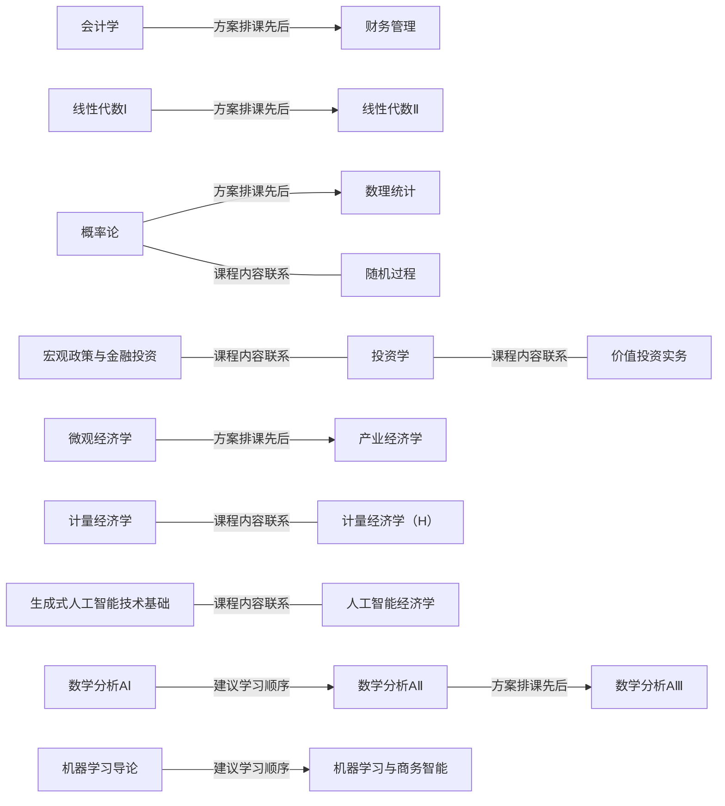

# 2025信息管理与信息系统（商业AI应用，AI系统开发)专业本科培养方案（港澳台侨生适用）

管理学院 · 信息管理与信息系统 · 方案 97198 · 116 个不同课程或科研条目。

[官方 Word](../originals/plan-97198.docx) · [教务详情](https://fdjwgl.fudan.edu.cn/manager/bizType/2/major-program-search/info/97198?skipAuth=1) · [方案快照](../raw/plan-97198.json.gz) · [年级目录](../README.md)

## 课程关系图

图中展示部分关系。下表保留全部已建立的课程对，来源位置使用本方案 JSON Pointer。

## 先修与内容联系

| 类型 | 起点 | 终点 | 依据 | 原表定位 |
| --- | --- | --- | --- | --- |
| 建议学习顺序 | 会计学 (BA10003) | 财务管理 (BA20009) | 会计报表和核算概念可用于理解财务决策。  | `/courseModules/5/planCourses/7`、`/courseModules/7/planCourses/2` |
| 建议学习顺序 | 微观经济学 (ECON20003) | 产业经济学 (ECON30168) | 企业和市场结构是产业经济分析的基础。  | `/courseModules/5/planCourses/5`、`/courseModules/24/planCourses/9` |
| 建议学习顺序 | 线性代数Ⅰ (MATH10001) | 线性代数Ⅱ (MATH10002) | 同方案的课程题名具有连续分册或序号。  | `/courseModules/5/planCourses/2`、`/courseModules/5/planCourses/3` |
| 建议学习顺序 | 数学分析AⅠ (MATH10010) | 数学分析AⅡ (MATH10011) | 同方案的课程题名具有连续分册或序号。  | `/courseModules/5/planCourses/0`、`/courseModules/5/planCourses/1` |
| 建议学习顺序 | 数学分析AⅡ (MATH10011) | 数学分析AⅢ (MATH20001) | 同方案的课程题名具有连续分册或序号。  | `/courseModules/5/planCourses/1`、`/courseModules/23/planCourses/6` |
| 建议学习顺序 | 概率论 (STAT20001) | 数理统计 (STAT20003) | 分布和期望为统计估计与检验提供基础。  | `/courseModules/7/planCourses/4`、`/courseModules/7/planCourses/7` |
| 建议学习顺序 | 机器学习导论 (STAT30027) | 机器学习与商务智能 (MSE20002) | “机器学习导论”题名标明基础层次，前置阅读可帮助了解“机器学习与商务智能”中的机器学习主题。  | `/courseModules/20/planCourses/6`、`/courseModules/16/planCourses/1` |
| 方案排课先后 | 会计学 (BA10003) | 财务管理 (BA20009) | 同方案该课程全部明确数字学期均早于后者。  | `/courseModules/5/planCourses/7`、`/courseModules/7/planCourses/2` |
| 方案排课先后 | 微观经济学 (ECON20003) | 产业经济学 (ECON30168) | 同方案该课程全部明确数字学期均早于后者。  | `/courseModules/5/planCourses/5`、`/courseModules/24/planCourses/9` |
| 方案排课先后 | 线性代数Ⅰ (MATH10001) | 线性代数Ⅱ (MATH10002) | 同方案该课程全部明确数字学期均早于后者。  | `/courseModules/5/planCourses/2`、`/courseModules/5/planCourses/3` |
| 方案排课先后 | 数学分析AⅠ (MATH10010) | 数学分析AⅡ (MATH10011) | 同方案该课程全部明确数字学期均早于后者。  | `/courseModules/5/planCourses/0`、`/courseModules/5/planCourses/1` |
| 方案排课先后 | 数学分析AⅡ (MATH10011) | 数学分析AⅢ (MATH20001) | 同方案该课程全部明确数字学期均早于后者。  | `/courseModules/5/planCourses/1`、`/courseModules/23/planCourses/6` |
| 方案排课先后 | 概率论 (STAT20001) | 数理统计 (STAT20003) | 同方案该课程全部明确数字学期均早于后者。  | `/courseModules/7/planCourses/4`、`/courseModules/7/planCourses/7` |
| 课程内容联系 | 行为金融学 (AIS210009) | 国际金融 (BA30042) | 本方案两门课程的题名均含“金融”，可据此对照这一主题。  | `/courseModules/24/planCourses/20`、`/courseModules/24/planCourses/21` |
| 课程内容联系 | 人工智能（AI）营销 (AIT310026) | 人工智能经济学 (MSE40005) | 本方案两门课程的题名均含“人工智能”，可据此对照这一主题。  | `/courseModules/24/planCourses/6`、`/courseModules/13/planCourses/3` |
| 课程内容联系 | 会计学 (BA10003) | 财务管理 (BA20009) | 会计信息与企业融资、投资决策存在应用联系。  | `/courseModules/5/planCourses/7`、`/courseModules/7/planCourses/2` |
| 课程内容联系 | 会计学 (BA10003) | 中级财务会计 (BA20013) | 本方案两门课程的题名均含“会计”，可据此对照这一主题。  | `/courseModules/5/planCourses/7`、`/courseModules/15/planCourses/0` |
| 课程内容联系 | 会计学 (BA10003) | 成本管理会计 (BA30014) | 本方案两门课程的题名均含“会计”，可据此对照这一主题。  | `/courseModules/5/planCourses/7`、`/courseModules/15/planCourses/1` |
| 课程内容联系 | 会计学 (BA10003) | 国际会计 (BA30017) | 本方案两门课程的题名均含“会计”，可据此对照这一主题。  | `/courseModules/5/planCourses/7`、`/courseModules/24/planCourses/27` |
| 课程内容联系 | 会计学 (BA10003) | 会计专题研究 (BA30037) | 本方案两门课程的题名均含“会计”，可据此对照这一主题。  | `/courseModules/5/planCourses/7`、`/courseModules/24/planCourses/13` |
| 课程内容联系 | 宏观政策与金融投资 (BA30001) | 投资学 (BA30012) | 本方案两门课程的题名均含“投资”，可据此对照这一主题。  | `/courseModules/24/planCourses/22`、`/courseModules/18/planCourses/0` |
| 课程内容联系 | 投资学 (BA30012) | 价值投资实务 (BA30053) | 本方案两门课程的题名均含“投资”，可据此对照这一主题。  | `/courseModules/18/planCourses/0`、`/courseModules/24/planCourses/15` |
| 课程内容联系 | 中国金融市场 (BA30023) | 国际金融 (BA30042) | 本方案两门课程的题名均含“金融”，可据此对照这一主题。  | `/courseModules/24/planCourses/17`、`/courseModules/24/planCourses/21` |
| 课程内容联系 | 国际金融 (BA30042) | 房地产金融 (BA30056) | 本方案两门课程的题名均含“金融”，可据此对照这一主题。  | `/courseModules/24/planCourses/21`、`/courseModules/24/planCourses/24` |
| 课程内容联系 | 国际金融 (BA30042) | 金融工程 (MSE30011) | 本方案两门课程的题名均含“金融”，可据此对照这一主题。  | `/courseModules/24/planCourses/21`、`/courseModules/16/planCourses/4` |
| 课程内容联系 | 会计与人工智能 (BA30058) | 人工智能经济学 (MSE40005) | 本方案两门课程的题名均含“人工智能”，可据此对照这一主题。  | `/courseModules/24/planCourses/25`、`/courseModules/13/planCourses/3` |
| 课程内容联系 | 线性代数Ⅰ (MATH10001) | 线性代数Ⅱ (MATH10002) | 本方案两门课程的题名均含“线性代数”，可据此对照这一主题。  | `/courseModules/5/planCourses/2`、`/courseModules/5/planCourses/3` |
| 课程内容联系 | 机器学习与商务智能 (MSE20002) | 机器学习导论 (STAT30027) | 本方案两门课程的题名均含“机器学习”，可据此对照这一主题。  | `/courseModules/16/planCourses/1`、`/courseModules/20/planCourses/6` |
| 课程内容联系 | 人工智能时代的商务模式 (MSE30002) | 人工智能经济学 (MSE40005) | 本方案两门课程的题名均含“人工智能”，可据此对照这一主题。  | `/courseModules/13/planCourses/1`、`/courseModules/13/planCourses/3` |
| 课程内容联系 | 生成式人工智能技术基础 (MSE30003) | 人工智能经济学 (MSE40005) | 本方案两门课程的题名均含“人工智能”，可据此对照这一主题。  | `/courseModules/9/planCourses/1`、`/courseModules/13/planCourses/3` |
| 课程内容联系 | 概率论 (STAT20001) | 随机过程 (STAT30020) | 共同主题为随机现象与概率模型。  | `/courseModules/7/planCourses/4`、`/courseModules/20/planCourses/1` |
| 课程内容联系 | 计量经济学 (STAT30021) | 计量经济学（H） (STAT30021h) | 本方案两门课程的题名均含“计量经济”，可据此对照这一主题。  | `/courseModules/8/planCourses/1`、`/courseModules/23/planCourses/0` |

本次未从可定位的明确表述中确认课程对课程预修。学期安排、系列分册与编辑建议均保留各自的依据。

## 按原方案模块阅读

同一模块展示原表中的课程归属。模块内课程之间的先后仍须逐项查阅。

- **A组（8门选4门，不少于10学分）**　基于AI的知识管理、人工智能时代的商务模式、程序设计与数据可视化、信息技术创新应用、社会智能与心理计算、现代操作系统和网络应用、数据科学编程进阶、人工智能经济学（原表模块 13）
- **会计学专业必修课**　中级财务会计、成本管理会计、审计学、高级财务会计、财务报告（原表模块 15）
- **管理科学专业必修课**　机器学习与商务智能、供应链管理、随机运筹学、金融工程、最优化方法及应用（原表模块 16）
- **工商管理专业必修课**　创新与创业、管理学研究方法、人力资源管理、东方管理、公司治理（原表模块 17）
- **财务管理专业必修课**　投资学、衍生证券、公司财务理论与实务、金融市场与金融机构（原表模块 18）
- **市场营销专业必修课**　消费者行为学、营销研究、服务营销、数字化营销（原表模块 19）
- **统计学专业必修课**　回归分析、时间序列分析、多元分析、随机过程、抽样调查、统计计算、机器学习导论、非参数统计、属性数据分析（原表模块 20）
- **A组（5门选3门）**　商业与技术伦理学、战略管理、组织沟通与社会环境、职业责任与领导力、国际商务管理（原表模块 22）

## 课程表

同一课程在不同模块分别出现时，按原表逐行列出。季节字段保留原值。

| 课程 | 代码 | 学分 | 学期 | 模块 |
| --- | --- | ---: | --- | --- |
| 数学分析AⅠ | MATH10010 | 5.0 | 第1学期 | 培养方案 / 专业培养课程 / 学科基础课程 |
| 数学分析AⅡ | MATH10011 | 5.0 | 第2学期 | 培养方案 / 专业培养课程 / 学科基础课程 |
| 线性代数Ⅰ | MATH10001 | 3.0 | 第1学期 | 培养方案 / 专业培养课程 / 学科基础课程 |
| 线性代数Ⅱ | MATH10002 | 2.0 | 第2学期 | 培养方案 / 专业培养课程 / 学科基础课程 |
| 管理学导论 | BA10004 | 3.0 | 第1学期 | 培养方案 / 专业培养课程 / 学科基础课程 |
| 微观经济学 | ECON20003 | 3.0 | 第2学期 | 培养方案 / 专业培养课程 / 学科基础课程 |
| 宏观经济学 | ECON20004 | 3.0 | 第3学期 | 培养方案 / 专业培养课程 / 学科基础课程 |
| 会计学 | BA10003 | 3.0 | 第2学期 | 培养方案 / 专业培养课程 / 学科基础课程 |
| Python编程基础与数据分析入门 | MSE10001 | 2.0 | 第1学期 | 培养方案 / 专业培养课程 / 专业核心教育课程 / A组 |
| 运筹学 | MSE20005 | 4.0 | 第3学期 | 培养方案 / 专业培养课程 / 专业核心教育课程 / A组 |
| 财务管理 | BA20009 | 3.0 | 第3学期 | 培养方案 / 专业培养课程 / 专业核心教育课程 / A组 |
| 管理信息系统 | MSE20003 | 2.0 | 第3学期 | 培养方案 / 专业培养课程 / 专业核心教育课程 / A组 |
| 概率论 | STAT20001 | 4.0 | 第3学期 | 培养方案 / 专业培养课程 / 专业核心教育课程 / A组 |
| 组织行为学 | BA20011 | 2.0 | 第4学期 | 培养方案 / 专业培养课程 / 专业核心教育课程 / A组 |
| 营销管理 | BA20001 | 2.0 | 第4学期 | 培养方案 / 专业培养课程 / 专业核心教育课程 / A组 |
| 数理统计 | STAT20003 | 4.0 | 第4学期 | 培养方案 / 专业培养课程 / 专业核心教育课程 / A组 |
| 统计软件 | STAT20013 | 3.0 | 第4学期 | 培养方案 / 专业培养课程 / 专业核心教育课程 / A组 |
| 数据结构与算法导论 | MSE30028 | 3.0 | 第2学期 | 培养方案 / 专业培养课程 / 专业核心教育课程 / B组 |
| 计量经济学 | STAT30021 | 3.0 | 第5学期 | 培养方案 / 专业培养课程 / 专业核心教育课程 / B组 |
| 数据库与企业数据管理 | MSE30019 | 3.0 | 第4学期 | 培养方案 / 专业培养课程 / 专业核心教育课程 / C组 |
| 生成式人工智能技术基础 | MSE30003 | 3.0 | 第5学期 | 培养方案 / 专业培养课程 / 专业核心教育课程 / C组 |
| 数据挖掘与商业智能 | MSE20001 | 3.0 | 第4学期 | 培养方案 / 专业培养课程 / 专业核心教育课程 / C组 |
| 系统分析与设计 | MSE30004 | 3.0 | 第5学期 | 培养方案 / 专业培养课程 / 专业核心教育课程 / C组 |
| 大数据商务分析与应用 | MSE30022 | 3.0 | 第6学期 | 培养方案 / 专业培养课程 / 专业核心教育课程 / C组 |
| 职业规划与发展 | BA20014 | 1.0 | 第4学期 | 培养方案 / 专业培养课程 / 专业核心教育课程 / C组 |
| 信息技术创新应用 | MSE30015 | 2.0 | 第6学期 | 培养方案 / 专业进阶I组 / A组（8门选4门，不少于10学分） |
| 人工智能时代的商务模式 | MSE30002 | 3.0 | 第6学期 | 培养方案 / 专业进阶I组 / A组（8门选4门，不少于10学分） |
| 社会智能与心理计算 | MSE40001 | 3.0 | 第7学期 | 培养方案 / 专业进阶I组 / A组（8门选4门，不少于10学分） |
| 人工智能经济学 | MSE40005 | 3.0 | 第7学期、第8学期 | 培养方案 / 专业进阶I组 / A组（8门选4门，不少于10学分） |
| 基于AI的知识管理 | MSE30001 | 3.0 | 第5学期 | 培养方案 / 专业进阶I组 / A组（8门选4门，不少于10学分） |
| 数据科学编程进阶 | MSE40003 | 3.0 | 第6学期 | 培养方案 / 专业进阶I组 / A组（8门选4门，不少于10学分） |
| 程序设计与数据可视化 | MSE30005 | 2.0 | 第6学期 | 培养方案 / 专业进阶I组 / A组（8门选4门，不少于10学分） |
| 现代操作系统和网络应用 | MSE40002 | 3.0 | 第7学期 | 培养方案 / 专业进阶I组 / A组（8门选4门，不少于10学分） |
| 中级财务会计 | BA20013 | 3.0 | 第4学期 | 培养方案 / 专业进阶I组 / B组 / 会计学专业必修课 |
| 成本管理会计 | BA30014 | 3.0 | 第5学期 | 培养方案 / 专业进阶I组 / B组 / 会计学专业必修课 |
| 财务报告 | BA30057 | 3.0 | 第5学期 | 培养方案 / 专业进阶I组 / B组 / 会计学专业必修课 |
| 审计学 | BA30016 | 3.0 | 第6学期 | 培养方案 / 专业进阶I组 / B组 / 会计学专业必修课 |
| 高级财务会计 | BA30040 | 3.0 | 第6学期 | 培养方案 / 专业进阶I组 / B组 / 会计学专业必修课 |
| 供应链管理 | MSE20007 | 3.0 | 第4学期 | 培养方案 / 专业进阶I组 / B组 / 管理科学专业必修课 |
| 机器学习与商务智能 | MSE20002 | 3.0 | 第4学期 | 培养方案 / 专业进阶I组 / B组 / 管理科学专业必修课 |
| 随机运筹学 | MSE30009 | 3.0 | 第5学期 | 培养方案 / 专业进阶I组 / B组 / 管理科学专业必修课 |
| 最优化方法及应用 | MSE30012 | 3.0 | 第5学期 | 培养方案 / 专业进阶I组 / B组 / 管理科学专业必修课 |
| 金融工程 | MSE30011 | 3.0 | 第6学期 | 培养方案 / 专业进阶I组 / B组 / 管理科学专业必修课 |
| 创新与创业 | BA30002 | 3.0 | 第5学期 | 培养方案 / 专业进阶I组 / B组 / 工商管理专业必修课 |
| 人力资源管理 | BA30025 | 2.0 | 第5学期 | 培养方案 / 专业进阶I组 / B组 / 工商管理专业必修课 |
| 东方管理 | BA30026 | 2.0 | 第6学期 | 培养方案 / 专业进阶I组 / B组 / 工商管理专业必修课 |
| 公司治理 | BA30029 | 3.0 | 第6学期 | 培养方案 / 专业进阶I组 / B组 / 工商管理专业必修课 |
| 管理学研究方法 | BA30004 | 3.0 | 第5学期 | 培养方案 / 专业进阶I组 / B组 / 工商管理专业必修课 |
| 投资学 | BA30012 | 3.0 | 第5学期 | 培养方案 / 专业进阶I组 / B组 / 财务管理专业必修课 |
| 金融市场与金融机构 | BA30033 | 3.0 | 第5学期 | 培养方案 / 专业进阶I组 / B组 / 财务管理专业必修课 |
| 衍生证券 | BA30027 | 3.0 | 第6学期 | 培养方案 / 专业进阶I组 / B组 / 财务管理专业必修课 |
| 公司财务理论与实务 | BA30028 | 3.0 | 第6学期 | 培养方案 / 专业进阶I组 / B组 / 财务管理专业必修课 |
| 消费者行为学 | BA30019 | 3.0 | 第5学期 | 培养方案 / 专业进阶I组 / B组 / 市场营销专业必修课 |
| 营销研究 | BA30020 | 3.0 | 第5学期 | 培养方案 / 专业进阶I组 / B组 / 市场营销专业必修课 |
| 服务营销 | BA30022 | 2.0 | 第5学期 | 培养方案 / 专业进阶I组 / B组 / 市场营销专业必修课 |
| 数字化营销 | BA30038 | 3.0 | 第6学期 | 培养方案 / 专业进阶I组 / B组 / 市场营销专业必修课 |
| 回归分析 | STAT30017 | 3.0 | 第5学期 | 培养方案 / 专业进阶I组 / B组 / 统计学专业必修课 |
| 随机过程 | STAT30020 | 3.0 | 第5学期 | 培养方案 / 专业进阶I组 / B组 / 统计学专业必修课 |
| 统计计算 | STAT30024 | 3.0 | 第5学期 | 培养方案 / 专业进阶I组 / B组 / 统计学专业必修课 |
| 抽样调查 | STAT30022 | 3.0 | 第6学期 | 培养方案 / 专业进阶I组 / B组 / 统计学专业必修课 |
| 时间序列分析 | STAT30018 | 3.0 | 第6学期 | 培养方案 / 专业进阶I组 / B组 / 统计学专业必修课 |
| 多元分析 | STAT30019 | 3.0 | 第6学期 | 培养方案 / 专业进阶I组 / B组 / 统计学专业必修课 |
| 机器学习导论 | STAT30027 | 3.0 | 第6学期 | 培养方案 / 专业进阶I组 / B组 / 统计学专业必修课 |
| 非参数统计 | STAT40014 | 3.0 | 第7学期 | 培养方案 / 专业进阶I组 / B组 / 统计学专业必修课 |
| 属性数据分析 | STAT40015 | 3.0 | 第7学期 | 培养方案 / 专业进阶I组 / B组 / 统计学专业必修课 |
| 战略管理 | BA20012 | 2.0 | 第5学期 | 培养方案 / 专业进阶II组(必修9学分) / A组（5门选3门） |
| 组织沟通与社会环境 | BA30003 | 2.0 | 第6学期 | 培养方案 / 专业进阶II组(必修9学分) / A组（5门选3门） |
| 国际商务管理 | BA30018 | 2.0 | 第5学期 | 培养方案 / 专业进阶II组(必修9学分) / A组（5门选3门） |
| 职业责任与领导力 | BA30005 | 2.0 | 第6学期 | 培养方案 / 专业进阶II组(必修9学分) / A组（5门选3门） |
| 商业与技术伦理学 | BA10001 | 2.0 | 第2学期 | 培养方案 / 专业进阶II组(必修9学分) / A组（5门选3门） |
| 计量经济学（H） | STAT30021h | 3.0 | 第5学期 | 培养方案 / 专业进阶II组(必修9学分) / B组 |
| 高级微观经济学（H） | ECON30167h | 3.0 | 第5学期 | 培养方案 / 专业进阶II组(必修9学分) / B组 |
| 现代企业理论（H） | ECON30172h | 2.0 | 第5学期 | 培养方案 / 专业进阶II组(必修9学分) / B组 |
| 智能仿真与在线学习 | MSE40006 | 3.0 | 第7学期 | 培养方案 / 专业进阶II组(必修9学分) / B组 |
| 高等概率论 | STAT30025 | 3.0 | 第5学期 | 培养方案 / 专业进阶II组(必修9学分) / B组 |
| 高等数理统计（一） | STAT30026 | 3.0 | 第5学期 | 培养方案 / 专业进阶II组(必修9学分) / B组 |
| 数学分析AⅢ | MATH20001 | 3.0 | 第3学期 | 培养方案 / 专业进阶II组(必修9学分) / B组 |
| 计量经济学 | STAT30021 | 3.0 | 第5学期 | 培养方案 / 专业进阶II组(必修9学分) / C组 |
| 产品创新管理 | BA30044 | 2.0 | 第5学期、第6学期 | 培养方案 / 专业进阶II组(必修9学分) / C组 |
| 品牌传播管理 | BA30051 | 3.0 | 第6学期 | 培养方案 / 专业进阶II组(必修9学分) / C组 |
| 营销工程 | BA30052 | 3.0 | 第5学期 | 培养方案 / 专业进阶II组(必修9学分) / C组 |
| 营销科技与决策系统 | BA30059 | 3.0 | 第5学期 | 培养方案 / 专业进阶II组(必修9学分) / C组 |
| 营销创意思维 | BA30061 | 3.0 | 第6学期 | 培养方案 / 专业进阶II组(必修9学分) / C组 |
| 人工智能（AI）营销 | AIT310026 | 3.0 | 第6学期 | 培养方案 / 专业进阶II组(必修9学分) / C组 |
| 税法 | BA30015 | 3.0 | 第5学期 | 培养方案 / 专业进阶II组(必修9学分) / C组 |
| 法律、商业与社会 | BA30030 | 2.0 | 第7学期 | 培养方案 / 专业进阶II组(必修9学分) / C组 |
| 产业经济学 | ECON30168 | 3.0 | 第5学期 | 培养方案 / 专业进阶II组(必修9学分) / C组 |
| 规制经济学 | ECON30169 | 3.0 | 第5学期 | 培养方案 / 专业进阶II组(必修9学分) / C组 |
| 产业组织与企业战略 | ECON30170 | 3.0 | 第6学期 | 培养方案 / 专业进阶II组(必修9学分) / C组 |
| 财务报表分析 | BA30036 | 3.0 | 第6学期 | 培养方案 / 专业进阶II组(必修9学分) / C组 |
| 会计专题研究 | BA30037 | 3.0 | 第6学期 | 培养方案 / 专业进阶II组(必修9学分) / C组 |
| 财务报表与资本市场 | BA30041 | 3.0 | 第6学期 | 培养方案 / 专业进阶II组(必修9学分) / C组 |
| 价值投资实务 | BA30053 | 2.0 | 第5学期 | 培养方案 / 专业进阶II组(必修9学分) / C组 |
| 国际财务管理 | BA30013 | 3.0 | 第6学期 | 培养方案 / 专业进阶II组(必修9学分) / C组 |
| 中国金融市场 | BA30023 | 3.0 | 第5学期 | 培养方案 / 专业进阶II组(必修9学分) / C组 |
| 基金管理 | BA30034 | 3.0 | 第5学期 | 培养方案 / 专业进阶II组(必修9学分) / C组 |
| 经济与金融中的统计方法 | BA30035 | 3.0 | 第6学期 | 培养方案 / 专业进阶II组(必修9学分) / C组 |
| 行为金融学 | AIS210009 | 3.0 | 第6学期 | 培养方案 / 专业进阶II组(必修9学分) / C组 |
| 国际金融 | BA30042 | 3.0 | 第5学期 | 培养方案 / 专业进阶II组(必修9学分) / C组 |
| 宏观政策与金融投资 | BA30001 | 3.0 | 第5学期 | 培养方案 / 专业进阶II组(必修9学分) / C组 |
| 资本资产定价 | BA30054 | 3.0 | 第6学期 | 培养方案 / 专业进阶II组(必修9学分) / C组 |
| 房地产金融 | BA30056 | 3.0 | 第5学期 | 培养方案 / 专业进阶II组(必修9学分) / C组 |
| 会计与人工智能 | BA30058 | 3.0 | 第6学期 | 培养方案 / 专业进阶II组(必修9学分) / C组 |
| 数字平台经济学 | ECON30173 | 3.0 | 第6学期 | 培养方案 / 专业进阶II组(必修9学分) / C组 |
| 国际会计 | BA30017 | 3.0 | 第5学期、第6学期 | 培养方案 / 专业进阶II组(必修9学分) / C组 |
| 营销渠道管理 | BA30021 | 2.0 | 第5学期、第6学期 | 培养方案 / 专业进阶II组(必修9学分) / C组 |
| 深度学习与运营优化 | MSE30007 | 3.0 | 第5学期 | 培养方案 / 专业进阶II组(必修9学分) / C组 |
| 强化学习与智能决策 | MSE40004 | 3.0 | 第7学期 | 培养方案 / 专业进阶II组(必修9学分) / C组 |
| 博弈论 | MSE30016 | 3.0 | 第6学期 | 培养方案 / 专业进阶II组(必修9学分) / C组 |
| AI会计理论与方法 | AIT410016 | 2.0 | 第6学期 | 培养方案 / 专业进阶II组(必修9学分) / C组 |
| 运营管理 | MSE30008 | 3.0 | 第6学期 | 培养方案 / 专业进阶II组(必修9学分) / C组 |
| 物流管理 | MSE30010 | 3.0 | 第6学期 | 培养方案 / 专业进阶II组(必修9学分) / C组 |
| 复芏计划(FDUROP) | 102 | 0.0 |  | 融合创新能力 |
| 国际交流 | 7 | 0.0 |  | 融合创新能力 |
| 毕业实习 | BA40002 | 1.0 | 第8学期 | 融合创新能力 |
| 毕业论文 | BA40001 | 4.0 | 第8学期 | 融合创新能力 |
| 社会调查 | BA30055 | 2.0 | 第5学期 | 融合创新能力 |
