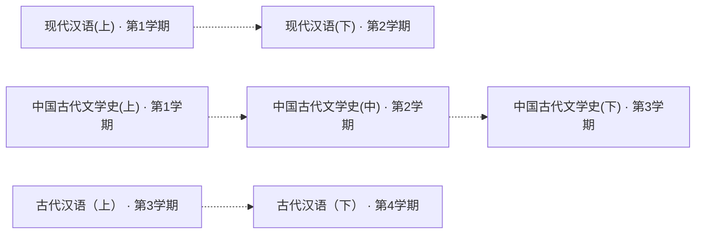

# 2023 级中文系培养方案与课程图谱

7 份方案列出 566 个不同代码。图谱收录 157 条建议学习顺序及 218 条内容联系。

[下载本年级资料包（含图谱和原件）](https://github.com/pythonbug225/fudan-course-atlas/raw/refs/heads/chinese-2026-plans-2025fall-2026spring-reviews/%E4%B8%AD%E6%96%87%E7%B3%BB%E5%8E%86%E5%B1%8A%E5%9F%B9%E5%85%BB%E6%96%B9%E6%A1%88/2023%E7%BA%A7/2023%E7%BA%A7%E8%B5%84%E6%96%99%E5%8C%85.zip) · [关系与课程数据](课程关系.json) · [查看教务目录快照](原始资料/目录.json)

## 选择你的培养方案

下表的课程数包括该方案列出的备选课及研究训练环节。学分列采用方案正文的毕业总学分或本博阶段总学分。

| 培养方案（点击下载教务 Word） | 总学分 | 列出代码数 | 原始数据 |
| --- | ---: | ---: | --- |
| [2023 汉语言文学专业“2+X”教学培养方案](原始资料/67316.docx) | 156 | 264 | [JSON](原始资料/67316.json) · [教务原文](https://fdjwgl.fudan.edu.cn/manager/bizType/2/major-program-search/info/67316?skipAuth=1) |
| [2023 汉语言文学专业“2+X”教学培养方案（留学生）](原始资料/67330.docx) | 156 | 153 | [JSON](原始资料/67330.json) · [教务原文](https://fdjwgl.fudan.edu.cn/manager/bizType/2/major-program-search/info/67330?skipAuth=1) |
| [2023 汉语言文学专业“2+X”教学培养方案（港澳台侨生）](原始资料/67346.docx) | 156 | 160 | [JSON](原始资料/67346.json) · [教务原文](https://fdjwgl.fudan.edu.cn/manager/bizType/2/major-program-search/info/67346?skipAuth=1) |
| [2023 汉语言专业“2+X”教学培养方案](原始资料/67347.docx) | 156 | 109 | [JSON](原始资料/67347.json) · [教务原文](https://fdjwgl.fudan.edu.cn/manager/bizType/2/major-program-search/info/67347?skipAuth=1) |
| [2023 汉语言专业“2+X”教学培养方案（留学生）](原始资料/67349.docx) | 156 | 102 | [JSON](原始资料/67349.json) · [教务原文](https://fdjwgl.fudan.edu.cn/manager/bizType/2/major-program-search/info/67349?skipAuth=1) |
| [2023 汉语言专业“2+X”教学培养方案（港澳台侨生）](原始资料/67350.docx) | 156 | 109 | [JSON](原始资料/67350.json) · [教务原文](https://fdjwgl.fudan.edu.cn/manager/bizType/2/major-program-search/info/67350?skipAuth=1) |
| [2023 汉语言(古文字学方向)专业教学培养方案（强基班适用）](原始资料/67351.docx) | 156 | 295 | [JSON](原始资料/67351.json) · [教务原文](https://fdjwgl.fudan.edu.cn/manager/bizType/2/major-program-search/info/67351?skipAuth=1) |

## 学习顺序与先修核查

逐份核查方案正文、修读规定、课程模块和课程备注、Word 表格和插图。未找到明确规定 A 课合格后才可修 B 课的条款。大纲建议限所引教学班。

教务处另有 2023 级学生学习手册目录，详情页要求登录，本次未取得中文系手册正文。另核了当年全校本科教学培养方案合订本印刷第 73–93 页的中文系方案与修读建议。 [官方手册发布页](https://jwc.fudan.edu.cn/cf/68/c39650a511848/page.htm) · [合订本中文系章节](https://jwc.fudan.edu.cn/_upload/article/files/83/6c/8a3c080c4f8991024f4b59ad4f1b/64d23c13-0465-4619-bd18-9e491594f850.pdf#page=85)

下图取自本年级普通汉语言文学方案。节点标注该方案列出的开课学期，虚线表示建议学习顺序。 [核对课程表](原始资料/67316.docx)

古文字学强基班还规定了完成大类人文基础课程的时间，并对“哲学导论”和“逻辑学”给出二选一安排。这类要求可在对应方案的课程设置中核对。 [强基班原件](原始资料/67351.docx)

## 查看单门课程

在交互图中先选择培养方案，再输入课程名称、课号或历史课号。点击相邻课程可以继续探索，展开“关系依据”可查看推断理由、适用方案及可用的大纲。课程卡列出每条原始记录的课程模块、学分、开课学期和建议修读学期。

另有 259 个代码保留在检索中，目前缺少足够依据连到其他课程。各路径的选修与必修要求以对应模块规定为准。

[返回历届方案目录](../README.md)
