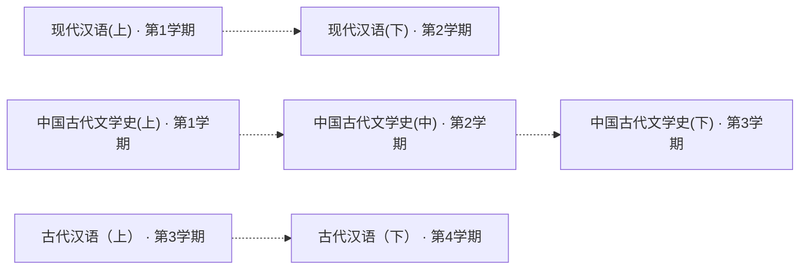

# 2024 级中文系培养方案与课程图谱

8 份方案列出 268 个不同代码。图谱收录 112 条建议学习顺序及 191 条内容联系。

[下载本年级资料包（含图谱和原件）](https://github.com/pythonbug225/fudan-course-atlas/raw/refs/heads/chinese-2026-plans-2025fall-2026spring-reviews/%E4%B8%AD%E6%96%87%E7%B3%BB%E5%8E%86%E5%B1%8A%E5%9F%B9%E5%85%BB%E6%96%B9%E6%A1%88/2024%E7%BA%A7/2024%E7%BA%A7%E8%B5%84%E6%96%99%E5%8C%85.zip) · [关系与课程数据](课程关系.json) · [查看教务目录快照](原始资料/目录.json)

## 选择你的培养方案

下表的课程数包括该方案列出的备选课及研究训练环节。学分列采用方案正文的毕业总学分或本博阶段总学分。

| 培养方案（点击下载教务 Word） | 总学分 | 列出代码数 | 原始数据 |
| --- | ---: | ---: | --- |
| [2024 汉语言文学专业“2+X”教学培养方案](原始资料/72663.docx) | 141 | 154 | [JSON](原始资料/72663.json) · [教务原文](https://fdjwgl.fudan.edu.cn/manager/bizType/2/major-program-search/info/72663?skipAuth=1) |
| [2024 汉语言文学专业“2+X”教学培养方案（留学生）](原始资料/72709.docx) | 141 | 151 | [JSON](原始资料/72709.json) · [教务原文](https://fdjwgl.fudan.edu.cn/manager/bizType/2/major-program-search/info/72709?skipAuth=1) |
| [2024 汉语言文学专业“2+X”教学培养方案（港澳台侨生）](原始资料/72713.docx) | 141 | 154 | [JSON](原始资料/72713.json) · [教务原文](https://fdjwgl.fudan.edu.cn/manager/bizType/2/major-program-search/info/72713?skipAuth=1) |
| [2024 汉语言专业“2+X”教学培养方案](原始资料/72719.docx) | 141 | 104 | [JSON](原始资料/72719.json) · [教务原文](https://fdjwgl.fudan.edu.cn/manager/bizType/2/major-program-search/info/72719?skipAuth=1) |
| [2024 汉语言专业“2+X”教学培养方案（留学生）](原始资料/72722.docx) | 141 | 101 | [JSON](原始资料/72722.json) · [教务原文](https://fdjwgl.fudan.edu.cn/manager/bizType/2/major-program-search/info/72722?skipAuth=1) |
| [2024 汉语言专业“2+X”教学培养方案（港澳台侨生）](原始资料/72726.docx) | 141 | 104 | [JSON](原始资料/72726.json) · [教务原文](https://fdjwgl.fudan.edu.cn/manager/bizType/2/major-program-search/info/72726?skipAuth=1) |
| [2024 中国语言文学类(古文字学)专业教学培养方案（强基班适用）](原始资料/72727.docx) | 141或142 | 200 | [JSON](原始资料/72727.json) · [教务原文](https://fdjwgl.fudan.edu.cn/manager/bizType/2/major-program-search/info/72727?skipAuth=1) |
| [2024 汉语言-人工智能双学士学位复合型人才培养项目教学培养方案](原始资料/72982.docx) | 176 | 109 | [JSON](原始资料/72982.json) · [教务原文](https://fdjwgl.fudan.edu.cn/manager/bizType/2/major-program-search/info/72982?skipAuth=1) |

## 学习顺序与先修核查

逐份核查方案正文、修读规定、课程模块和课程备注、Word 表格和插图。未找到明确规定 A 课合格后才可修 B 课的条款。大纲建议限所引教学班。

补核了中文系 2024 级《本科生课程学习手册》全 67 页。按印刷页码，第 25–42 页给出指导性修读计划与类别完成时限；第 63、65 页的学程面向外系学生。手册未点名一组中文系主修课程须按前置条件修读。 [官方手册原件](https://jwc.fudan.edu.cn/_upload/article/files/d4/56/707002a8413b8a3cc690244c1118/c13743da-d1b6-4876-8c09-410fdf0042d8.pdf)

下图取自本年级普通汉语言文学方案。节点标注该方案列出的开课学期，虚线表示建议学习顺序。 [核对课程表](原始资料/72663.docx)

汉语言—人工智能项目列有《程序设计》和《数据结构》。陈彤兵 2026 秋《数据结构》班大纲建议先学《程序设计》或《C程序设计》，学生可以从两者中选一门准备。图谱保留了这条建议的学期与班次。 [教学班大纲](https://github.com/pythonbug225/fudan-course-atlas/blob/e25755c049a143e646c943692d582c2c1526ac6e/public/syllabi/1038714.html)

## 查看单门课程

在交互图中先选择培养方案，再输入课程名称、课号或历史课号。点击相邻课程可以继续探索，展开“关系依据”可查看推断理由、适用方案及可用的大纲。课程卡列出每条原始记录的课程模块、学分、开课学期和建议修读学期。

另有 55 个代码保留在检索中，目前缺少足够依据连到其他课程。各路径的选修与必修要求以对应模块规定为准。

[返回历届方案目录](../README.md)
