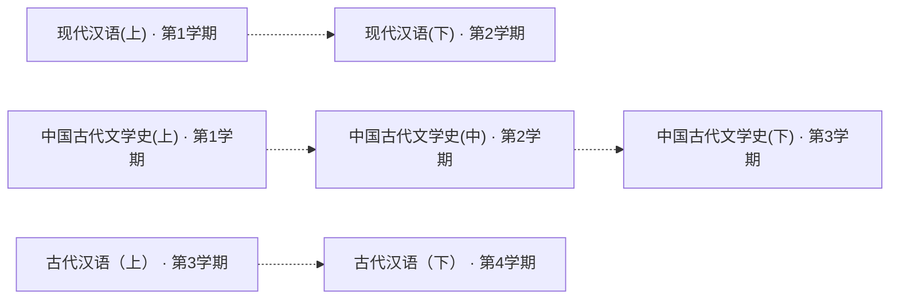

# 2025 级中文系培养方案与课程图谱

11 份方案列出 333 个不同代码（含 7 个培养环节）。图谱收录 117 条建议学习顺序及 309 条内容联系。

[下载本年级资料包（含图谱和原件）](https://github.com/pythonbug225/fudan-course-atlas/raw/refs/heads/chinese-2026-plans-2025fall-2026spring-reviews/%E4%B8%AD%E6%96%87%E7%B3%BB%E5%8E%86%E5%B1%8A%E5%9F%B9%E5%85%BB%E6%96%B9%E6%A1%88/2025%E7%BA%A7/2025%E7%BA%A7%E8%B5%84%E6%96%99%E5%8C%85.zip) · [关系与课程数据](课程关系.json) · [查看教务目录快照](原始资料/目录.json)

## 选择你的培养方案

下表的课程数包括该方案列出的备选课及研究训练环节。学分列采用方案正文的毕业总学分或本博阶段总学分。

| 培养方案（点击下载教务 Word） | 总学分 | 列出代码数 | 原始数据 |
| --- | ---: | ---: | --- |
| [2025 汉语言文学专业本科培养方案](原始资料/96943.docx) | 140 | 118 | [JSON](原始资料/96943.json) · [教务原文](https://fdjwgl.fudan.edu.cn/manager/bizType/2/major-program-search/info/96943?skipAuth=1) · [体系图](原始资料/体系图-ec2faa98d35a.jpeg) |
| [2025 汉语言文学专业本科培养方案（留学生适用）](原始资料/96947.docx) | 140 | 118 | [JSON](原始资料/96947.json) · [教务原文](https://fdjwgl.fudan.edu.cn/manager/bizType/2/major-program-search/info/96947?skipAuth=1) · [体系图](原始资料/体系图-ec2faa98d35a.jpeg) |
| [2025 汉语言文学专业本科培养方案（港澳台侨生适用）](原始资料/96954.docx) | 140 | 118 | [JSON](原始资料/96954.json) · [教务原文](https://fdjwgl.fudan.edu.cn/manager/bizType/2/major-program-search/info/96954?skipAuth=1) · [体系图](原始资料/体系图-ec2faa98d35a.jpeg) |
| [2025 汉语言专业本科培养方案](原始资料/96955.docx) | 140 | 66 | [JSON](原始资料/96955.json) · [教务原文](https://fdjwgl.fudan.edu.cn/manager/bizType/2/major-program-search/info/96955?skipAuth=1) · [体系图](原始资料/体系图-e9a5a3bb4b41.jpeg) |
| [2025 汉语言专业本科培养方案（留学生适用）](原始资料/96957.docx) | 140 | 66 | [JSON](原始资料/96957.json) · [教务原文](https://fdjwgl.fudan.edu.cn/manager/bizType/2/major-program-search/info/96957?skipAuth=1) · [体系图](原始资料/体系图-e9a5a3bb4b41.jpeg) |
| [2025 汉语言专业本科培养方案（港澳台侨生适用）](原始资料/96958.docx) | 140 | 66 | [JSON](原始资料/96958.json) · [教务原文](https://fdjwgl.fudan.edu.cn/manager/bizType/2/major-program-search/info/96958?skipAuth=1) · [体系图](原始资料/体系图-e9a5a3bb4b41.jpeg) |
| [2025 汉语言-人工智能双学士学位项目培养方案](原始资料/96961.docx) | 176 | 89 | [JSON](原始资料/96961.json) · [教务原文](https://fdjwgl.fudan.edu.cn/manager/bizType/2/major-program-search/info/96961?skipAuth=1) · [体系图](原始资料/体系图-f192394daefc.jpeg) |
| [2025 中国语言文学类(古文字学)专业本科培养方案（强基班适用）](原始资料/96962.docx) | 141或142 | 181 | [JSON](原始资料/96962.json) · [教务原文](https://fdjwgl.fudan.edu.cn/manager/bizType/2/major-program-search/info/96962?skipAuth=1) · [体系图](原始资料/体系图-74933114d67f.jpeg) |
| [2025汉语言文学 - 中国语言文学本博融通培养方案（中国语言文学博雅班）](原始资料/97334.docx) | 166 | 223 | [JSON](原始资料/97334.json) · [教务原文](https://fdjwgl.fudan.edu.cn/manager/bizType/2/major-program-search/info/97334?skipAuth=1) · [体系图](原始资料/体系图-1598aeeebd08.jpeg) |
| [2025汉语言 - 中国语言文学本博融通培养方案（中国语言文学博雅班）](原始资料/140711.docx) | 166 | 125 | [JSON](原始资料/140711.json) · [教务原文](https://fdjwgl.fudan.edu.cn/manager/bizType/2/major-program-search/info/140711?skipAuth=1) · [体系图](原始资料/体系图-1598aeeebd08.jpeg) |
| [2025 汉语言-人工智能双学士学位项目本博融通培养方案](原始资料/151271.docx) | 206 | 127 | [JSON](原始资料/151271.json) · [教务原文](https://fdjwgl.fudan.edu.cn/manager/bizType/2/major-program-search/info/151271?skipAuth=1) |

## 学习顺序与先修核查

逐份核查方案正文、修读规定、课程模块和课程备注、Word 表格和插图。未找到明确规定 A 课合格后才可修 B 课的条款。大纲建议限所引教学班。

教务处另有 2025 级学生学习手册目录，详情页要求登录，本次未取得中文系手册正文。该年级的课程级先修核查以收录的 11 份教务方案为限。 [官方手册发布页](https://jwc.fudan.edu.cn/5e/54/c39650a745044/page.htm)

下图取自本年级普通汉语言文学方案。节点标注该方案列出的开课学期，虚线表示建议学习顺序。 [核对课程表](原始资料/96943.docx)

两份博雅班本博融通方案均列 166 学分，汉语言—人工智能双学士本博融通方案列 206 学分。点击对应 Word 可查看学位与转段要求。课程体系图中的模块和学分沿用各方案的口径。

## 查看单门课程

在交互图中先选择培养方案，再输入课程名称、课号或历史课号。点击相邻课程可以继续探索，展开“关系依据”可查看推断理由、适用方案及可用的大纲。课程卡列出每条原始记录的课程模块、学分、开课学期和建议修读学期。

另有 43 个代码保留在检索中，目前缺少足够依据连到其他课程。各路径的选修与必修要求以对应模块规定为准。

[返回历届方案目录](../README.md)
