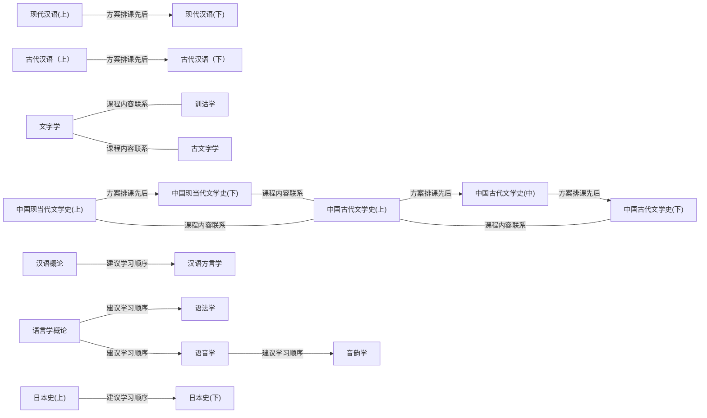

# 2023 汉语言(古文字学方向)专业教学培养方案（强基班适用）

中国语言文学系 · 汉语言(古文字学方向) · 方案 67351 · 295 个不同课程或科研条目。

[官方 Word](https://github.com/pythonbug225/fudan-course-atlas/blob/research/schoolwide-cohorts-2023-2025/research/contributions/%E5%85%A8%E6%A0%A1%E5%9F%B9%E5%85%BB%E6%96%B9%E6%A1%882023-2025/%E5%B7%B2%E6%9C%89%E9%99%A2%E7%B3%BB%E8%A7%84%E8%8C%83%E6%95%B0%E6%8D%AE/%E4%B8%AD%E5%9B%BD%E8%AF%AD%E8%A8%80%E6%96%87%E5%AD%A6%E7%B3%BB/2023/originals/plan-67351.docx) · [教务详情](https://fdjwgl.fudan.edu.cn/manager/bizType/2/major-program-search/info/67351?skipAuth=1) · [方案快照](https://github.com/pythonbug225/fudan-course-atlas/blob/research/schoolwide-cohorts-2023-2025/research/contributions/%E5%85%A8%E6%A0%A1%E5%9F%B9%E5%85%BB%E6%96%B9%E6%A1%882023-2025/%E5%B7%B2%E6%9C%89%E9%99%A2%E7%B3%BB%E8%A7%84%E8%8C%83%E6%95%B0%E6%8D%AE/%E4%B8%AD%E5%9B%BD%E8%AF%AD%E8%A8%80%E6%96%87%E5%AD%A6%E7%B3%BB/2023/raw/plan-67351.json.gz) · [年级目录](https://github.com/pythonbug225/fudan-course-atlas/blob/research/schoolwide-cohorts-2023-2025/research/contributions/%E5%85%A8%E6%A0%A1%E5%9F%B9%E5%85%BB%E6%96%B9%E6%A1%882023-2025/%E5%B7%B2%E6%9C%89%E9%99%A2%E7%B3%BB%E8%A7%84%E8%8C%83%E6%95%B0%E6%8D%AE/%E4%B8%AD%E5%9B%BD%E8%AF%AD%E8%A8%80%E6%96%87%E5%AD%A6%E7%B3%BB/2023/README.md)

## 修读导读

- **建议先学**　《语言学概论》（`CHIN20010`） → 《语法学》（`CHIN20026`）。语言结构与语法单位的概念可供语法分析使用。方案分别列在第3、5学期。

- **可以对照着读**　《文字学》（`CHIN20019`）与《训诂学》（`CHIN20020`）。文字形体与字词解释在古典文献阅读中联系紧密。

- **查模块选课**　《专业英语(汉语言)》（`CHIN20015`）、《现代汉语(上)》（`CHIN20001`）列在“专业必修课程”中。原表见 `/courseModules/10`。

## 课程关系图

图中展示部分关系。下表保留全部已建立的课程对，来源位置使用本方案 JSON Pointer。

## 先修与内容联系

| 类型 | 起点 | 终点 | 依据 | 原表定位 |
| --- | --- | --- | --- | --- |
| 建议学习顺序 | 汉语概论 (CHIN10004) | 汉语方言学 (CHIN20017) | 汉语基本结构可为比较地域变体做准备。  | `/courseModules/8/planCourses/3`、`/courseModules/10/planCourses/12` |
| 建议学习顺序 | 现代汉语(上) (CHIN20001) | 现代汉语(下) (CHIN20002) | 同方案的课程题名具有连续分册或序号。  | `/courseModules/10/planCourses/0`、`/courseModules/10/planCourses/1` |
| 建议学习顺序 | 中国现当代文学史(上) (CHIN20003) | 中国现当代文学史(下) (CHIN20004) | 同方案的课程题名具有连续分册或序号。  | `/courseModules/10/planCourses/2`、`/courseModules/10/planCourses/3` |
| 建议学习顺序 | 中国古代文学史(上) (CHIN20005) | 中国古代文学史(中) (CHIN20006) | 同方案的课程题名具有连续分册或序号。  | `/courseModules/10/planCourses/4`、`/courseModules/10/planCourses/5` |
| 建议学习顺序 | 中国古代文学史(中) (CHIN20006) | 中国古代文学史(下) (CHIN20007) | 同方案的课程题名具有连续分册或序号。  | `/courseModules/10/planCourses/5`、`/courseModules/10/planCourses/6` |
| 建议学习顺序 | 语言学概论 (CHIN20010) | 语音学 (CHIN20021) | 一般语言学概念有助于进一步认识语音系统。  | `/courseModules/10/planCourses/8`、`/courseModules/14/planCourses/10` |
| 建议学习顺序 | 语言学概论 (CHIN20010) | 语法学 (CHIN20026) | 语言结构与语法单位的概念可供语法分析使用。  | `/courseModules/10/planCourses/8`、`/courseModules/10/planCourses/19` |
| 建议学习顺序 | 语音学 (CHIN20021) | 音韵学 (CHIN20016) | 语音描述方法有助于理解历史音系。  | `/courseModules/14/planCourses/10`、`/courseModules/10/planCourses/11` |
| 建议学习顺序 | 古代汉语（上） (CHIN20024) | 古代汉语（下） (CHIN20025) | 同方案的课程题名具有连续分册或序号。  | `/courseModules/10/planCourses/17`、`/courseModules/10/planCourses/18` |
| 建议学习顺序 | 文化遗产导论 (CULT20002) | 非物质文化遗产导论 (CULT20004) | “文化遗产导论”题名标明基础层次，前置阅读可帮助了解“非物质文化遗产导论”中的文化遗产主题。  | `/courseModules/16/planCourses/153`、`/courseModules/16/planCourses/166` |
| 建议学习顺序 | 文化遗产导论 (CULT20002) | 国际文化遗产保护概论 (CULT20006) | “文化遗产导论”题名标明基础层次，前置阅读可帮助了解“国际文化遗产保护概论”中的文化遗产主题。  | `/courseModules/16/planCourses/153`、`/courseModules/16/planCourses/172` |
| 建议学习顺序 | 文化遗产导论 (CULT20002) | 文化遗产管理与法规 (CULT30001) | “文化遗产导论”题名标明基础层次，前置阅读可帮助了解“文化遗产管理与法规”中的文化遗产主题。  | `/courseModules/16/planCourses/153`、`/courseModules/16/planCourses/137` |
| 建议学习顺序 | 文化遗产导论 (CULT20002) | 文化遗产类型 (CULT30017) | “文化遗产导论”题名标明基础层次，前置阅读可帮助了解“文化遗产类型”中的文化遗产主题。  | `/courseModules/16/planCourses/153`、`/courseModules/16/planCourses/171` |
| 建议学习顺序 | 史学原典导读 (HIST10003) | 中国史学史 (HIST20003) | 研读史学原典有助于认识史学思想与史书体例。  | `/courseModules/8/planCourses/9`、`/courseModules/16/planCourses/1` |
| 建议学习顺序 | 中国古代史（上） (HIST10007) | 中国古代史（下） (HIST10008) | 同方案的课程题名具有连续分册或序号。  | `/courseModules/16/planCourses/68`、`/courseModules/16/planCourses/69` |
| 建议学习顺序 | 中国近现代史（上） (HIST20008) | 中国近现代史（中） (HIST20009) | 同方案的课程题名具有连续分册或序号。  | `/courseModules/16/planCourses/86`、`/courseModules/16/planCourses/87` |
| 建议学习顺序 | 中国近现代史（中） (HIST20009) | 中国近现代史（下） (HIST30084) | 同方案的课程题名具有连续分册或序号。  | `/courseModules/16/planCourses/87`、`/courseModules/16/planCourses/88` |
| 建议学习顺序 | 日本史(上) (HIST30036) | 日本史(下) (HIST30037) | 同方案的课程题名具有连续分册或序号。  | `/courseModules/16/planCourses/33`、`/courseModules/16/planCourses/34` |
| 建议学习顺序 | 基础拉丁语(上) (HIST30038) | 基础拉丁语(下) (HIST30039) | 同方案的课程题名具有连续分册或序号。  | `/courseModules/16/planCourses/35`、`/courseModules/16/planCourses/36` |
| 建议学习顺序 | 英国史（上） (HIST30087) | 英国史（下） (HIST30088) | 同方案的课程题名具有连续分册或序号。  | `/courseModules/16/planCourses/91`、`/courseModules/16/planCourses/92` |
| 建议学习顺序 | 初级古希腊语（上） (HIST30099) | 初级古希腊语（下） (HIST30100) | 同方案的课程题名具有连续分册或序号。  | `/courseModules/16/planCourses/108`、`/courseModules/16/planCourses/109` |
| 建议学习顺序 | 中级古希腊语 （上） (HIST30101) | 中级古希腊语（下） (HIST30102) | 同方案的课程题名具有连续分册或序号。  | `/courseModules/16/planCourses/110`、`/courseModules/16/planCourses/111` |
| 建议学习顺序 | 中级拉丁语（上） (HIST30103) | 中级拉丁语（下） (HIST30104) | 同方案的课程题名具有连续分册或序号。  | `/courseModules/16/planCourses/112`、`/courseModules/16/planCourses/113` |
| 建议学习顺序 | 初级古希伯来语（上） (HIST30113) | 初级古希伯来语（下） (HIST30114) | 同方案的课程题名具有连续分册或序号。  | `/courseModules/16/planCourses/125`、`/courseModules/16/planCourses/126` |
| 方案排课先后 | 现代汉语(上) (CHIN20001) | 现代汉语(下) (CHIN20002) | 同方案该课程全部明确数字学期均早于后者。  | `/courseModules/10/planCourses/0`、`/courseModules/10/planCourses/1` |
| 方案排课先后 | 中国现当代文学史(上) (CHIN20003) | 中国现当代文学史(下) (CHIN20004) | 同方案该课程全部明确数字学期均早于后者。  | `/courseModules/10/planCourses/2`、`/courseModules/10/planCourses/3` |
| 方案排课先后 | 中国古代文学史(上) (CHIN20005) | 中国古代文学史(中) (CHIN20006) | 同方案该课程全部明确数字学期均早于后者。  | `/courseModules/10/planCourses/4`、`/courseModules/10/planCourses/5` |
| 方案排课先后 | 中国古代文学史(中) (CHIN20006) | 中国古代文学史(下) (CHIN20007) | 同方案该课程全部明确数字学期均早于后者。  | `/courseModules/10/planCourses/5`、`/courseModules/10/planCourses/6` |
| 方案排课先后 | 语言学概论 (CHIN20010) | 语音学 (CHIN20021) | 同方案该课程全部明确数字学期均早于后者。  | `/courseModules/10/planCourses/8`、`/courseModules/14/planCourses/10` |
| 方案排课先后 | 语言学概论 (CHIN20010) | 语法学 (CHIN20026) | 同方案该课程全部明确数字学期均早于后者。  | `/courseModules/10/planCourses/8`、`/courseModules/10/planCourses/19` |
| 方案排课先后 | 语音学 (CHIN20021) | 音韵学 (CHIN20016) | 同方案该课程全部明确数字学期均早于后者。  | `/courseModules/14/planCourses/10`、`/courseModules/10/planCourses/11` |
| 方案排课先后 | 古代汉语（上） (CHIN20024) | 古代汉语（下） (CHIN20025) | 同方案该课程全部明确数字学期均早于后者。  | `/courseModules/10/planCourses/17`、`/courseModules/10/planCourses/18` |
| 方案排课先后 | 中国古代史（上） (HIST10007) | 中国古代史（下） (HIST10008) | 同方案该课程全部明确数字学期均早于后者。  | `/courseModules/16/planCourses/68`、`/courseModules/16/planCourses/69` |
| 方案排课先后 | 中国近现代史（上） (HIST20008) | 中国近现代史（中） (HIST20009) | 同方案该课程全部明确数字学期均早于后者。  | `/courseModules/16/planCourses/86`、`/courseModules/16/planCourses/87` |
| 方案排课先后 | 中国近现代史（中） (HIST20009) | 中国近现代史（下） (HIST30084) | 同方案该课程全部明确数字学期均早于后者。  | `/courseModules/16/planCourses/87`、`/courseModules/16/planCourses/88` |
| 课程内容联系 | 专业论文写作 (ARCH20009) | 史学论文写作 (HIST30071) | 本方案两门课程的题名均含“写作”，可据此对照这一主题。  | `/courseModules/16/planCourses/151`、`/courseModules/16/planCourses/71` |
| 课程内容联系 | 汉唐考古 (ARCH20012) | 地学考古 (MUSE130082) | 本方案两门课程的题名均含“考古”，可据此对照这一主题。  | `/courseModules/16/planCourses/183`、`/courseModules/16/planCourses/179` |
| 课程内容联系 | 中国考古学 (ARCH20014) | 地学考古 (MUSE130082) | 本方案两门课程的题名均含“考古”，可据此对照这一主题。  | `/courseModules/16/planCourses/186`、`/courseModules/16/planCourses/179` |
| 课程内容联系 | 中国史前考古 (ARCH20015) | 中国史学史 (HIST20003) | 本方案两门课程的题名均含“中国史”，可据此对照这一主题。  | `/courseModules/16/planCourses/190`、`/courseModules/16/planCourses/1` |
| 课程内容联系 | 陶瓷考古 (ARCH30013) | 地学考古 (MUSE130082) | 本方案两门课程的题名均含“考古”，可据此对照这一主题。  | `/courseModules/16/planCourses/181`、`/courseModules/16/planCourses/179` |
| 课程内容联系 | 饮食考古 (ARCH30014) | 地学考古 (MUSE130082) | 本方案两门课程的题名均含“考古”，可据此对照这一主题。  | `/courseModules/16/planCourses/191`、`/courseModules/16/planCourses/179` |
| 课程内容联系 | 中国文学传统 (CHIN10001) | 中国文学经典 (CHIN10005) | 经典文本与文学传统可从作品接受与文学演变联系。  | `/courseModules/8/planCourses/0`、`/courseModules/7/planCourses/0` |
| 课程内容联系 | 语言与文化 (CHIN10006) | 语言学概论 (CHIN20010) | 两课可从语言系统和文化语境共同观察语言现象。  | `/courseModules/8/planCourses/4`、`/courseModules/10/planCourses/8` |
| 课程内容联系 | 中国现当代文学史(上) (CHIN20003) | 中国古代文学史(上) (CHIN20005) | 本方案两门课程的题名均含“文学史”，可据此对照这一主题。  | `/courseModules/10/planCourses/2`、`/courseModules/10/planCourses/4` |
| 课程内容联系 | 中国现当代文学史(下) (CHIN20004) | 中国古代文学史(上) (CHIN20005) | 本方案两门课程的题名均含“文学史”，可据此对照这一主题。  | `/courseModules/10/planCourses/3`、`/courseModules/10/planCourses/4` |
| 课程内容联系 | 中国古代文学史(上) (CHIN20005) | 中国古代文学史(中) (CHIN20006) | 本方案两门课程的题名均含“文学史”，可据此对照这一主题。  | `/courseModules/10/planCourses/4`、`/courseModules/10/planCourses/5` |
| 课程内容联系 | 中国古代文学史(上) (CHIN20005) | 中国古代文学史(下) (CHIN20007) | 本方案两门课程的题名均含“文学史”，可据此对照这一主题。  | `/courseModules/10/planCourses/4`、`/courseModules/10/planCourses/6` |
| 课程内容联系 | 文字学 (CHIN20019) | 训诂学 (CHIN20020) | 文字形体与字词解释在古典文献阅读中联系紧密。  | `/courseModules/10/planCourses/13`、`/courseModules/10/planCourses/14` |
| 课程内容联系 | 文字学 (CHIN20019) | 古文字学 (CHIN30025) | 本方案两门课程的题名均含“文字学”，可据此对照这一主题。  | `/courseModules/10/planCourses/13`、`/courseModules/11/planCourses/2` |
| 课程内容联系 | 文字学 (CHIN20019) | 古文字学经典论著导读 (CHIN40062) | 本方案两门课程的题名均含“文字学”，可据此对照这一主题。  | `/courseModules/10/planCourses/13`、`/courseModules/14/planCourses/22` |
| 课程内容联系 | 语音学 (CHIN20021) | 汉语语音史 (CHIN50050) | 本方案两门课程的题名均含“语音”，可据此对照这一主题。  | `/courseModules/14/planCourses/10`、`/courseModules/14/planCourses/9` |
| 课程内容联系 | 语法学 (CHIN20026) | 汉语语法词汇史 (CHIN40042) | 本方案两门课程的题名均含“语法”，可据此对照这一主题。  | `/courseModules/10/planCourses/19`、`/courseModules/14/planCourses/8` |
| 课程内容联系 | 文化遗产导论 (CULT20002) | 非物质文化遗产导论 (CULT20004) | 本方案两门课程的题名均含“文化遗产”，可据此对照这一主题。  | `/courseModules/16/planCourses/153`、`/courseModules/16/planCourses/166` |
| 课程内容联系 | 文化遗产导论 (CULT20002) | 国际文化遗产保护概论 (CULT20006) | 本方案两门课程的题名均含“文化遗产”，可据此对照这一主题。  | `/courseModules/16/planCourses/153`、`/courseModules/16/planCourses/172` |
| 课程内容联系 | 文化遗产导论 (CULT20002) | 文化遗产管理与法规 (CULT30001) | 本方案两门课程的题名均含“文化遗产”，可据此对照这一主题。  | `/courseModules/16/planCourses/153`、`/courseModules/16/planCourses/137` |
| 课程内容联系 | 文化遗产导论 (CULT20002) | 文化遗产类型 (CULT30017) | 本方案两门课程的题名均含“文化遗产”，可据此对照这一主题。  | `/courseModules/16/planCourses/153`、`/courseModules/16/planCourses/171` |
| 课程内容联系 | 文物保护基础 (CULT20003) | 文物修复 (CULT30019) | 本方案两门课程的题名均含“文物”，可据此对照这一主题。  | `/courseModules/16/planCourses/159`、`/courseModules/16/planCourses/185` |
| 课程内容联系 | 文物研究导论 (CULT20005) | 文物修复 (CULT30019) | 本方案两门课程的题名均含“文物”，可据此对照这一主题。  | `/courseModules/16/planCourses/167`、`/courseModules/16/planCourses/185` |
| 课程内容联系 | 文物保护技术 (CULT30002) | 文物修复 (CULT30019) | 本方案两门课程的题名均含“文物”，可据此对照这一主题。  | `/courseModules/16/planCourses/139`、`/courseModules/16/planCourses/185` |
| 课程内容联系 | 文物分析技术 (CULT30010) | 文物修复 (CULT30019) | 本方案两门课程的题名均含“文物”，可据此对照这一主题。  | `/courseModules/16/planCourses/155`、`/courseModules/16/planCourses/185` |
| 课程内容联系 | 中国近代传播史 (HIST130241) | 传播学概论 (JCM10003) | 本方案两门课程的题名均含“传播”，可据此对照这一主题。  | `/courseModules/16/planCourses/103`、`/courseModules/8/planCourses/15` |
| 课程内容联系 | 中国史学史 (HIST20003) | 当代中国史研究概论 (HIST30056) | 本方案两门课程的题名均含“中国史”，可据此对照这一主题。  | `/courseModules/16/planCourses/1`、`/courseModules/16/planCourses/53` |
| 课程内容联系 | 马克思主义新闻思想 (JCM10001) | 新闻学概论 (JCM10002) | 本方案两门课程的题名均含“新闻”，可据此对照这一主题。  | `/courseModules/8/planCourses/13`、`/courseModules/8/planCourses/14` |
| 课程内容联系 | 世界博物馆概论 (MUSE130016) | 博物馆教育 (MUSE30004) | 本方案两门课程的题名均含“博物馆”，可据此对照这一主题。  | `/courseModules/16/planCourses/140`、`/courseModules/16/planCourses/162` |
| 课程内容联系 | 博物馆信息化 (MUSE130054) | 博物馆教育 (MUSE30004) | 本方案两门课程的题名均含“博物馆”，可据此对照这一主题。  | `/courseModules/16/planCourses/160`、`/courseModules/16/planCourses/162` |
| 课程内容联系 | 博物馆学概论 (MUSE20001) | 博物馆教育 (MUSE30004) | 本方案两门课程的题名均含“博物馆”，可据此对照这一主题。  | `/courseModules/16/planCourses/138`、`/courseModules/16/planCourses/162` |
| 课程内容联系 | 博物馆教育 (MUSE30004) | 儿童博物馆概论 (MUSE30006) | 本方案两门课程的题名均含“博物馆”，可据此对照这一主题。  | `/courseModules/16/planCourses/162`、`/courseModules/16/planCourses/173` |
| 课程内容联系 | 哲学导论 (PHIL10002) | 逻辑学 (PHIL10003) | 论证与概念分析是哲学讨论的共同方法。  | `/courseModules/7/planCourses/1`、`/courseModules/7/planCourses/2` |

本次未从可定位的明确表述中确认课程对课程预修。学期安排、系列分册与编辑建议均保留各自的依据。

## 按原方案模块阅读

同一模块展示原表中的课程归属。模块内课程之间的先后仍须逐项查阅。

- **人文类基础课程（必修）**　中国文学经典、中国古代文明、哲学导论、逻辑学（原表模块 7）
- **人文类基础课程（选修）**　考古学导论、中国文学传统、美学、现代文艺赏析、汉语概论、语言与文化、中国古代工艺美术、中国文字源流、语言学导论、世界文学导读、美国历史与文化、现代欧美戏剧名篇赏析、史学原典导读、世界文明史通论、近代中国社会研究、近代的世界、马克思主义新闻思想、新闻学概论等24项（原表模块 8）
- **限定选修课**　诗骚精读、《说文解字》精读、古文字学（原表模块 11）
- **须选2门**　田野考古学、专业论文写作、科技考古导论、夏商周考古、汉唐考古、中国古代史、中国考古学、中国史前考古、考古学思想史、东亚史前考古、专业英语、动物考古学、植物考古学、陶瓷考古、饮食考古、海上丝绸之路考古概论、水下考古学导论、分子考古学等195项（原表模块 16）

## 课程表

同一课程在不同模块分别出现时，按原表逐行列出。季节字段保留原值。

| 课程 | 代码 | 学分 | 学期 | 模块 |
| --- | --- | ---: | --- | --- |
| 朋辈心理辅导理论与实践 | GEMH10018 | 1.0 | SPRING | 培养方案 / 通识教育课程 / 通识教育专项教育课程 / 心理健康教育课程 |
| 国学涵养与心理成长 | GEMH10016 | 1.0 | AUTUMN | 培养方案 / 通识教育课程 / 通识教育专项教育课程 / 心理健康教育课程 |
| 健康行为心理 | GEMH10005 | 1.0 | SPRING、AUTUMN | 培养方案 / 通识教育课程 / 通识教育专项教育课程 / 心理健康教育课程 |
| 幸福心理学 | GEMH10008 | 2.0 | SPRING、AUTUMN | 培养方案 / 通识教育课程 / 通识教育专项教育课程 / 心理健康教育课程 |
| 大学生心理健康导论 | GEMH10010 | 2.0 | SPRING、AUTUMN | 培养方案 / 通识教育课程 / 通识教育专项教育课程 / 心理健康教育课程 |
| 儿童发展和社会适应 | GEMH10006 | 2.0 | SPRING、AUTUMN | 培养方案 / 通识教育课程 / 通识教育专项教育课程 / 心理健康教育课程 |
| 大学生心理健康与发展 | GEMH10014 | 2.0 | SPRING、AUTUMN | 培养方案 / 通识教育课程 / 通识教育专项教育课程 / 心理健康教育课程 |
| 咨询心理学与心智成长 | GEMH10015 | 2.0 | SPRING、AUTUMN | 培养方案 / 通识教育课程 / 通识教育专项教育课程 / 心理健康教育课程 |
| 成功心理素质训练 | GEMH10007 | 2.0 | SPRING | 培养方案 / 通识教育课程 / 通识教育专项教育课程 / 心理健康教育课程 |
| 从公共卫生视角看心理健康 | GEMH20001 | 2.0 | SPRING、AUTUMN | 培养方案 / 通识教育课程 / 通识教育专项教育课程 / 心理健康教育课程 |
| 沟通心理学 | GEMH10020 | 2.0 | AUTUMN | 培养方案 / 通识教育课程 / 通识教育专项教育课程 / 心理健康教育课程 |
| 心理健康与大学生活 | GEMH10013 | 1.0 | AUTUMN | 培养方案 / 通识教育课程 / 通识教育专项教育课程 / 心理健康教育课程 |
| 两性心理学 | GEMH10009 | 2.0 | SPRING | 培养方案 / 通识教育课程 / 通识教育专项教育课程 / 心理健康教育课程 |
| 静心冥想与心理健康 | GEMH10017 | 1.0 | SPRING | 培养方案 / 通识教育课程 / 通识教育专项教育课程 / 心理健康教育课程 |
| 领导力与自我管理 | GEMH10011 | 1.0 | SPRING、AUTUMN | 培养方案 / 通识教育课程 / 通识教育专项教育课程 / 心理健康教育课程 |
| 新生命教育与心理健康 | GEMH10001 | 2.0 |  | 培养方案 / 通识教育课程 / 通识教育专项教育课程 / 心理健康教育课程 |
| 媒介心理学 | GEMH10002 | 2.0 |  | 培养方案 / 通识教育课程 / 通识教育专项教育课程 / 心理健康教育课程 |
| 积极心理成长的理论与实践 | GEMH10003 | 2.0 |  | 培养方案 / 通识教育课程 / 通识教育专项教育课程 / 心理健康教育课程 |
| 自我与认同 | GEMH10004 | 1.0 |  | 培养方案 / 通识教育课程 / 通识教育专项教育课程 / 心理健康教育课程 |
| 中国文学经典 | CHIN10005 | 3.0 | 第1学期 | 培养方案 / 专业培养课程 / 大类基础课程 / 人文类基础课程（必修） |
| 哲学导论 | PHIL10002 | 3.0 | SPRING、AUTUMN | 培养方案 / 专业培养课程 / 大类基础课程 / 人文类基础课程（必修） |
| 逻辑学 | PHIL10003 | 3.0 | SPRING、AUTUMN | 培养方案 / 专业培养课程 / 大类基础课程 / 人文类基础课程（必修） |
| 中国古代文明 | HIST10006 | 3.0 | 第1学期 | 培养方案 / 专业培养课程 / 大类基础课程 / 人文类基础课程（必修） |
| 中国文学传统 | CHIN10001 | 2.0 | SPRING、AUTUMN | 培养方案 / 专业培养课程 / 大类基础课程 / 人文类基础课程（选修） |
| 美学 | CHIN10002 | 2.0 | SPRING、AUTUMN | 培养方案 / 专业培养课程 / 大类基础课程 / 人文类基础课程（选修） |
| 现代文艺赏析 | CHIN10003 | 2.0 | SPRING、AUTUMN | 培养方案 / 专业培养课程 / 大类基础课程 / 人文类基础课程（选修） |
| 汉语概论 | CHIN10004 | 2.0 | SPRING、AUTUMN | 培养方案 / 专业培养课程 / 大类基础课程 / 人文类基础课程（选修） |
| 语言与文化 | CHIN10006 | 2.0 | SPRING、AUTUMN | 培养方案 / 专业培养课程 / 大类基础课程 / 人文类基础课程（选修） |
| 语言学导论 | FORE10005 | 2.0 | SPRING、AUTUMN | 培养方案 / 专业培养课程 / 大类基础课程 / 人文类基础课程（选修） |
| 世界文学导读 | FORE10006 | 2.0 | SPRING、AUTUMN | 培养方案 / 专业培养课程 / 大类基础课程 / 人文类基础课程（选修） |
| 美国历史与文化 | FORE120007 | 2.0 | SPRING、AUTUMN | 培养方案 / 专业培养课程 / 大类基础课程 / 人文类基础课程（选修） |
| 现代欧美戏剧名篇赏析 | FORE120009 | 2.0 | SPRING、AUTUMN | 培养方案 / 专业培养课程 / 大类基础课程 / 人文类基础课程（选修） |
| 史学原典导读 | HIST10003 | 2.0 | SPRING、AUTUMN | 培养方案 / 专业培养课程 / 大类基础课程 / 人文类基础课程（选修） |
| 世界文明史通论 | HIST10004 | 2.0 | SPRING、AUTUMN | 培养方案 / 专业培养课程 / 大类基础课程 / 人文类基础课程（选修） |
| 近代中国社会研究 | HIST10005 | 2.0 | SPRING、AUTUMN | 培养方案 / 专业培养课程 / 大类基础课程 / 人文类基础课程（选修） |
| 近代的世界 | HIST120010 | 2.0 | SPRING、AUTUMN | 培养方案 / 专业培养课程 / 大类基础课程 / 人文类基础课程（选修） |
| 马克思主义新闻思想 | JCM10001 | 2.0 | SPRING、AUTUMN | 培养方案 / 专业培养课程 / 大类基础课程 / 人文类基础课程（选修） |
| 新闻学概论 | JCM10002 | 2.0 | SPRING、AUTUMN | 培养方案 / 专业培养课程 / 大类基础课程 / 人文类基础课程（选修） |
| 传播学概论 | JCM10003 | 2.0 | SPRING、AUTUMN | 培养方案 / 专业培养课程 / 大类基础课程 / 人文类基础课程（选修） |
| 媒介学导论 | JOUR120010 | 2.0 | SPRING、AUTUMN | 培养方案 / 专业培养课程 / 大类基础课程 / 人文类基础课程（选修） |
| 考古学导论 | ARCH10001 | 2.0 | AUTUMN | 培养方案 / 专业培养课程 / 大类基础课程 / 人文类基础课程（选修） |
| 中国古代工艺美术 | CULT10001 | 2.0 | SPRING、AUTUMN | 培养方案 / 专业培养课程 / 大类基础课程 / 人文类基础课程（选修） |
| 中国文字源流 | CULT10002 | 2.0 | SPRING、AUTUMN | 培养方案 / 专业培养课程 / 大类基础课程 / 人文类基础课程（选修） |
| 基督教哲学 | PHIL120005 | 2.0 | SPRING、AUTUMN | 培养方案 / 专业培养课程 / 大类基础课程 / 人文类基础课程（选修） |
| 佛教哲学 | PHIL120006 | 2.0 | SPRING、AUTUMN | 培养方案 / 专业培养课程 / 大类基础课程 / 人文类基础课程（选修） |
| 先秦哲学 | PHIL120014 | 2.0 | AUTUMN | 培养方案 / 专业培养课程 / 大类基础课程 / 人文类基础课程（选修） |
| 宗教学导论 | PHIL10004 | 2.0 | AUTUMN | 培养方案 / 专业培养课程 / 大类基础课程 / 人文类基础课程（选修） |
| 现代汉语(上) | CHIN20001 | 2.0 | 第1学期 | 培养方案 / 专业培养课程 / 专业核心教育课程 / 专业必修课程 |
| 现代汉语(下) | CHIN20002 | 2.0 | 第2学期 | 培养方案 / 专业培养课程 / 专业核心教育课程 / 专业必修课程 |
| 中国现当代文学史(上) | CHIN20003 | 2.0 | 第3学期 | 培养方案 / 专业培养课程 / 专业核心教育课程 / 专业必修课程 |
| 中国现当代文学史(下) | CHIN20004 | 2.0 | 第4学期 | 培养方案 / 专业培养课程 / 专业核心教育课程 / 专业必修课程 |
| 中国古代文学史(上) | CHIN20005 | 2.0 | 第1学期 | 培养方案 / 专业培养课程 / 专业核心教育课程 / 专业必修课程 |
| 中国古代文学史(中) | CHIN20006 | 2.0 | 第2学期 | 培养方案 / 专业培养课程 / 专业核心教育课程 / 专业必修课程 |
| 中国古代文学史(下) | CHIN20007 | 2.0 | 第3学期 | 培养方案 / 专业培养课程 / 专业核心教育课程 / 专业必修课程 |
| 文学概论 | CHIN20009 | 2.0 | 第5学期 | 培养方案 / 专业培养课程 / 专业核心教育课程 / 专业必修课程 |
| 语言学概论 | CHIN20010 | 2.0 | 第3学期 | 培养方案 / 专业培养课程 / 专业核心教育课程 / 专业必修课程 |
| 毕业论文 | CHIN40076 | 4.0 | 第8学期 | 培养方案 / 专业培养课程 / 专业核心教育课程 / 专业必修课程 |
| 专业英语(汉语言) | CHIN20015 | 3.0 | 第7学期 | 培养方案 / 专业培养课程 / 专业核心教育课程 / 专业必修课程 |
| 音韵学 | CHIN20016 | 2.0 | 第5学期 | 培养方案 / 专业培养课程 / 专业核心教育课程 / 专业必修课程 |
| 汉语方言学 | CHIN20017 | 2.0 | 第6学期 | 培养方案 / 专业培养课程 / 专业核心教育课程 / 专业必修课程 |
| 文字学 | CHIN20019 | 2.0 | 第5学期 | 培养方案 / 专业培养课程 / 专业核心教育课程 / 专业必修课程 |
| 训诂学 | CHIN20020 | 2.0 | 第6学期 | 培养方案 / 专业培养课程 / 专业核心教育课程 / 专业必修课程 |
| 学年论文 | CHIN20022 | 2.0 | 第6学期 | 培养方案 / 专业培养课程 / 专业核心教育课程 / 专业必修课程 |
| 古典文献学基础 | CHIN20023 | 2.0 | 第5学期 | 培养方案 / 专业培养课程 / 专业核心教育课程 / 专业必修课程 |
| 古代汉语（上） | CHIN20024 | 2.0 | 第3学期 | 培养方案 / 专业培养课程 / 专业核心教育课程 / 专业必修课程 |
| 古代汉语（下） | CHIN20025 | 2.0 | 第4学期 | 培养方案 / 专业培养课程 / 专业核心教育课程 / 专业必修课程 |
| 语法学 | CHIN20026 | 2.0 | 第5学期 | 培养方案 / 专业培养课程 / 专业核心教育课程 / 专业必修课程 |
| 修辞学 | CHIN20027 | 2.0 | 第6学期 | 培养方案 / 专业培养课程 / 专业核心教育课程 / 专业必修课程 |
| 语言学史 | CHIN30029 | 2.0 | 第7学期 | 培养方案 / 专业培养课程 / 专业核心教育课程 / 专业必修课程 |
| 社会实践 | CHIN20028 | 3.0 | 第6学期 | 培养方案 / 专业培养课程 / 专业核心教育课程 / 专业必修课程 |
| 诗骚精读 | CHIN30012 | 2.0 | 第5学期 | 培养方案 / 专业培养课程 / 专业核心教育课程 / 限定选修课 |
| 《说文解字》精读 | CHIN30017 | 2.0 | 第6学期 | 培养方案 / 专业培养课程 / 专业核心教育课程 / 限定选修课 |
| 古文字学 | CHIN30025 | 2.0 | 第5学期 | 培养方案 / 专业培养课程 / 专业核心教育课程 / 限定选修课 |
| 《四库提要》精读 | CHIN30015 | 2.0 | 第6学期 | 培养方案 / 强基专业发展课程 / 专业进阶课程 |
| 《普通语言学教程》精读 | CHIN40019 | 2.0 | 第5学期 | 培养方案 / 强基专业发展课程 / 专业进阶课程 |
| 庄子精读 | CHIN30024 | 2.0 | 第4学期 | 培养方案 / 强基专业发展课程 / 专业进阶课程 |
| 近代汉语 | CHIN40031 | 2.0 | SPRING | 培养方案 / 强基专业发展课程 / 专业进阶课程 |
| 语义学 | CHIN40032 | 2.0 | SPRING | 培养方案 / 强基专业发展课程 / 专业进阶课程 |
| 汉语史 | CHIN40033 | 2.0 | SPRING | 培养方案 / 强基专业发展课程 / 专业进阶课程 |
| 《语言论》精读 | CHIN40037 | 2.0 | 第6学期 | 培养方案 / 强基专业发展课程 / 专业进阶课程 |
| 汉语词汇学 | CHIN40038 | 2.0 | SPRING | 培养方案 / 强基专业发展课程 / 专业进阶课程 |
| 汉语语法词汇史 | CHIN40042 | 2.0 | SPRING、AUTUMN | 培养方案 / 强基专业发展课程 / 专业进阶课程 |
| 汉语语音史 | CHIN50050 | 2.0 | SPRING | 培养方案 / 强基专业发展课程 / 专业进阶课程 |
| 语音学 | CHIN20021 | 2.0 | 第4学期 | 培养方案 / 强基专业发展课程 / 专业进阶课程 |
| 论语精读 | CHIN30027 | 2.0 | 第4学期 | 培养方案 / 强基专业发展课程 / 专业进阶课程 |
| 语言类型学 | CHIN50054 | 2.0 | SPRING、AUTUMN | 培养方案 / 强基专业发展课程 / 专业进阶课程 |
| 历史比较语言学 | CHIN50058 | 2.0 | SPRING、AUTUMN | 培养方案 / 强基专业发展课程 / 专业进阶课程 |
| 学术前沿专题 | CHIN50060 | 2.0 | SPRING、AUTUMN | 培养方案 / 强基专业发展课程 / 专业进阶课程 |
| 古籍校释实践 | CHIN50061 | 2.0 | SPRING、AUTUMN | 培养方案 / 强基专业发展课程 / 专业进阶课程 |
| 甲骨学概论 | CHIN40056 | 2.0 | SPRING、AUTUMN | 培养方案 / 强基专业发展课程 / 专业进阶课程 |
| 商周金文概论 | CHIN40057 | 2.0 | SPRING、AUTUMN | 培养方案 / 强基专业发展课程 / 专业进阶课程 |
| 战国文字概论 | CHIN40058 | 2.0 | SPRING、AUTUMN | 培养方案 / 强基专业发展课程 / 专业进阶课程 |
| 秦汉文字概论 | CHIN40059 | 2.0 | SPRING、AUTUMN | 培养方案 / 强基专业发展课程 / 专业进阶课程 |
| 出土文献与传世典籍 | CHIN40060 | 2.0 | SPRING、AUTUMN | 培养方案 / 强基专业发展课程 / 专业进阶课程 |
| 敦煌学概论 | CHIN40061 | 2.0 | SPRING、AUTUMN | 培养方案 / 强基专业发展课程 / 专业进阶课程 |
| 古文字学经典论著导读 | CHIN40062 | 2.0 | SPRING、AUTUMN | 培养方案 / 强基专业发展课程 / 专业进阶课程 |
| 古文字工具书与数字化资源 | CHIN40063 | 2.0 | SPRING、AUTUMN | 培养方案 / 强基专业发展课程 / 专业进阶课程 |
| 古汉语语文基础 | CHIN40064 | 2.0 | SPRING、AUTUMN | 培养方案 / 强基专业发展课程 / 专业进阶课程 |
| 汉语上古音基础 | CHIN40065 | 2.0 | SPRING、AUTUMN | 培养方案 / 强基专业发展课程 / 专业进阶课程 |
| 汉字源流与中国传统文化 | CHIN40069 | 2.0 | SPRING、AUTUMN | 培养方案 / 强基专业发展课程 / 专业进阶课程 |
| 史学导论 | HIST20002 | 3.0 | 第3学期 | 培养方案 / 强基专业发展课程 / 拓展进阶课程 / 须选2门 |
| 中国史学史 | HIST20003 | 3.0 | 第4学期 | 培养方案 / 强基专业发展课程 / 拓展进阶课程 / 须选2门 |
| 西方史学史 | HIST20004 | 3.0 | 第4学期 | 培养方案 / 强基专业发展课程 / 拓展进阶课程 / 须选2门 |
| 专业英语(历史学) | HIST30003 | 2.0 | 第5学期 | 培养方案 / 强基专业发展课程 / 拓展进阶课程 / 须选2门 |
| 先秦史 | HIST30005 | 2.0 | SPRING、AUTUMN | 培养方案 / 强基专业发展课程 / 拓展进阶课程 / 须选2门 |
| 秦汉史 | HIST30006 | 2.0 | SPRING、AUTUMN | 培养方案 / 强基专业发展课程 / 拓展进阶课程 / 须选2门 |
| 隋唐史 | HIST30146 | 2.0 | SPRING、AUTUMN | 培养方案 / 强基专业发展课程 / 拓展进阶课程 / 须选2门 |
| 明清史 | HIST30007 | 2.0 | SPRING、AUTUMN | 培养方案 / 强基专业发展课程 / 拓展进阶课程 / 须选2门 |
| 中国经学史 | HIST30008 | 2.0 | SPRING、AUTUMN | 培养方案 / 强基专业发展课程 / 拓展进阶课程 / 须选2门 |
| 中国历史地理概论 | HIST30009 | 2.0 | SPRING、AUTUMN | 培养方案 / 强基专业发展课程 / 拓展进阶课程 / 须选2门 |
| 中国近代社会史 | HIST30010 | 2.0 | SPRING、AUTUMN | 培养方案 / 强基专业发展课程 / 拓展进阶课程 / 须选2门 |
| 中国近代经济史 | HIST30011 | 2.0 | SPRING、AUTUMN | 培养方案 / 强基专业发展课程 / 拓展进阶课程 / 须选2门 |
| 中国近代思想史 | HIST30012 | 2.0 | SPRING、AUTUMN | 培养方案 / 强基专业发展课程 / 拓展进阶课程 / 须选2门 |
| 中国现代思想史 | HIST30013 | 2.0 | SPRING、AUTUMN | 培养方案 / 强基专业发展课程 / 拓展进阶课程 / 须选2门 |
| 中日关系史 | HIST30014 | 2.0 | SPRING、AUTUMN | 培养方案 / 强基专业发展课程 / 拓展进阶课程 / 须选2门 |
| 中英关系史 | HIST30015 | 2.0 | SPRING、AUTUMN | 培养方案 / 强基专业发展课程 / 拓展进阶课程 / 须选2门 |
| 近现代中韩关系史 | HIST30016 | 2.0 | SPRING、AUTUMN | 培养方案 / 强基专业发展课程 / 拓展进阶课程 / 须选2门 |
| 中美关系史 | HIST30017 | 2.0 | SPRING、AUTUMN | 培养方案 / 强基专业发展课程 / 拓展进阶课程 / 须选2门 |
| 美国史 | HIST30018 | 2.0 | SPRING、AUTUMN | 培养方案 / 强基专业发展课程 / 拓展进阶课程 / 须选2门 |
| 佛教史 | HIST30019 | 2.0 | SPRING、AUTUMN | 培养方案 / 强基专业发展课程 / 拓展进阶课程 / 须选2门 |
| 中国古代城市史 | HIST30020 | 2.0 | SPRING、AUTUMN | 培养方案 / 强基专业发展课程 / 拓展进阶课程 / 须选2门 |
| 中国古代经济史 | HIST30021 | 2.0 | SPRING、AUTUMN | 培养方案 / 强基专业发展课程 / 拓展进阶课程 / 须选2门 |
| 内陆亚洲的历史与文化 | HIST30022 | 2.0 | SPRING、AUTUMN | 培养方案 / 强基专业发展课程 / 拓展进阶课程 / 须选2门 |
| 中国古代礼制研究 | HIST30023 | 2.0 | SPRING、AUTUMN | 培养方案 / 强基专业发展课程 / 拓展进阶课程 / 须选2门 |
| 中国近现代史文献 | HIST30025 | 2.0 | SPRING、AUTUMN | 培养方案 / 强基专业发展课程 / 拓展进阶课程 / 须选2门 |
| 中国金融史 | HIST30026 | 2.0 | SPRING、AUTUMN | 培养方案 / 强基专业发展课程 / 拓展进阶课程 / 须选2门 |
| 20世纪中国社会思潮 | HIST30027 | 2.0 | SPRING、AUTUMN | 培养方案 / 强基专业发展课程 / 拓展进阶课程 / 须选2门 |
| “文化大革命”史 | HIST130057 | 2.0 | SPRING、AUTUMN | 培养方案 / 强基专业发展课程 / 拓展进阶课程 / 须选2门 |
| 韩国史 | HIST30028 | 2.0 | SPRING、AUTUMN | 培养方案 / 强基专业发展课程 / 拓展进阶课程 / 须选2门 |
| 民国对外关系史 | HIST30029 | 2.0 | SPRING、AUTUMN | 培养方案 / 强基专业发展课程 / 拓展进阶课程 / 须选2门 |
| 魏晋南北朝史 | HIST30034 | 2.0 | SPRING、AUTUMN | 培养方案 / 强基专业发展课程 / 拓展进阶课程 / 须选2门 |
| 中国近现代史理论与方法 | HIST130081 | 2.0 | SPRING、AUTUMN | 培养方案 / 强基专业发展课程 / 拓展进阶课程 / 须选2门 |
| 口述历史 | HIST30035 | 2.0 | SPRING、AUTUMN | 培养方案 / 强基专业发展课程 / 拓展进阶课程 / 须选2门 |
| 日本史(上) | HIST30036 | 2.0 | SPRING、AUTUMN | 培养方案 / 强基专业发展课程 / 拓展进阶课程 / 须选2门 |
| 日本史(下) | HIST30037 | 2.0 | SPRING、AUTUMN | 培养方案 / 强基专业发展课程 / 拓展进阶课程 / 须选2门 |
| 基础拉丁语(上) | HIST30038 | 3.0 | SPRING、AUTUMN | 培养方案 / 强基专业发展课程 / 拓展进阶课程 / 须选2门 |
| 基础拉丁语(下) | HIST30039 | 3.0 | SPRING、AUTUMN | 培养方案 / 强基专业发展课程 / 拓展进阶课程 / 须选2门 |
| 西方基督教史 | HIST30040 | 2.0 | SPRING、AUTUMN | 培养方案 / 强基专业发展课程 / 拓展进阶课程 / 须选2门 |
| 专业日语（历史学）Ⅰ | HIST30041 | 2.0 | SPRING、AUTUMN | 培养方案 / 强基专业发展课程 / 拓展进阶课程 / 须选2门 |
| 中国古代博物学史 | HIST30042 | 2.0 | SPRING、AUTUMN | 培养方案 / 强基专业发展课程 / 拓展进阶课程 / 须选2门 |
| 中华人民共和国经济史 | HIST30044 | 2.0 | SPRING、AUTUMN | 培养方案 / 强基专业发展课程 / 拓展进阶课程 / 须选2门 |
| 17－19世纪的美国 | HIST30045 | 2.0 | SPRING、AUTUMN | 培养方案 / 强基专业发展课程 / 拓展进阶课程 / 须选2门 |
| 古代希腊文化史 | HIST130124 | 2.0 | SPRING、AUTUMN | 培养方案 / 强基专业发展课程 / 拓展进阶课程 / 须选2门 |
| 基督教思想经典选读 | HIST30046 | 2.0 | SPRING、AUTUMN | 培养方案 / 强基专业发展课程 / 拓展进阶课程 / 须选2门 |
| 中国历史：从改良到革命 | HIST130126 | 2.0 | SPRING、AUTUMN | 培养方案 / 强基专业发展课程 / 拓展进阶课程 / 须选2门 |
| 中国古代社会生活史 | HIST30047 | 2.0 | SPRING、AUTUMN | 培养方案 / 强基专业发展课程 / 拓展进阶课程 / 须选2门 |
| 晚清史 | HIST30049 | 2.0 | SPRING、AUTUMN | 培养方案 / 强基专业发展课程 / 拓展进阶课程 / 须选2门 |
| 近代早期西欧社会 | HIST30050 | 2.0 | SPRING、AUTUMN | 培养方案 / 强基专业发展课程 / 拓展进阶课程 / 须选2门 |
| 留学生与近代中国 | HIST30051 | 2.0 | SPRING、AUTUMN | 培养方案 / 强基专业发展课程 / 拓展进阶课程 / 须选2门 |
| 中国近代社会性别与妇女史 | HIST30052 | 2.0 | SPRING、AUTUMN | 培养方案 / 强基专业发展课程 / 拓展进阶课程 / 须选2门 |
| 宋辽金史 | HIST30053 | 2.0 | SPRING、AUTUMN | 培养方案 / 强基专业发展课程 / 拓展进阶课程 / 须选2门 |
| 晚清对外关系 | HIST30054 | 2.0 | SPRING、AUTUMN | 培养方案 / 强基专业发展课程 / 拓展进阶课程 / 须选2门 |
| 欧美汉学 | HIST30055 | 2.0 | SPRING、AUTUMN | 培养方案 / 强基专业发展课程 / 拓展进阶课程 / 须选2门 |
| 当代中国史研究概论 | HIST30056 | 2.0 | SPRING、AUTUMN | 培养方案 / 强基专业发展课程 / 拓展进阶课程 / 须选2门 |
| 蒙元史 | HIST30057 | 2.0 | SPRING、AUTUMN | 培养方案 / 强基专业发展课程 / 拓展进阶课程 / 须选2门 |
| 明清中西绘画交流史 | HIST30058 | 2.0 | SPRING、AUTUMN | 培养方案 / 强基专业发展课程 / 拓展进阶课程 / 须选2门 |
| 魏晋隋唐史名著选读 | HIST30059 | 2.0 | SPRING、AUTUMN | 培养方案 / 强基专业发展课程 / 拓展进阶课程 / 须选2门 |
| 中国现代化史 | HIST30061 | 2.0 | SPRING、AUTUMN | 培养方案 / 强基专业发展课程 / 拓展进阶课程 / 须选2门 |
| 中国现代经济思想史 | HIST30062 | 2.0 | SPRING、AUTUMN | 培养方案 / 强基专业发展课程 / 拓展进阶课程 / 须选2门 |
| 当代国外史学理论 | HIST130158 | 2.0 | SPRING、AUTUMN | 培养方案 / 强基专业发展课程 / 拓展进阶课程 / 须选2门 |
| 北洋军阀史 | HIST30064 | 2.0 | SPRING、AUTUMN | 培养方案 / 强基专业发展课程 / 拓展进阶课程 / 须选2门 |
| 中国艺术的文化史 | HIST130168 | 2.0 | SPRING、AUTUMN | 培养方案 / 强基专业发展课程 / 拓展进阶课程 / 须选2门 |
| 近代以来的民族主义思潮 | HIST30065 | 2.0 | SPRING、AUTUMN | 培养方案 / 强基专业发展课程 / 拓展进阶课程 / 须选2门 |
| 历史社会学 | HIST30066 | 2.0 | SPRING、AUTUMN | 培养方案 / 强基专业发展课程 / 拓展进阶课程 / 须选2门 |
| 毛泽东时代的中国社会 | HIST30067 | 2.0 | SPRING、AUTUMN | 培养方案 / 强基专业发展课程 / 拓展进阶课程 / 须选2门 |
| 简帛文献学概论 | HIST30068 | 2.0 | SPRING、AUTUMN | 培养方案 / 强基专业发展课程 / 拓展进阶课程 / 须选2门 |
| 石刻史料与中古中国 | HIST30069 | 2.0 | SPRING、AUTUMN | 培养方案 / 强基专业发展课程 / 拓展进阶课程 / 须选2门 |
| 中国历史文选 | HIST20006 | 3.0 | 第3学期 | 培养方案 / 强基专业发展课程 / 拓展进阶课程 / 须选2门 |
| 中国古代史（上） | HIST10007 | 4.0 | 第1学期 | 培养方案 / 强基专业发展课程 / 拓展进阶课程 / 须选2门 |
| 中国古代史（下） | HIST10008 | 4.0 | 第2学期 | 培养方案 / 强基专业发展课程 / 拓展进阶课程 / 须选2门 |
| 20世纪的世界 | HIST20007 | 4.0 | 第4学期 | 培养方案 / 强基专业发展课程 / 拓展进阶课程 / 须选2门 |
| 史学论文写作 | HIST30071 | 2.0 | 第5学期 | 培养方案 / 强基专业发展课程 / 拓展进阶课程 / 须选2门 |
| 古希腊史 | HIST30072 | 2.0 | SPRING、AUTUMN | 培养方案 / 强基专业发展课程 / 拓展进阶课程 / 须选2门 |
| 俄罗斯史 | HIST30073 | 2.0 | SPRING、AUTUMN | 培养方案 / 强基专业发展课程 / 拓展进阶课程 / 须选2门 |
| 明清文化史 | HIST30075 | 2.0 | SPRING、AUTUMN | 培养方案 / 强基专业发展课程 / 拓展进阶课程 / 须选2门 |
| 公共史学研究导论 | HIST130193 | 2.0 | SPRING、AUTUMN | 培养方案 / 强基专业发展课程 / 拓展进阶课程 / 须选2门 |
| 欧洲文艺复兴和宗教改革史 | HIST30076 | 2.0 | SPRING、AUTUMN | 培养方案 / 强基专业发展课程 / 拓展进阶课程 / 须选2门 |
| 欧洲现代社会文化史 | HIST130195 | 2.0 | SPRING、AUTUMN | 培养方案 / 强基专业发展课程 / 拓展进阶课程 / 须选2门 |
| 法国史（下） | HIST130198 | 2.0 | SPRING、AUTUMN | 培养方案 / 强基专业发展课程 / 拓展进阶课程 / 须选2门 |
| 日本中世纪的国家与社会 | HIST30077 | 2.0 | SPRING、AUTUMN | 培养方案 / 强基专业发展课程 / 拓展进阶课程 / 须选2门 |
| 《汉书·艺文志》研读 | HIST30078 | 2.0 | SPRING、AUTUMN | 培养方案 / 强基专业发展课程 / 拓展进阶课程 / 须选2门 |
| 中古官制史料研读 | HIST30079 | 2.0 | SPRING、AUTUMN | 培养方案 / 强基专业发展课程 / 拓展进阶课程 / 须选2门 |
| 中国近代史文献与研究选读 | HIST30080 | 2.0 | SPRING、AUTUMN | 培养方案 / 强基专业发展课程 / 拓展进阶课程 / 须选2门 |
| 近代中西文化交流文献选读 | HIST130206 | 2.0 | SPRING、AUTUMN | 培养方案 / 强基专业发展课程 / 拓展进阶课程 / 须选2门 |
| 中国基督宗教史研读 | HIST30081 | 2.0 | SPRING、AUTUMN | 培养方案 / 强基专业发展课程 / 拓展进阶课程 / 须选2门 |
| 西方古典文献导读 | HIST30082 | 2.0 | SPRING、AUTUMN | 培养方案 / 强基专业发展课程 / 拓展进阶课程 / 须选2门 |
| 中国近现代史（上） | HIST20008 | 3.0 | 第3学期 | 培养方案 / 强基专业发展课程 / 拓展进阶课程 / 须选2门 |
| 中国近现代史（中） | HIST20009 | 3.0 | 第4学期 | 培养方案 / 强基专业发展课程 / 拓展进阶课程 / 须选2门 |
| 中国近现代史（下） | HIST30084 | 3.0 | 第5学期 | 培养方案 / 强基专业发展课程 / 拓展进阶课程 / 须选2门 |
| 中国近代教育史 | HIST30085 | 2.0 | SPRING、AUTUMN | 培养方案 / 强基专业发展课程 / 拓展进阶课程 / 须选2门 |
| 美国政治史 | HIST30086 | 2.0 | SPRING、AUTUMN | 培养方案 / 强基专业发展课程 / 拓展进阶课程 / 须选2门 |
| 英国史（上） | HIST30087 | 2.0 | SPRING、AUTUMN | 培养方案 / 强基专业发展课程 / 拓展进阶课程 / 须选2门 |
| 英国史（下） | HIST30088 | 2.0 | SPRING、AUTUMN | 培养方案 / 强基专业发展课程 / 拓展进阶课程 / 须选2门 |
| 中国近现代医学文化史 | HIST30089 | 2.0 | SPRING、AUTUMN | 培养方案 / 强基专业发展课程 / 拓展进阶课程 / 须选2门 |
| 古代近东文明 | HIST30090 | 2.0 | SPRING、AUTUMN | 培养方案 / 强基专业发展课程 / 拓展进阶课程 / 须选2门 |
| 秦汉史料选读 | HIST30091 | 2.0 | SPRING、AUTUMN | 培养方案 / 强基专业发展课程 / 拓展进阶课程 / 须选2门 |
| 上海史 | HIST130233 | 3.0 | SPRING、AUTUMN | 培养方案 / 强基专业发展课程 / 拓展进阶课程 / 须选2门 |
| 中国思想文化专题研究 | HIST30092 | 2.0 | SPRING、AUTUMN | 培养方案 / 强基专业发展课程 / 拓展进阶课程 / 须选2门 |
| 15世纪以前的世界 | HIST10009 | 4.0 | 第2学期 | 培养方案 / 强基专业发展课程 / 拓展进阶课程 / 须选2门 |
| 世界近代史 | HIST20010 | 4.0 | 第3学期 | 培养方案 / 强基专业发展课程 / 拓展进阶课程 / 须选2门 |
| 西欧中世纪史 | HIST30093 | 2.0 | SPRING、AUTUMN | 培养方案 / 强基专业发展课程 / 拓展进阶课程 / 须选2门 |
| 罗马史 | HIST30094 | 2.0 | SPRING、AUTUMN | 培养方案 / 强基专业发展课程 / 拓展进阶课程 / 须选2门 |
| 中国近代史学史 | HIST30095 | 2.0 | SPRING、AUTUMN | 培养方案 / 强基专业发展课程 / 拓展进阶课程 / 须选2门 |
| 中国近代传播史 | HIST130241 | 2.0 | SPRING、AUTUMN | 培养方案 / 强基专业发展课程 / 拓展进阶课程 / 须选2门 |
| 中国近世宗教史 | HIST30096 | 2.0 | SPRING、AUTUMN | 培养方案 / 强基专业发展课程 / 拓展进阶课程 / 须选2门 |
| 中外医学文化交流史 | HIST30097 | 2.0 | SPRING、AUTUMN | 培养方案 / 强基专业发展课程 / 拓展进阶课程 / 须选2门 |
| 来华外国人与近代中国 | HIST30098 | 2.0 | SPRING、AUTUMN | 培养方案 / 强基专业发展课程 / 拓展进阶课程 / 须选2门 |
| 西夏学入门 | HIST130247 | 2.0 | SPRING、AUTUMN | 培养方案 / 强基专业发展课程 / 拓展进阶课程 / 须选2门 |
| 初级古希腊语（上） | HIST30099 | 3.0 | SPRING、AUTUMN | 培养方案 / 强基专业发展课程 / 拓展进阶课程 / 须选2门 |
| 初级古希腊语（下） | HIST30100 | 3.0 | SPRING、AUTUMN | 培养方案 / 强基专业发展课程 / 拓展进阶课程 / 须选2门 |
| 中级古希腊语 （上） | HIST30101 | 3.0 | SPRING、AUTUMN | 培养方案 / 强基专业发展课程 / 拓展进阶课程 / 须选2门 |
| 中级古希腊语（下） | HIST30102 | 3.0 | SPRING、AUTUMN | 培养方案 / 强基专业发展课程 / 拓展进阶课程 / 须选2门 |
| 中级拉丁语（上） | HIST30103 | 3.0 | SPRING、AUTUMN | 培养方案 / 强基专业发展课程 / 拓展进阶课程 / 须选2门 |
| 中级拉丁语（下） | HIST30104 | 3.0 | SPRING、AUTUMN | 培养方案 / 强基专业发展课程 / 拓展进阶课程 / 须选2门 |
| 历史人类学导论 | HIST30105 | 2.0 | SPRING、AUTUMN | 培养方案 / 强基专业发展课程 / 拓展进阶课程 / 须选2门 |
| 影像资料中的当代中国历史（1949-2000） | HIST30106 | 2.0 | SPRING、AUTUMN | 培养方案 / 强基专业发展课程 / 拓展进阶课程 / 须选2门 |
| 民间文献与田野调查 | HIST130264 | 2.0 | SPRING、AUTUMN | 培养方案 / 强基专业发展课程 / 拓展进阶课程 / 须选2门 |
| 历史研究的方法与实践 | HIST30107 | 3.0 | SPRING、AUTUMN | 培养方案 / 强基专业发展课程 / 拓展进阶课程 / 须选2门 |
| 古代近东考古与艺术 | HIST130266 | 2.0 | SPRING、AUTUMN | 培养方案 / 强基专业发展课程 / 拓展进阶课程 / 须选2门 |
| 古希腊语文学讨论课 | HIST130273 | 2.0 | SPRING、AUTUMN | 培养方案 / 强基专业发展课程 / 拓展进阶课程 / 须选2门 |
| 韩国文化史 | HIST30108 | 2.0 | SPRING、AUTUMN | 培养方案 / 强基专业发展课程 / 拓展进阶课程 / 须选2门 |
| 古希腊－罗马历史书写 | HIST30109 | 3.0 | SPRING、AUTUMN | 培养方案 / 强基专业发展课程 / 拓展进阶课程 / 须选2门 |
| 契丹女真史专题 | HIST30110 | 2.0 | SPRING、AUTUMN | 培养方案 / 强基专业发展课程 / 拓展进阶课程 / 须选2门 |
| 16-19世纪的大西洋世界 | HIST30111 | 2.0 | SPRING、AUTUMN | 培养方案 / 强基专业发展课程 / 拓展进阶课程 / 须选2门 |
| 古希伯来经典导论 | HIST30112 | 2.0 | SPRING、AUTUMN | 培养方案 / 强基专业发展课程 / 拓展进阶课程 / 须选2门 |
| 初级古希伯来语（上） | HIST30113 | 3.0 | SPRING、AUTUMN | 培养方案 / 强基专业发展课程 / 拓展进阶课程 / 须选2门 |
| 初级古希伯来语（下） | HIST30114 | 3.0 | SPRING、AUTUMN | 培养方案 / 强基专业发展课程 / 拓展进阶课程 / 须选2门 |
| 日本近代史 | HIST30115 | 2.0 | SPRING、AUTUMN | 培养方案 / 强基专业发展课程 / 拓展进阶课程 / 须选2门 |
| 丝绸之路沿线出土写本导读 | HIST30116 | 2.0 | SPRING、AUTUMN | 培养方案 / 强基专业发展课程 / 拓展进阶课程 / 须选2门 |
| 撒哈拉以南非洲的近现代史 | HIST30117 | 2.0 | SPRING、AUTUMN | 培养方案 / 强基专业发展课程 / 拓展进阶课程 / 须选2门 |
| 古代伊朗与中亚 | HIST30118 | 2.0 | SPRING、AUTUMN | 培养方案 / 强基专业发展课程 / 拓展进阶课程 / 须选2门 |
| 罗马帝国的衰亡 | HIST30119 | 2.0 | SPRING、AUTUMN | 培养方案 / 强基专业发展课程 / 拓展进阶课程 / 须选2门 |
| 古希腊语文学研讨 | HIST30123 | 3.0 | SPRING、AUTUMN | 培养方案 / 强基专业发展课程 / 拓展进阶课程 / 须选2门 |
| 世界近现代社会转型 | HIST30124 | 2.0 | SPRING、AUTUMN | 培养方案 / 强基专业发展课程 / 拓展进阶课程 / 须选2门 |
| 蒙古族史 | HIST130291 | 2.0 | SPRING、AUTUMN | 培养方案 / 强基专业发展课程 / 拓展进阶课程 / 须选2门 |
| 民国财政史 | HIST30125 | 2.0 | SPRING、AUTUMN | 培养方案 / 强基专业发展课程 / 拓展进阶课程 / 须选2门 |
| 中国近代文献研读 | HIST30126 | 2.0 | SPRING、AUTUMN | 培养方案 / 强基专业发展课程 / 拓展进阶课程 / 须选2门 |
| 文化遗产管理与法规 | CULT30001 | 2.0 | SPRING、AUTUMN | 培养方案 / 强基专业发展课程 / 拓展进阶课程 / 须选2门 |
| 博物馆学概论 | MUSE20001 | 2.0 | SPRING、AUTUMN | 培养方案 / 强基专业发展课程 / 拓展进阶课程 / 须选2门 |
| 文物保护技术 | CULT30002 | 2.0 | SPRING、AUTUMN | 培养方案 / 强基专业发展课程 / 拓展进阶课程 / 须选2门 |
| 世界博物馆概论 | MUSE130016 | 2.0 | SPRING、AUTUMN | 培养方案 / 强基专业发展课程 / 拓展进阶课程 / 须选2门 |
| 考古学思想史 | ARCH30007 | 2.0 | SPRING、AUTUMN | 培养方案 / 强基专业发展课程 / 拓展进阶课程 / 须选2门 |
| 田野考古学 | ARCH20008 | 2.0 | SPRING、AUTUMN | 培养方案 / 强基专业发展课程 / 拓展进阶课程 / 须选2门 |
| 博物馆经营管理 | MUSE20002 | 2.0 | SPRING、AUTUMN | 培养方案 / 强基专业发展课程 / 拓展进阶课程 / 须选2门 |
| 博物馆藏品管理 | MUSE30001 | 2.0 | SPRING、AUTUMN | 培养方案 / 强基专业发展课程 / 拓展进阶课程 / 须选2门 |
| 中国玉器 | CULT30003 | 2.0 | SPRING、AUTUMN | 培养方案 / 强基专业发展课程 / 拓展进阶课程 / 须选2门 |
| 中国绘画史 | CULT30004 | 2.0 | SPRING、AUTUMN | 培养方案 / 强基专业发展课程 / 拓展进阶课程 / 须选2门 |
| 中国青铜器 | CULT30005 | 2.0 | SPRING、AUTUMN | 培养方案 / 强基专业发展课程 / 拓展进阶课程 / 须选2门 |
| 中国陶瓷史 | CULT30006 | 2.0 | SPRING、AUTUMN | 培养方案 / 强基专业发展课程 / 拓展进阶课程 / 须选2门 |
| 中国古代建筑史 | CULT30007 | 2.0 | SPRING、AUTUMN | 培养方案 / 强基专业发展课程 / 拓展进阶课程 / 须选2门 |
| 中国钱币学 | CULT30008 | 2.0 | SPRING、AUTUMN | 培养方案 / 强基专业发展课程 / 拓展进阶课程 / 须选2门 |
| 专业论文写作 | ARCH20009 | 2.0 | SPRING、AUTUMN | 培养方案 / 强基专业发展课程 / 拓展进阶课程 / 须选2门 |
| 中国科技史概论 | CULT30009 | 2.0 | SPRING、AUTUMN | 培养方案 / 强基专业发展课程 / 拓展进阶课程 / 须选2门 |
| 文化遗产导论 | CULT20002 | 2.0 | SPRING、AUTUMN | 培养方案 / 强基专业发展课程 / 拓展进阶课程 / 须选2门 |
| 展览形式设计 | MUSE30002 | 2.0 | SPRING、AUTUMN | 培养方案 / 强基专业发展课程 / 拓展进阶课程 / 须选2门 |
| 文物分析技术 | CULT30010 | 2.0 | SPRING、AUTUMN | 培养方案 / 强基专业发展课程 / 拓展进阶课程 / 须选2门 |
| 中国美术考古 | CULT30011 | 2.0 | SPRING、AUTUMN | 培养方案 / 强基专业发展课程 / 拓展进阶课程 / 须选2门 |
| 科技考古导论 | ARCH20010 | 2.0 | SPRING、AUTUMN | 培养方案 / 强基专业发展课程 / 拓展进阶课程 / 须选2门 |
| 展览内容策划 | MUSE30003 | 2.0 | SPRING、AUTUMN | 培养方案 / 强基专业发展课程 / 拓展进阶课程 / 须选2门 |
| 文物保护基础 | CULT20003 | 2.0 | SPRING、AUTUMN | 培养方案 / 强基专业发展课程 / 拓展进阶课程 / 须选2门 |
| 博物馆信息化 | MUSE130054 | 2.0 | SPRING、AUTUMN | 培养方案 / 强基专业发展课程 / 拓展进阶课程 / 须选2门 |
| 中国漆器史 | CULT30012 | 2.0 | SPRING、AUTUMN | 培养方案 / 强基专业发展课程 / 拓展进阶课程 / 须选2门 |
| 博物馆教育 | MUSE30004 | 2.0 | SPRING、AUTUMN | 培养方案 / 强基专业发展课程 / 拓展进阶课程 / 须选2门 |
| 纸质文物修复 | CULT30013 | 2.0 | SPRING、AUTUMN | 培养方案 / 强基专业发展课程 / 拓展进阶课程 / 须选2门 |
| 古陶瓷修复 | CULT30014 | 2.0 | SPRING、AUTUMN | 培养方案 / 强基专业发展课程 / 拓展进阶课程 / 须选2门 |
| 中国墓葬艺术导论 | CULT30015 | 2.0 | SPRING、AUTUMN | 培养方案 / 强基专业发展课程 / 拓展进阶课程 / 须选2门 |
| 非物质文化遗产导论 | CULT20004 | 2.0 | SPRING、AUTUMN | 培养方案 / 强基专业发展课程 / 拓展进阶课程 / 须选2门 |
| 文物研究导论 | CULT20005 | 2.0 | SPRING、AUTUMN | 培养方案 / 强基专业发展课程 / 拓展进阶课程 / 须选2门 |
| 东亚史前考古 | ARCH30009 | 2.0 | SPRING、AUTUMN | 培养方案 / 强基专业发展课程 / 拓展进阶课程 / 须选2门 |
| 博物馆国际交流与合作 | MUSE30005 | 2.0 | SPRING、AUTUMN | 培养方案 / 强基专业发展课程 / 拓展进阶课程 / 须选2门 |
| 中国古典园林史 | CULT30016 | 2.0 | SPRING、AUTUMN | 培养方案 / 强基专业发展课程 / 拓展进阶课程 / 须选2门 |
| 文化遗产类型 | CULT30017 | 2.0 | SPRING、AUTUMN | 培养方案 / 强基专业发展课程 / 拓展进阶课程 / 须选2门 |
| 国际文化遗产保护概论 | CULT20006 | 2.0 | SPRING、AUTUMN | 培养方案 / 强基专业发展课程 / 拓展进阶课程 / 须选2门 |
| 儿童博物馆概论 | MUSE30006 | 2.0 | SPRING、AUTUMN | 培养方案 / 强基专业发展课程 / 拓展进阶课程 / 须选2门 |
| 专业英语 | ARCH30010 | 2.0 | SPRING、AUTUMN | 培养方案 / 强基专业发展课程 / 拓展进阶课程 / 须选2门 |
| 博物馆职业伦理与法规 | MUSE20003 | 2.0 | SPRING、AUTUMN | 培养方案 / 强基专业发展课程 / 拓展进阶课程 / 须选2门 |
| 世界建筑艺术概论 | CULT30018 | 2.0 | SPRING、AUTUMN | 培养方案 / 强基专业发展课程 / 拓展进阶课程 / 须选2门 |
| 动物考古学 | ARCH30011 | 2.0 | SPRING、AUTUMN | 培养方案 / 强基专业发展课程 / 拓展进阶课程 / 须选2门 |
| 博物馆展览说明文字研究 | MUSE30007 | 2.0 | SPRING、AUTUMN | 培养方案 / 强基专业发展课程 / 拓展进阶课程 / 须选2门 |
| 地学考古 | MUSE130082 | 2.0 | SPRING、AUTUMN | 培养方案 / 强基专业发展课程 / 拓展进阶课程 / 须选2门 |
| 植物考古学 | ARCH30012 | 2.0 | SPRING、AUTUMN | 培养方案 / 强基专业发展课程 / 拓展进阶课程 / 须选2门 |
| 陶瓷考古 | ARCH30013 | 2.0 | SPRING、AUTUMN | 培养方案 / 强基专业发展课程 / 拓展进阶课程 / 须选2门 |
| 夏商周考古 | ARCH20011 | 2.0 | SPRING、AUTUMN | 培养方案 / 强基专业发展课程 / 拓展进阶课程 / 须选2门 |
| 汉唐考古 | ARCH20012 | 2.0 | SPRING、AUTUMN | 培养方案 / 强基专业发展课程 / 拓展进阶课程 / 须选2门 |
| 中国古代史 | ARCH20013 | 4.0 | SPRING、AUTUMN | 培养方案 / 强基专业发展课程 / 拓展进阶课程 / 须选2门 |
| 文物修复 | CULT30019 | 3.0 | SPRING、AUTUMN | 培养方案 / 强基专业发展课程 / 拓展进阶课程 / 须选2门 |
| 中国考古学 | ARCH20014 | 4.0 | SPRING、AUTUMN | 培养方案 / 强基专业发展课程 / 拓展进阶课程 / 须选2门 |
| 海上丝绸之路考古概论 | ARCH40005 | 2.0 | SPRING、AUTUMN | 培养方案 / 强基专业发展课程 / 拓展进阶课程 / 须选2门 |
| 水下考古学导论 | ARCH40006 | 2.0 | SPRING、AUTUMN | 培养方案 / 强基专业发展课程 / 拓展进阶课程 / 须选2门 |
| 中国古代青瓷 | CULT30020 | 2.0 | SPRING、AUTUMN | 培养方案 / 强基专业发展课程 / 拓展进阶课程 / 须选2门 |
| 中国史前考古 | ARCH20015 | 3.0 | SPRING、AUTUMN | 培养方案 / 强基专业发展课程 / 拓展进阶课程 / 须选2门 |
| 饮食考古 | ARCH30014 | 2.0 | SPRING、AUTUMN | 培养方案 / 强基专业发展课程 / 拓展进阶课程 / 须选2门 |
| 分子考古学 | ARCH40007 | 2.0 | SPRING、AUTUMN | 培养方案 / 强基专业发展课程 / 拓展进阶课程 / 须选2门 |
| 世界遗产概论 | CULT30021 | 2.0 | SPRING、AUTUMN | 培养方案 / 强基专业发展课程 / 拓展进阶课程 / 须选2门 |
| 中国古典语文基础 | HIST30144 | 2.0 | SPRING、AUTUMN | 培养方案 / 强基专业发展课程 / 拓展进阶课程 / 须选2门 |
