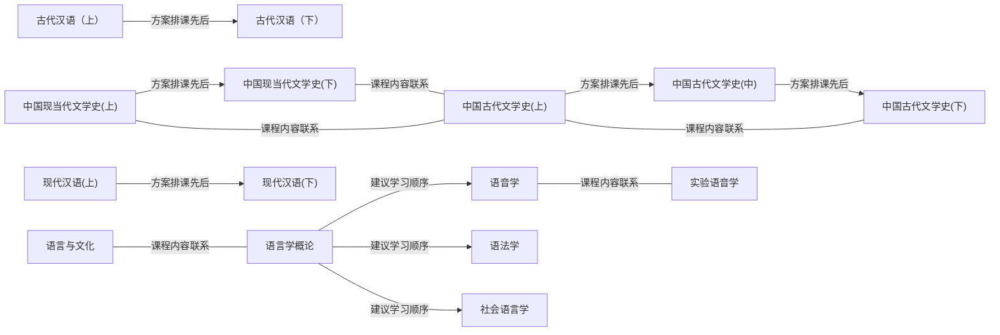

# 2025汉语言 - 中国语言文学本博融通培养方案（中国语言文学博雅班）

中国语言文学系 · 中国语言文学类 · 方案 140711 · 125 个不同课程或科研条目。

[官方 Word](https://github.com/pythonbug225/fudan-course-atlas/blob/research/schoolwide-cohorts-2023-2025/research/contributions/%E5%85%A8%E6%A0%A1%E5%9F%B9%E5%85%BB%E6%96%B9%E6%A1%882023-2025/%E5%B7%B2%E6%9C%89%E9%99%A2%E7%B3%BB%E8%A7%84%E8%8C%83%E6%95%B0%E6%8D%AE/%E4%B8%AD%E5%9B%BD%E8%AF%AD%E8%A8%80%E6%96%87%E5%AD%A6%E7%B3%BB/2025/originals/plan-140711.docx) · [教务详情](https://fdjwgl.fudan.edu.cn/manager/bizType/2/major-program-search/info/140711?skipAuth=1) · [方案快照](https://github.com/pythonbug225/fudan-course-atlas/blob/research/schoolwide-cohorts-2023-2025/research/contributions/%E5%85%A8%E6%A0%A1%E5%9F%B9%E5%85%BB%E6%96%B9%E6%A1%882023-2025/%E5%B7%B2%E6%9C%89%E9%99%A2%E7%B3%BB%E8%A7%84%E8%8C%83%E6%95%B0%E6%8D%AE/%E4%B8%AD%E5%9B%BD%E8%AF%AD%E8%A8%80%E6%96%87%E5%AD%A6%E7%B3%BB/2025/raw/plan-140711.json.gz) · [年级目录](https://github.com/pythonbug225/fudan-course-atlas/blob/research/schoolwide-cohorts-2023-2025/research/contributions/%E5%85%A8%E6%A0%A1%E5%9F%B9%E5%85%BB%E6%96%B9%E6%A1%882023-2025/%E5%B7%B2%E6%9C%89%E9%99%A2%E7%B3%BB%E8%A7%84%E8%8C%83%E6%95%B0%E6%8D%AE/%E4%B8%AD%E5%9B%BD%E8%AF%AD%E8%A8%80%E6%96%87%E5%AD%A6%E7%B3%BB/2025/README.md)

## 修读导读

- **建议先学**　《语言学概论》（`CHIN20010`） → 《语法学》（`CHIN20026`）。语言结构与语法单位的概念可供语法分析使用。方案分别列在第3、4学期。

- **可以对照着读**　《语言与文化》（`CHIN10006`）与《语言学概论》（`CHIN20010`）。两课可从语言系统和文化语境共同观察语言现象。

- **查模块选课**　《中国古代文学史(中)》（`CHIN20006`）、《中国现当代文学史(上)》（`CHIN20003`）列在“专业必修课程”中。原表见 `/courseModules/10`。

## 课程关系图

图中展示部分关系。下表保留全部已建立的课程对，来源位置使用本方案 JSON Pointer。

## 先修与内容联系

| 类型 | 起点 | 终点 | 依据 | 原表定位 |
| --- | --- | --- | --- | --- |
| 建议学习顺序 | 现代汉语(上) (CHIN20001) | 现代汉语(下) (CHIN20002) | 同方案的课程题名具有连续分册或序号。  | `/courseModules/10/planCourses/12`、`/courseModules/10/planCourses/19` |
| 建议学习顺序 | 中国现当代文学史(上) (CHIN20003) | 中国现当代文学史(下) (CHIN20004) | 同方案的课程题名具有连续分册或序号。  | `/courseModules/10/planCourses/1`、`/courseModules/10/planCourses/5` |
| 建议学习顺序 | 中国古代文学史(上) (CHIN20005) | 中国古代文学史(中) (CHIN20006) | 同方案的课程题名具有连续分册或序号。  | `/courseModules/10/planCourses/15`、`/courseModules/10/planCourses/0` |
| 建议学习顺序 | 中国古代文学史(中) (CHIN20006) | 中国古代文学史(下) (CHIN20007) | 同方案的课程题名具有连续分册或序号。  | `/courseModules/10/planCourses/0`、`/courseModules/10/planCourses/2` |
| 建议学习顺序 | 语言学概论 (CHIN20010) | 语音学 (CHIN20021) | 一般语言学概念有助于进一步认识语音系统。  | `/courseModules/10/planCourses/3`、`/courseModules/10/planCourses/6` |
| 建议学习顺序 | 语言学概论 (CHIN20010) | 语法学 (CHIN20026) | 语言结构与语法单位的概念可供语法分析使用。  | `/courseModules/10/planCourses/3`、`/courseModules/10/planCourses/11` |
| 建议学习顺序 | 语言学概论 (CHIN20010) | 社会语言学 (CHIN50044) | 语言结构与语言变异概念可支持社会语言学学习。  | `/courseModules/10/planCourses/3`、`/courseModules/14/planCourses/33` |
| 建议学习顺序 | 古代汉语（上） (CHIN20024) | 古代汉语（下） (CHIN20025) | 同方案的课程题名具有连续分册或序号。  | `/courseModules/10/planCourses/4`、`/courseModules/10/planCourses/7` |
| 方案排课先后 | 现代汉语(上) (CHIN20001) | 现代汉语(下) (CHIN20002) | 同方案该课程全部明确数字学期均早于后者。  | `/courseModules/10/planCourses/12`、`/courseModules/10/planCourses/19` |
| 方案排课先后 | 中国现当代文学史(上) (CHIN20003) | 中国现当代文学史(下) (CHIN20004) | 同方案该课程全部明确数字学期均早于后者。  | `/courseModules/10/planCourses/1`、`/courseModules/10/planCourses/5` |
| 方案排课先后 | 中国古代文学史(上) (CHIN20005) | 中国古代文学史(中) (CHIN20006) | 同方案该课程全部明确数字学期均早于后者。  | `/courseModules/10/planCourses/15`、`/courseModules/10/planCourses/0` |
| 方案排课先后 | 中国古代文学史(中) (CHIN20006) | 中国古代文学史(下) (CHIN20007) | 同方案该课程全部明确数字学期均早于后者。  | `/courseModules/10/planCourses/0`、`/courseModules/10/planCourses/2` |
| 方案排课先后 | 语言学概论 (CHIN20010) | 语法学 (CHIN20026) | 同方案该课程全部明确数字学期均早于后者。  | `/courseModules/10/planCourses/3`、`/courseModules/10/planCourses/11` |
| 方案排课先后 | 古代汉语（上） (CHIN20024) | 古代汉语（下） (CHIN20025) | 同方案该课程全部明确数字学期均早于后者。  | `/courseModules/10/planCourses/4`、`/courseModules/10/planCourses/7` |
| 课程内容联系 | 考古学导论 (ARCH10001) | 考古资料与先秦秦汉古籍整理 (CHIN60096) | 本方案两门课程的题名均含“考古”，可据此对照这一主题。  | `/courseModules/8/planCourses/8`、`/courseModules/15/planCourses/23` |
| 课程内容联系 | 中国文学传统 (CHIN10001) | 中国文学经典 (CHIN10005) | 经典文本与文学传统可从作品接受与文学演变联系。  | `/courseModules/8/planCourses/0`、`/courseModules/7/planCourses/0` |
| 课程内容联系 | 语言与文化 (CHIN10006) | 语言学概论 (CHIN20010) | 两课可从语言系统和文化语境共同观察语言现象。  | `/courseModules/8/planCourses/2`、`/courseModules/10/planCourses/3` |
| 课程内容联系 | 中国现当代文学史(上) (CHIN20003) | 中国古代文学史(上) (CHIN20005) | 本方案两门课程的题名均含“文学史”，可据此对照这一主题。  | `/courseModules/10/planCourses/1`、`/courseModules/10/planCourses/15` |
| 课程内容联系 | 中国现当代文学史(下) (CHIN20004) | 中国古代文学史(上) (CHIN20005) | 本方案两门课程的题名均含“文学史”，可据此对照这一主题。  | `/courseModules/10/planCourses/5`、`/courseModules/10/planCourses/15` |
| 课程内容联系 | 中国古代文学史(上) (CHIN20005) | 中国古代文学史(中) (CHIN20006) | 本方案两门课程的题名均含“文学史”，可据此对照这一主题。  | `/courseModules/10/planCourses/15`、`/courseModules/10/planCourses/0` |
| 课程内容联系 | 中国古代文学史(上) (CHIN20005) | 中国古代文学史(下) (CHIN20007) | 本方案两门课程的题名均含“文学史”，可据此对照这一主题。  | `/courseModules/10/planCourses/15`、`/courseModules/10/planCourses/2` |
| 课程内容联系 | 文字学 (CHIN20019) | 古文字学 (CHIN30025) | 本方案两门课程的题名均含“文字学”，可据此对照这一主题。  | `/courseModules/10/planCourses/10`、`/courseModules/14/planCourses/21` |
| 课程内容联系 | 文字学 (CHIN20019) | 文字学专题 (CHIN60098) | 本方案两门课程的题名均含“文字学”，可据此对照这一主题。  | `/courseModules/10/planCourses/10`、`/courseModules/15/planCourses/24` |
| 课程内容联系 | 语音学 (CHIN20021) | 实验语音学 (CHIN40039) | 均关注语音结构与声音特征。  | `/courseModules/10/planCourses/6`、`/courseModules/14/planCourses/12` |
| 课程内容联系 | 语音学 (CHIN20021) | 汉语语音史 (CHIN50050) | 本方案两门课程的题名均含“语音”，可据此对照这一主题。  | `/courseModules/10/planCourses/6`、`/courseModules/14/planCourses/22` |
| 课程内容联系 | 语音学 (CHIN20021) | 实验语音学方法论 (CHIN50086) | 本方案两门课程的题名均含“语音”，可据此对照这一主题。  | `/courseModules/10/planCourses/6`、`/courseModules/15/planCourses/7` |
| 课程内容联系 | 语音学 (CHIN20021) | 语音学与音系学 (CHIN60116) | 本方案两门课程的题名均含“语音”，可据此对照这一主题。  | `/courseModules/10/planCourses/6`、`/courseModules/15/planCourses/26` |
| 课程内容联系 | 语法学 (CHIN20026) | 汉语方言语法研究 (CHIN50016) | 本方案两门课程的题名均含“语法”，可据此对照这一主题。  | `/courseModules/10/planCourses/11`、`/courseModules/14/planCourses/30` |
| 课程内容联系 | 语法学 (CHIN20026) | 汉语语法史 (CHIN50017) | 本方案两门课程的题名均含“语法”，可据此对照这一主题。  | `/courseModules/10/planCourses/11`、`/courseModules/14/planCourses/28` |
| 课程内容联系 | 语法学 (CHIN20026) | 汉语语法学 (CHIN50088) | 本方案两门课程的题名均含“语法”，可据此对照这一主题。  | `/courseModules/10/planCourses/11`、`/courseModules/15/planCourses/8` |
| 课程内容联系 | 语法学 (CHIN20026) | 语法专题研究 (CHIN60066) | 本方案两门课程的题名均含“语法”，可据此对照这一主题。  | `/courseModules/10/planCourses/11`、`/courseModules/15/planCourses/17` |
| 课程内容联系 | 汉语方言语法研究 (CHIN50016) | 方言语料的整理与分析 (CHIN50019) | 本方案两门课程的题名均含“方言”，可据此对照这一主题。  | `/courseModules/14/planCourses/30`、`/courseModules/14/planCourses/29` |
| 课程内容联系 | 马克思主义新闻思想 (JCM10001) | 新闻学概论 (JCM10002) | 本方案两门课程的题名均含“新闻”，可据此对照这一主题。  | `/courseModules/8/planCourses/14`、`/courseModules/8/planCourses/12` |
| 课程内容联系 | 哲学导论 (PHIL10002) | 逻辑学 (PHIL10003) | 论证与概念分析是哲学讨论的共同方法。  | `/courseModules/7/planCourses/2`、`/courseModules/7/planCourses/3` |

本次未从可定位的明确表述中确认课程对课程预修。学期安排、系列分册与编辑建议均保留各自的依据。

## 按原方案模块阅读

同一模块展示原表中的课程归属。模块内课程之间的先后仍须逐项查阅。

- **限定选修课**　西方语言学史、中国语言学史（原表模块 11）

## 课程表

同一课程在不同模块分别出现时，按原表逐行列出。季节字段保留原值。

| 课程 | 代码 | 学分 | 学期 | 模块 |
| --- | --- | ---: | --- | --- |
| 中国文学经典 | CHIN10005 | 3.0 | SPRING、AUTUMN | 培养方案 / 专业培养课程 / 学科基础课程 / 人文基础课程 / 必修课程 |
| 中国古代文明 | HIST10006 | 3.0 | SPRING、AUTUMN | 培养方案 / 专业培养课程 / 学科基础课程 / 人文基础课程 / 必修课程 |
| 哲学导论 | PHIL10002 | 3.0 | SPRING、AUTUMN | 培养方案 / 专业培养课程 / 学科基础课程 / 人文基础课程 / 必修课程 |
| 逻辑学 | PHIL10003 | 3.0 | SPRING、AUTUMN | 培养方案 / 专业培养课程 / 学科基础课程 / 人文基础课程 / 必修课程 |
| 中国文学传统 | CHIN10001 | 2.0 | SPRING、AUTUMN | 培养方案 / 专业培养课程 / 学科基础课程 / 人文基础课程 / 选修课程 |
| 美学 | CHIN10002 | 2.0 | SPRING、AUTUMN | 培养方案 / 专业培养课程 / 学科基础课程 / 人文基础课程 / 选修课程 |
| 语言与文化 | CHIN10006 | 2.0 | SPRING、AUTUMN | 培养方案 / 专业培养课程 / 学科基础课程 / 人文基础课程 / 选修课程 |
| 汉语概论 | CHIN10004 | 2.0 | SPRING、AUTUMN | 培养方案 / 专业培养课程 / 学科基础课程 / 人文基础课程 / 选修课程 |
| 现代文艺赏析 | CHIN10003 | 2.0 | SPRING、AUTUMN | 培养方案 / 专业培养课程 / 学科基础课程 / 人文基础课程 / 选修课程 |
| 史学原典导读 | HIST10003 | 2.0 | SPRING、AUTUMN | 培养方案 / 专业培养课程 / 学科基础课程 / 人文基础课程 / 选修课程 |
| 世界文明史通论 | HIST10004 | 2.0 | SPRING、AUTUMN | 培养方案 / 专业培养课程 / 学科基础课程 / 人文基础课程 / 选修课程 |
| 近代中国社会研究 | HIST10005 | 2.0 | SPRING、AUTUMN | 培养方案 / 专业培养课程 / 学科基础课程 / 人文基础课程 / 选修课程 |
| 考古学导论 | ARCH10001 | 2.0 | AUTUMN | 培养方案 / 专业培养课程 / 学科基础课程 / 人文基础课程 / 选修课程 |
| 中国古代工艺美术 | CULT10001 | 2.0 | SPRING、AUTUMN | 培养方案 / 专业培养课程 / 学科基础课程 / 人文基础课程 / 选修课程 |
| 中国文字源流 | CULT10002 | 2.0 | AUTUMN | 培养方案 / 专业培养课程 / 学科基础课程 / 人文基础课程 / 选修课程 |
| 宗教学导论 | PHIL10004 | 2.0 | AUTUMN | 培养方案 / 专业培养课程 / 学科基础课程 / 人文基础课程 / 选修课程 |
| 新闻学概论 | JCM10002 | 2.0 | SPRING、AUTUMN | 培养方案 / 专业培养课程 / 学科基础课程 / 人文基础课程 / 选修课程 |
| 传播学概论 | JCM10003 | 2.0 | SPRING、AUTUMN | 培养方案 / 专业培养课程 / 学科基础课程 / 人文基础课程 / 选修课程 |
| 马克思主义新闻思想 | JCM10001 | 2.0 | SPRING、AUTUMN | 培养方案 / 专业培养课程 / 学科基础课程 / 人文基础课程 / 选修课程 |
| 语言学导论 | FORE10005 | 2.0 | SPRING、AUTUMN | 培养方案 / 专业培养课程 / 学科基础课程 / 人文基础课程 / 选修课程 |
| 世界文学导读 | FORE10006 | 2.0 | SPRING、AUTUMN | 培养方案 / 专业培养课程 / 学科基础课程 / 人文基础课程 / 选修课程 |
| 中国古代文学史(中) | CHIN20006 | 2.0 | 第2学期 | 培养方案 / 专业培养课程 / 专业核心教育课程 / 专业必修课程 |
| 中国现当代文学史(上) | CHIN20003 | 2.0 | 第3学期 | 培养方案 / 专业培养课程 / 专业核心教育课程 / 专业必修课程 |
| 中国古代文学史(下) | CHIN20007 | 2.0 | 第3学期 | 培养方案 / 专业培养课程 / 专业核心教育课程 / 专业必修课程 |
| 语言学概论 | CHIN20010 | 2.0 | 第3学期 | 培养方案 / 专业培养课程 / 专业核心教育课程 / 专业必修课程 |
| 古代汉语（上） | CHIN20024 | 2.0 | 第3学期 | 培养方案 / 专业培养课程 / 专业核心教育课程 / 专业必修课程 |
| 中国现当代文学史(下) | CHIN20004 | 2.0 | 第4学期 | 培养方案 / 专业培养课程 / 专业核心教育课程 / 专业必修课程 |
| 语音学 | CHIN20021 | 2.0 | 第3学期 | 培养方案 / 专业培养课程 / 专业核心教育课程 / 专业必修课程 |
| 古代汉语（下） | CHIN20025 | 2.0 | 第4学期 | 培养方案 / 专业培养课程 / 专业核心教育课程 / 专业必修课程 |
| 文学概论 | CHIN20009 | 2.0 | 第4学期 | 培养方案 / 专业培养课程 / 专业核心教育课程 / 专业必修课程 |
| 音韵学 | CHIN20016 | 2.0 | 第5学期 | 培养方案 / 专业培养课程 / 专业核心教育课程 / 专业必修课程 |
| 文字学 | CHIN20019 | 2.0 | 第5学期 | 培养方案 / 专业培养课程 / 专业核心教育课程 / 专业必修课程 |
| 语法学 | CHIN20026 | 2.0 | 第4学期 | 培养方案 / 专业培养课程 / 专业核心教育课程 / 专业必修课程 |
| 现代汉语(上) | CHIN20001 | 2.0 | 第1学期 | 培养方案 / 专业培养课程 / 专业核心教育课程 / 专业必修课程 |
| 汉语方言学 | CHIN20017 | 2.0 | 第6学期 | 培养方案 / 专业培养课程 / 专业核心教育课程 / 专业必修课程 |
| 训诂学 | CHIN20020 | 2.0 | 第6学期 | 培养方案 / 专业培养课程 / 专业核心教育课程 / 专业必修课程 |
| 中国古代文学史(上) | CHIN20005 | 2.0 | 第1学期 | 培养方案 / 专业培养课程 / 专业核心教育课程 / 专业必修课程 |
| 修辞学 | CHIN20027 | 2.0 | 第5学期 | 培养方案 / 专业培养课程 / 专业核心教育课程 / 专业必修课程 |
| 专业英语(汉语言) | CHIN20015 | 3.0 | 第7学期 | 培养方案 / 专业培养课程 / 专业核心教育课程 / 专业必修课程 |
| 语言统计学 | CHIN20018 | 2.0 | 第6学期 | 培养方案 / 专业培养课程 / 专业核心教育课程 / 专业必修课程 |
| 现代汉语(下) | CHIN20002 | 2.0 | 第2学期 | 培养方案 / 专业培养课程 / 专业核心教育课程 / 专业必修课程 |
| 中国语言学史 | CHIN30018 | 2.0 | 第5学期 | 培养方案 / 专业培养课程 / 专业核心教育课程 / 限定选修课 |
| 西方语言学史 | CHIN30011 | 2.0 | 第5学期 | 培养方案 / 专业培养课程 / 专业核心教育课程 / 限定选修课 |
| 中国语言学论著选读 | CHIN40041 | 2.0 | SPRING、AUTUMN | 培养方案 / 专业进阶课程I |
| 近代汉语 | CHIN40031 | 2.0 | SPRING、AUTUMN | 培养方案 / 专业进阶课程I |
| 语义学 | CHIN40032 | 2.0 | SPRING、AUTUMN | 培养方案 / 专业进阶课程I |
| 语用学 | CHIN40034 | 2.0 | SPRING、AUTUMN | 培养方案 / 专业进阶课程I |
| 诗骚精读 | CHIN30012 | 2.0 | SPRING、AUTUMN | 培养方案 / 专业进阶课程I |
| 《说文解字》精读 | CHIN30017 | 2.0 | SPRING、AUTUMN | 培养方案 / 专业进阶课程I |
| 《马氏文通》精读 | CHIN40036 | 2.0 | SPRING、AUTUMN | 培养方案 / 专业进阶课程I |
| 《普通语言学教程》精读 | CHIN40019 | 2.0 | SPRING、AUTUMN | 培养方案 / 专业进阶课程I |
| 新媒体语言研究 | CHIN40047 | 2.0 | SPRING、AUTUMN | 培养方案 / 专业进阶课程I |
| 语篇语言学 | CHIN40053 | 2.0 | SPRING、AUTUMN | 培养方案 / 专业进阶课程I |
| 语言类型与共性 | CHIN40067 | 2.0 | SPRING、AUTUMN | 培养方案 / 专业进阶课程I |
| 汉语词汇学 | CHIN40038 | 2.0 | SPRING、AUTUMN | 培养方案 / 专业进阶课程I |
| 实验语音学 | CHIN40039 | 2.0 | SPRING、AUTUMN | 培养方案 / 专业进阶课程I |
| 应用语言学 | CHIN40035 | 2.0 | SPRING、AUTUMN | 培养方案 / 专业进阶课程I |
| 《语言论》精读 | CHIN40037 | 2.0 | SPRING、AUTUMN | 培养方案 / 专业进阶课程I |
| 语言发声和感知的解剖生理机制 | CHIN40052 | 2.0 | SPRING、AUTUMN | 培养方案 / 专业进阶课程I |
| 语言哲学 | CHIN50047 | 2.0 | SPRING、AUTUMN | 培养方案 / 专业进阶课程I |
| 语言大数据与统计建模 | AIS210007 | 2.0 | SPRING、AUTUMN | 培养方案 / 专业进阶课程I |
| 中国手语语言学 | CHIN40040 | 2.0 | SPRING、AUTUMN | 培养方案 / 专业进阶课程I |
| 中国境内语言概论 | CHIN40011 | 2.0 | SPRING、AUTUMN | 培养方案 / 专业进阶课程I |
| 音系学 | CHIN40010 | 2.0 | SPRING、AUTUMN | 培养方案 / 专业进阶课程I |
| 古文字学 | CHIN30025 | 2.0 | SPRING、AUTUMN | 培养方案 / 专业进阶课程I |
| 汉语语音史 | CHIN50050 | 2.0 | SPRING、AUTUMN | 培养方案 / 专业进阶课程I |
| 现代汉语语法研究 | CHIN50046 | 2.0 | SPRING、AUTUMN | 培养方案 / 专业进阶课程I |
| 汉语修辞学史 | CHIN50045 | 2.0 | SPRING、AUTUMN | 培养方案 / 专业进阶课程I |
| 《修辞学发凡》研究 | CHIN50052 | 2.0 | SPRING、AUTUMN | 培养方案 / 专业进阶课程I |
| 语言类型学 | CHIN50054 | 2.0 | SPRING、AUTUMN | 培养方案 / 专业进阶课程I |
| 汉语词汇史 | CHIN50022 | 2.0 | SPRING、AUTUMN | 培养方案 / 专业进阶课程I |
| 汉语语法史 | CHIN50017 | 2.0 | SPRING、AUTUMN | 培养方案 / 专业进阶课程I |
| 方言语料的整理与分析 | CHIN50019 | 2.0 | SPRING、AUTUMN | 培养方案 / 专业进阶课程I |
| 汉语方言语法研究 | CHIN50016 | 2.0 | SPRING、AUTUMN | 培养方案 / 专业进阶课程I |
| 汉语认知语言学 | CHIN50048 | 2.0 | SPRING、AUTUMN | 培养方案 / 专业进阶课程I |
| 历史比较语言学 | CHIN50058 | 2.0 | SPRING、AUTUMN | 培养方案 / 专业进阶课程I |
| 社会语言学 | CHIN50044 | 2.0 | SPRING、AUTUMN | 培养方案 / 专业进阶课程I |
| 神经语言学 | CHIN50057 | 2.0 | SPRING、AUTUMN | 培养方案 / 专业进阶课程I |
| 心理语言学 | CHIN50063 | 2.0 | SPRING、AUTUMN | 培养方案 / 专业进阶课程I |
| 生成语言学 | CHIN50049 | 2.0 | SPRING、AUTUMN | 培养方案 / 专业进阶课程I |
| 地理语言学入门 | CHIN50067 | 2.0 | SPRING、AUTUMN | 培养方案 / 专业进阶课程I |
| 病理语言学 | CHIN50006 | 2.0 | SPRING、AUTUMN | 培养方案 / 专业进阶课程I |
| 语言习得与发展 | CHIN50015 | 2.0 | SPRING、AUTUMN | 培养方案 / 专业进阶课程I |
| 语言文学研究方法 | CHIN50072 | 3.0 | SPRING、AUTUMN | 培养方案 / 专业进阶课程II |
| 现代语言理论述评 | CHIN50075 | 3.0 | SPRING、AUTUMN | 培养方案 / 专业进阶课程II |
| 古代汉语研究 | CHIN50076 | 3.0 | SPRING、AUTUMN | 培养方案 / 专业进阶课程II |
| 现代汉语研究 | CHIN50077 | 3.0 | SPRING、AUTUMN | 培养方案 / 专业进阶课程II |
| 音韵学 | CHIN50081 | 2.0 | SPRING、AUTUMN | 培养方案 / 专业进阶课程II |
| 汉语方言学 | CHIN50082 | 2.0 | SPRING、AUTUMN | 培养方案 / 专业进阶课程II |
| 修辞学专题研究 | CHIN50083 | 2.0 | SPRING、AUTUMN | 培养方案 / 专业进阶课程II |
| 实验语音学方法论 | CHIN50086 | 2.0 | SPRING、AUTUMN | 培养方案 / 专业进阶课程II |
| 汉语语法学 | CHIN50088 | 2.0 | SPRING、AUTUMN | 培养方案 / 专业进阶课程II |
| 语言类型学 | CHIN50095 | 2.0 | SPRING、AUTUMN | 培养方案 / 专业进阶课程II |
| 形态句法学 | CHIN60002 | 2.0 | SPRING、AUTUMN | 培养方案 / 专业进阶课程II |
| 经典语言实验导读 | CHIN60003 | 2.0 | SPRING、AUTUMN | 培养方案 / 专业进阶课程II |
| 语言学名著选读 | CHIN60061 | 2.0 | SPRING、AUTUMN | 培养方案 / 专业进阶课程II |
| 理论语言学专题 | CHIN60062 | 2.0 | SPRING、AUTUMN | 培养方案 / 专业进阶课程II |
| 手语语言学 | CHIN60063 | 2.0 | SPRING、AUTUMN | 培养方案 / 专业进阶课程II |
| 语言学专题研究 | CHIN60064 | 2.0 | SPRING、AUTUMN | 培养方案 / 专业进阶课程II |
| 语义学 | CHIN60065 | 2.0 | SPRING、AUTUMN | 培养方案 / 专业进阶课程II |
| 语法专题研究 | CHIN60066 | 2.0 | SPRING、AUTUMN | 培养方案 / 专业进阶课程II |
| 训诂学 | CHIN60068 | 2.0 | SPRING、AUTUMN | 培养方案 / 专业进阶课程II |
| 殷周金文选读 | CHIN60087 | 2.0 | SPRING、AUTUMN | 培养方案 / 专业进阶课程II |
| 甲骨学 | CHIN60088 | 2.0 | SPRING、AUTUMN | 培养方案 / 专业进阶课程II |
| 简帛研究 | CHIN60089 | 2.0 | SPRING、AUTUMN | 培养方案 / 专业进阶课程II |
| 先秦秦汉出土文献语言研究概况 | CHIN60095 | 2.0 | SPRING、AUTUMN | 培养方案 / 专业进阶课程II |
| 考古资料与先秦秦汉古籍整理 | CHIN60096 | 2.0 | SPRING、AUTUMN | 培养方案 / 专业进阶课程II |
| 文字学专题 | CHIN60098 | 2.0 | SPRING、AUTUMN | 培养方案 / 专业进阶课程II |
| 汉语史专题 | CHIN60099 | 2.0 | SPRING、AUTUMN | 培养方案 / 专业进阶课程II |
| 语音学与音系学 | CHIN60116 | 2.0 | SPRING、AUTUMN | 培养方案 / 专业进阶课程II |
| 统计语言学 | CHIN60117 | 2.0 | SPRING、AUTUMN | 培养方案 / 专业进阶课程II |
| 战国文字研究 | CHIN60118 | 2.0 | SPRING、AUTUMN | 培养方案 / 专业进阶课程II |
| 玺印封泥研究 | CHIN60119 | 2.0 | SPRING、AUTUMN | 培养方案 / 专业进阶课程II |
| 古文字专书研读 | CHIN70013 | 2.0 | SPRING、AUTUMN | 培养方案 / 专业进阶课程II |
| 语言调查实践 | CHIN50108 | 2.0 |  | 培养方案 / 专业进阶课程II |
| 复芏计划(FDUROP) | 102 | 0.0 |  | 融合创新能力 |
| 研究生学术活动 | 4 | 2.0 |  | 融合创新能力 |
| 研究生实践活动 | 5 | 2.0 |  | 融合创新能力 |
| 博士生资格考核 | 2 | 0.0 |  | 融合创新能力 |
| 博士学位论文开题 | 1 | 0.0 |  | 融合创新能力 |
| 博士论文中期考核 | 3 | 0.0 |  | 融合创新能力 |
| 博士学位论文预审 | 6 | 0.0 |  | 融合创新能力 |
| 学年论文 | CHIN20022 | 2.0 | 第6学期 | 融合创新能力 |
| 社会实践 | CHIN20028 | 3.0 | 第6学期 | 融合创新能力 |
| 毕业论文 | CHIN40076 | 4.0 | 第8学期 | 融合创新能力 |
