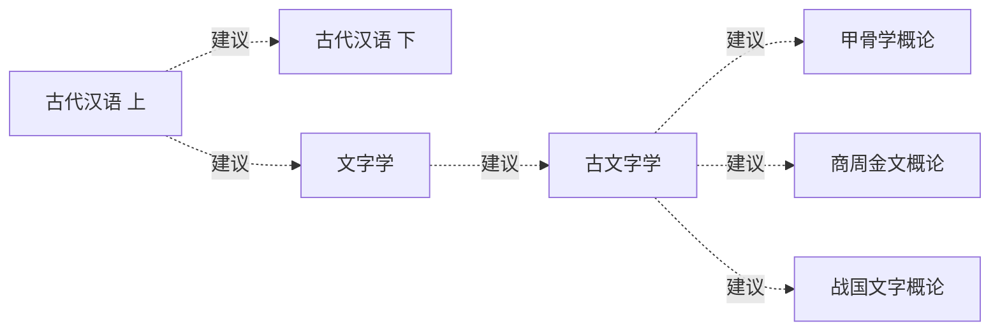
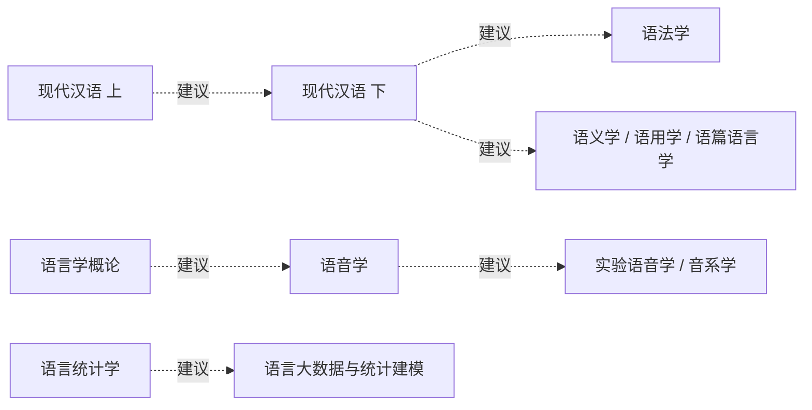
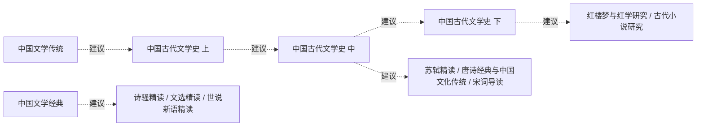

# 中文系课程关系导读

本图谱梳理2025秋、2026春官方课表中的291个课程代码，对应286个不同名称，包含本科、本研融通及研究生。291门均可检索；同名不同课号保留为不同节点。213份可用大纲对应158个课号，其余课程保留缺项。8份2026级培养方案用来核对课程归属与方案角色，未将其中的开课季节当作强制先修关系。

## 怎样阅读

目前没有从这些材料中确认官方硬性先修要求，不代表学校从未设置先修限制。80条虚线箭头表示整理者建议的学习顺序；446条无向连线表示内容或方法上的联系。两类关系都不是教务选课规则。

至少一端没有可用大纲的245条边标记为“待核”，依据为官方课名及研究方向，交互图谱默认隐藏。其余边由已读大纲内容支持，但关系本身仍是整理分析。每条边可展开原文摘录、教师、学期、教学班号和原始大纲链接。

打开 `index.html` 后可搜索课名/课号、按学科或层次筛选、点击节点继续探索，并切换到学科导航。JSON、CSV保留全量节点和关系；界面开关只影响展示。

## 几条可以直接探索的路线

以下均为建议，按个人已有知识可调整；箭头两侧的对应大纲仍需结合具体教学班核对。

古代汉语提供文言阅读基础；文字学帮助建立文字分析概念，古文字学再引向具体材料。音韵学—汉语上古音基础／汉语语音史是另一条分析声音及语言演变的路线。断代文字课之间未设强制先后。

现代汉语上篇主要涉及汉语概说、语音、词汇与汉字，下篇进入语法与修辞；语言学概论则提供各分支共用的基本概念。这两种基础相互补充，图谱没有规定它们必须互为先修。进入实验、计算与认知方向时，还应另外核对统计、编程及实验方法的具体要求；现有材料不足以补造这些课程级限制。

文学史上篇提供上古、中古的文学线索，中篇对应唐宋，下篇对应元明清。文学史与原典精读可以交叉推进；通识精读课也不因被放在路线末端而变成高阶准入课。

现当代文学可从《中国现当代文学史(上)》继续到下篇，或在上篇基础上进入鲁迅、周作人、老舍、胡适的精读；下篇与中国新诗、当代小说选读相衔接。文学史背景和单一作家研究的视角不同，图谱将其作为互相补充的学习路径。

文论路线为《文学概论》—《中国文学批评史》—《文心雕龙》精读／中国古典诗学；美学路线从《美学》分叉到中国古典美学、西方古典美学、现当代西方美学和《艺术即经验》导读。比较文学、翻译与外国文学另保留共同问题和跨文化方法的内容联系。

文献方法路线为《古典文献学基础》—版本目录学／《四库提要》精读／古籍校释实践／唐宋与先唐要籍导读。培养方案共同列出这些课程不自动产生先修边；相关箭头来自方法与任务之间的分析。

## 数据字段与维护

- `课程关系数据.json`：`nodes` 使用课号作稳定ID；`edges` 给出关系类型、方向、依据强度、解释、局限和原文摘录；`sources` 定位官方大纲，`programs` 定位培养方案。
- `official_prerequisite` 为官方明确规定的先修关系，本版为0；`recommended_before` 为建议先学；`content_related` 为无方向内容联系。所有现有边的 `official_requirement` 均为 `false`。
- `moderate` 表示两端均有可核对的大纲内容；`tentative` 表示至少一端仅有官方名称依据，不是统计概率或量化评分。
- `先修核查记录.json` 保留确认范围与缺项。缺少大纲、没有建立边、未匹配培养方案都不等于无先修或无关系。
- 数据快照为2026-10-27，图谱整理日期为2026-11-19。各来源链接固定到原始提交；后续更新须保留学期、教师和教学班范围。

新增关系时应先补读来源，保持建议与官方要求的区别，并同步JSON、CSV及浏览器数据。不要因课程代码大小、名称的上下篇或同属一个培养模块就写入硬性先修。
